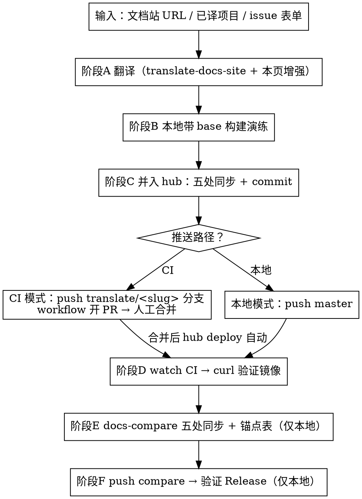

# publishing-docs-cn — 文档站汉化全流程（翻译→部署→对照登记）

## Overview

把一个英文文档站走完整链：**翻译（[translate-docs-site](../translate-docs-site/SKILL.md)）→ 并入 hub 仓库部署到 GitHub Pages → 登记进 docs-compare 并生成锚点表 → 推送验证**。本 skill 是 translate-docs-site 的下游延伸：前者交付「本地可构建的中文项目」，本 skill 交付「上线 + 可对照」。

## 运行模式（先判环境，再选口径）

| | 本地模式 | CI 模式 |
|---|---|---|
| 触发 | 用户会话指令 | issue 表单 + `translate` label；`/continue` 评论续跑 |
| hub 仓库 | `C:\Users\lif3n\src\docs`（Windows 写死，用户已确认） | 工作目录 = checkout 的 hub 仓库根（master） |
| 对照仓库 | `C:\Users\lif3n\src\docs-compare`（分支 **main**） | **禁止碰**（CI 不做 compare 登记） |
| slug 约定 | 本地目录 `<name>-docs-cn/`，Pages 子路径 `/docs-cn/<name>/` | 同左 |
| 授权 | 「提交并推送并验证部署」指令整体授权 push 两仓库 | 翻译阶段：push `translate/<slug>` 分支、issue 回帖、读 issue 线程。**禁止直推 master、不创建 PR**。对照登记阶段（仅 auto 模式收尾，第二次 claude 调用）：在 workflow 指定的 docs-compare 工作副本内操作并推 main，已授权 |
| 交付物 | 上线 + 对照登记（A–F 全链） | auto 模式：阶段 A+B+C → 自动合并上线 → **部署就绪后自动做 E/F（compare 五处同步+锚点表+推送+Release 验证）→ issue 收官回帖**；review 模式：A+B+C 出 PR，E/F 留本地 |
| 卡点处理 | 停下问用户 | 拿不准 → 回帖提问 + `needs-input` label；死局 → `blocked`；额度耗尽 → `quota-blocked`；均回帖后正常退出，等用户 `/reply <答复>` 或 `/continue` 续跑 |

表单参数由 workflow 解析成 env 注入（见下节），claude **不解析 issue body**。

## CI 模式协议

env 注入参数：`UPSTREAM_REPO`（上游 git 仓库，**可空=闭源站镜像汉化**）、`DOCS_URL`、`SLUG`（可空，workflow 从仓库名/域名自动推导）、`SUBDIR`（monorepo 子目录，可空）、`SCOPE`（范围裁剪，可空）、`GLOSSARY_NOTES`（可空）、`DEPLOY_MODE`（auto=自动合 master 上线 / review=建 PR 等人工，缺省 auto）、`ISSUE_NUMBER`、`RESUME`（1=续跑，0=全新）。

### 状态契约（STATUS 文件）

`./$SLUG-docs-cn/.translation-state/STATUS` 记录本轮结局，workflow 按它分路：**`done`** = 阶段 C 完成，workflow 建 PR；**`paused:needs-input`** = 已回帖提问等答复，本 run 正常结束不建 PR；**`paused:quota`** = 额度耗尽已回帖。每次 checkpoint push 都带最新 STATUS。

### 不确定点协议（不许猜）

遇到拿不准的事（站点结构异常、JS 渲染抓不到正文、疑似反爬、规模超限、多方案难取舍）：`gh issue comment` 提出具体问题（**附证据与候选项**，别问开放题）→ 打 `needs-input` label → STATUS 写 `paused:needs-input` → checkpoint push → 正常退出。用户 `/reply` 答复后新 run 续跑，**线程里用户的回复 = 指令，逐条落实**。这与 `blocked`（死局，要改需求才能继续）的区别：needs-input 是「等你输入就能继续」，blocked 是「输入也救不了，需改需求」。

### 开工探测

`RESUME=1` 时走续跑流程：

1. 读 `./$SLUG-docs-cn/.translation-state/progress.md`——**权威状态，git 已提交内容为准**；issue 线程（`gh issue view $ISSUE_NUMBER --comments`）只作对照参考
2. 抽查已提交批次构建绿（不重译已 commit 的批次）
3. 从 progress.md 的「下一步」继续

### 推送凭据口径（CI）

push 一律用 checkout 预配的 origin 凭据（`DOCS_CN_PAT`，fine-grained PAT 需含 **Contents rw + Workflows rw**——Workflows 缺失时推 `deploy-pages.yml` 改动会被服务端拒绝，报错形如 "refusing to allow a Personal Access Token to create or update workflow"）。**禁止用 `GH_TOKEN`/`gh` 拼带 token 的 URL 推 git**：App token（GITHUB_TOKEN）权限清单里没有 workflows scope，GitHub 硬性禁止它推任何 workflow 文件，绕过去只会把卡点推迟到阶段 C 收尾。

### 进度纪律（每批循环，死也不丢状态）

1. 批次翻译完成 → commit（**必须含**：更新的 `.translation-state/progress.md`、`.anchor-maps/`、GLOSSARY.md）
2. **立即 `git push origin HEAD` checkpoint**（本地模式无此步）
3. `gh issue comment $ISSUE_NUMBER` 回帖一行进度（批次名/页数/状态）
4. 死于任何时刻最多丢当前未提交批——**不要攒大 commit**

### 429 / 额度协议

- **瞬时 429**：CLI 内建退避重试消化，不回帖、不停下
- **持续耗尽**（重试仍 429 / credit 不足）：写清「已完成 / 剩余 / 如何续跑（/continue）」→ `gh issue comment` → 打 `quota-blocked` label → STATUS 写 `paused:quota` → 正常退出
- **功能死局**（许可风险、构建死局、要改需求才能继续）：同流程，label 用 `blocked`

### 闭源站模式（UPSTREAM_REPO 为空）

无 git 源，走「抓站 → HTML 就地翻译 → 静态镜像」管线（herdr / diagram-design / hallmark 先例的通用化）：

1. **探边**：抓 `DOCS_URL` 首页 + `sitemap.xml`（若有）估页数与形态；再抓 3-5 个代表页看**正文是否直接在 HTML 里**。正文全靠 JS 客户端渲染（HTML 里拿不到正文）→ 红线，走不确定点协议上报证据（抓到的 HTML 正文占比），给候选项（放弃 / 只镜像不翻译 / 用户给该站专用方案——Next.js flight、chunk 硬编码串这类属专项工程，见 herdr、AI Hero 先例，通用管线别硬啃）
2. **规模预算**：无 `SCOPE` 默认 ≤150 页，超限走不确定点协议要范围；有 `SCOPE` 按其执行
3. **抓站**：同 origin 枚举（sitemap 优先，缺则从首页 BFS）→ 存 HTML + 静态资源树；**资源路径改相对引用**（子路径零改写首选，参照 diagram-design/hallmark 先例）；对限速站点放慢节奏，仍被封 → 上报
4. **就地翻译**：只译可见正文与 UI 文案（title/description/alt/aria-label/按钮/表格）；**script 内容、style、JSON 数据、代码块、URL 路径一律不动**；HTML 翻译残留用剥标签后的 CJK 占比扫描兜底
5. **验证**：静态目录起本地 http server 冒烟（无构建系统的等价动作）；hub 并入按**产物级镜像形态**（CI 纯拷贝零构建，同 herdr/diagram-design 先例），五处同步照常
6. **排除清单**：多产品分区站（用 sitemap 分区）、带画廊/交互 demo 的站（模板层翻译）这些特例先 grep 记忆/仓库内同名先例站再动手，有先例照抄先例口径

### 收尾

阶段 C 五处同步提交后、最终 push 前：`git fetch origin master` 并 `git merge --no-edit origin/master` 把最新 master 并进分支——冲突规则：sites.json 双方条目**并存**并重跑 `node scripts/gen-index.cjs`、README 双方段落并存（这是自动合并能 ff 推 master 的前提）。然后最终 push → STATUS 写 `done` → 回帖一行总结即结束。

**STATUS=done 的前置硬条件**：progress.md 与 git log 逐批对齐——批次表**不允许残留 ⬜**（逐行改 ✅ 并补 commit 号）、「下一步」改为收官说明、已译文件清单/锚点状态等段落刷新到终态。只刷头部不回填表格 = 违约（ag-ui 首轮实录：表头写 done、B6 行 ⬜ 混进了合并，workflow 现有 ⬜ 检查会拦）。

上线两模式（workflow 按 `DEPLOY_MODE` 分路，claude 不做合并/PR）：**auto** = workflow 直接合入 master 并触发部署，无 PR；**review** = workflow 建 PR 等人工合并。两者之下用户都可在 issue 里 `/reply 修改：…` 提迭代意见 → 新 run 续跑落实并推同一分支。

## 流程



### 阶段 A：翻译（按 translate-docs-site 执行，附加本页增强）

translate-docs-site 全部决策与流程适用。实战增强：

1. **并行批次**（30–150 页）：按目录分片子代理，每个注入同一 `GLOSSARY.md`。**子代理纪律：一次回复只译一个文件**（多文件单回复会撞 32k 输出上限直接死亡）；每文件产出锚点映射 `.anchor-maps/<batch>/<file>.mdx.map.md`（行格式 `原英文标题 | 中文标题 | 新锚点`）。**CI 模式：总并发 ≤2，每批结束走「进度纪律」push + 回帖。**
2. **旧锚点快照**（翻译开工前）：全英文基线构建后 `cp -r <站>/dist /tmp/dist-en`——它是旧锚点的权威底稿（多数框架的锚点校验规则尚未实现，回修全靠自己）。**CI 模式：dist-en 不进 git（太重），续跑时重新生成基线构建即可。**
3. **锚点回修**：用框架自带的 slugger（通常 node_modules 里有 github-slugger）写回修脚本：映射表 + dist-en（旧 id）+ 新 dist（新 id）三方核对；子代理已重算的中文锚点直接对新 dist 校验即可。
4. **残留检查**：skill 自带 residue-check.cjs（路径见该 skill，支持 `.md/.mdx`）——import 行与围栏代码块的命中忽略。
5. **demo 可见文案要译**：组件 props 字符串、JSX 子内容会直接渲染，属于残留；import/代码块/代码 token 不译。
6. **术语分歧**：终检 `grep -rl` 统计各译法文件数，取多数派全文统一，并把定稿回写 GLOSSARY「终检补充批次」表。
7. **CJK 粗体闭合**（翻译后必踩的 CommonMark 坑）：`**……。**后文` 中闭合 `**` 前是全角标点、后紧跟文字 → 无法闭合，页面上字面显示 `**`。修法：句读/括注移出粗体（`**……**。后文`、`**词**（gloss）后文`）。终检必做：扫 dist 正文字面 `**`（剥 script/style/code/pre 后 grep），应为 0——详细规则见 translate-docs-site 的「粗体与 CJK 闭合」。
8. **`.translation-state/progress.md`**（CI 模式必建）：已完成文件清单、当前阶段（A/B/C）、GLOSSARY 状态、锚点回修状态、下一步。随每批 commit 更新。

### 阶段 B：本地带 base 构建演练（推 CI 前必做）

**本地 Git Bash 陷阱**（**仅本地 Windows**，CI 是 ubuntu 无此坑，直接 env 即可）：MSYS 会把 `/` 开头的 env 值改写成 `C:/Program Files/Git/...`；`MSYS_NO_PATHCONV=1` 会连带破坏 pnpm 启动器（MODULE_NOT_FOUND）——只用 ENV_CONV_EXCL：

```bash
MSYS2_ENV_CONV_EXCL="DOCS_BASE;DOCS_SITE" \
  DOCS_BASE=/docs-cn/<slug>/ DOCS_SITE=https://lif3ng-vibe.github.io \
  pnpm build
```

验证 dist：内链 `href="/docs-cn/<slug>/…"`、canonical、llms.txt 绝对 URL、`_astro/` 资源路径全部带前缀。
**免 sed 判定**：若上游框架自带 authored-links 基础处理（grep 源码 `authored-links`/`withBase`），正文内链构建时自动加 base，CI 段**不要** sed（会双重前缀）；纯 Starlight 站才走 hub 老模式（CI sed `.md` 内链）。

### 阶段 C：并入 hub（五处同步）

1. 若翻译项目是嵌套 git 仓库：**删其 `.git`** 并入为普通子目录（提交信息/快照 commit 已记录在其 README 即可）。`git add -n <dir>` dry-run 确认 node_modules/dist 零混入。CI 模式下项目直接建在仓库根、无嵌套 git，跳过本步。
2. `sites.json` 加条目（`name/slug/desc/orig/repo`；orig≠repo 才显示「官方文档」按钮；`group` 缺省 = hub 组，分仓另行定档）→ `node scripts/gen-index.cjs`。
3. `.github/workflows/deploy-pages.yml`：加构建段 + Assemble `mv <dir>/…dist _site/<slug>`。**两个正交维度**：构建命令由仓库形态决定，sed 与否由框架能力决定（见阶段 B 的免 sed 判定）。
   - 标准 Starlight + 无 authored-links：`DOCS_BASE` env + `find src/content/docs -name '*.md' -exec sed -i 's|\](/|\](/docs-cn/<slug>/|g' {} +` + `npm ci && npm run build`；
   - **pnpm monorepo**：`DOCS_SITE: https://lif3ng-vibe.github.io` + `DOCS_BASE: /docs-cn/<slug>/` env **必须带**（漏了会产出根路径构建）+ `corepack enable` + `pnpm install --frozen-lockfile` + `pnpm --filter <框架包名> build` + `pnpm --filter <站点包名> build`（filter 名读各包 package.json；顺序不能倒，站点依赖框架包 dist；dist 落点以站点包实际输出为准，如 `apps/www/dist/`）；
   - 带 authored-links 的站（不论形态）：不加 sed；无 authored-links 的 monorepo 站：monorepo 构建命令 + `find … -name '*.md' -exec sed …` 照标准变体加。
4. README 三处：收录项目表、仓库结构树、部署后访问地址列表。
5. commit（信息含上游快照 commit + 页数）。CI 模式：commit 后走「进度纪律」push + 回帖。

### 阶段 D：push hub 并验证（本地模式直推；CI 模式 = 人工合并 PR 后自动）

本地模式：

```bash
git push origin master   # hub 分支是 master
gh run watch <run-id> --repo lif3ng-vibe/docs-cn --exit-status
curl -s -o /dev/null -w '%{http_code}' https://lif3ng-vibe.github.io/docs-cn/<slug>/   # 200
curl -sL https://lif3ng-vibe.github.io/docs-cn/<slug>/ | grep -c '[一-龥]'             # >0
```

CI 模式：workflow 开 PR → 人工 review 合并 → push master 自动触发 hub `deploy-pages.yml`（paths-ignore 只豁免 README/docs）→ 分仓站由 dispatch-siblings 惯例下发（需 `DOCS_DISPATCH_TOKEN` 已配）。验证由人工或后续 watch 完成。

### 阶段 E：docs-compare 登记 + 锚点表（本地模式；CI auto 模式由「对照登记」阶段自动执行，见 CI 模式协议）

**代码五处同步**（上游有更新时先 `git pull --rebase`）：

| 文件 | 改什么 |
|---|---|
| `packages/core/src/defaults.ts` | RAW 数组加条目（官方站置尾） |
| `apps/cdp/config/sites.json` | 同条目（JSON 形态） |
| `apps/tauri/config/sites.json` | 同条目 |
| `README.md` | 内置站点对快照 JSON + 「内置的 N 个站点对」计数 |
| `scripts/anchor-map.config.json` | 生成器站点条目（见下） |

**页面枚举两模式**（anchor-scan）：
- 默认：GitHub 树枚举 `<dir>/src/content/docs/*.md`——仅适用于标准 Starlight 子站；
- **`listFrom: { sitemap: "<url>" }`**：非标准布局（pnpm monorepo、内容非 .md、多一层目录）用这个。**sitemap 必须与 `site.origin` 同源**（代码过滤 `u.origin !== o.origin`），给镜像 URL 会得 0 页；上游站无 base 时直接用原站 sitemap（如 `https://nimbus-docs.com/sitemap-index.xml`，支持一层 index 嵌套）。

**生成**（全站跑会超时，用单站临时 config）：

```bash
node -e "const fs=require('fs');const c=JSON.parse(fs.readFileSync('scripts/anchor-map.config.json','utf8'));c.sites=c.sites.filter(s=>s.id==='<id>');fs.writeFileSync(process.env.TEMP+'/<id>-only.json',JSON.stringify(c,null,2))"
node scripts/gen-anchor-map.mjs "$TMP/<id>-only.json"
# 产物 out/<id>/anchor-map.json 并自动 copyTo apps/chrome-extension/src/static/anchor-maps/
```

镜像站根**不放** anchor-map.json（现有实践：扩展打包 + Release 下发，无需二次部署）。改完 `npm test` + `npm run build` 全绿再提交。

### 阶段 F：push compare 并验证（本地模式；CI auto 模式随阶段 E 一并执行）

```bash
git push origin main      # compare 分支是 main；远程领先时先 pull --rebase 再重跑测试
gh run watch <run-id> --repo lif3ng-vibe/docs-compare --exit-status   # 约 3-4 分钟
# 验证 Release 滚动更新（固定 URL 不变、内容更新）：
gh release view latest --repo lif3ng-vibe/docs-compare --json assets --jq '.assets[].name'
#   应含 anchor-maps-<id>.json；sites.json 里应有新站条目：
curl -s https://github.com/lif3ng-vibe/docs-compare/releases/download/latest/sites.json | grep <id>
```

## 常见错误

| 错误 | 后果 | 正确做法 |
|---|---|---|
| `MSYS_NO_PATHCONV=1` 传 base env | pnpm 启动器 MODULE_NOT_FOUND | `MSYS2_ENV_CONV_EXCL="DOCS_BASE;DOCS_SITE"`（仅本地 Git Bash） |
| listFrom.sitemap 填镜像站 URL | 枚举 0 页（origin 过滤） | sitemap 与 site.origin 同源（用原站的） |
| CI 段给 authored-links 框架加 sed | 内链双重前缀 | 免 sed 与否由 authored-links grep 判定（与仓库形态正交），见阶段 C 两维度 |
| push hub 用 `main` / compare 用 `master` | refspec 拒绝 | hub=master，compare=main |
| 不 fetch 直接 push compare | non-fast-forward 拒绝 | `git fetch` → `git pull --rebase` → 重跑 test/build → push |
| residue-check 原版查 MDX 项目 | 假 CLEAN | 用 skill 目录内已支持 `.mdx` 的版本 |
| 子代理一次译多个文件 | 32k 输出上限中断 | 一回复一文件 + 极简汇报 |
| 全站跑 gen-anchor-map | 数分钟 + 可能超时 | 单站临时 config |
| 翻译项目 .git 不删直接 add hub | 嵌套 gitlink，CI 检出缺内容 | 删 `.git` + dry-run 验证 |
| Release 发布步骤搭在非必绿 job | 其他 job 自测挂会连坐 Release 不滚动 | 发布块放必绿 job（如 test），保留 `if: push` |
| CI 模式攒批不推 checkpoint | run 死掉丢几小时工作量 | 每批 commit 后立即 push + 回帖（进度纪律） |
| CI 续跑不读 progress.md 直接重译 | 白烧额度、译态覆盖 | git 已提交内容为权威，先核对再继续 |
| CI 里碰 docs-compare / 直推 master / 自开 PR | 越权，破坏人工 review 点 | 硬性边界：分支 + 回帖为止，PR 归 workflow |
| 429 静默死亡不打 label | 用户不知道该 /continue | 按 429 协议回帖 quota-blocked 后退出 |
| 拿不准的事自行猜测硬做 | 整批返工烧额度 | 走不确定点协议：回帖提问 + needs-input，等 /reply |
| 闭源模式改 script/JSON/flight 数据 | 站点交互全灭（mintlify/AI Hero 先例） | 只译可见正文与 UI 文案，数据层一律不动，拿不准上报 |
| 结束不写 STATUS 文件 | workflow 判 unknown 走失败回帖路径 | done/paused:* 状态契约，checkpoint 随带 |
