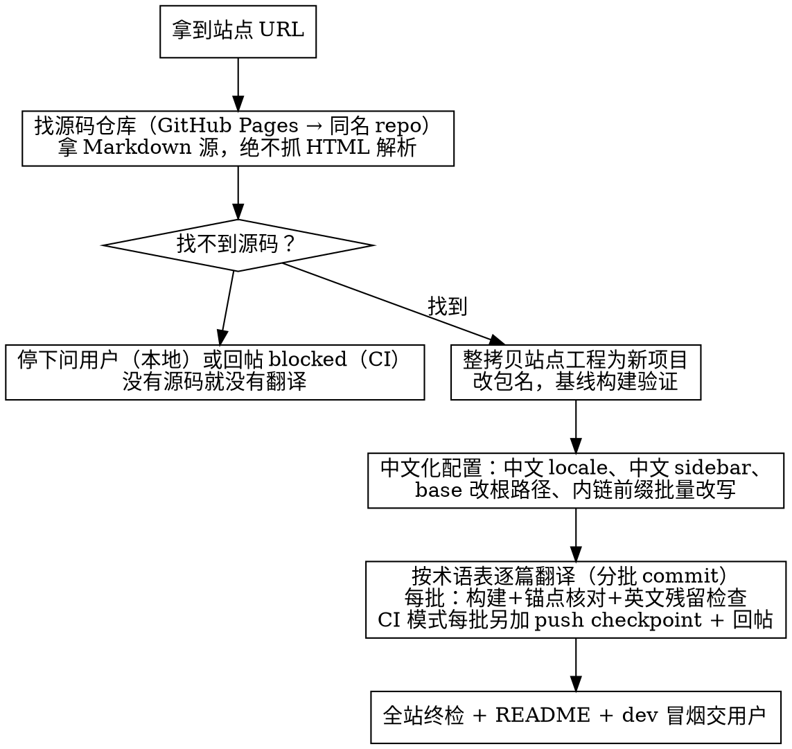

# translate-docs-site — 文档站汉化（决策已预授权）

## Overview

把一个英文文档站完整汉化为本地可运行、可构建的中文项目。用户已确认过一整套决策——**不要再问**，直接按"用户已确认的决策"执行；只问清单外的新问题。

## 用户已确认的决策（不要再问）

| 决策点 | 已确认 | 当初问题 |
|---|---|---|
| 访问形态 | **本地 dev server + 可构建**；不部署（部署是用户的事，别主动 push/deploy） | ~~部署到线上？纯 md？~~ |
| 技术栈 | **原班工具链**：拿到源码就复用上游站点工程（原 config/主题/组件），仅中文化；不换 VitePress 等 | ~~VitePress？Docusaurus？~~ |
| 语言形态 | **纯中文单语**，不做 en+zh 双语切换 | ~~双语 locale？~~ |
| 翻译范围 | **全站汉化**：全部 md 正文 + frontmatter + 落地页 + UI 文案 + aria-label | ~~只翻入门篇？只翻正文？~~ |
| 术语策略 | 意译；术语首次出现附英文原词「知识图谱（knowledge graph）」；产品名/工具名不译 | 每次不必重问术语偏好 |
| 翻译质量档 | 校对级：术语一致、锚点正确、无英文残留、无翻译腔 | ~~机翻草稿级够吗？~~ |
| 项目位置 | 当前目录下新建 `<站点名>-docs-cn/`，git 管理但**不建远端不 push**（CI 模式例外，见下节） | ~~放哪？fork？~~ |
| 验收 | `npm run build` 零错误 + dev server 冒烟 + 用户浏览器过目 | |

**仍然要问的**（清单外新情况）：源站 URL 打不开/无源码仓库（无源码就停，不抓 HTML）、许可证禁止衍生、规模异常（如 >150 页）、用户主动要求改变上述任何一项。隐式决策：图片含英文截图照用不重绘（图注可译）；一次性快照，不做上游持续同步（README 记源 URL + 快照日期，以后要同步靠它手动 diff）。

## CI 模式（由 issue 触发时）

被 GitHub CI 触发（存在 `UPSTREAM_REPO`/`SLUG`/`ISSUE_NUMBER` 等 env）时，运行规则以 [publishing-docs-cn](../publishing-docs-cn/SKILL.md) 的「CI 模式协议」为准，本页按此改判：

- 「项目位置」：建在仓库根 `./$SLUG-docs-cn/`；**checkpoint 推 `translate/<slug>` 分支属授权范围**（"不建远端不 push"的例外）
- **「无源码就停」的例外**：`UPSTREAM_REPO` 为空 = 用户明确提交的闭源站任务，走 publishing-docs-cn「闭源站模式」（抓站 → HTML 就地翻译 → 静态镜像）；仅当 JS 渲染抓不到正文等红线情况才上报
- **卡点分级**：等你输入就能继续的（规模超限要范围、多方案取舍）→ 回帖提问 + `needs-input` label；死局（许可风险、要改需求）→ `blocked` label。两者都回帖后正常退出，用户 `/reply` 或 `/continue` 续跑——**不等待、不猜测**
- 「规模异常 >150 页」：`SCOPE` env 有值按裁剪执行；无值回帖 `needs-input` 问范围，不自行开翻
- 术语补充（`GLOSSARY_NOTES` env）有值时并入 GLOSSARY.md；状态契约（STATUS 文件）与续跑/429 协议见 publishing-docs-cn

## 术语表（第 4 步开工前先建）

翻译开工前，从源文档高频术语提炼术语表，存到项目里 `GLOSSARY.md`（两列表格：英文 → 中文，含"不译"名单）。它同时是并行子代理的注入材料和终检的 grep 清单（每个术语抽查全站一致性）。无需用户过目——出问题在终检统一修。

## 流程



### 第 1 步：拿源（关键）

GitHub Pages 站点几乎都有源 repo（页面 footer 的 GitHub 链接 / `https://github.com/<user>/<repo>`）。下载 tarball（`curl -L https://codeload.github.com/<user>/<repo>/tar.gz/refs/heads/main`）比 API 稳（API 有限流）。CI 模式下 `UPSTREAM_REPO` env 已给仓库地址（可带 `#<branch>` 或 `#<commit>`）；`SUBDIR` env 非空时文档在该子目录内。找 `site/`、`docs/`、`website/` 一类目录里的 Markdown。**翻译渲染后 HTML 是灾难**——没有源码就停下来：本地问用户；CI 模式 `UPSTREAM_REPO` 为空属用户明确提交的闭源任务，改走 publishing-docs-cn「闭源站模式」而非停止。

### 第 2 步：脚手架

整目录拷贝站点工程 → 改 `package.json` name/version → `npm install` → 基线构建必须通过 → commit。`.gitignore` 排除 `node_modules/ dist/ .astro/` 和解压底稿目录。

### 第 3 步：配置中文化（一次性，别拆散）

以下陷阱以 **Astro/Starlight** 为例（本项目组验证过的栈）；遇 VitePress/Docusaurus 等其他栈，同一批事项（locale、base、内链、字体、落地页文案）逐项找等价机制，流程不变：

- **Starlight 0.39.x 陷阱**：单语言中文必须写 `defaultLocale: 'root', locales: { root: { label: '简体中文', lang: 'zh-CN' } }`——写 `defaultLocale: 'zh'` 会强制 URL 加 `/zh/` 前缀导致 sidebar slug 全部失配、构建失败。
- `base` 改根路径 `/`（去掉上游 Pages 子路径）；随之**批量改写文档内链前缀**：`sed 's|](/<prefix>/|](/|g'`，注意别误伤 `raw.githubusercontent.com/<user>/<repo>/` 外链（改写模式锚定 `](/` 开头即可）。同名 repo 推断失败时（`<user>.github.io` 仓库 / gh-pages 分支 / monorepo 子目录 / Actions 产物），依次查：页面 footer 链接、仓库 `site|docs|website|app` 目录、gh-pages 分支、`.github/workflows` 里的部署配置。CI 模式目标 base 由 publishing-docs-cn 阶段 B/C 决定（hub 组 `/docs-cn/<slug>/`）。
- 中文 sidebar（分组+条目标题译文 = 各页 frontmatter title，两边必须一致）。
- 落地页：`lang="zh-CN"`、title/description、hero、按钮、复制反馈 "Copied"→"已复制"、aria-label 汉化；**样式块和 DOM 结构一律不动**。
- 主题 CSS：`--sl-font` 追加 CJK fallback（'PingFang SC', 'Hiragino Sans GB', 'Microsoft YaHei'，插在拉丁字体之后），视觉不变中文才不缺字。

### 第 4 步：逐篇翻译

分批（入门→核心→指南→参考→故障排查），每批一个 commit。翻译规范：

**不译**：代码块、命令、CLI 子命令、MCP 工具名、环境变量（`XXX_*`）、产品/工具名（MCP、SQLite、tree-sitter、Claude Code、Node、npm、git…）、配置键、API 方法名、路径、报错原文、表格中的 Method/命令/取值列、`#` 外的代码注释（**cli 命令清单的 `#` 注释要译**）。

**要译**：frontmatter title/description（一句话摘要保持一句话）、正文意译、表格表头与说明列、`:::tip` 块、aria-label、工具输出的**说明段**（示例代码块内的工具输出本身保留原样）。

**排版**：中文全角标点（，。：；？！、（）""——）；中英文/数字之间一个半角空格；代码内半角。**全站统一**：引号用 ""（不用「」）；破折号——不带空格；"某次变更"不用"一次变更"（歧义）；"接入"不用"接线"。

**粗体与 CJK 闭合**（英文原文句号后有空格不触发、中文翻译后必踩的 CommonMark 坑）：粗体闭合 `**` 前**不能是全角/半角标点且紧跟文字**（right-flanking 判定失败 → 前一个 `**` 被吞、后一个字面显示）。写法规则：句读移出粗体——`**……。**后文` ✗ → `**……**。后文` ✓（`**标题：**正文` 同理 → `**标题**：正文`）；括注移出粗体——`**词（gloss）**后文` ✗ → `**词**（gloss）后文` ✓。粗体结尾是文字或行尾则无问题。

**锚点**：标题译成中文后，github-slugger 保留 CJK、空格转连字符。页内 `#锚点` 链接必须重算（译前先列出「英文标题→中文标题→新锚点」对照表）。构建后 grep dist 的 `href="#…"` 与 `id="…"` 匹配，以实际生成 id 为准回修。

**每批验证三件套**：
1. `npm run build` 零错误（Astro 顺带校验死链）
2. 锚点核对（改动过锚点的页）
3. 英文残留检查——**Git Bash 的 awk 不支持 `\b` 且无匹配退出码为 0，用 awk 检查必得假 CLEAN**。用 Node 版（本 skill 目录的 `residue-check.cjs`，已支持 `.md/.mdx`；本地全局安装路径 `~/.claude/skills/translate-docs-site/`，仓库内置路径 `.claude/skills/translate-docs-site/`——取当前实际加载的这份）：
   ```bash
   node "<本 skill 目录>/residue-check.cjs" src/content/docs/<批次目录>/
   ```
   干净打印 `CLEAN` 退出 0；有残留打印 `文件:行号:内容` 退出 1。**已知盲区**（靠人工过目兜底）：只查 6 个停用词（the/and/with/your/from/that），不含它们的英文句子漏检；`#`、`>`、`-`、`|` 开头的行整行跳过——英文标题/列表项/表格不查；链接 slug（如 `your-first-graph`）会误报。
4. 渲染产物扫字面 `**`（全站终检必做，抓 CJK 粗体闭合失败）：对 dist 的 html 剥掉 `<script>/<style>/<code>/<pre>` 与标签后 grep `**`，命中的 `**…。**文字` 即翻译引入的坑，按上方规则回源修复后重建复扫。

### 第 5 步：终检交付

- 全站锚点 + 残留终检；`package.json` 补 `"engines"`（读 node_modules 里 SSG 的实际 engines 要求，别猜）；README（本地运行/构建/前置要求/非官方翻译声明 + 源 URL 与快照日期）。
- `npm run build` 零错误后 commit → `npm run dev` → 给用户地址，建议浏览路线（落地页/侧边栏/锚点页/搜索）。CI 模式无 dev server 冒烟：用 dist 静态校验（产物存在 + 前缀正确）替代，浏览器过目留给 PR review 阶段。
- 部署相关（`site` 配置、sitemap、CNAME）**留给用户部署时再补**，别自作主张。

## 常见错误

| 错误 | 后果 | 正确做法 |
|---|---|---|
| 问了表里已确认的问题 | 用户烦："这不该封装过吗" | 查"用户已确认的决策"表 |
| 用 `defaultLocale: 'zh'` | 构建/sidebar 全挂 | `root` + `lang: 'zh-CN'` |
| 用 awk 做残留检查 | 假 CLEAN，英文漏网 | Node 脚本（见上） |
| 翻译时改内链路径 | 死链 | 只译链接文字，路径在配置阶段统一改 |
| 忘了 `#` 注释要译 / 工具输出不该译 | 风格不一致 | 对照"不译/要译"两清单 |
| 一次 commit 塞全部翻译 | 审查粒度失控 | 分批：配置/入门/核心/指南/参考/收尾 |
| 猜 Node 版本要求 | 低版本用户首跑失败 | 读 node_modules 实际 engines |
| 自作主张部署/加 site 配置 | 越权 | 交付为止，部署留给用户 |
| CI 模式还在"停下问用户" | run 卡死到超时，白烧机时 | 回帖 blocked 后退出，等人处理 |

## 规模自适应

≤30 页：如上单线流程。30–150 页：同流程但翻译批次按目录分片、可并行子代理（每片注入同一术语表；CI 模式总并发 ≤2，每批走 checkpoint 纪律）。>150 页：本地停下问用户（分批交付计划 / 是否继续）；CI 模式看 `SCOPE`——有值按裁剪执行，无值回帖 `needs-input` 问范围，不自行开翻。闭源站（CI 模式）：页数以探边抓 sitemap 估得为准，同样受 150 页预算约束。
