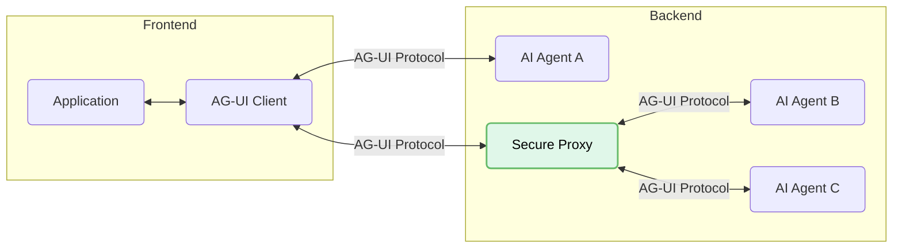

智能体–用户交互协议（AG-UI）构建在一套灵活的事件驱动架构之上，让前端应用与 AI 智能体之间实现顺畅而高效的通信。本文介绍核心的架构组件与概念。

## 设计原则

AG-UI 的设计轻量且尽量少做限定，因此可以轻松集成各种各样的智能体实现。协议的灵活性来自它极简的硬性要求：

1. **事件驱动通信**：智能体在执行过程中需发出 16 种标准化事件类型中的若干事件，形成客户端可处理的更新流。

2. **双向交互**：智能体接受用户输入，支撑起人与 AI 无缝协作的工作流。

协议内置了一层中间件，从两个关键方面最大化兼容性：

- **灵活的事件结构**：事件无需与 AG-UI 的格式完全一致——只要与 AG-UI 兼容即可。这让现有的智能体框架只需少量改动就能适配自己的原生事件格式。

- **传输层无关**：AG-UI 不限定事件的投递方式，支持多种传输机制，包括服务器推送事件（SSE）、webhook、WebSocket 等。这种灵活性让开发者可以为自己的架构选择最合适的传输层。

这种务实的做法让 AG-UI 易于采用，无需对现有的智能体实现或前端应用做大规模改造。

## 架构总览

AG-UI 采用客户端–服务端架构，将智能体与应用之间的通信标准化：



- **应用**：面向用户的应用（如对话应用，或任何具备 AI 能力的应用）。
- **AG-UI 客户端**：通用通信客户端（如 `HttpAgent`），或用于对接现有协议的专用客户端。
- **智能体**：在后端处理请求并生成流式响应的 AI 智能体。
- **安全代理**：提供额外能力并充当安全代理的后端服务。

## 核心组件

### 协议层

AG-UI 的协议层为智能体通信提供了灵活的基础。

- **普适兼容**：实现 `run(input: RunAgentInput) -> Observable<BaseEvent>` 即可接入任何协议

协议的核心抽象让应用能够运行智能体并接收事件流：

{/* prettier-ignore */}
```typescript
// Core agent execution interface
type RunAgent = () => Observable<BaseEvent>

class MyAgent extends AbstractAgent {
  run(input: RunAgentInput): RunAgent {
    const { threadId, runId } = input
    return () =>
      from([
        { type: EventType.RUN_STARTED, threadId, runId },
        {
          type: EventType.MESSAGES_SNAPSHOT,
          messages: [
            { id: "msg_1", role: "assistant", content: "Hello, world!" }
          ],
        },
        { type: EventType.RUN_FINISHED, threadId, runId },
      ])
  }
}
```

### 标准 HTTP 客户端

AG-UI 提供标准 HTTP 客户端 `HttpAgent`，可用于连接任何这样的端点：接受请求体类型为 `RunAgentInput` 的 POST 请求，并返回 `BaseEvent` 对象流。

`HttpAgent` 支持以下传输层：

- **HTTP SSE（服务器推送事件）**

  - 基于文本的流式传输，兼容性广
  - 易于阅读和调试

- **HTTP 二进制协议**
  - 高性能、省空间的自定义传输
  - 可靠的二进制序列化，适合生产环境

### 消息类型

AG-UI 针对智能体通信的不同方面定义了几类事件：

- **生命周期事件**

  - `RUN_STARTED`、`RUN_FINISHED`、`RUN_ERROR`
  - `STEP_STARTED`、`STEP_FINISHED`

- **文本消息事件**

  - `TEXT_MESSAGE_START`、`TEXT_MESSAGE_CONTENT`、`TEXT_MESSAGE_END`

- **工具调用事件**

  - `TOOL_CALL_START`、`TOOL_CALL_ARGS`、`TOOL_CALL_END`

- **状态管理事件**

  - `STATE_SNAPSHOT`、`STATE_DELTA`、`MESSAGES_SNAPSHOT`

- **特殊事件**
  - `RAW`、`CUSTOM`

## 运行智能体

要运行智能体，先创建客户端实例，然后执行它：

```typescript
// Create an HTTP agent client
const agent = new HttpAgent({
  url: "https://your-agent-endpoint.com/agent",
  agentId: "unique-agent-id",
  threadId: "conversation-thread"
});

// Start the agent and handle events
agent.runAgent({
  tools: [...],
  context: [...]
}).subscribe({
  next: (event) => {
    // Handle different event types
    switch(event.type) {
      case EventType.TEXT_MESSAGE_CONTENT:
        // Update UI with new content
        break;
      // Handle other event types
    }
  },
  error: (error) => console.error("Agent error:", error),
  complete: () => console.log("Agent run complete")
});
```

## 状态管理

AG-UI 通过专用事件提供高效的状态管理：

- `STATE_SNAPSHOT`：某一时刻的完整状态表示
- `STATE_DELTA`：基于 JSON Patch 格式（RFC 6902）的增量状态变更
- `MESSAGES_SNAPSHOT`：完整的对话历史

这些事件让客户端侧可以用最少的数据传输实现高效的状态管理。

## 工具与交接

AG-UI 通过标准化事件支持智能体间的交接与工具使用：

- 工具定义通过 `runAgent` 参数传入
- 工具调用以 `TOOL_CALL_START` → `TOOL_CALL_ARGS` → `TOOL_CALL_END` 的事件序列流式传输
- 智能体可以交接给其他智能体，并保持上下文连续

## 事件

AG-UI 中的所有通信都基于带类型的事件。每个事件都继承自 `BaseEvent`：

```typescript
interface BaseEvent {
  type: EventType
  timestamp?: number
  rawEvent?: any
}
```

事件有严格的类型定义与校验，确保组件之间通信可靠。
