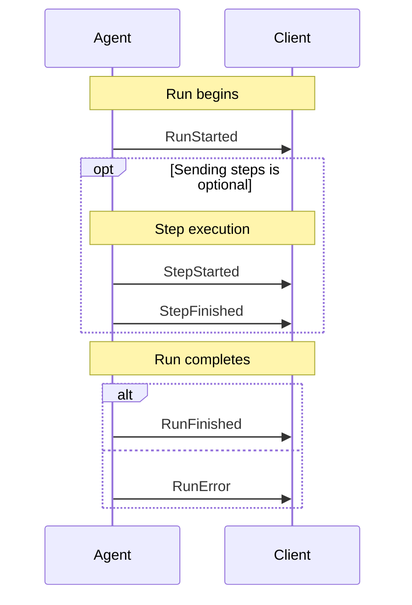
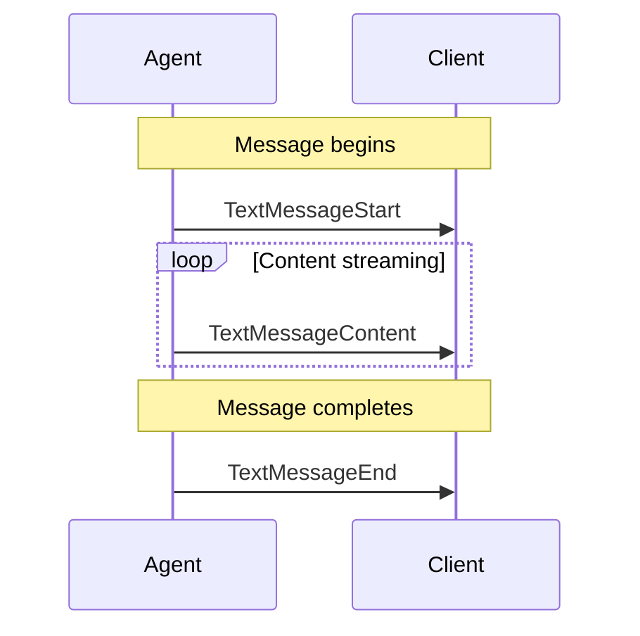
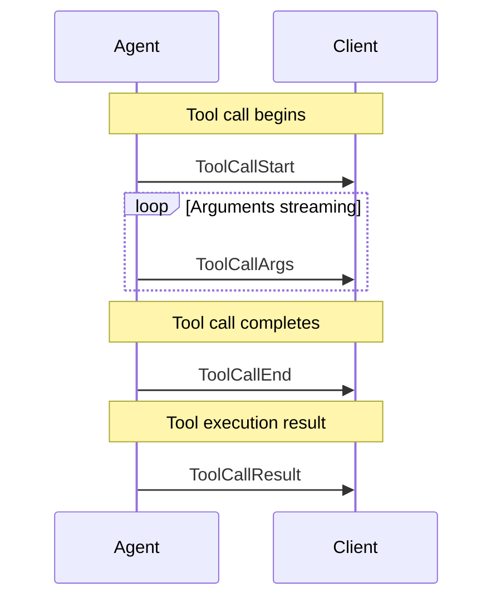
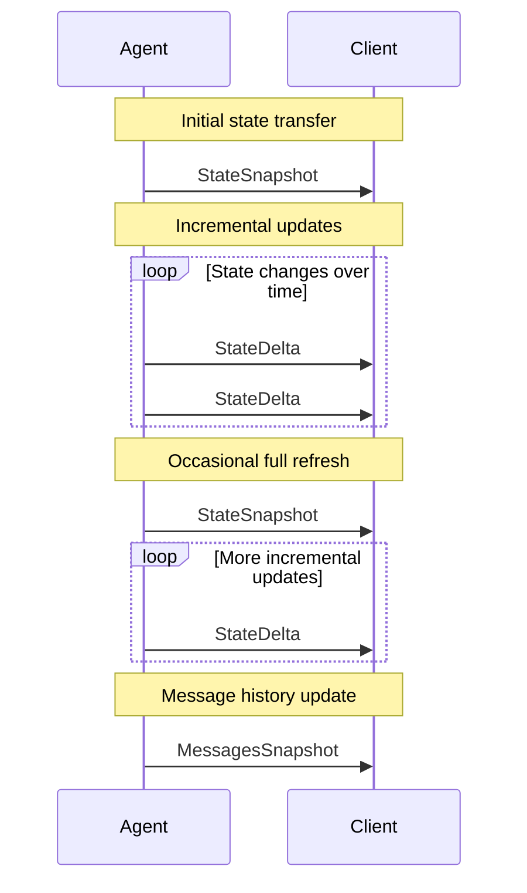
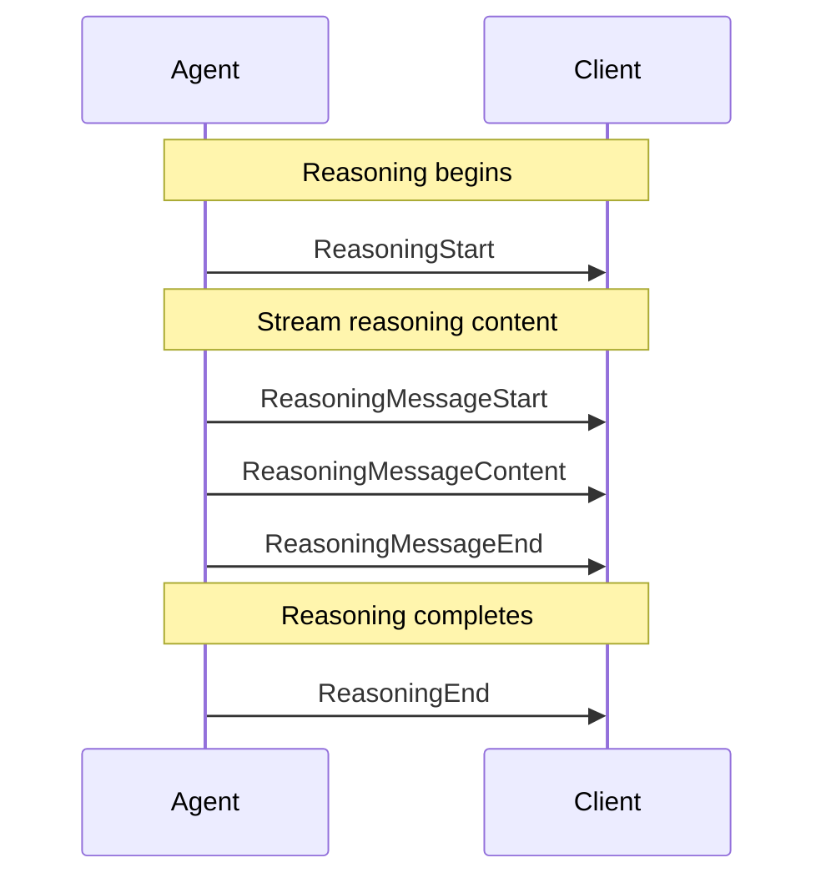
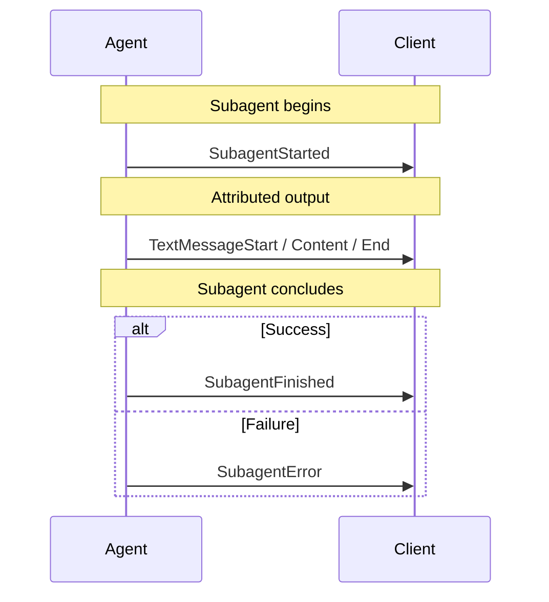

# 事件

智能体–用户交互协议采用基于事件的流式架构。事件是智能体与前端之间通信的基本单元，支撑实时的、结构化的交互。

## 事件类型总览

协议中的事件按用途分类：

| 类别         | 说明                           |
| ------------ | ------------------------------ |
| 生命周期事件 | 跟踪智能体运行的推进过程       |
| 文本消息事件 | 处理流式文本内容               |
| 工具调用事件 | 管理智能体发起的工具执行       |
| 状态管理事件 | 在智能体与 UI 之间同步状态     |
| 活动事件     | 表示进行中的活动进度           |
| 子智能体事件 | 跟踪子智能体并标注其输出归属   |
| 特殊事件     | 支持自定义功能                 |
| 草案事件     | 开发中的提议事件               |

## 事件基础属性

所有事件都共享一组基础属性：

| 属性        | 说明                                   |
| ----------- | -------------------------------------- |
| `type`      | 具体的事件类型标识符                   |
| `timestamp` | 可选的时间戳，标明事件的创建时间       |
| `rawEvent`  | 可选字段，若事件经过转换则携带原始数据 |
| `metadata`  | 可选的附加信息，随事件一起传递         |

### 元数据

`metadata` 是一个可选的开放式对象（按键扩展），用于给事件附加额外信息——比如 token 用量、追踪 ID、结束原因。它在基础事件上声明一次，因此每种事件类型都携带它。

消费方会把事件的元数据按键合并进该事件构建的消息，后写入者覆盖先写入者。正因如此，生产方可以把 token 用量放在消息的最后一个事件上发出，而不必事先就知道这个值。

完整的规则见[元数据](/concepts/metadata)：保留的 `ag-ui` 键、哪些事件会合并而哪些不会、工具调用如何携带自己的元数据，以及这个对象在各传输层上的行为。

大多数事件还接受一个可选的 `subagentRunId`，用来标明产出该事件的子智能体；没有这个字段的事件归属于父智能体。详见[子智能体](/concepts/subagents)。

## 生命周期事件

这些事件刻画了一次智能体运行的生命周期。典型的运行遵循可预测的模式：以 `RunStarted` 事件开始，中间可能包含多对可选的 `StepStarted`/`StepFinished`，最后以 `RunFinished` 事件（成功）或 `RunError` 事件（失败）收尾。

生命周期事件为智能体运行提供了关键的结构骨架，让前端能够跟踪进度、合理管理 UI 状态、优雅地处理错误。它们为“操作何时开始、何时结束”提供了一致的框架，从而支撑加载指示器、进度跟踪、错误恢复等特性的实现。

`RunStarted` 与 `RunFinished` 或 `RunError` 二者是必选事件，构成一次运行的边界。步骤事件是可选的，可以在一次运行中出现多次，从而支持结构化、可观测的进度跟踪。

### RunStarted

标志一次智能体运行的开始。

`RunStarted` 事件是智能体开始处理请求时发出的第一个事件。它建立了一个新的执行上下文，由唯一的 `runId` 标识。前端以这个事件为信号来初始化进度指示器、加载状态等 UI 元素。它还提供了关键的标识符，可用于把后续事件与本次运行关联起来。

| 属性          | 说明                                                                                                                                             |
| ------------- | ------------------------------------------------------------------------------------------------------------------------------------------------ |
| `threadId`    | 会话线程的 ID                                                                                                                                    |
| `runId`       | 本次智能体运行的 ID                                                                                                                              |
| `parentRunId` | （可选）用于分支/时间旅行的血统指针。若存在，指向同一线程中更早的一次运行，形成类似 git 的只追加日志                                              |
| `input`       | （可选）本次运行发送给智能体的确切输入负载。可以省略历史中已有的消息；compactEvents() 会做规范化处理                                              |

### RunFinished

标志一次智能体运行的结束。每次运行都以 `RunFinished` 或 `RunError` 终止。

`RunFinished` 有一个可选的 `outcome` 可辨识联合（discriminated union）：

- **缺省**——尚未采用中断感知生命周期的旧式生产方。按正常完成处理。
- `outcome: { type: "success" }`——运行正常完成。可选的 `result` 仍保留在事件根节点上，以向后兼容。
- `outcome: { type: "interrupt", interrupts: [...] }`——运行因等待人类输入而暂停。非空的 `interrupts` 数组位于该 outcome 变体内部。客户端通过启动一次新的运行来恢复，其 `RunAgentInput` 中包含一个 `resume` 数组，逐一回应每个待处理的中断。

<Note>
  完整的中断生命周期——`Interrupt` 类型、契约规则、错误处理、原因分类与完整示例——见[中断](/concepts/interrupts)。
</Note>

### RunError

标志智能体运行过程中发生错误。

`RunError` 事件表示智能体遇到了无法恢复的错误，运行因此提前终止。该事件说明了出了什么问题，让前端能够展示相应的错误信息，并可能提供恢复选项。`RunError` 事件之后，本次运行不会再有任何后续处理。

| 属性      | 说明           |
| --------- | -------------- |
| `message` | 错误信息       |
| `code`    | 可选的错误码   |

### StepStarted

标志一次运行中某个步骤的开始。

`StepStarted` 事件表示智能体开始处理某个特定的子任务或阶段。步骤提供了对智能体进展的细粒度可见性，让 UI 中的跟踪与反馈更精确。步骤是可选的，但对于那些拆分成可观测阶段更有利的复杂操作，强烈建议使用。`stepName` 可以是当前正在执行的节点或函数的名称。

| 属性       | 说明     |
| ---------- | -------- |
| `stepName` | 步骤名称 |

### StepFinished

标志一次运行中某个步骤的完成。

`StepFinished` 事件表示智能体已完成某个特定的子任务或阶段。与对应的 `StepStarted` 事件配对后，它为一个独立的工作单元划定了边界。前端可以用这些事件更新进度指示器、播放完成动画，或展示该步骤特有的结果。`stepName` 必须与对应的 `StepStarted` 事件一致，才能正确配对步骤的开始与结束。

| 属性       | 说明     |
| ---------- | -------- |
| `stepName` | 步骤名称 |

## 文本消息事件

这些事件刻画了对话中文本消息的生命周期。文本消息事件遵循流式模式，内容增量送达：消息以 `TextMessageStart` 事件开始，随后是一个或多个 `TextMessageContent` 事件，在文本就绪时分块送达，最后以 `TextMessageEnd` 事件结束。

这种流式方式让消息内容在生成的同时就能实时显示，与“等整条消息生成完毕再展示”相比，用户体验响应更快。

每个 `TextMessageContent` 事件都包含一个携带文本片段的 `delta` 字段。前端应按接收顺序拼接这些片段，还原出完整的消息。`messageId` 属性把所有相关事件串在一起，让前端能把内容片段关联到正确的消息上。

### TextMessageStart

标志一条文本消息的开始。

`TextMessageStart` 事件在对话中初始化一条新的文本消息。它建立一个唯一的 `messageId`，后续的内容片段和结束事件都会引用它。前端可以借这个事件为即将到来的消息做好准备，比如新建一个带加载指示器的消息气泡。`role` 属性标明消息是来自助手，还是来自对话中的其他参与者。

| 属性        | 说明                                                                            |
| ----------- | ------------------------------------------------------------------------------- |
| `messageId` | 消息的唯一标识符                                                                |
| `role`      | 消息发送方的角色（"developer"、"system"、"assistant"、"user"、"tool"）           |

### TextMessageContent

表示流式文本消息中的一块内容。

`TextMessageContent` 事件在文本就绪时增量送达消息内容。每个事件在 `delta` 属性中携带一小段文本，应追加到之前收到的片段之后。这类事件的流式特性让内容可以实时显示，带来更灵敏、更有参与感的用户体验。实现上应高效处理这些事件，确保文字渲染平滑，不出现明显延迟或闪烁。

| 属性        | 说明                             |
| ----------- | -------------------------------- |
| `messageId` | 与 `TextMessageStart` 中的 ID 一致 |
| `delta`     | 文本内容片段（非空）             |

### TextMessageEnd

标志一条文本消息的结束。

`TextMessageEnd` 事件标志一条流式文本消息的完成。收到该事件后，前端即可确认消息已完整，不会再有新内容。UI 由此可以完成最终渲染、移除加载指示器，并触发消息完成后的动作，比如启用回复控件，或自动滚动以确保整条消息可见。

| 属性        | 说明                               |
| ----------- | ---------------------------------- |
| `messageId` | 与 `TextMessageStart` 中的 ID 一致 |

### TextMessageChunk

便捷事件，可自动展开为 Start → Content → End。

`TextMessageChunk` 事件让你不必显式发送 `TextMessageStart` 和 `TextMessageEnd` 事件。客户端的流转换器会把 chunk 展开成标准的三段式：

- 某条消息的首个 chunk 必须包含 `messageId`，并会发出 `TextMessageStart`（未提供 role 时默认为 `assistant`）。
- 每个携带 `delta` 的 chunk 都会为当前 `messageId` 发出一个 `TextMessageContent`。
- 当流切换到新的消息 ID 或流结束时，自动发出 `TextMessageEnd`。

| 属性        | 说明                                     |
| ----------- | ---------------------------------------- |
| `messageId` | 消息的可选唯一标识符；消息的首个 chunk 必填 |
| `role`      | 发送方的可选角色（"developer"、"system"、"assistant"、"user"） |
| `delta`     | 消息的可选文本内容                       |

## 工具调用事件

这些事件刻画了智能体发起的工具调用的生命周期。工具调用遵循与文本消息类似的流式模式：智能体需要使用工具时，先发出 `ToolCallStart` 事件，随后是一个或多个 `ToolCallArgs` 事件流式传参，最后以 `ToolCallEnd` 事件结束。

这种流式方式让前端能够实时展示工具执行过程，使智能体的动作透明可见，并就正在调用哪些工具、传了哪些参数给出即时反馈。

每个 `ToolCallArgs` 事件都包含一个携带参数片段的 `delta` 字段。前端应按接收顺序拼接这些片段，还原出完整的参数对象。`toolCallId` 属性把所有相关事件串在一起，让前端能把参数片段关联到正确的工具调用上。

### ToolCallStart

标志一次工具调用的开始。

`ToolCallStart` 事件表示智能体正在调用某个工具来执行特定功能。该事件提供被调用工具的名称，并建立唯一的 `toolCallId`，后续事件都会引用它。前端可以用这个事件向用户展示工具使用情况，比如提示某项操作正在进行。可选的 `parentMessageId` 可以把工具调用关联到对话中的某条消息，说明为什么要使用这个工具。

| 属性              | 说明                       |
| ----------------- | -------------------------- |
| `toolCallId`      | 本次工具调用的唯一标识符   |
| `toolCallName`    | 被调用工具的名称           |
| `parentMessageId` | 可选的父消息 ID            |

### ToolCallArgs

表示一次工具调用的参数数据片段。

`ToolCallArgs` 事件在参数就绪时增量送达工具参数。每个事件在 `delta` 属性中携带一段参数数据。这些片段通常是 JSON 碎片，拼起来就是工具的完整参数对象。对于构造完整参数可能耗时较长的复杂工具调用，流式传输参数尤其有价值。前端可以逐步把参数展示给用户，让人看清究竟给工具传了哪些参数。

| 属性         | 说明                               |
| ------------ | ---------------------------------- |
| `toolCallId` | 与 `ToolCallStart` 中的 ID 一致    |
| `delta`      | 参数数据片段                       |

### ToolCallEnd

标志一次工具调用的结束。

`ToolCallEnd` 事件标志一次工具调用的完成。收到该事件后，前端即可确认所有参数已传输完毕，工具执行正在进行或已完成。UI 由此可以完成工具调用的展示并准备接收可能的结果。在工具执行结果单独返回的系统中，该事件表示智能体已完成对工具及其参数的指定，正在等待或已经收到结果。

| 属性         | 说明                            |
| ------------ | ------------------------------- |
| `toolCallId` | 与 `ToolCallStart` 中的 ID 一致 |

### ToolCallResult

提供一次工具调用的执行结果。

`ToolCallResult` 事件送达此前智能体调用的工具所产出的输出或结果。该事件在系统执行完工具之后发出，包含工具实际生成的输出。与工具调用声明阶段（start、args、end）的流式模式不同，结果作为一个完整单元一次性送达，因为工具执行通常产出完整输出。前端可以用这个事件向用户展示工具结果、追加到对话历史，或基于工具输出触发后续动作。

| 属性         | 说明                                      |
| ------------ | ----------------------------------------- |
| `messageId`  | 该结果所属对话消息的 ID                   |
| `toolCallId` | 与对应 `ToolCallStart` 事件中的 ID 一致   |
| `content`    | 工具执行产生的实际结果/输出内容           |
| `role`       | 可选的角色标识，工具结果通常为 "tool"     |

### ToolCallChunk

便捷事件，可自动展开为 Start → Args → End。

`ToolCallChunk` 事件让你不必显式发送 `ToolCallStart` 和 `ToolCallEnd` 事件。客户端的流转换器会把 chunk 展开成标准的工具调用三段式：

- 某次工具调用的首个 chunk 必须包含 `toolCallId` 和 `toolCallName`，并会发出 `ToolCallStart`（透传可能存在的 `parentMessageId`）。
- 每个携带 `delta` 的 chunk 都会为当前 `toolCallId` 发出一个 `ToolCallArgs`。
- 当流切换到新的 `toolCallId` 或流结束时，自动发出 `ToolCallEnd`。

| 属性              | 说明                                       |
| ----------------- | ------------------------------------------ |
| `toolCallId`      | 后续 chunk 可省略；工具调用的首个 chunk 必填 |
| `toolCallName`    | 后续 chunk 可省略；工具调用的首个 chunk 必填 |
| `parentMessageId` | 可选的父消息 ID                            |
| `delta`           | 可选的参数数据片段（通常是 JSON 碎片）     |

## 状态管理事件

这些事件用于管理智能体状态并与前端同步。协议中的状态管理遵循高效的“快照–增量”模式：完整的状态快照只在开始或不定期发送，持续发生的变化则用增量更新（delta）表达。

这种做法同时兼顾完整性与效率：快照确保前端掌握完整的状态上下文，增量则把频繁更新的数据传输降到最低。两者结合，前端无需多余的数据传输就能准确呈现智能体状态。

快照与增量的组合让前端能高效跟踪智能体状态的变化，同时保证一致性。快照充当同步点，把状态重置到已知基线；增量则在快照之间提供轻量更新。

### StateSnapshot

提供智能体状态的完整快照。

`StateSnapshot` 事件完整呈现智能体当前的状态。该事件通常在交互开始或需要同步时发送。它包含与前端相关的所有状态变量，让前端能够彻底重建自己的内部表示。前端应当用这份快照的内容整体替换现有状态模型，而不是尝试与之前的状态合并。

| 属性       | 说明           |
| ---------- | -------------- |
| `snapshot` | 完整的状态快照 |

### StateDelta

使用 JSON Patch 提供智能体状态的部分更新。

`StateDelta` 事件以 JSON Patch 操作（RFC 6902 定义）的形式携带智能体状态的增量更新。每个 delta 表示要对当前状态模型应用的具体变更。这种方式节省带宽，只发送变化的部分而非整个状态。前端应按顺序应用这些补丁，以维持准确的状态表示。如果前端在应用补丁后发现不一致，可以请求一份新的 `StateSnapshot`。

| 属性   | 说明                            |
| ------ | ------------------------------- |
| `delta` | JSON Patch 操作数组（RFC 6902） |

### MessagesSnapshot

提供对话中所有消息的快照。

`MessagesSnapshot` 事件送达当前对话的完整消息历史。与一般的状态快照不同，它专门聚焦对话记录本身。该事件适用于初始化聊天历史、连接中断后重新同步，或在用户加入进行中的对话时提供完整视图。前端应当用它来建立或刷新展示给用户的对话上下文。

| 属性       | 说明           |
| ---------- | -------------- |
| `messages` | 消息对象数组   |

在 `MessagesSnapshot` 中，`activity` 与 `reasoning` 消息是“要么全带、要么不带”的。如果快照携带了该角色的任何一条消息，它就必须是该角色的完整集合：重复出现的条目会替换客户端的副本，未列出的条目会被删除。如果一条都没带，快照就对该角色不作任何表态，客户端保留自己已有的消息。

这两个角色默认都只存在于客户端侧，因此不带它们是安全的。活动消息永远不会回传给智能体——它们会从 `RunAgentInput` 中剥离——而推理通常只以流式 `Reasoning` 事件的形式存在。不跟踪这两者的后端直接在快照中省略它们即可，客户端手里的数据不会丢失。

## 活动事件

活动事件（Activity Events）暴露发生在聊天消息之间的结构化、进行中的活动更新。它们遵循与状态系统相同的快照/增量模式，UI 因此可以先立即渲染完整的活动视图，再随着新信息到来增量更新。

活动消息与其他消息共用同一个 id 空间，因此它的 `messageId` 不得被文本或推理消息复用，反之亦然。二者的 `content` 形状不同——活动是结构化对象，文本与推理是字符串——共用 id 没有一致的语义。如果客户端在活动消息已占用的 id 下收到一条文本或推理消息，应保持活动消息原样，而不是覆盖它。

### ActivitySnapshot

送达一条活动消息的完整快照。

| 属性           | 说明                                                          |
| -------------- | ------------------------------------------------------------- |
| `messageId`    | 该事件所更新的 `ActivityMessage` 的标识符                     |
| `activityType` | 活动判别值（例如 `"PLAN"`、`"SEARCH"`）                       |
| `content`      | 表示完整活动状态的结构化 JSON 负载                            |
| `replace`      | 可选。默认为 `true`。为 `false` 时，若消息已存在则忽略该快照  |

前端应当新建一条 `ActivityMessage`，或用快照提供的负载替换现有消息。

### ActivityDelta

使用 JSON Patch 操作对已有活动应用增量更新。

| 属性           | 说明                                              |
| -------------- | ------------------------------------------------- |
| `messageId`    | 目标活动消息的标识符                              |
| `activityType` | 活动判别值（与最近一次快照中的值一致）            |
| `patch`        | 要应用到活动数据的 RFC 6902 JSON Patch 操作数组   |

活动增量应按顺序应用到先前已同步的活动内容上。如果应用检测到分歧，可以请求或发出一份新的 `ActivitySnapshot` 来重新同步。

## 特殊事件

特殊事件为协议提供了灵活性，允许承载系统专属功能并对接外部系统。它们不遵循其他事件类型的标准生命周期或流式模式，而是服务于专门用途。

### Raw

用于透传来自外部系统的事件。

`Raw` 事件充当容器，承载那些原生并不遵循 AG-UI 协议的外部系统或来源的事件。这种事件类型把其他事件系统的事件包装成标准化格式，从而实现互操作。内嵌的事件数据在 `event` 属性中保持原样，可选的 `source` 属性标明它来自哪个系统。前端可以利用这些信息妥善处理外部事件——既可以自行处理，也可以交给系统专属的处理器。

| 属性    | 说明             |
| ------- | ---------------- |
| `event` | 原始事件数据     |
| `source` | 可选的来源标识  |

### Custom

用于应用专属的自定义事件。

`Custom` 事件提供了一种扩展机制，用于实现标准事件类型未覆盖的功能。与充当透传容器的 `Raw` 事件不同，`Custom` 事件明确属于协议的一部分，只是语义由应用自行定义。`name` 属性标识具体的自定义事件类型，`value` 属性携带相关数据。借助这一机制，无需正式修改规范就能扩展协议。团队应为自己的自定义事件编写文档，以确保前端与智能体之间的实现一致。

| 属性    | 说明               |
| ------- | ------------------ |
| `name`  | 自定义事件的名称   |
| `value` | 与该事件关联的值   |

## 推理事件

推理事件支持 LLM 推理过程的可见性与连续性，在保护隐私的前提下实现思维链推理。这些事件让智能体可以呈现推理信号（例如摘要），并支持加密的推理条目以在多轮之间延续状态——尤其是在 `store:false` 或零数据保留策略下——同时不暴露原始的思维链。

加密推理条目的底层概念启发了本设计，详见 [OpenAI 零数据保留（ZTR）文档](https://developers.openai.com/cookbook/examples/responses_api/reasoning_items/#encrypted-reasoning-items)、[OpenAI store 参数文档](https://platform.openai.com/docs/api-reference/responses/create#responses_create-store)和 [Gemini Thought Signatures](https://ai.google.dev/gemini-api/docs/thought-signatures)。

更多完整文档——包括隐私考量、合规指引与实现示例——见[推理](/concepts/reasoning)。

### ReasoningStart

标志推理的开始。

`ReasoningStart` 事件表示智能体即将开始一个推理过程。它建立一个由唯一 `messageId` 标识的推理上下文。

| 属性        | 说明                   |
| ----------- | ---------------------- |
| `messageId` | 本次推理的唯一标识符   |

### ReasoningMessageStart

标志一条推理消息的开始。

`ReasoningMessageStart` 事件开启一条流式推理消息。该消息将包含智能体推理中应向用户展示的可见部分（例如摘要或部分思维链）。

| 属性        | 说明                              |
| ----------- | --------------------------------- |
| `messageId` | 消息的唯一标识符                  |
| `role`      | 推理消息的角色（`"reasoning"`）   |

### ReasoningMessageContent

表示流式推理消息中的一块内容。

`ReasoningMessageContent` 事件向客户端增量送达推理内容。相同 `messageId` 的多个内容事件应拼接起来，构成完整的可见推理。

| 属性        | 说明                           |
| ----------- | ------------------------------ |
| `messageId` | 与 ReasoningMessageStart 中的 ID 一致 |
| `delta`     | 推理内容片段（非空字符串）     |

### ReasoningMessageEnd

标志一条推理消息的结束。

`ReasoningMessageEnd` 事件表示指定推理消息的全部内容已发送完毕。客户端应就此定稿展示该推理消息的 UI。

| 属性        | 说明                                  |
| ----------- | ------------------------------------- |
| `messageId` | 与 ReasoningMessageStart 中的 ID 一致 |

### ReasoningMessageChunk

便捷事件，用于自动开启/结束推理消息。

`ReasoningMessageChunk` 事件自动管理消息生命周期，简化了实现。首个携带 `messageId` 的 chunk 隐式开启该消息；空的 `delta` 或下一个非推理事件则隐式结束该消息。

| 属性        | 说明                                       |
| ----------- | ------------------------------------------ |
| `messageId` | 消息 ID（首个事件必须非空）                |
| `delta`     | 推理内容片段（空字符串表示结束该消息）     |

### ReasoningEnd

标志推理的结束。

`ReasoningEnd` 事件表示智能体已完成给定上下文的推理过程。该事件之后不应再期待相同 `messageId` 的推理事件。

| 属性        | 说明                   |
| ----------- | ---------------------- |
| `messageId` | 本次推理的唯一标识符   |

### ReasoningEncryptedValue

把加密的思维链推理附加到一条消息或一次工具调用上。

`ReasoningEncryptedValue` 事件携带加密的推理内容，代表与特定实体相关的 LLM 内部思维链。这让智能体可以在多轮对话之间延续推理状态，而无需向客户端暴露原始内容。客户端对这些加密值只做不透明的存储与转发——只有智能体（或经授权的后端）能解密它们。

| 属性             | 说明                                     |
| ---------------- | ---------------------------------------- |
| `subtype`        | 实体类型：`"message"` 或 `"tool-call"`   |
| `entityId`       | 该推理所属消息或工具调用的 ID            |
| `encryptedValue` | 加密的思维链内容数据块                   |

使用场景：

- **消息推理**：把加密推理附加到 `AssistantMessage` 或 `ReasoningMessage` 上，为后续轮次保留上下文
- **工具调用推理**：把加密推理附加到某次工具调用上，记录智能体为何选择特定参数、如何解读结果

## 子智能体事件

子智能体事件让智能体报告自己已把工作委派给某个子智能体，前端因此能分辨哪段输出出自哪个子智能体。没有这些事件，三个并发流式输出的子智能体就会混成一股无法区分的流。

归属信息由大多数其他事件上的可选 `subagentRunId` 承载；这三个事件则框定子智能体的活动区间，并给出可用于展示的名称。

`subagentRunId` 标识的是**一次调用**，而不是可复用的子智能体定义——同一个子智能体运行两次会得到两个不同的值。完整模型（包括嵌套、并发与客户端强制执行的规则）见[子智能体](/concepts/subagents)。

### SubagentStarted

宣告一次新的子智能体调用。

| 属性                  | 说明                                        |
| --------------------- | ------------------------------------------- |
| `subagentRunId`       | 本次调用的不透明标识符                      |
| `name`                | 子智能体声明的名称或类型，用于展示          |
| `description`         | 可选的人类可读描述                          |
| `parentSubagentRunId` | 可选的外层子智能体（子智能体嵌套时）        |
| `parentToolCallId`    | 可选的、派生出该子智能体的工具调用          |
| `parentMessageId`     | 可选的、承载该工具调用的消息                |

### SubagentFinished

标志一次子智能体调用完成。

| 属性            | 说明                                          |
| --------------- | --------------------------------------------- |
| `subagentRunId` | 与 SubagentStarted 中的 ID 一致               |
| `result`        | 可选的完成负载，对应 `RunFinished.result`     |
| `outcome`       | 可选的可辨识联合：`{ type: "success" }` 或 `{ type: "suspended", interruptIds?: string[] }`。缺省表示成功（旧式解读）。`suspended` 表示子智能体已在中途设置检查点、等待外部输入——随后该运行以中断 outcome 结束，`interruptIds` 指明哪些运行级中断的答案会唤醒该子智能体。 |

### SubagentError

标志一次子智能体调用失败。

| 属性            | 说明                            |
| --------------- | ------------------------------- |
| `subagentRunId` | 与 SubagentStarted 中的 ID 一致 |
| `message`       | 人类可读的错误信息              |
| `code`          | 可选的错误码                    |

<Note>
  `StateSnapshot` 与 `StateDelta` 可以携带归属信息，但这里的归属表示的是**来源而非所有权**：它只记录更新由哪个子智能体产出。状态始终以运行（run）为作用域，带归属的快照或增量与不带归属的一样，都应用到本次运行的唯一状态文档上。不存在按子智能体划分的状态。
</Note>

## 已废弃事件

<Warning>
  以下事件已废弃，将在 1.0.0 版本中移除。请改用对应的 Reasoning 事件。
</Warning>

### Thinking 事件（已废弃）

`THINKING_*` 事件已被 `REASONING_*` 事件取代：

| 已废弃事件                      | 替代事件                    |
| ------------------------------- | --------------------------- |
| `THINKING_START`                | `REASONING_START`           |
| `THINKING_END`                  | `REASONING_END`             |
| `THINKING_TEXT_MESSAGE_START`   | `REASONING_MESSAGE_START`   |
| `THINKING_TEXT_MESSAGE_CONTENT` | `REASONING_MESSAGE_CONTENT` |
| `THINKING_TEXT_MESSAGE_END`     | `REASONING_MESSAGE_END`     |

详细的迁移指引见[Reasoning 迁移](/concepts/reasoning#migration-from-thinking-events)。

## 草案事件

这些事件目前处于草案状态，定稿前可能变更。它们代表正在积极开发和讨论中的协议扩展提案。

### Meta 事件

  草案

[查看提案](/drafts/meta-events)

Meta 事件提供独立于智能体运行的注解与信号，例如用户反馈或外部系统事件。

#### MetaEvent

一种带外注解事件，可出现在流中的任意位置。

| 属性       | 说明                                       |
| ---------- | ------------------------------------------ |
| `metaType` | 应用自定义的类型（如 "thumbs_up"、"tag"）  |
| `payload`  | 应用自定义的负载                           |

### 扩展的生命周期事件

  草案

[查看规范](/concepts/interrupts)

对现有生命周期事件的扩展，用于支持中断与分支。

#### RunFinished（扩展）

`RunFinished` 事件新增字段，以支持中断感知的工作流。

| 属性      | 说明                                                                                                                              |
| --------- | --------------------------------------------------------------------------------------------------------------------------------- |
| `outcome` | 可选的可辨识联合：`{ type: "success" }` 或 `{ type: "interrupt", interrupts: [...] }`。旧式生产方缺省。                            |
| `result`  | 可选。自由格式的完成负载。为与旧式生产方向后兼容而保留在事件根节点；可与任意 outcome 共存。                                        |

血统与输入捕获见[序列化](/concepts/serialization)。

#### RunStarted（扩展）

`RunStarted` 事件新增字段，以支持分支与输入跟踪。

| 属性          | 说明                                       |
| ------------- | ------------------------------------------ |
| `parentRunId` | 可选：用于分支/时间旅行的父运行 ID         |
| `input`       | 可选：本次运行的确切智能体输入             |

## 事件流模式

协议中的事件通常遵循特定的模式：

1. **Start–Content–End 模式**：用于流式内容（文本消息、工具调用）
   - `Start` 事件开启流
   - `Content` 事件送达数据片段
   - `End` 事件标志完成

2. **快照–增量模式**：用于状态同步
   - `Snapshot` 提供完整状态
   - `Delta` 事件提供增量更新

3. **生命周期模式**：用于监控智能体运行
   - `Started` 事件标志开始
   - `Finished`/`Error` 事件标志结束

## 实现注意事项

实现事件处理器时：

- 事件应按接收顺序处理
- 具有相同 ID（如 `messageId`、`toolCallId`）的事件属于同一条逻辑流
- 实现应对乱序送达具备容错能力
- 自定义事件应遵循既有模式以保持一致性
