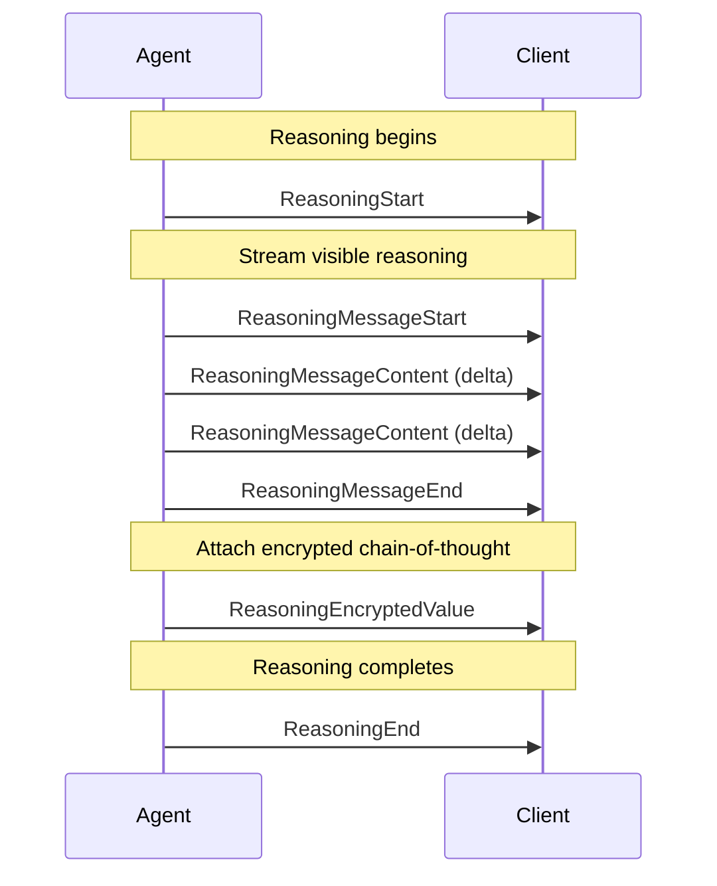

# 推理

AG-UI 为 LLM 推理（reasoning）提供一等公民级的支持，在保持隐私与跨轮次状态延续的同时，实现思维链的可见性。

## 概览

现代 LLM 越来越多地使用思维链推理来提升响应质量。AG-UI 的推理支持针对三个关键挑战：

- **推理可见性**：向用户呈现推理信号（例如摘要），而不暴露原始思维链
- **状态延续**：借助加密推理条目跨轮次维护推理上下文，即使在 `store:false` 或零数据保留（ZDR）策略下也能做到
- **隐私合规**：在保留推理能力的同时，满足企业隐私要求

<Tip>
  与活动消息不同，推理消息用来表示智能体的内部思考过程，可以出于隐私考虑加密，并且会在后续轮次回传给智能体做进一步处理。
</Tip>

## ReasoningMessage

`ReasoningMessage` 类型表示消息历史中的推理内容：

```typescript
interface ReasoningMessage {
  id: string
  role: "reasoning"
  content: string // Reasoning content (visible to client)
  encryptedValue?: string // Optional encrypted reasoning for state continuity
}
```

| 属性             | 类型          | 说明                                                 |
| ---------------- | ------------- | ---------------------------------------------------- |
| `id`             | `string`      | 推理消息的唯一标识符                                 |
| `role`           | `"reasoning"` | 消息角色判别值                                       |
| `content`        | `string`      | 对客户端可见的推理内容                               |
| `encryptedValue` | `string?`     | 用于状态延续的加密思维链数据块                       |

关键特性：

- **与助手消息分离**：推理与最终响应分开保存，避免污染对话历史
- **可流式**：内容通过流式事件到达
- **可选加密**：当 `encryptedValue` 存在时，它代表加密的思维链，客户端对其只做不透明的存储与转发

## 推理事件

推理事件管理推理消息的生命周期。完整的事件参考见[事件](/concepts/events#reasoning-events)。

### 事件流程

典型的推理流程遵循如下模式：



### 事件类型

| 事件                      | 用途                                                          |
| ------------------------- | ------------------------------------------------------------- |
| `ReasoningStart`          | 标志推理阶段的开始                                            |
| `ReasoningMessageStart`   | 开启一条流式推理消息                                          |
| `ReasoningMessageContent` | 送达推理内容片段                                              |
| `ReasoningMessageEnd`     | 结束一条推理消息                                              |
| `ReasoningMessageChunk`   | 自动管理消息生命周期的便捷事件                                |
| `ReasoningEnd`            | 标志推理完成                                                  |
| `ReasoningEncryptedValue` | 把加密思维链附加到消息或工具调用                              |

## 隐私与合规

AG-UI 的推理设计遵循隐私优先原则：

### 零数据保留（ZDR）

对要求零数据保留的部署：

1. **加密推理值**可以跨轮次携带状态，而无需在客户端存储可解密的内容
2. 客户端通过 `ReasoningEncryptedValue` 事件接收并转发 `encryptedValue` 数据块，全程不透明
3. 只有智能体（或经授权的后端）能解密推理内容

### 可见性控制

智能体控制哪些推理对用户可见：

- **完全可见**：通过 `ReasoningMessageContent` 事件流式输出完整思维链
- **仅摘要**：发出精简摘要，同时把详细推理作为加密值附加
- **隐藏**：只使用 `ReasoningEncryptedValue` 事件，不做任何可见的流式输出

### 合规考量

| 要求                    | 解决方案                                                                            |
| ----------------------- | ----------------------------------------------------------------------------------- |
| GDPR 的删除权           | 加密内容可以随时丢弃，而不损失推理能力                                              |
| SOC 2 数据处理          | 推理内容从不在客户端以明文存储                                                      |
| HIPAA 最小必要原则      | 只暴露摘要；详细推理保持加密                                                        |
| 审计日志                | `ReasoningStart`/`ReasoningEnd` 事件提供审计线索而不暴露内容                        |

## 实现示例

### 基础推理流程

一个展示可见推理的简单实现：

```typescript
// Agent emits reasoning start
yield {
  type: "REASONING_START",
  messageId: "reasoning-001",
}

// Stream visible reasoning content
yield {
  type: "REASONING_MESSAGE_START",
  messageId: "msg-123",
  role: "reasoning",
}

yield {
  type: "REASONING_MESSAGE_CONTENT",
  messageId: "msg-123",
  delta: "Let me ",
}

yield {
  type: "REASONING_MESSAGE_CONTENT",
  messageId: "msg-123",
  delta: "think through ",
}

yield {
  type: "REASONING_MESSAGE_CONTENT",
  messageId: "msg-123",
  delta: "this step ",
}

yield {
  type: "REASONING_MESSAGE_CONTENT",
  messageId: "msg-123",
  delta: "by step...",
}

yield {
  type: "REASONING_MESSAGE_END",
  messageId: "msg-123",
}

// End reasoning
yield {
  type: "REASONING_END",
  messageId: "reasoning-001",
}
```

### 用于状态延续的加密内容

在跨轮次维护推理状态而不暴露内容时，使用 `ReasoningEncryptedValue` 事件把加密思维链附加到消息或工具调用上：

```typescript
// Agent emits reasoning start
yield {
  type: "REASONING_START",
  messageId: "reasoning-002",
}

// Stream a visible summary for the user
yield {
  type: "REASONING_MESSAGE_START",
  messageId: "msg-456",
  role: "reasoning",
}

yield {
  type: "REASONING_MESSAGE_CONTENT",
  messageId: "msg-456",
  delta: "Analyzing your request...",
}

yield {
  type: "REASONING_MESSAGE_END",
  messageId: "msg-456",
}

// Attach encrypted chain-of-thought to the reasoning message
yield {
  type: "REASONING_ENCRYPTED_VALUE",
  subtype: "message",
  entityId: "msg-456",
  encryptedValue: "eyJhbGciOiJBMjU2R0NNIiwiZW5jIjoiQTI1NkdDTSJ9...",
}

yield {
  type: "REASONING_END",
  messageId: "reasoning-002",
}

// On subsequent turns, client sends back the message with encryptedValue
// which the agent can decrypt to restore reasoning context
```

### 把加密推理附加到工具调用

你也可以把加密推理附加到工具调用上，记录智能体为何选择特定参数、如何解读结果：

```typescript
// Tool call with encrypted reasoning
yield {
  type: "TOOL_CALL_START",
  toolCallId: "tool-123",
  toolCallName: "search_database",
  parentMessageId: "msg-789",
}

yield {
  type: "TOOL_CALL_ARGS",
  toolCallId: "tool-123",
  delta: '{"query": "user preferences"}',
}

yield {
  type: "TOOL_CALL_END",
  toolCallId: "tool-123",
}

// Attach encrypted reasoning explaining why this tool was called
yield {
  type: "REASONING_ENCRYPTED_VALUE",
  subtype: "tool-call",
  entityId: "tool-123",
  encryptedValue: "encrypted-reasoning-about-tool-selection...",
}
```

### 符合 ZDR 的实现

针对零数据保留场景：

```typescript
// Server-side: encrypt reasoning before sending
const encryptedReasoning = await encrypt(detailedChainOfThought, secretKey)

yield {
  type: "REASONING_START",
  messageId: "reasoning-003",
}

// Only emit a high-level summary to the client
yield {
  type: "REASONING_MESSAGE_CHUNK",
  messageId: "summary-001",
  delta: "Processing your request securely...",
}

yield {
  type: "REASONING_MESSAGE_CHUNK",
  messageId: "summary-001",
  delta: "", // Empty delta closes the message
}

// Attach the encrypted chain-of-thought
yield {
  type: "REASONING_ENCRYPTED_VALUE",
  subtype: "message",
  entityId: "summary-001",
  encryptedValue: encryptedReasoning,
}

yield {
  type: "REASONING_END",
  messageId: "reasoning-003",
}

// Client stores only:
// - The encrypted blob (cannot decrypt)
// - The summary text (no sensitive details)
// Full reasoning is never persisted in plaintext
```

### 使用便捷 chunk 事件

`ReasoningMessageChunk` 事件自动管理消息生命周期，简化了实现：

```typescript
// First chunk with messageId starts the message automatically
yield {
  type: "REASONING_MESSAGE_CHUNK",
  messageId: "msg-789",
  delta: "Analyzing the problem space...",
}

// Subsequent chunks continue the stream
yield {
  type: "REASONING_MESSAGE_CHUNK",
  messageId: "msg-789",
  delta: " Considering multiple approaches...",
}

// Empty delta (or next non-reasoning event) closes automatically
yield {
  type: "REASONING_MESSAGE_CHUNK",
  messageId: "msg-789",
  delta: "",
}
```

## 客户端集成

### 处理推理事件

```typescript
import { EventType, type BaseEvent } from "@ag-ui/core"

function handleEvent(event: BaseEvent) {
  switch (event.type) {
    case EventType.REASONING_START:
      // Initialize reasoning UI (e.g., "thinking" indicator)
      console.log("Agent is reasoning...")
      break

    case EventType.REASONING_MESSAGE_CONTENT:
      // Append visible reasoning to UI
      appendReasoningText(event.messageId, event.delta)
      break

    case EventType.REASONING_ENCRYPTED_VALUE:
      // Store encrypted value for the referenced entity
      if (event.subtype === "message") {
        storeMessageEncryptedValue(event.entityId, event.encryptedValue)
      } else if (event.subtype === "tool-call") {
        storeToolCallEncryptedValue(event.entityId, event.encryptedValue)
      }
      break

    case EventType.REASONING_END:
      // Finalize reasoning UI
      console.log("Reasoning complete")
      break
  }
}
```

### 回传加密推理

在后续请求中，带上已存储的加密值：

```typescript
const response = await agent.run({
  threadId: "thread-123",
  messages: [
    ...previousMessages,
    {
      id: "reasoning-002",
      role: "reasoning",
      content: "Analyzing your request...", // Visible summary
      encryptedValue: storedEncryptedBlob, // Opaque to client
    },
    {
      id: "user-msg-001",
      role: "user",
      content: "Follow up question...",
    },
  ],
})
```

## 从 Thinking 事件迁移

<Warning>
  `THINKING_*` 事件已废弃，将在 1.0.0 版本中移除。新的实现应使用 `REASONING_*` 事件。
</Warning>

### 已废弃事件

以下事件已废弃：

| Deprecated Event                | Replacement                 |
| ------------------------------- | --------------------------- |
| `THINKING_START`                | `REASONING_START`           |
| `THINKING_END`                  | `REASONING_END`             |
| `THINKING_TEXT_MESSAGE_START`   | `REASONING_MESSAGE_START`   |
| `THINKING_TEXT_MESSAGE_CONTENT` | `REASONING_MESSAGE_CONTENT` |
| `THINKING_TEXT_MESSAGE_END`     | `REASONING_MESSAGE_END`     |

### 迁移步骤

1. **更新事件类型**：把所有 `THINKING_*` 事件类型替换为对应的 `REASONING_*`
2. **更新消息类型**：使用带 `role: "reasoning"` 的 `ReasoningMessage`，取代任何 thinking 专属的消息类型
3. **增加加密值支持**：考虑使用 `ReasoningEncryptedValue` 事件，提升隐私合规性
4. **充分测试**：确保既有功能在新事件类型下正常工作

### 迁移示例

迁移前（已废弃）：

```typescript
// ❌ Deprecated - do not use
yield { type: "THINKING_START", messageId: "think-001" }
yield { type: "THINKING_TEXT_MESSAGE_START", messageId: "msg-001" }
yield { type: "THINKING_TEXT_MESSAGE_CONTENT", messageId: "msg-001", delta: "..." }
yield { type: "THINKING_TEXT_MESSAGE_END", messageId: "msg-001" }
yield { type: "THINKING_END", messageId: "think-001" }
```

迁移后（当前实现）：

```typescript
// ✅ Current implementation
yield { type: "REASONING_START", messageId: "reasoning-001" }
yield { type: "REASONING_MESSAGE_START", messageId: "msg-001", role: "assistant" }
yield { type: "REASONING_MESSAGE_CONTENT", messageId: "msg-001", delta: "..." }
yield { type: "REASONING_MESSAGE_END", messageId: "msg-001" }
yield { type: "REASONING_END", messageId: "reasoning-001" }
```

## 最佳实践

1. **始终成对使用 start/end 事件**：每个 `ReasoningStart` 都应有对应的 `ReasoningEnd`
2. **敏感推理使用加密值**：当思维链包含敏感信息时，用 `ReasoningEncryptedValue` 把加密内容附加到消息或工具调用上
3. **给用户反馈**：即使推理已加密，也要发出可见摘要，让用户知道智能体在工作
4. **优雅处理缺失事件**：客户端应对不完整的事件流具备容错能力
5. **考虑带宽**：对特别长的推理链，考虑只发出摘要以减少数据传输

## 相关文档

- [事件](/concepts/events#reasoning-events)——完整的事件类型参考
- [消息](/concepts/messages#reasoning-messages)——消息类型文档
- [序列化](/concepts/serialization)——状态延续与血统
