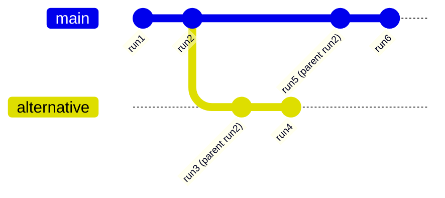

# 序列化

AG-UI 的序列化提供了一种标准方式，用于持久化和恢复驱动智能体–UI 会话的事件流。有了序列化的事件流，你可以：

- 在刷新或重连之后恢复聊天历史与 UI 状态
- 接入正在运行的智能体并继续接收事件
- 从任意先前的运行创建分支（时间旅行）
- 压缩已存储的历史以减小体积，而不丢失语义

本页通过示例讲解这套模型、更新后的事件字段以及实用的使用模式。

## 核心概念

- 流序列化——把完整的事件历史与可移植的表示形式（如 JSON）相互转换，以便存入数据库、文件或日志。
- 事件压缩——在保持语义的前提下把冗长的事件流约简为快照（例如合并内容片段、把增量折叠成快照）。
- 运行血统——用 `parentRunId` 跟踪对话的分支，形成类似 git 的只追加日志，支持时间旅行与备选路径。

## 更新后的事件字段

`RunStarted` 事件包含额外的可选字段：

```ts
type RunStartedEvent = BaseEvent & {
  type: EventType.RUN_STARTED
  threadId: string
  runId: string
  /** Parent for branching/time travel within the same thread */
  parentRunId?: string
  /** Exact agent input for this run (may omit messages already in history) */
  input?: AgentInput
}
```

这些字段支持血统跟踪，并让实现能够精确记录传给智能体的内容，而不依赖此前记录的消息。

## 事件压缩

压缩在保持相同可观测结果的前提下，降低事件流中的噪音。典型的实现会提供一个工具函数：

```ts
declare function compactEvents(events: BaseEvent[]): BaseEvent[]
```

常见的压缩规则包括：

- 消息流——把 `TEXT_MESSAGE_*` 序列合并为单条消息快照；同一条消息相邻的 `TEXT_MESSAGE_CONTENT` 拼接在一起。
- 推理流——以相同方式拼接同一条推理消息的 `REASONING_MESSAGE_CONTENT`。
- 工具调用——把工具调用的 start/content/end 折叠成一条紧凑记录。
- 状态——把连续的 `STATE_DELTA` 事件合并成最终的一个 `STATE_SNAPSHOT`，并丢弃被取代的更新。
- 运行输入规范化——从 `RunStarted.input.messages` 中移除流中更早位置已有的消息。

## 分支与时间旅行

在 `RunStarted` 事件上设置 `parentRunId` 会形成类似 git 的血统。事件流变成一条不可变、只追加的日志，每次运行都可以从任意先前的运行分叉出来。



好处：

- 同一份序列化日志中容纳多个分支
- 历史不可变（只追加）
- 确定性地时间旅行到任意时点

## 示例

### 基础序列化

```ts
// Serialize event stream
const events: BaseEvent[] = [...];
const serialized = JSON.stringify(events);

await storage.save(threadId, serialized);

// Restore and compact later
const restored = JSON.parse(await storage.load(threadId));
const compacted = compactEvents(restored);
```

### 事件压缩

压缩前：

```ts
[
  { type: "TEXT_MESSAGE_START", messageId: "msg1", role: "user" },
  { type: "TEXT_MESSAGE_CONTENT", messageId: "msg1", delta: "Hello " },
  { type: "TEXT_MESSAGE_CONTENT", messageId: "msg1", delta: "world" },
  { type: "TEXT_MESSAGE_END", messageId: "msg1" },
  { type: "STATE_DELTA", patch: { op: "add", path: "/foo", value: 1 } },
  { type: "STATE_DELTA", patch: { op: "replace", path: "/foo", value: 2 } },
]
```

压缩后：

```ts
[
  {
    type: "MESSAGES_SNAPSHOT",
    messages: [{ id: "msg1", role: "user", content: "Hello world" }],
  },
  {
    type: "STATE_SNAPSHOT",
    state: { foo: 2 },
  },
]
```

### 使用 `parentRunId` 分支

```ts
// Original run
{
  type: "RUN_STARTED",
  threadId: "thread1",
  runId: "run1",
  input: { messages: ["Tell me about Paris"] },
}

// Branch from run1
{
  type: "RUN_STARTED",
  threadId: "thread1",
  runId: "run2",
  parentRunId: "run1",
  input: { messages: ["Actually, tell me about London instead"] },
}
```

### 规范化输入

```ts
// First run includes full message
{
  type: "RUN_STARTED",
  runId: "run1",
  input: { messages: [{ id: "msg1", role: "user", content: "Hello" }] },
}

// Second run omits already‑present message
{
  type: "RUN_STARTED",
  runId: "run2",
  input: { messages: [{ id: "msg2", role: "user", content: "How are you?" }] },
  // msg1 omitted; it already exists in history
}
```

## 元数据

事件与消息携带一个可选的[元数据](/concepts/metadata)对象，它也是你要序列化的内容的一部分——请把它与其他内容一起持久化，否则重放的事件流会丢失 token 用量、追踪 ID 以及生产方附加的其他一切。

持久化时有两点需要知道：

- **压缩会折叠元数据**。把增量折叠起来时，它们的元数据也会合并，后写者胜。顺序方面的注意事项见[事件压缩](#事件压缩)与[压缩参考](/sdk/js/client/compaction)。
- **二进制比 JSON 窄**。在 protobuf 之上，元数据是 `google.protobuf.Struct`，null、数组和嵌套对象都能保留——但数字是 IEEE-754 双精度浮点数，超过 2^53 的整数会丢失精度，而且若干事件类型根本没有 protobuf 表示。JSON 则能精确往返所有内容。归档存储请优先选 JSON。

## 实现注意事项

- 为压缩与序列化/反序列化提供 SDK 辅助函数。
- 只追加地存储事件流；尽可能采用增量写入。
- 持久化长历史时考虑压缩存储。
- 按 `threadId`、`runId` 与时间戳建立索引，加快检索。

## 另见

- 概念页：[事件](/concepts/events)、[元数据](/concepts/metadata)、[状态管理](/concepts/state)
- SDK：TypeScript 编码器与核心事件类型

