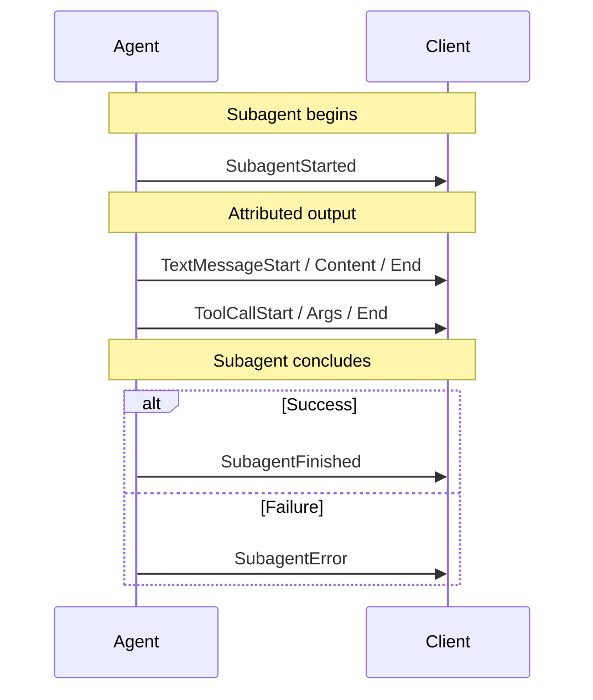

# 子智能体

许多智能体框架都允许智能体把工作委派给子智能体——主管（supervisor）分发研究任务、“智能体即工具”模式（工具调用*就是*一个嵌套的智能体），或者规划器把子任务并行外包出去。

对前端而言，这一切都作为一股事件流到达。没有额外信息就无法分辨某条消息出自哪个子智能体，三个并发的调研智能体就会渲染成一堵无法区分的文字墙。

AG-UI 的子智能体支持恰好解决这个问题，也仅此而已：它把每个事件**归属**（attribute）到产出它的子智能体，并报告子智能体何时开始与结束。它不做编排、不做调度，也不定义子智能体——这些完全留给框架。

## `subagentRunId` 标识一次调用，而非一个定义

这是最需要理解的一点，也是最容易搞错的一点。

`subagentRunId` 是子智能体**一次调用的不透明句柄**。同一个子智能体运行两次，会得到两个不同的值。它不是可复用子智能体定义的稳定标识符，也不是名称。

与顶层运行的对称性能让这一区分更清楚：

| 顶层                                     | 子智能体                                            |
| ---------------------------------------- | --------------------------------------------------- |
| `agentId`——一个配置好的、可复用的智能体 | 子智能体的 `name`——一种可复用的子智能体类型         |
| `runId`——一次调用的生命周期              | `subagentRunId`——一次嵌套调用的生命周期             |

因此：

- **应该**用 `subagentRunId` 作为瞬态 UI 状态的键——例如可折叠分组、加载动画、进度行。
- **不要**用 `subagentRunId` 持久化任何东西并指望它在以后的运行中仍有意义，也不要把同一个子智能体的两次调用视为共享一个值。当你想表达“这是哪种子智能体”时，请用 `name`。
- **一个例外**：以 `outcome: { type: "suspended" }` 结束的子智能体**可以**在恢复运行时复用它的 id。能够把恢复的工作与被挂起的调用关联起来的生产方应当这么做，而客户端必须把之后出现的 `SubagentStarted` 视为一次延续（waiting → running），绝不能当作重复。无法关联的生产方则生成新 id——此时客户端的等待状态通过它所回应的中断 id 来解除，而不是靠 id 复用（见[挂起](#挂起)）。

<Note>
  这个字段在预发布版本中叫 `subagentId`。因为旧名称暗示了可复用的定义，所以改名了。如果你用的是仍叫 `subagentId` 的 `canary` 版本，值的含义完全相同——只是名字变了。
</Note>

## 生命周期事件

三个事件框定子智能体的活动区间。



### SubagentStarted

宣告一次新的子智能体调用，并给出一个 UI 可展示的名称。

| 属性                  | 说明                                                            |
| --------------------- | --------------------------------------------------------------- |
| `subagentRunId`       | 本次调用的不透明 id。必填                                       |
| `name`                | 子智能体声明的类型或名称，用于展示。必填                        |
| `description`         | 可选的人类可读描述                                              |
| `parentSubagentRunId` | 可选——外层子智能体（子智能体嵌套时）                            |
| `parentToolCallId`    | 可选——派生出该子智能体的工具调用                                |
| `parentMessageId`     | 可选——承载该工具调用的消息                                      |

`parentToolCallId` 与 `parentMessageId` 为“智能体即工具”模式而生。它们让客户端能把子智能体关联到创建它的那次调用——例如把子智能体的输出渲染在工具调用卡片内——而不必去检查 `rawEvent`。

### SubagentFinished

为本次运行关闭该子智能体调用的事件流片段。

| 属性            | 说明                                                    |
| --------------- | ------------------------------------------------------- |
| `subagentRunId` | 与 `SubagentStarted` 中的 id 一致。必填                 |
| `result`        | 可选的完成负载，对应 `RunFinished.result`               |
| `outcome`       | 可选的类型化结果，对应 `RunFinished.outcome`：`{ type: "success" }` 或 `{ type: "suspended", interruptIds?: [...] }`。缺省表示成功 |

#### 挂起

子智能体可以在任务中途暂停，等待外部输入——比如它内部触发了一次需要人类批准的请求。此时运行会以中断结果结束（见[中断](/concepts/interrupts)），而且由于每个已启动的子智能体都必须在 `RunFinished` 之前关闭，被暂停的子智能体仍会发出 `SubagentFinished`——只是带着 `outcome: { type: "suspended" }`，UI 因此可以渲染“等待中”而不是“已完成”。`interruptIds` 指明该子智能体直接拥有的运行级中断（每个这样的 `Interrupt` 也带有指回 `subagentRunId` 的反向引用）；如果某个祖先是因为*后代*中断而被挂起，它的这个字段可以为空或省略。

挂起是 `subagentRunId` 唯一可以有意跨越多次运行的情形——双方各有不同的义务：

- **客户端必须接受**后续运行中复用被挂起调用 id 的 `SubagentStarted`，并将其视为*延续*——把现有分组从“等待中”切回“运行中”，绝不渲染重复项。
- **生产方在能够关联时应复用 id**，把恢复的工作与被挂起的调用对应起来。LangGraph 集成就是这么做的：它的 id 派生自检查点任务标识，能在暂停中存续。复用正是让客户端无缝接续分组的关键。
- **无法关联的生产方生成新 id**，这也是合法的。客户端的等待状态不会悬空：被挂起结果的 `interruptIds` 与客户端自己发送的恢复条目共同指明哪些审批已得到回应，因此即使旧 id 下没有延续到来，等待徽标也能据此解除。

### SubagentError

标志一次子智能体调用失败。

| 属性            | 说明                                            |
| --------------- | ----------------------------------------------- |
| `subagentRunId` | 与 `SubagentStarted` 中的 id 一致。必填         |
| `message`       | 人类可读的错误信息。必填                        |
| `code`          | 可选的错误码                                    |

## 归属

除生命周期事件外，大多数事件还可以携带可选的 `subagentRunId`，说明它们由谁产出。

没有 `subagentRunId` 的事件归属于父智能体。归属是增量式的：从不设置该字段的事件流，行为与子智能体支持出现之前完全一致。

归属也可以独立成立。生产方可以只给事件打标，而完全不发出 `SubagentStarted` / `SubagentFinished`——这足以让 UI 按产出方分组输出，而不必承诺报告生命周期。客户端必须接受从未被宣告过的标识符；见[客户端强制执行的规则](#客户端强制执行的规则)。

**可以携带归属的事件**：文本消息家族、工具调用家族、活动事件、推理家族、步骤事件、状态事件，以及 `Raw`/`Custom`。

**不能携带归属的事件**：`RunStarted`、`RunFinished`、`RunError`——它们描述的是运行整体——以及 `MessagesSnapshot`，后者改为按消息携带归属，因为一份快照会混合来自多个产出方的消息。

### 归属是来源，不是所有权

这一区分在状态事件上最为要紧，值得直白地说清楚。

`StateSnapshot` 与 `StateDelta` 可以携带归属。其上的归属记录的是**这次更新由哪个子智能体产出**——并不意味着该子智能体拥有自己的状态。AG-UI 的状态以运行（run）为作用域：一次运行只有一份状态文档，带归属的快照或增量同样应用到这份文档上。这个标记是你可以展示出来的来源信息（“调研智能体更新了共享草稿区”），不是一个独立的作用域。

这正是归属在其他独立事件上所承载的含义。没有人会把一个带归属的 `Custom` 事件理解为子智能体拥有私有自定义事件，状态也是如此。

<Warning>
  不存在按子智能体划分的状态。如果你给快照打上归属，指望父级状态不受影响，那它一定会受影响——快照与任何快照一样，会替换本次运行的状态。如果需要把各子智能体的数据分开，请在运行状态内部使用不同的键。
</Warning>

请注意，生产方从不*被强制*给状态打归属。有些就不这么做：例如 LangGraph 集成在子智能体活跃期间不发出状态，因为它的状态只有一份共享文档，委派中途的快照会带上残缺的视图。这是合理的生产方侧选择，不是协议要求。

### 归属会传递到消息

当带归属的事件创建出一条消息时，`subagentRunId` 会传递到那条消息上。正因如此，渲染层无需重放事件流就能按子智能体给对话分组——消息自身携带自己的来源，并且跨轮次、跨快照保持不变。

### 工具结果携带自己的归属

`ToolCallResult` 的归属独立于它所回应的那次调用，这是有意为之而非疏漏：*执行*工具调用的一方可能与*请求*这次调用的子智能体不同。由前端执行的工具，或主管代表子智能体运行的调用，产出的结果其所有者都不是调用方。若继承调用方的归属，就会误报这些情况，所以每个结果都声明自己的归属。

## 嵌套与并发

子智能体可以嵌套。`SubagentStarted` 上的 `parentSubagentRunId` 把子级链接到它的外层子智能体；没有父链接的子智能体则直接属于本次运行。

子智能体还会**并发**运行，这正是区分“能用的实现”与“看似能用的实现”的地方。三个子智能体同时流式输出时，它们的事件会交错到达，归属是消除歧义的唯一手段。尤其要注意：

- 两个子智能体可能同时各有一条未关闭的文本消息。客户端必须分别独立跟踪，而不是假设同一时刻只有一条打开的消息。
- 一个子智能体的 `SubagentFinished` 只关闭它自己打开的流，绝不会关闭兄弟节点或父级的。
- 父级可能先于子级结束。因此 `parentSubagentRunId` 可能指向一个已经结束的子智能体，这是合法的。

### 并发与 chunk 简写

`TextMessageChunk` / `ToolCallChunk` / `ReasoningMessageChunk` 事件是一种简写：客户端会合成 START/CONTENT/END 边界，省略 id 的 chunk 表示“与上一个相同”。在并发场景下，“上一个”只有**在单个子智能体范围内**才有意义——因此这种简写只在发送方子智能体自己的流内解析，不跨越整个运行。

对生产方而言，实践结论是一条规则：既不带 id 也不带 `subagentRunId` 的 chunk，若存在父级的同类打开流，就解析到父级——不打标就意味着父级——否则解析到唯一的同类打开流。当多个子智能体的流都可能认领它时，没有任何依据可以解析，客户端会直接拒绝而不是猜测。**并发流式输出时，请给每个 chunk 打上归属**，或者重复携带 id。

## 客户端强制执行的规则

下面每条规则都*以相应事件存在为前提*。只打归属本身就是子智能体支持的一种完整、合法的用法，因此这里没有任何一条要求事件流必须发送生命周期事件。

- `SubagentFinished` 与 `SubagentError` 指名的必须是当前活跃的子智能体，而且一个子智能体在一次运行内不会被启动两次。生命周期事件必须带有 schema 要求的字段（三者都要有 `subagentRunId`，`SubagentStarted` 要有 `name`，`SubagentError` 要有 `message`）——即使对于绕过线级 schema 校验的进程内生产方，客户端也会强制这一点。
- 延续与关闭事件必须与实体创建时的所有者一致。一个子智能体打开的文本消息，不能由另一个子智能体来延续。
- 所有权也通过重放的历史确立：`MessagesSnapshot` 中的消息（以及它携带的每个工具调用）归它所带的 `subagentRunId` 所有——缺省即父级——此后若有事件以不同所有者重新打开该 id，会被拒绝，与出现冲突的第二个开启者同样处理。
- 工具调用归属于其 `parentMessageId` 所指的助手消息。`ToolCall` 本身没有归属字段，因此如果 `ToolCallStart` 显式给出的 `subagentRunId` 与那条消息的所有者不一致，它就无法被如实表示，会被拒绝；不打标的工具调用则继承父消息的所有者。
- 步骤以打开它的智能体为作用域：子智能体不能关闭父级的步骤，也不能关闭兄弟的步骤。
- 每个已启动的子智能体都必须在 `RunFinished` 之前关闭。

以下几项被有意**不**强制，因为协议并不要求它们：

- **用于归属的 `subagentRunId` 不必曾被启动过**。只打归属而不发生命周期事件是一种受支持的模式，因此客户端不得把未宣告过的标识符当作错误。UI 应按看到的任何 id 分组，在没有 `name` 时退回用 id 标示。
- `parentSubagentRunId` 只需要指向一个*曾启动过*的子智能体，不必仍然活跃——父级先于子级结束是正当的情况。
- 归属到已结束子智能体的事件会被接受。延续事件即使在该子智能体结束后，仍带着它所属子智能体的标记。
- 只要求在 `RunFinished` 之前关闭，而不要求在 `RunError` 之前。未关闭的子智能体正是运行被中止时的预期形态。
- 带归属的状态事件会被接受。生产方选择在委派中途不发这类事件，是生产方侧的决定，不是规则——见[归属是来源，不是所有权](#归属是来源不是所有权)。

## 兼容性

<Warning>
  **旧客户端会直接拒绝这些生命周期事件**。归属是增量且安全的——`subagentRunId` 只是一个未知的*字段*，客户端可以容忍——但 `SubagentStarted`、`SubagentFinished` 与 `SubagentError` 是未知的*事件类型*，比子智能体支持更早的客户端会在解码阶段、在任何应用代码运行之前就栽在上面。客户端侧没有任何办法把它们过滤掉。

  如果你的部分消费方早于子智能体支持出现，生产方不得向它们发出这些生命周期事件。
</Warning>

两个方向并不对称，值得分开来说。

### 新智能体对接旧客户端

生命周期事件会弄垮旧客户端，因此发出它们必须**由生产方显式开启**。支持子智能体的集成因此都暴露一个开关，默认关闭——在 LangGraph 集成中就是 `subagent_visibility`：

```python
agent = LangGraphAgent(
    name="my-agent",
    graph=graph,
    subagent_visibility="attributed",
)
```

这个值描述客户端会看到什么。`"inline"`（默认）不发出任何生命周期事件，也不发出 `subagentRunId`，任何与子智能体相关的东西都不会进入 `MessagesSnapshot`——事件流与子智能体支持出现之前完全一样，包括子智能体自己的文本以父级工作的面貌到达。`"attributed"` 发出本文描述的完整表面。`"hidden"` 则完全压制子智能体的内部流：客户端只看到父级的派生工具调用、它的结果，以及父级自己的回复。等所有消费方都足够新之后，再打开 `"attributed"`。

只打归属是更安全的中间步骤，因为这个字段会被不认识它的客户端忽略。想要分组效果又不想破坏兼容性的生产方，可以只给事件打归属，完全跳过生命周期事件。

### 新客户端对接旧智能体

这种情况自动处理。TypeScript 客户端会根据智能体上报的版本插入一个兼容垫片（shim），而且它在**两个**方向上都生效。

- **客户端 → 智能体**。垫片会从发出的输入消息中剥离 `subagentRunId`，旧智能体因此不会收到自己无法解读的归属。这是承重的一半：重放的消息历史，或由更新版客户端写入的已存线程，确实可能带着这个字段。
- **智能体 → 客户端**。垫片还会丢弃 `SubagentStarted`、`SubagentFinished` 与 `SubagentError`，并从其余每个事件中剥离 `subagentRunId`（包括 `MessagesSnapshot` 中的消息和 `RunStarted` 的输入回显）。这是防御性的规范化，而不是翻译——上报了子智能体支持之前版本的智能体本就不该发出这些东西，所以它真正防的是混合或经代理的管道。

第二个方向的后果值得了解：处于这个垫片之后的消费方看到的是**被拉平、无归属的事件流**，即使上游确实打了归属。如果你希望归属能到达你的 UI，智能体就必须上报一个支持子智能体的版本。

## 支持情况

| SDK        | 状态                                                          |
| ---------- | ------------------------------------------------------------- |
| TypeScript | 事件、归属、校验、订阅者钩子、protobuf                        |
| Python     | 事件与归属                                                    |
| .NET       | 事件、归属、校验、protobuf                                    |

二进制 protobuf 传输层在 TypeScript 与 .NET 上都承载子智能体归属，且由同一份 schema 生成，因此带子智能体归属的事件流可以跨语言往返而不丢失。

### 已知限制

- **protobuf 只覆盖一部分事件类型**。36 种事件类型中有 19 种有 protobuf 映射：全部三个子智能体事件，加上文本消息、工具调用 start/args/end、状态、步骤与运行家族，以及 `MessagesSnapshot`、`Raw` 和 `Custom`。其余的根本无法编码——其中好几种恰恰携带归属：`ToolCallResult`、推理家族与活动事件。chunk 简写也无法编码：`TextMessageChunk` 与 `ToolCallChunk` 有携带 `subagent_run_id` 的消息定义，却没有可选的 `EventType` 枚举项，而 `ReasoningMessageChunk` 干脆没有 proto 消息。这些问题全部早于子智能体支持。
- **.NET 在来自不同子智能体的并行工具调用上会丢失第二个所有者**。把一次运行转换成 `Microsoft.Extensions.AI` 消息时，相邻的工具调用会合并进同一个 `ChatMessage`，而 AG-UI 按消息归属，于是只有第一个所有者存活下来。这是当前的实现限制，而非本质冲突——提供方的约束只是相邻性，交错排列同样能满足，同时保留归属。

## 另见

- [事件](/concepts/events)——完整的事件目录，包括子智能体事件
- [消息](/concepts/messages)——归属如何呈现在消息上
- [状态](/concepts/state)——状态为何以运行（run）为作用域
