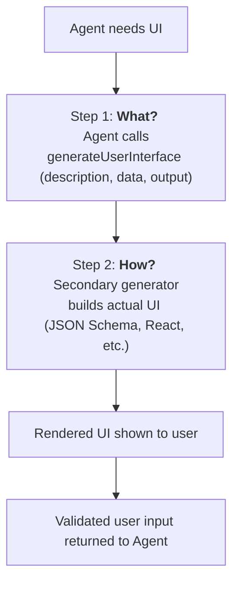

# 生成式用户界面

## 摘要

### 问题陈述

目前，为智能体交互创建自定义用户界面，需要程序员定义特定的工具渲染器。这限制了智能体驱动应用的灵活性与适应能力。

### 动机

本草案描述了 AG-UI 的一项扩展，用于实现**生成式用户界面**——由人工智能直接产出的界面，无需程序员定义自定义工具渲染器。关键思路是利用我们向智能体发送客户端侧工具的能力，从而让所有 AG-UI 支持的智能体框架都能获得这一能力。

## 状态

- **状态**：草案
- **作者**：Markus Ecker (mail@mme.xyz)

## 挑战与限制

### 工具描述长度

OpenAI 对工具描述强制执行 1024 字符的限制。Gemini 与 Anthropic 则没有此限制。

### 参数 JSON Schema 的限制

类、嵌套、`$ref` 与 `oneOf` 在各家 LLM 提供商之间无法得到可靠支持。

### 上下文窗口方面的考量

向智能体注入大体量的 UI 描述语言可能降低其表现。专门用于 UI 生成的智能体，比把 UI 生成与其他任务混在一起的智能体表现更好。

## 详细规范

### 两步生成流程



### 第一步：生成什么？

向智能体注入一个轻量工具：

**工具定义**：

- **名称**：`generateUserInterface`
- **参数**：
  - **description**：对 UI 的高层描述（例如 _"一个用于输入用户地址的表单"_）
  - **data**：用于生成 UI 的任意预填数据
  - **output**：智能体期望用户回交数据的描述或 schema（字段、必填/可选、类型、约束）

**工具调用示例**：

```json
{
  "tool": "generateUserInterface",
  "arguments": {
    "description": "A form that collects a user's shipping address.",
    "data": {
      "firstName": "Ada",
      "lastName": "Lovelace",
      "city": "London"
    },
    "output": {
      "type": "object",
      "required": [
        "firstName",
        "lastName",
        "street",
        "city",
        "postalCode",
        "country"
      ],
      "properties": {
        "firstName": { "type": "string", "title": "First Name" },
        "lastName": { "type": "string", "title": "Last Name" },
        "street": { "type": "string", "title": "Street Address" },
        "city": { "type": "string", "title": "City" },
        "postalCode": { "type": "string", "title": "Postal Code" },
        "country": {
          "type": "string",
          "title": "Country",
          "enum": ["GB", "US", "DE", "AT"]
        }
      }
    }
  }
}
```

### 第二步：如何生成？

把 UI 生成委托给第二个 LLM 或智能体：

- CopilotKit 用户始终保持掌控：可以制作自己的生成器、添加自定义库、附加额外提示词等。
- 工具被调用时，第二个模型会消费 `description`、`data` 与 `output` 来生成用户界面
- 该模型只专注于 UI 生成，确保最大的保真度与一致性
- 生成方式可以按需更换（例如 JSON、HTML 或其他可渲染格式）
- UI 格式描述不受结构或长度约束，允许任意复杂的规格说明

## 实现示例

### 示例输出：UISchemaGenerator

```json
{
  "jsonSchema": {
    "title": "Shipping Address",
    "type": "object",
    "required": [
      "firstName",
      "lastName",
      "street",
      "city",
      "postalCode",
      "country"
    ],
    "properties": {
      "firstName": { "type": "string", "title": "First name" },
      "lastName": { "type": "string", "title": "Last name" },
      "street": { "type": "string", "title": "Street address" },
      "city": { "type": "string", "title": "City" },
      "postalCode": { "type": "string", "title": "Postal code" },
      "country": {
        "type": "string",
        "title": "Country",
        "enum": ["GB", "US", "DE", "AT"]
      }
    }
  },
  "uiSchema": {
    "type": "VerticalLayout",
    "elements": [
      {
        "type": "Group",
        "label": "Personal Information",
        "elements": [
          { "type": "Control", "scope": "#/properties/firstName" },
          { "type": "Control", "scope": "#/properties/lastName" }
        ]
      },
      {
        "type": "Group",
        "label": "Address",
        "elements": [
          { "type": "Control", "scope": "#/properties/street" },
          { "type": "Control", "scope": "#/properties/city" },
          { "type": "Control", "scope": "#/properties/postalCode" },
          { "type": "Control", "scope": "#/properties/country" }
        ]
      }
    ]
  },
  "initialData": {
    "firstName": "Ada",
    "lastName": "Lovelace",
    "city": "London",
    "country": "GB"
  }
}
```

### 示例输出：ReactFormHookGenerator

```tsx
import React from "react"
import { useForm } from "react-hook-form"
import { z } from "zod"
import { zodResolver } from "@hookform/resolvers/zod"

// ----- Schema (contract) -----
const AddressSchema = z.object({
  firstName: z.string().min(1, "Required"),
  lastName: z.string().min(1, "Required"),
  street: z.string().min(1, "Required"),
  city: z.string().min(1, "Required"),
  postalCode: z.string().regex(/^[A-Za-z0-9\\-\\s]{3,10}$/, "3–10 chars"),
  country: z.enum(["GB", "US", "DE", "AT", "FR", "IT", "ES"]),
})
export type Address = z.infer<typeof AddressSchema>

type Props = {
  initialData?: Partial<Address>
  meta?: { title?: string; submitLabel?: string }
  respond: (data: Address) => void // <-- called on successful submit
}

const COUNTRIES: Address["country"][] = [
  "GB",
  "US",
  "DE",
  "AT",
  "FR",
  "IT",
  "ES",
]

export default function AddressForm({ initialData, meta, respond }: Props) {
  const {
    register,
    handleSubmit,
    formState: { errors },
  } = useForm<Address>({
    resolver: zodResolver(AddressSchema),
    defaultValues: {
      firstName: "",
      lastName: "",
      street: "",
      city: "",
      postalCode: "",
      country: "GB",
      ...initialData,
    },
  })

  const onSubmit = (data: Address) => {
    // Guaranteed to match AddressSchema
    respond(data)
  }

  return (
    <form onSubmit={handleSubmit(onSubmit)}>
      {meta?.title && <h2>{meta.title}</h2>}

      {/* Section: Personal Information */}
      <fieldset>
        <legend>Personal Information</legend>

        <div>
          <label>First name</label>
          <input {...register("firstName")} placeholder="Ada" autoFocus />
          {errors.firstName && <small>{errors.firstName.message}</small>}
        </div>

        <div>
          <label>Last name</label>
          <input {...register("lastName")} placeholder="Lovelace" />
          {errors.lastName && <small>{errors.lastName.message}</small>}
        </div>
      </fieldset>

      {/* Section: Address */}
      <fieldset>
        <legend>Address</legend>

        <div>
          <label>Street address</label>
          <input {...register("street")} />
          {errors.street && <small>{errors.street.message}</small>}
        </div>

        <div>
          <label>City</label>
          <input {...register("city")} />
          {errors.city && <small>{errors.city.message}</small>}
        </div>

        <div>
          <label>Postal code</label>
          <input {...register("postalCode")} />
          {errors.postalCode && <small>{errors.postalCode.message}</small>}
        </div>

        <div>
          <label>Country</label>
          <select {...register("country")}>
            {COUNTRIES.map((c) => (
              <option key={c} value={c}>
                {c}
              </option>
            ))}
          </select>
          {errors.country && <small>{errors.country.message}</small>}
        </div>
      </fieldset>

      <div>
        <button type="submit">{meta?.submitLabel ?? "Submit"}</button>
      </div>
    </form>
  )
}
```

## 实现注意事项

### 客户端 SDK 变更

TypeScript SDK 新增内容：

- 新的 `generateUserInterface` 工具类型
- 支持可插拔生成器的 UI 生成器注册表
- 针对生成 UI schema 的校验层
- 处理用户提交数据的响应处理器

Python SDK 新增内容：

- 支持 UI 生成工具的调用
- schema 校验工具
- UI 定义的序列化

### 对集成的影响

- 所有 AG-UI 集成无需修改即可利用这一能力
- 框架发出标准工具调用，由客户端处理 UI 生成
- 向后兼容现有的基于工具的 UI 方案

## 用例

### 动态表单

智能体可以基于会话上下文即时生成表单，无需预先定义的 schema。

### 数据可视化

生成与所讨论数据相称的图表或表格。

### 交互式工作流

创建贴合用户需求的多步骤向导或引导式流程。

### 自适应界面

根据用户偏好或设备能力生成不同的 UI 布局。

## 测试策略

- 针对工具注入与调用的单元测试
- 使用多个 UI 生成器的集成测试
- 演示各类 UI 的端到端测试
- 比较单步与两步生成的性能基准测试
- 跨提供商兼容性测试

## 参考资料

- [AG-UI 工具文档](/concepts/tools)
- [JSON Schema](https://json-schema.org/)
- [React Hook Form](https://react-hook-form.com/)
- [JSON Forms](https://jsonforms.io/)
