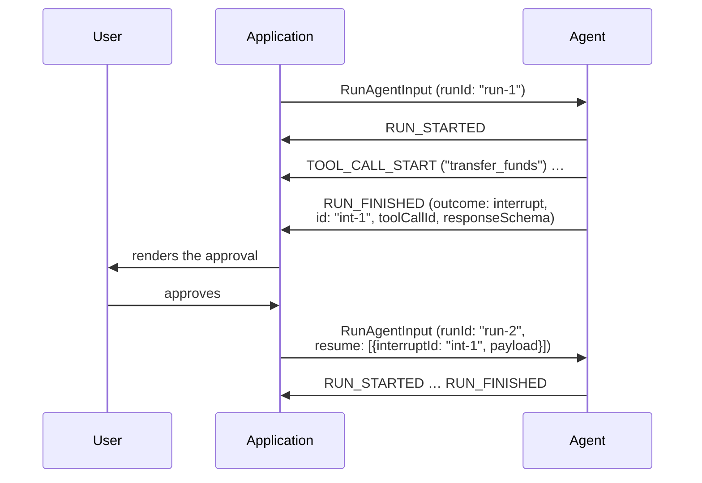

一次运行有时需要只有外部世界才能给的东西——一项批准、一份凭据、一个选择。协议没有从消费者到运行的中途通道，因此运行不等：它结束，说明自己在等待什么，而延续它的那次运行携带答案。

## 中断

需要外部输入的运行以 `RUN_FINISHED` 结束，其 `outcome` 为 interrupt outcome，携带一个或多个 `Interrupt` 对象——至少一个，因为没有任何东西可应答的 interrupt outcome 会让消费者无事可做。

- 生产者 MUST NOT 把被中断的运行报告为成功：interrupt outcome 是结束一次停下来*发问*的运行的唯一符合规范的途径——生产者指名自己在等待什么，resume 条目来应答它。因调用[前端工具](/spec/1.0/events/tool-calls#前端工具)而停止的运行是另一条寻常路径：它以 success 结束，在 success outcome 的 `pendingToolCallIds` 中列名未应答的调用，答案搭下一次输入的消息过来。因*被叫停*而停止的运行两者都不是：它以 [cancelled outcome](/spec/1.0/events/lifecycle#被取消的运行) 结束，什么也不要。
- 每个中断的 `id` MUST 在运行内唯一；resume 条目以这个 id 应答它。
- 中断的 `reason` 是开放字符串——协议不打算对智能体需要输入的每一种原因都做分类。`message` 是给应答者看的人类可读提示词；`toolCallId` 指名批准所涉及的工具调用；`responseSchema` 描述答案应有的形态，以不透明方式承载，让消费者可以据此构建表单。
- 在子智能体内部引发的中断 MAY 携带该子智能体的 `subagentRunId`；归因与随之而来的 suspended outcome 由[子智能体规则](/spec/1.0/events/subagents)管辖。

被中断的运行是一次已关闭的运行。[运行生命周期](/spec/1.0/events/lifecycle)关于已关闭运行所说的一切都适用——包括它容许的唯一一个迟到者：报告关闭之后才暴露的失败的 `RUN_ERROR`——而继续就意味着一次新运行。

## 恢复

延续的运行把答案放进输入的 `resume` 列表，每个被应答的中断对应一个 `ResumeEntry`：

- 每个条目的 `interruptId` MUST 指名一次来自被延续运行的中断——线程上最近一次被中断的运行。
- 条目的 `status` 说明中断是被应答还是被放弃；`payload` 携带智能体请求的答案，可为任意 JSON 值；`metadata` 是关于该响应的信封信息，不是答案的一部分。
- resume 列表 MUST 覆盖被延续运行的每一个中断：每个中断要么被应答，要么由携带 abandoned 状态的条目显式放弃。省略不是放弃。覆盖是*消费者*一方必须执行的规则：手中握着关闭用的 `RUN_FINISHED` 所交付的中断、又是它来组装 resume 列表的，正是消费者，所以它是唯一总能判断列表是否完整的参与者。消费者 MUST 在运行开始之前——在任何东西发出之前——拒绝让某个中断未被覆盖的恢复输入，也 MUST NOT 在自己没有对应条目的中断上悄然继续。协议不要求生产者检查这一点，它也无需为符合规范而保留被中断运行的任何东西；而有缺陷的消费者真发了不完整列表时生产者怎么办，属于它的错误处理，见下文。被放弃的中断对智能体的工作意味着什么，是生产者的事。
- `expiresAt` 有意不约束格式，因此一个中断*是否*已过期，由作判断的消费者自行解读——参考实现把它当日期读，并把当前时刻及更早视为已过期。规则附着在判断上，而不是附着在 schema 拒绝规定格式的解析上：被消费者判定为已过期的中断不再能被*应答*——消费者会在运行开始前拒绝解析它的 resume 条目，一如拒绝未覆盖的中断。它仍然可以——并且，既然覆盖是强制性的，就必须——被放弃，这就是线程越过无人及时应答的中断的方式。
- 线程与状态的连续性跨越这道鸿沟依然成立：恢复的运行携带相同的 `threadId`、累积的消息，以及被中断运行留下的状态，与任何[顺序运行](/spec/1.0/events/lifecycle)完全一样。
- token 用量不跨鸿沟携带：恢复运行的 `usage` [只覆盖](/spec/1.0/events/lifecycle#token-用量)它自己发起的模型调用。被中断的运行已在打断它的那次 `RUN_FINISHED` 上报告了自己的用量。

收到 resume 条目的生产者，把它们当作自己停下来等待的那些答案。这份列表是消费者对"作出了哪些决定"的完整陈述，生产者照单全收：它无须记住上一次运行的中断，无须把列表与之对照，也无须为此在任何两次运行之间保存状态。跨鸿沟什么都不带的生产者是符合规范的。

尽管如此，消费者规则的两种违例仍可能到达生产者。下面是生产者对它们的错误处理，而不是发送它们的许可。

- **无法识别的条目**——指名生产者并未引发的中断：运行 SHOULD 在没有该条目的情况下继续，生产者 SHOULD 暴露警告，而不是为一份自己从未索要的答案让运行失败。

- **未覆盖的中断**——生产者能判断它仍未解决且没有对应条目，或是因为它保留了被中断运行的检查点，或是因为消息里有一个既无结果、也没有条目应答它的需批准工具调用。
  生产者 MUST NOT 凭一条缺席的条目就执行被中断的操作，也 MUST NOT 把缺席当作放弃——带着警告丢掉调用、以 success 收尾，会让有缺陷的消费者放弃没有任何人决定放弃的东西，而这正是覆盖规则要防止的结果。注意到了，生产者就让这个中断保持开启。它 MAY 在运行开始前拒绝输入，如同对待任何无效输入（以 `RUN_ERROR` 开场的流，或传输层对请求本身的拒绝）；或者它 MAY 在被覆盖条目允许的范围内运行，然后再次以 interrupt outcome 结束，携带仍未解决的中断，让消费者再得到一次应答的机会。无论哪种方式，只要生产者知道某个中断仍开着而无人应答，运行就 MUST NOT 以 success 结束。无法判断的生产者——上文的无状态情形——在此没有义务，因为它无从注意。

## 消息流

## 数据类型

[`RunFinishedInterruptOutcome`](/spec/1.0/schema#runfinishedinterruptoutcome)、[`Interrupt`](/spec/1.0/schema#interrupt) 与 [`ResumeEntry`](/spec/1.0/schema#resumeentry) 由 [schema 参考](/spec/1.0/schema)定义。`expiresAt` 若给出，按惯例携带 ISO 8601 时间戳；schema 有意不约束其格式。

## 错误处理

携带中断的 success outcome 是一个自相矛盾，schema 已经拒绝它——success outcome 是封闭的。出现在并未延续被中断运行的那次运行上的 resume 列表什么也回答不了；生产者把它的条目当作无法识别的内容处理，如上文所述。
