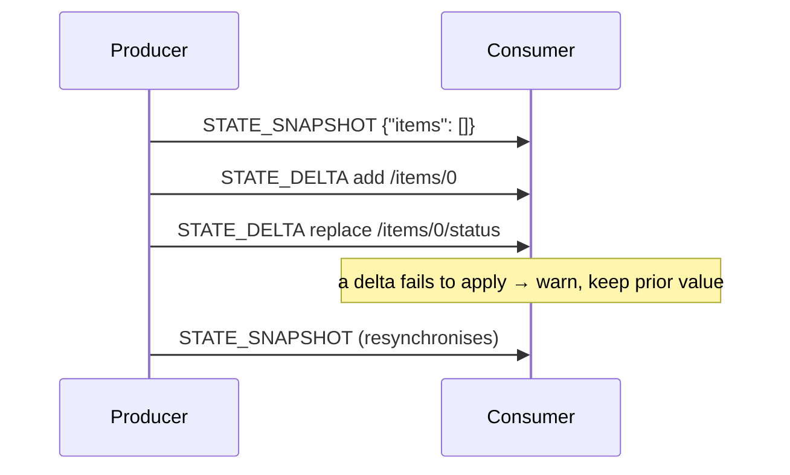

生产者报告的东西里，有一些不是文本流，而是会演化的值：智能体的状态、活动的内容、对话本身。它们以**快照**（替换）与**增量**（修订）的形式传输。

使用这个模式的事件族有：[状态](/spec/1.0/events/state)（`STATE_SNAPSHOT`、`STATE_DELTA`，以及对话用的 `MESSAGES_SNAPSHOT`）与[活动](/spec/1.0/events/activity)（`ACTIVITY_SNAPSHOT`、`ACTIVITY_DELTA`）。本页说明它们共有的东西；各事件族页面说明各自替换与修订的对象。

## 快照

快照携带完整的值。消费者 MUST 用快照的内容替换自己手中的副本——快照不是合并——除非快照本身通过其事件族定义的字段选择退出（[活动](/spec/1.0/events/activity)的 `replace: false` 是唯一一例）。它之前的增量全部作废：无论快照被应用还是被搁置，它都是新的基准时刻。

生产者 MAY 随时发送快照，且 SHOULD 在无法保证消费者基准与自己一致时发送一份——发生错误之后、出现了增量无法表达的内容之后，或在延续旧线程的运行开始时。

## 增量

增量修订当前值，以 [RFC 6902](https://datatracker.ietf.org/doc/html/rfc6902) JSON Patch 表达：一组按顺序、原子化应用的操作——任何一个操作失败，文档保持原样。

- 增量作用于消费者的当前值：最后一个快照加上其后所有增量修正后的结果。对状态而言，一次运行起始的值是输入的 `state`，输入[未携带时](/spec/1.0/basic/run-input#state)则为空对象。
- 生产者 MUST NOT 为没有给过消费者基准的值发送增量。什么算基准由事件族决定——状态从输入获得基准，活动则要等它的第一个快照。
- Patch 操作是有意开放的对象：schema 如此标注，RFC 6902 未定义的成员是协议上合法的材料，[处理模型](/spec/1.0/basic/processing) MUST NOT 剥离。

## 补丁不适用时

结构上有效不代表补丁能实际应用：一个格式良好的操作可能指向并不存在的路径，RFC 6902 把这一点留给应用方。格式错误的*操作*——不是数组的补丁、缺失必填成员或携带错误类型成员的操作——是格式错误的已知值，与其他格式错误一样致命。`op` 指名了 RFC 6902 未定义之物的操作不是格式错误，而是无法识别——本消费者发布之后才加入判别联合的成员——适用[处理模型](/spec/1.0/basic/processing)的列表规则：该元素从补丁中丢弃并给出警告，运行存活。而格式良好却应用失败的补丁又是另一种情形：

- 消费者 MUST NOT 保留部分应用的结果——RFC 6902 的应用是原子的。
- 消费者 MUST 把失败暴露出来——一条足以诊断的警告，指明什么失败了、为何失败——并且 MAY 带着先前的值继续，而不让运行失败。
- 失败的 `test` 操作就是这一情形：补丁不适用，消费者保留先前的值。

从那一刻起，消费者的值可能与生产者的分道扬镳。得知此事、或无法排除此事的生产者，SHOULD 用快照重新同步；消费者 MUST 采纳下一个快照，无论之前跳过了什么——这正是恢复成为可能的原因。

## 消息流

## 数据类型

补丁的形态——[`JsonPatch`](/spec/1.0/schema#jsonpatch)、它的操作、[`JsonPointer`](/spec/1.0/schema#jsonpointer)——由 [schema 参考](/spec/1.0/schema)参照 RFC 6902 定义。
