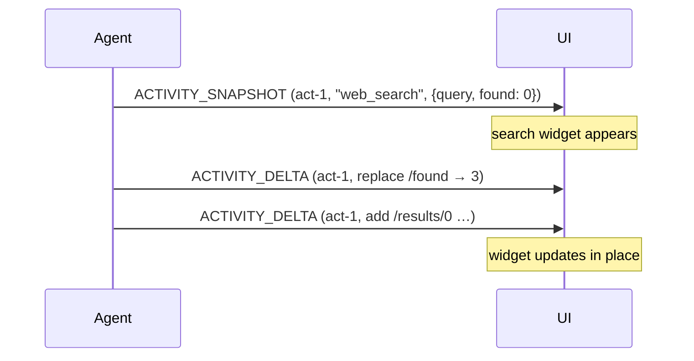

活动是不属于对话内容的结构化进度——一次正在进行的搜索、一张逐渐勾选的清单、一个 UI 渲染为独立组件的步骤。它物化为一条消息，从而在序列中保有自己的位置，但其内容是对象，不是文本。

## 事件

活动绑定[快照–增量模式](/spec/1.0/basic/patterns/snapshots)，以每条活动消息为范围、以 `messageId` 配对。

### `ACTIVITY_SNAPSHOT`

创建或替换一条活动消息。

```json
{
  "type": "ACTIVITY_SNAPSHOT",
  "messageId": "act-1",
  "activityType": "web_search",
  "content": { "query": "…", "found": 3 }
}
```

- `activityType` 是开放字符串：集合由生产者决定，不是协议决定。消费者 MUST 容忍自己不认识的类型。
- 针对消费者未曾见过的 `messageId` 的快照，会创建这条活动消息，序列位置就是它到达之点。
- 针对已有活动的快照会替换其内容与 `activityType`。`replace` 是 OPTIONAL 的；缺省表示替换，这一含义是规范性的。显式的 `replace: false` 要求消费者保持既有消息原样——内容*和* `activityType` 都不动；快照自己的取值只在它创建消息时生效。它不是合并。
- 替换替换的是*内容*，而不是到目前为止累积的元数据——元数据继续按[元数据规则](/spec/1.0/basic/metadata)合并。归因是例外：替换型快照重新铸造该活动，因此消息的 `subagentRunId` 变成快照自己的，包括变为缺省。
- 针对已有活动的 `replace: false` 快照不会重新铸造所有权：已确立的所有者继续有效，快照自己的归因 MUST 与之一致。生产者的义务与[子智能体规则](/spec/1.0/events/subagents)加在流式延续上的相同；消费者的义务则有意更弱——已确立的所有者继续有效，消费者无须拒绝不一致，而流式延续的不一致必须被拒绝。

### `ACTIVITY_DELTA`

以 RFC 6902 补丁修订一条活动消息的内容。增量的 `activityType` 会替换消息的——增量 MAY 给它所修订的活动改类型，无意改类型的增量 MUST 重复当前类型，因为该字段是必填的。

- 生产者 MUST NOT 为自己没有用快照创建过的活动消息发送增量——快照是[该模式](/spec/1.0/basic/patterns/snapshots)要求的基准。
- 指名不存在消息、或非活动消息的增量会被跳过；消费者 SHOULD 暴露警告，且 MUST NOT 让运行失败。
- 打完补丁的结果 MUST 仍是对象：按 schema，`content` 就是对象，生产者 MUST NOT 发送应用之后会让它变成别的东西的补丁——比如根替换。消费者无须检测该违例。
- 补丁失败的处理遵循[该模式](/spec/1.0/basic/patterns/snapshots#补丁不适用时)，重新同步靠同一条 `messageId` 的新快照。

## 对话中的活动消息

活动消息以固定的 `activity` 角色出现在历史中。它是消费者用来渲染的材料，不是智能体据以续接的对话：消费者 MUST 在发送[运行输入](/spec/1.0/basic/run-input)的 `messages` 中剥离活动消息。活动消息如何在 `MESSAGES_SNAPSHOT` 中存活，由那个[事件](/spec/1.0/events/state#messages_snapshot)的页面规定。

## 消息流



## 数据类型

[`ActivitySnapshotEvent`](/spec/1.0/schema#activitysnapshotevent)、[`ActivityDeltaEvent`](/spec/1.0/schema#activitydeltaevent) 与 [`ActivityMessage`](/spec/1.0/schema#activitymessage) 由 [schema 参考](/spec/1.0/schema)定义。[`ActivityMessage`](/spec/1.0/schema#activitymessage) 独立定义而不组合基础消息，因为它的 content 是对象而非字符串。

## 错误处理

格式错误的活动事件作为格式错误的已知值处理，是致命的。两个被容忍的失败——针对缺失或非活动消息的增量、以及应用失败的格式良好补丁——如上文所述给出警告并跳过；两者都会让生产者与消费者对该活动可能各执一词，而生产者的下一个快照会修复这一点。
