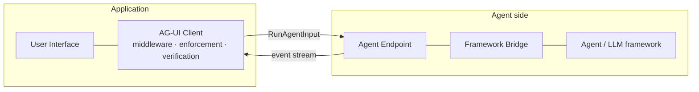
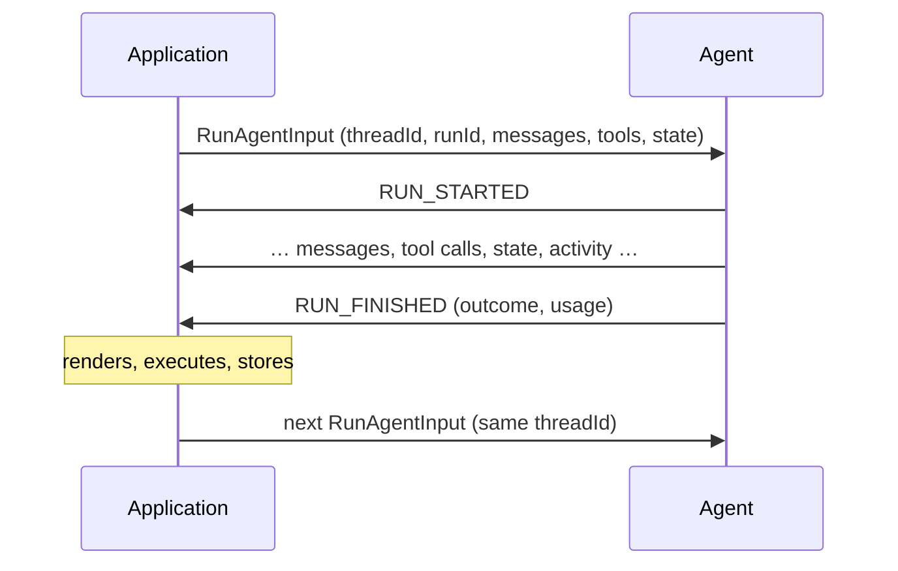

import DraftNotice from "/snippets/draft-notice.mdx";

<DraftNotice />

AG-UI 通过单一通道把智能体连接到面向用户的应用：一条有序的类型化事件流，回应唯一一次请求。用户所见智能体的一切——文本、工具调用、推理、状态、进度——都在这条流里，没有旁路通道。

## 核心组件

### 应用

应用拥有用户。它渲染事件流，执行自己声明过的[工具调用](/spec/draft/events/tool-calls)，维护智能体与之共享的[状态](/spec/draft/events/state)，并决定哪些操作需要用户同意。

### 客户端

客户端是消费者的协议机器，通常是一个 SDK。它发送[运行输入](/spec/draft/basic/run-input)，对返回内容执行[处理管线](/spec/draft/basic/processing)——兼容性翻译、中间件、强制执行、分片（chunk）展开、校验——然后把一条可信任的流交给应用。

### 智能体端点及其桥接器

这是生产者一侧。桥接器（bridge）把框架的原生事件翻译成协议事件；端点则以某种[传输层绑定](/spec/draft/basic/transports)通信。协议不携带任何框架概念，正因如此，一个客户端才能对接任意框架。

### 中间件

中间件是任意一方安装进客户端管线的代码。它在强制执行剥离任何内容**之前**就能看到每个事件，因此兼容性垫片（shim）可以翻译[已退役的形态](/spec/draft/basic/versioning#retired-shapes)，扩展也可以处理当前版本未定义的内容。

## 运行

运行（run）是交互的单元。消费者用一个 `RunAgentInput` 开启一次交换；生产者以事件作答，事件由[运行生命周期](/spec/draft/events/lifecycle)括起——即所请求的那次运行，其前可能还回放了历史；整段对话就是由这样的运行构成的线程，不断累积消息与状态。

## 设计原则

1. **智能体的暴露应当极其容易**。桥接器只做翻译，不做实现：框架发出的任何内容都映射到少数几个事件族上，且一切可选的东西都是可选的。强制面只有运行生命周期，别无其他。

2. **一切可观察的内容都在交换之中**。智能体可见行为的任何信息都不走带外通道：保存这些交换的录制器——每次运行输入与回应它的那些事件——可以重建 UI 在每个时刻所知的内容，这正是协议可测试、可回放、与传输层无关的原因。

3. **宽容的读取方，严格的写入方**。生产者 MUST 只发出 schema 定义过的内容；消费者 MUST 在遇到无法识别的内容时存活下来，剥离它并给出警告，而不是失败。完整的非对称规则——以及为什么已知值的格式错误会被反向处理——见[处理模型](/spec/draft/basic/processing)。

4. **中间件先于强制执行运行**。在任何内容被剥离之前，翻译先得到机会，因此协议可以在不抛弃任何一方的前提下演进：昨天的形态在边界处被翻译，明天的形态则一路透传给认识它们的人。

5. **传输层就是绑定**。语义绝不因线上格式（wire）而异。同样的事件、同样的规则，无论封装为 SSE 文本还是 protobuf 帧——跨实现的一致性由共享的字节测试样例库（fixture corpus）钉死。
