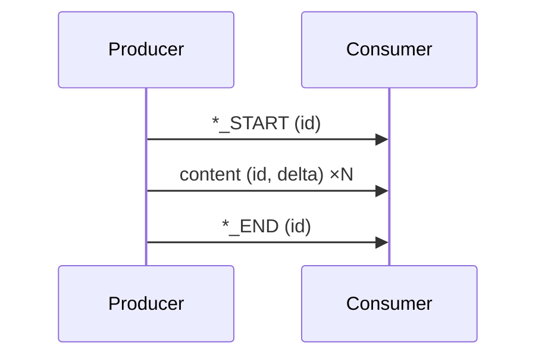
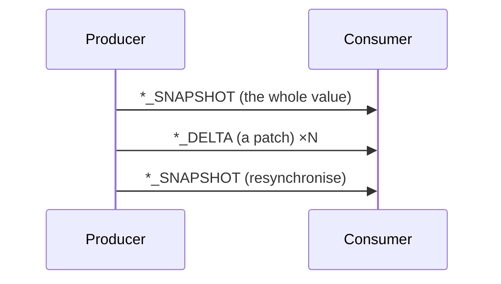
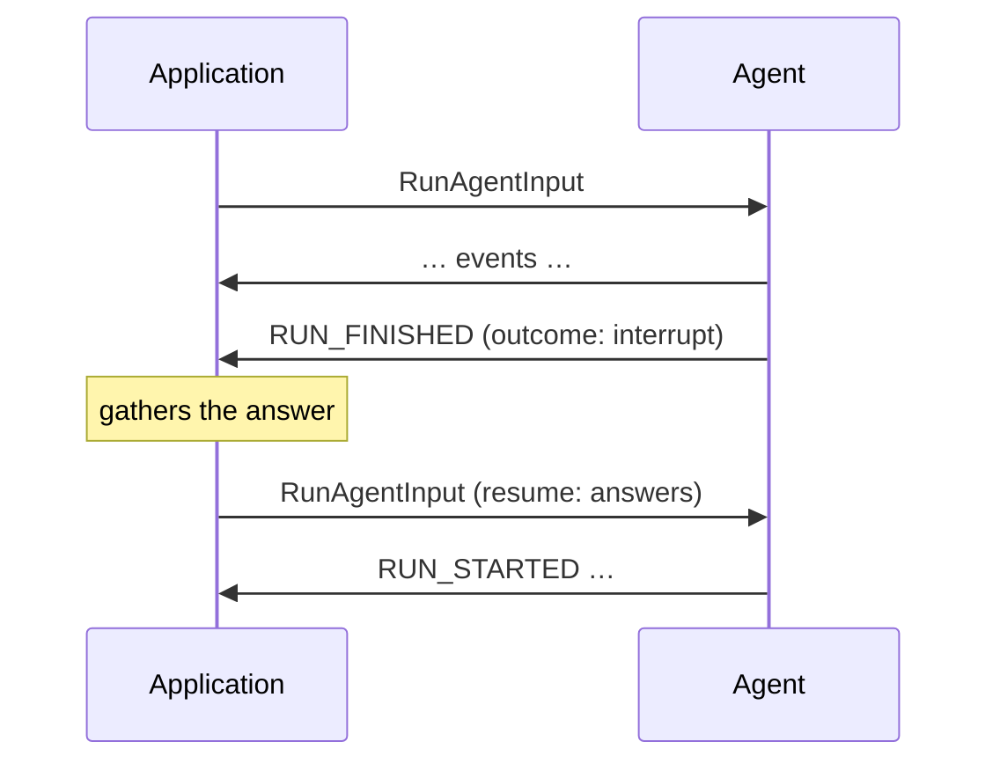

import DraftNotice from "/snippets/draft-notice.mdx";

<DraftNotice />

本页定义核心协议的事件模式：生产者把事件组合成流的种种方式。每种[传输层](/spec/draft/basic/transports)都承载所有这些模式；传输层之间的差别只在事件如何分帧与投递。

协议的方向是固定的。事件从生产者流向消费者；消费者在每次交换中只说一次话——发送开启这次交换的[运行输入](/spec/draft/basic/run-input)。生产者 MUST NOT 要求消费者在运行中途发来任何消息——需要外部输入的运行会结束，答案在下一次运行时到达：或经由一个中断与它的 resume 条目，或经由一个未被应答、而在下一次输入的消息中得到应答的[前端工具调用](/spec/draft/events/tool-calls#frontend-tools)。

## 流式

Long values arrive a piece at a time: a `*_START` opens an item, content
events extend it, a `*_END` closes it — or a chunked shorthand compresses the
three. Text messages, tool calls and reasoning messages all stream this way.

参见[流式消息](/spec/draft/basic/patterns/streaming)。

## 快照与增量

会演化的值——智能体状态、活动、对话本身——以"替换用的快照 + 修订用的增量"承载，增量以 RFC 6902 JSON Patch 表达。

参见[快照与增量](/spec/draft/basic/patterns/snapshots)。

## 中断与恢复

需要外部给出某样东西——一项批准、一个缺失的值——的运行，以 interrupt outcome 结束；从中延续的那次运行把答案放进自己的输入。

参见[中断与恢复](/spec/draft/basic/patterns/interrupt-resume)。

## 新增模式

所有协议特性都由这些模式构建。新增模式的协议修订版在本页定义它。传输层无需改动即可承载新模式，因为模式完全以事件与运行输入来表达。
