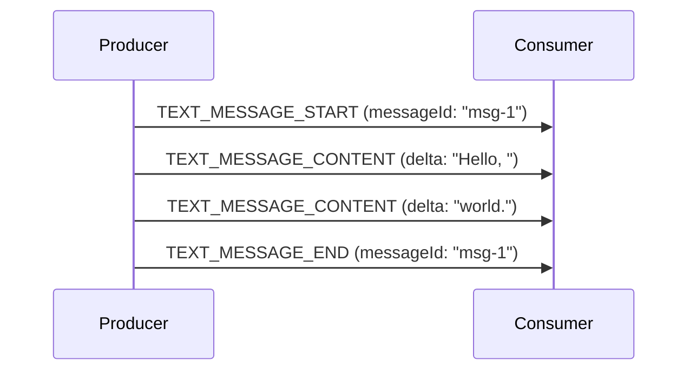
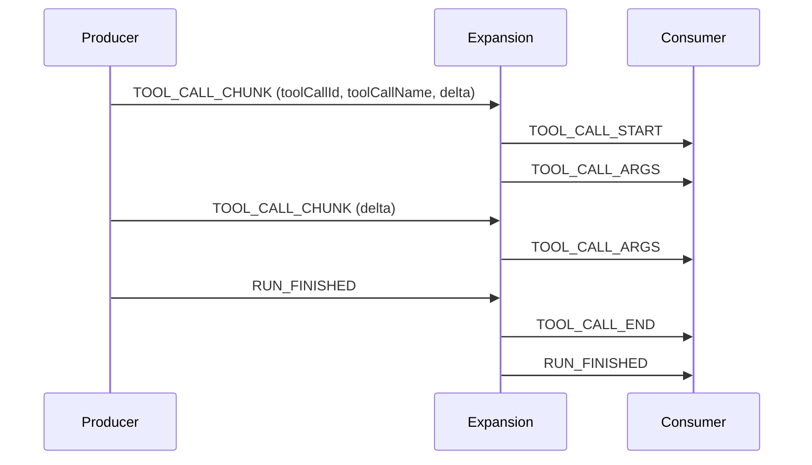

import DraftNotice from "/snippets/draft-notice.mdx";

<DraftNotice />

三个事件族把长的值分片流式传输：文本消息、工具调用与推理消息。三者都遵循同一个模式、有两种写法——显式的**开启–内容–关闭**三连，以及为不得不缓冲的生产者准备的紧凑 **chunk** 形式。本页一次性定义该模式；各事件族页面（[文本消息](/spec/draft/events/text-messages)、[工具调用](/spec/draft/events/tool-calls)、[推理](/spec/draft/events/reasoning)）只补充各自特有的内容。

## 开启、内容、关闭

流式条目由它的 `*_START` 事件开启，由零个或多个 content 事件延展，由它的 `*_END` 事件关闭，全部以条目的标识符配对（消息用 `messageId`，工具调用用 `toolCallId`）。

- 生产者 MUST NOT 开启一个标识符已然开启的条目。
- 生产者 MUST NOT 为未开启的标识符发送 content 或 end 事件。
- 生产者开启的每个条目，MUST 在运行结束之前关闭。

开启事件携带描述该条目的字段；content 事件只携带标识符与一个 `delta`。delta 按到达顺序拼接，构成条目的值。

## 交错

消息、工具调用、推理消息与步骤彼此独立。生产者 MAY 自由交错它们——消息还在流式传输时，一个工具调用 MAY 开启——只要每个条目都遵守自己的开启/关闭纪律。

独立事件（`STATE_SNAPSHOT`、`STATE_DELTA`、`MESSAGES_SNAPSHOT`、`ACTIVITY_SNAPSHOT`、`ACTIVITY_DELTA`、`CUSTOM`、`RAW`、`REASONING_ENCRYPTED_VALUE`）不开启也不关闭自己的任何条目，MAY 出现在一次开启的运行内的任何位置。在 chunk 形式下，它们当中的一些确实会结束一条开启的 chunk 流——它们的到达正是在告诉消费者简写无法再继续——如[关闭 chunk 流](#关闭-chunk-流)所列。

## chunk 形式

`TEXT_MESSAGE_CHUNK`、`TOOL_CALL_CHUNK` 与 `REASONING_MESSAGE_CHUNK` 是三连事件的紧凑写法。消费者 MUST 把它们展开成 start/content/end 形式，且要在校验之前、应用代码之前进行，这样三连事件的每条规则都适用于展开后的事件。展开相对强制执行与中间件的位置由[处理模型](/spec/draft/basic/processing)规定；在所有路径上都成立的不变量是：chunk 按它作为事件的本来面目被裁决——无论哪个阶段先遇到格式错误的 chunk，都拒绝它而不是修复它。

两种写法在同一个条目内不混用。由 chunk 开启的条目以 chunk 形式延续和关闭——它的 `*_END` 是合成的、从不发送——由 `*_START` 开启的条目则以显式事件延续和关闭。携带一条 chunk 流正在组装的标识符的显式事件，不是它的延续：它终止这个简写，如[关闭 chunk 流](#关闭-chunk-流)所述，其后的事件按三连事件的规则裁决——这就使得在同一条目内混用两种形式成为一种生产者 MUST NOT 发出的格式错误序列。

### 首个 chunk

条目的首个 chunk 携带开启它所需的信息；后续 chunk MAY 省略这些字段，延续已开启的条目。

- 一条消息的首个 `TEXT_MESSAGE_CHUNK` MUST 携带 `messageId`。它 MAY 携带 `role`；角色缺省表示 `assistant`，与 `TEXT_MESSAGE_START` 上完全一致。
- 一条消息的首个 `REASONING_MESSAGE_CHUNK` MUST 携带 `messageId`。
- 一次调用的首个 `TOOL_CALL_CHUNK` MUST 同时携带 `toolCallId` 与 `toolCallName`。

消费者 MUST 把缺失必填字段的首个 chunk 视为违反协议，而不是自己捏造一个标识符。

### 延续 chunk

- 携带标识符的后续 chunk，MUST 携带与它正在延续的相同的标识符。指名不同标识符的 chunk 开启一个新条目，前一个先关闭。
- 延续 chunk MAY 重复其开头 chunk 确立过的字段——文本消息上的 `role` 或 `name`，工具调用上的 `toolCallName` 或 `parentMessageId`——但只能以相同的值。消费者 MUST 把冲突的重复视为违反协议。这也包括与开头 chunk 因省略而确立的值相冲突的情形：开启时未给角色的消息是 `assistant` 消息，后续 chunk 若声称别的角色，即与之矛盾。

<Note>
  冲突重复规则与[子智能体归因规则](/spec/draft/events/subagents)对在 `subagentRunId` 上与开头 chunk 不一致的延续所下的判断是同一个：生产者就同一个条目说了两句互不兼容的话，没有哪种"选一个"的方式是正确的。
</Note>

### 关闭 chunk 流

chunk 形式没有显式的结束事件，因此当流无法再继续时，消费者合成 `*_END`：

- 当一个 chunk 在同一条泳道中开启了不同的条目；
- 当消息、工具调用、步骤、状态、自定义或推理事件到达该条目所在泳道——有四个例外置身于组装之外、不关闭任何东西：`RAW`、`ACTIVITY_SNAPSHOT`、`ACTIVITY_DELTA`、`REASONING_ENCRYPTED_VALUE`（还有 `SUBAGENT_STARTED`，它开启新泳道而不碰这条）；
- 当运行级事件到达——`RUN_STARTED`、`RUN_FINISHED`、`RUN_ERROR` 或 `MESSAGES_SNAPSHOT`——会关闭所有泳道；或当条目归因的子智能体终止时，关闭该子智能体的泳道。

一条简写延续属于哪条泳道——父智能体的还是某个子智能体的——由[归因规则](/spec/draft/events/subagents)决定；对既不带标识符也不带标记的延续，则靠解析：若父智能体存在同类开启流则延续之，否则延续该类型唯一开启的那条流。当多条泳道都持有该类型的开启流、而其中没有父智能体的那条时，延续没有唯一所指，MUST 作为歧义被拒绝——并行运行子智能体的生产者 MUST 为自己的延续标注归因。chunk 流 MUST NOT 比它的主人活得更久：由子智能体开启的条目，最迟在该子智能体的终止事件时关闭。

### chunk 元数据

chunk 的 `metadata` 作用于由该 chunk 合成的事件，并按[元数据规则](/spec/draft/basic/metadata)合并进条目。只携带元数据的延续 chunk——比如最后一条报告用量与结束原因的 chunk——是合法的：它不添加内容，它的元数据仍然到达它所延续的条目。
