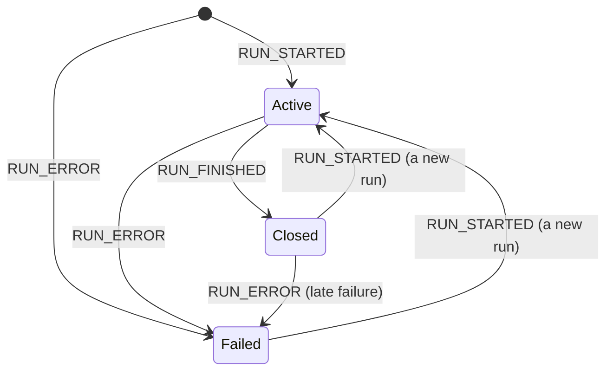

import DraftNotice from "/snippets/draft-notice.mdx";

<DraftNotice />

消费者发送一个 [`RunAgentInput`](/spec/draft/basic/run-input)；生产者以一条承载一次或多次运行的事件流作答——所请求的运行，其前可能还有回放的历史。本页说明一次运行何时开始与结束、这些边界意味着什么；运行*之内*的顺序规则归[事件模式](/spec/draft/basic/patterns)管辖。

## 运行

一条流 MUST 以 `RUN_STARTED` 或 `RUN_ERROR` 开场。生产者 MUST NOT 先发出任何其他事件，消费者 MUST 把以其他任何东西开场的流视为违反协议。`RUN_ERROR` 之所以被允许打头阵，是因为运行可能在开始之前就失败——够不着智能体的传输层有失败要报告，却没有可挂靠的运行。

### `RUN_STARTED`

开启运行。它携带运行的标识符；生产者自己的 `protocolVersion` 声明（按[版本管理规则](/spec/draft/basic/versioning#版本协商)）；并 MAY 回显本次运行由以启动的那份输入，让未发起请求的消费者也能看到智能体被要求做什么。`parentRunId` 指名派生本次运行的那次运行——当一个智能体把另一个智能体作为独立运行、而非一次运行内的[子智能体](/spec/draft/events/subagents)来调用时出现。

### `RUN_FINISHED`

关闭一次未失败的运行，并报告它如何结束：

- 它的 `outcome` 区分完成了的运行、因等待外部输入而被中断的运行、以及在完成之前被停止的运行；outcome 缺省表示成功。interrupt outcome 及其后续由[中断与恢复](/spec/draft/basic/patterns/interrupt-resume)规定；cancelled outcome 规定在[下文](#被取消的运行)。outcome 报告的是生产者对运行结束原因的了解：因[前端工具调用](/spec/draft/events/tool-calls#前端工具)而停止的运行是一次已完成的运行，其 success outcome MAY 在 `pendingToolCallIds` 中列名自己未获应答的调用，因为这样的调用之后应用是否延续线程，是应用的决定，不是生产者的。
- 生产者 MUST NOT 发送 schema 未描述的 outcome 取值。
- `result` 是 OPTIONAL 的，携带运行的返回值（如果有）。
- `usage` 是 OPTIONAL 的，报告 token 用量，每个提供方与模型一条记录，按[下文记账](#token-用量)执行。只想要总量的消费者把各条相加即可。

消费者无法识别的 outcome 与其他无法识别的内容一样，按同样的条款被剥离。剥离一个可选字段的结果是它缺省，而缺省的 outcome 表示成功——因此消费者无须区分完成了的运行与"以该消费者发布之后才命名的某种原因结束"的运行。

<Note>
  这为 outcome 集合能有多大用处划了界。后续版本新增的终态，到达旧消费者那里会是一场成功的运行；因此需要一个让旧消费者*注意到*新结束方式的版本，无法只靠 `outcome` 说话——它需要一个这些消费者本就视为重要的载体。这也是下面的 cancelled outcome 为什么在 1.0 就命名、而不留到以后的原因：事后才加入，一次被取消的运行会以"已完成运行"的面目到达每一个 1.0 消费者。
</Note>

### 被取消的运行

一次运行可以在完成之前被有意停止——被它为之运行的那个人、被应用自己的代码、被生产者执行的某个限制。它没有失败，也不在等待什么，但它也没有完成，而无法把它与已完成运行区分开的消费者，会把半成品当作成品呈现。cancelled outcome 说的就是这种结束。

- 出于非失败的原因在完成之前停止运行的生产者，MUST 以携带 cancelled outcome 的 `RUN_FINISHED` 关闭它。它 MUST NOT 把被停止的运行报告为成功——既不能用 success outcome，也不能靠省略 outcome。
- 适用于已关闭运行的一切在这里同样成立。生产者 MUST 关闭该运行开启的一切——消息、工具调用、步骤、子智能体——然后才发出取消它的 `RUN_FINISHED`，与成功运行之前完全一样。关闭一次工具调用确立的是其参数文本已完整，而不是其参数有效，所以在参数中途被切断的调用照常关闭，如何处理解析不了的参数由应用决定，按[工具调用规则](/spec/draft/events/tool-calls#tool_call_end)。无法按顺序关闭的生产者——停止动作把它脚下的流拆了——改为报告 `RUN_ERROR`：那次运行没有干净地结束，`RUN_ERROR` 正是为没干净结束的运行准备的事件。
- 被取消的运行没有返回值：`result` SHOULD 缺省。`usage` MAY 报告停止之前累积的 token。
- 被取消的运行什么也不等。它的 outcome 不携带中断，线程上的下一次运行是一次普通的新运行，不是恢复。
- 消费者 MUST NOT 把被取消的运行呈现为已成功，也 MUST NOT 把它呈现为已失败——用户自己要求的停止不是该展示给他们的错误。运行在停止之前交付的一切仍然算已交付，与 `RUN_ERROR` 之后一样。除此之外如何呈现这次停止，是消费者的事。

取消是生产者对自己正在运行的运行所作的报告。抛弃一条流的消费者——关闭连接、停止读取——得到的是一次[被截断的运行](/spec/draft/basic/transports#截断)，不是被取消的运行：对一次自己从未收到结局的运行，它 MUST NOT 合成 `RUN_FINISHED`，无论 cancelled 还是别的。

### `RUN_ERROR`

结束一次失败的运行。`message` 说明出了什么问题，供人阅读；`code` 是 OPTIONAL 的、机器可读的，是协议未定义词表的开放字符串；`usage` MAY 报告失败之前累积的 token，记账方式与 `RUN_FINISHED` 上的相同（[见下](#token-用量)）。

`RUN_ERROR` 是一个格式良好的事件：生产者是在报告自己的失败，不是在发送消费者该拒绝的东西。将运行视为失败，意味着消费者 MUST 把失败暴露给应用代码，且 MUST NOT 把运行报告为已成功。它不规定怎么做——启动运行的那次调用是抛异常、以失败解决、还是经回调报告，是实现自由，两个符合规范的消费者可以不同。

### token 用量

`RUN_FINISHED` 与 `RUN_ERROR` 上的 `usage` 报告本次运行的模型调用花费几何，每个提供方与模型一条 [`TokenUsage`](/spec/draft/schema#tokenusage) 记录。各提供方的统计方式不同——有的把缓存的提示词 token 折进输入计数，有的把它们并列报告，还有的把推理与输出的其余部分分开报告——所以协议定下一种记账法，由生产者翻译进去。每个计数要么是总量，要么是某个总量的具名组成部分：

- `inputTokens` 是本次调用被计费的全部提示词 token：缓存与否、是否写入缓存、是否文本都算。`outputTokens` 是生成的全部 token，包括推理。
- `cachedInputTokens`（缓存读）、`cacheWriteInputTokens`（缓存写）与 `reasoningTokens` 是这些总量的组成部分，绝不是在总量之外另加的部分。两个缓存计数互不相交。提供方在较小的总量旁边单独报告其中某项时，生产者 MUST 在发出条目之前把它加进总量；提供方已把它计入总量时，生产者 MUST NOT 再加一次。
- `totalTokens` 是 `inputTokens` 加 `outputTokens`。生产者 MAY 自行计算而不是照抄提供方的总量，且 MUST NOT 照抄统计口径不同的提供方总量。
- 计数缺省表示提供方没有报告；为零表示它报告了零。生产者 MUST NOT 为没有数据的计数发出零，消费者 MUST NOT 把缺省的计数读作零。

运行是记账边界：

- 用量覆盖运行内发生的每一次模型调用，包括其[子智能体](/spec/draft/events/subagents)发起的调用：子智能体事件不携带自己的用量，子智能体的调用就是这个运行的调用。
- 作为独立运行被调用的智能体——由 `parentRunId` 指名——在自己的终止事件上报告自己的用量，派生它的运行 MUST NOT 把这份用量并进自己的。
- [恢复](/spec/draft/basic/patterns/interrupt-resume)被中断运行的运行，只报告它自己发起的调用。被中断的运行已经报告过自己的，想要一个线程总量的消费者把该线程各运行的用量相加即可。

在这套记账之下，只想要总量的消费者把 `totalTokens` 跨条目、跨运行相加即可；而计算成本的消费者，对缓存读、缓存写与推理各有一部分可按各自费率计价，且不会重复计算任何一项。

### 运行关闭之后

一次运行以 `RUN_FINISHED` 或 `RUN_ERROR` 结束，此后它就是关闭状态。运行一旦关闭：

- 生产者 MUST NOT 再为该运行发出任何事件，下文点名的两个除外。
- 生产者 MAY 发出 `RUN_STARTED`，在同一条流上开启一次新运行。
- 生产者 MAY 在 `RUN_FINISHED` 之后发出 `RUN_ERROR`，报告运行已报告成功之后才暴露的失败——比如冲刷缓冲区时的传输层错误。这种情况下消费者 MUST 把该运行视为失败。
- `RUN_ERROR` 之后，除 `RUN_STARTED` 外生产者 MUST NOT 再发出任何东西。

运行关闭之后到达的任何其他事件，消费者 MUST 拒绝。

### 一条流上的多次运行

一条流 MAY 依次承载多次运行——回放线程是常见情形。生产者 MUST 在开启下一次运行之前关闭当前运行：运行仍处活跃状态时到来的 `RUN_STARTED` 是违例。

在流内的多次运行之间，消息累积、[状态](/spec/draft/events/state)持续，除非有事件替换它。重述历史的生产者——回放一个消费者输入中已携带其材料的线程——MUST 以快照的方式重述：`MESSAGES_SNAPSHOT` 按 id 调和，`STATE_SNAPSHOT` 整体替换，因此消费者已持有的重述是幂等的。把消费者已有的消息再流式传输一遍会追加而非重述，这就是流式三连只用于新内容的原因。

运行范围的跟踪——开启的消息、开启的工具调用、开启的步骤、活跃的子智能体——不跨这条边界：`RUN_FINISHED` 要求运行开启的一切都已关闭，`RUN_ERROR` 则在结束运行的同时结束一切仍开着的东西。新运行从空空如也开始。

## 步骤

步骤标记一次运行的各阶段，供展示进度的 UI 使用。`STEP_STARTED` 开启一个步骤，`STEP_FINISHED` 关闭它，以 `stepName` 配对。

- 生产者 MUST NOT 开启名字已然开启的步骤，也 MUST NOT 结束从未开启过的步骤。
- 生产者开启的每个步骤，MUST 在运行结束之前关闭。
- 步骤 MAY 彼此重叠、也可以与运行中的任何东西重叠；步骤是盖在流上一段区间的标签，不是容器。

## 数据类型

事件形态由 [schema 参考](/spec/draft/schema)定义：[`RunStartedEvent`](/spec/draft/schema#runstartedevent)、[`RunFinishedEvent`](/spec/draft/schema#runfinishedevent)（连同 [`RunFinishedOutcome`](/spec/draft/schema#runfinishedoutcome)）、[`RunErrorEvent`](/spec/draft/schema#runerrorevent)、[`StepStartedEvent`](/spec/draft/schema#stepstartedevent)、[`StepFinishedEvent`](/spec/draft/schema#stepfinishedevent) 与 [`TokenUsage`](/spec/draft/schema#tokenusage)。

## 错误处理

有两种不同的东西会让运行糟糕地结束，消费者要把它们分开。

**消费者拒绝的流**是它检测到的协议违例：本页上生产者 MUST NOT 做的一切，被消费者看到时都是致命的——`RUN_STARTED` 之前的事件、关闭之后除被容许两例之外的事件、嵌套的 `RUN_STARTED`、不配平的步骤、或 `RUN_FINISHED` 时仍有东西开着。错在生产者，这条流不可信。

**以 `RUN_ERROR` 报告自身失败的运行**恰恰相反：符合规范的生产者声明自己的工作没有成功。流是格式良好的，消费者按上述规则接受它。

消费者 MUST NOT 把两者混为一谈。无论哪种失败的运行，都保留它失败之前交付的一切——`RUN_ERROR` 说的是运行没有完成，不是说它的事件没有发生过。
