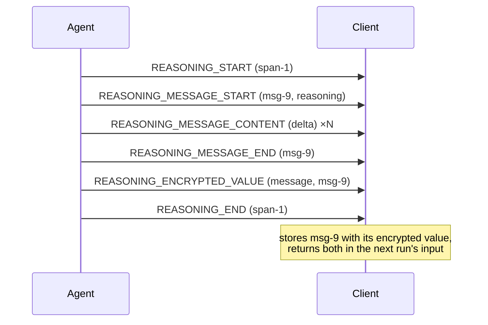

import DraftNotice from "/snippets/draft-notice.mdx";
import { Since } from "/snippets/since.mdx";

<DraftNotice />

推理是模型在给出答案之前的思考。生产者把它流式传输出来，让 UI 能展示正在进行的工作；而当提供方把真实的思维链保持私密时，协议则携带一份加密产物，由消费者存储并返回，自己无法读取。

## 用户交互模型

推理通常渲染在对话之外——默认折叠、以思考的样式呈现。协议不强制任何呈现方式；消费者 MAY 完全隐藏推理。

## 事件

### 区段：`REASONING_START` 与 `REASONING_END`

推理区段（span）括起一段思考，由 `REASONING_START` 开启、`REASONING_END` 关闭，以 `messageId` 配对。一个区段 MAY 包含多条推理消息。

- 生产者 MUST NOT 开启 `messageId` 已然开启的区段，MUST 在运行结束前关闭自己开启的每个区段，且 MUST NOT 关闭自己未曾开启的区段。
- 区段的标识符不划分任何命名空间：区段内的推理消息携带自己的 `messageId`。

### 推理消息

推理消息遵循[流式模式](/spec/draft/basic/patterns/streaming)：`REASONING_MESSAGE_START` 开启一条（其 `role` 固定为 `reasoning`），`REASONING_MESSAGE_CONTENT` 延展它，`REASONING_MESSAGE_END` 关闭它，全部以 `messageId` 配对——`REASONING_MESSAGE_CHUNK` 则是紧凑写法，其首个 chunk MUST 携带 `messageId`。该模式的规则与文本消息完全一致。

消费者 MUST 检测对这套纪律的违例并让运行失败，区段与推理消息一视同仁：

- 指名一条无人开启的消息的 `REASONING_MESSAGE_CONTENT` 或 `REASONING_MESSAGE_END` 没有所指，消费者 MUST NOT 替孤儿片段捏造出它指名的那条消息。文本消息拒绝同样的形态；推理不是例外。
- 指名一个无人开启的区段的 `REASONING_END` 同样被拒绝，重开已开启区段的 `REASONING_START` 亦然。
- 指名一条已然开启的推理消息的 `REASONING_MESSAGE_START` 同样被拒绝——该消息必须先以 `REASONING_MESSAGE_END` 关闭，其 `messageId` 才能再次使用。区段与其中的消息 MAY 共享标识符，因此各自对照自己的开启集合检查。
- 运行结束时仍开启的区段或推理消息会让运行失败。

区段与推理消息是两个独立的命名空间：`REASONING_START` 开启的是一个区段而不是消息，因此指名区段 `messageId` 的片段与其他孤儿一样是孤儿。

### `REASONING_ENCRYPTED_VALUE`

携带提供方不透明、加密的推理产物。`subtype` 说明 `entityId` 指名的是哪类东西——消息还是工具调用——这决定了值存储在哪里。

- 消费者 MUST 把 `encryptedValue` 视为不透明：绝不解析、绝不解读、绝不假定它是任何特定格式。
- 消费者 MUST 把该值与其指名的消息或工具调用一起存储，并在后续运行输入中原样返回，让生产者能恢复它所代表的推理上下文。这条规则预设了一个装得下它的目标：按 schema，活动消息不携带加密值，因此指名活动消息的事件被视为指名了消费者一无所知的东西——即下文的未知 `entityId` 情形。
- 无法保全它的消费者——降级路径、装不下它的存储——是在丢失内容，MUST 给出警告（[版本管理](/spec/draft/basic/versioning)）。
- 产物随其消息走。重述该消息的 [`MESSAGES_SNAPSHOT`](/spec/draft/events/state) 会整体替换它，`encryptedValue` 也在内——因此仍需要这份产物的生产者 MUST 在快照的副本里重述它，省略它就是收回自己的产物。消费者的义务是在所有事件应用完之后返回自己手中持有的东西，而不是复活被快照移除的东西。

#### `encryptedValueType`

<Since version="1.1" pr="2888" />

一个提供方可以发出不止一种产物，而字节本身说不出自己是哪一种。比如 Anthropic 既返回对可见思考的签名，也返回已脱敏的思考块，两者都必须以各自的块类型送回。`encryptedValueType` 指名种类。它位于本事件的 `encryptedValue` 旁边，也出现在每种携带值的消息上，以及工具调用上。它是 1.1 新增的。

- 取值由生产者定义，协议不定义任何取值。生产者 SHOULD 给自己的取值加上赋予其含义的提供方或框架前缀——`anthropic.redacted_thinking`、`openai.encrypted_content`——让不同生产者的取值不会相撞。
- 消费者 MUST 像 `encryptedValue` 一样对待 `encryptedValueType`：不透明，与值一起存储，原样返回。
- 类型描述的是某一个值，并随该值一起被替换。存储了新 `encryptedValue` 的消费者 MUST 把事件的 `encryptedValueType` 与之一同存储；事件未携带类型时，MUST 移除已存的类型。旧类型留在新字节上会贴错标签。
- 生产者 MUST NOT 在没有 `encryptedValue` 的情况下发送 `encryptedValueType`。
- 没有类型的值是合法的：它是字段出现之前每个生产者发送的东西，也是 1.0 消费者剥离类型之后返回的东西。生产者 MUST 在后续运行输入中接受它。
- 发现自己不认识的类型的生产者 MAY 丢弃该值，而不必向自己的提供方发送并非由它签发的字节。

该事件是独立的：它什么都不开启、什么都不关闭，MAY 出现在一次开启的运行内的任何位置，不过按惯例它到达于捕捉其思考的那个区段之内。

## 消息流

## 数据类型

事件形态由 [schema 参考](/spec/draft/schema)定义：[`ReasoningStartEvent`](/spec/draft/schema#reasoningstartevent)、[`ReasoningEndEvent`](/spec/draft/schema#reasoningendevent)、[`ReasoningMessageStartEvent`](/spec/draft/schema#reasoningmessagestartevent)、[`ReasoningMessageContentEvent`](/spec/draft/schema#reasoningmessagecontentevent)、[`ReasoningMessageEndEvent`](/spec/draft/schema#reasoningmessageendevent)、[`ReasoningMessageChunkEvent`](/spec/draft/schema#reasoningmessagechunkevent) 与 [`ReasoningEncryptedValueEvent`](/spec/draft/schema#reasoningencryptedvalueevent)。在对话历史中，一条推理消息是一个 [`ReasoningMessage`](/spec/draft/schema#reasoningmessage)。

## 错误处理

`entityId` 指名了消费者一无所知之物的 `REASONING_ENCRYPTED_VALUE`，无法存到它该在的地方；消费者 SHOULD 给出警告并 MAY 丢弃它，但 MUST NOT 因此让运行失败。

格式错误的推理事件——缺失必填字段、`subtype` 不是字符串——是格式错误的已知值，与其他一样致命。而 `subtype` 是 schema 未指名的字符串则不同：它是无法识别的内容——本消费者发布之后才加入的成员——[处理模型](/spec/draft/basic/processing)会剥离它并给出警告；由于它处于必填位置，承载它的事件会被移除。

## 安全考量

推理内容里时常出现生产者选择不写进答案的材料。消费者 SHOULD 以与对话同等的保密级别对待它，并且 MUST NOT 把 `encryptedValue` 喂给签发它的那个生产者之外的任何东西——它是恢复上下文的能力凭据，不是给应用用的数据。
