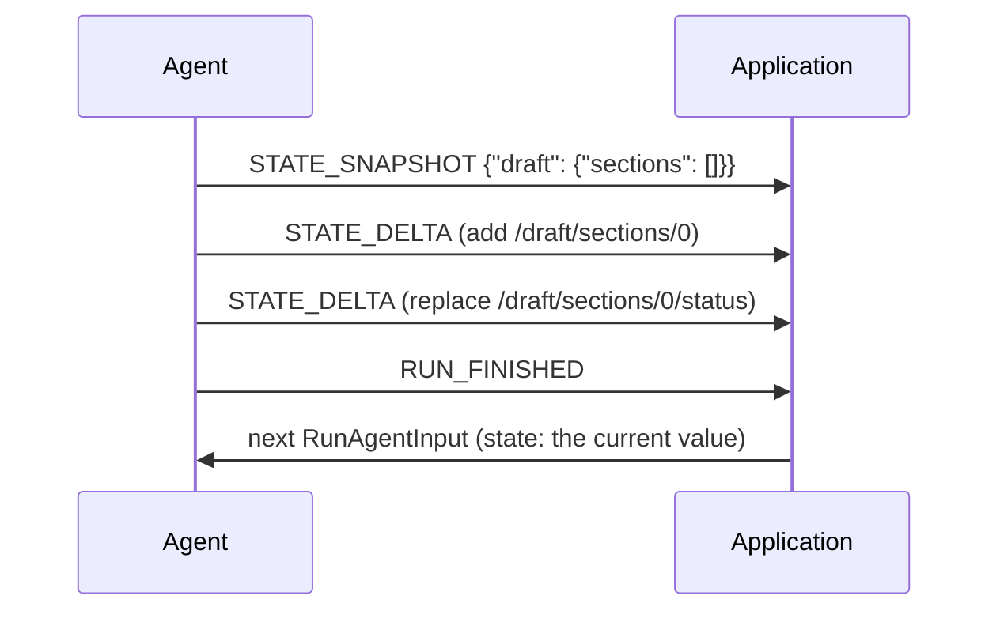

import DraftNotice from "/snippets/draft-notice.mdx";

<DraftNotice />

状态是智能体与应用保持同步的那个值——一份计划、一个表单、一份在写的文档。它经由[快照–增量模式](/spec/draft/basic/patterns/snapshots)传输；本页补充状态特有的内容，以及对话自身快照的特有内容。

## 事件

### `STATE_SNAPSHOT`

整体替换智能体状态。在增量无法表达该变化时发送，或用于让消费者重新同步。消费者 MUST 用 `snapshot` 替换自己的状态——不许合并。

### `STATE_DELTA`

以 RFC 6902 补丁修订当前状态。基准是消费者的当前状态：运行开始时，是输入的 `state`；此后，是本次运行自己的快照与增量叠加出来的结果。[该模式](/spec/draft/basic/patterns/snapshots)关于补丁所说的一切——原子应用、开放操作、失败处理、重新同步——原样适用。

### `MESSAGES_SNAPSHOT`

生产者所拥有的全部消息，按顺序排列。

它覆盖整个对话，而非简单覆写，因为消费者可能持有任何生产者都不跟踪的消息。调和方式：

- 快照中的消息以其相同 id 替换消费者手中的副本——*原地*替换：对已持有的消息，消费者保留其原有位置。消费者从未见过的快照消息按快照顺序追加。因此快照的顺序只对消费者初次相见的消息具有权威性；它不会重排消费者已有的东西。
- 消费者持有的消息若在快照中*缺席*则被丢弃——生产者声明的是完整集合——**但**生产者无从了解的仅客户端材料除外：从不流向生产者的[活动](/spec/draft/events/activity)消息，以及多数生产者都不跟踪的推理消息。
- 这个例外按角色划分、且可自我撤销：快照自身若携带任何活动消息，就是在声明完整的活动集合，消费者的活动消息凡不在其中的照常丢弃。推理消息同理。

快照覆盖整个对话，因此不携带自己的 `subagentRunId`；它经由所包含的消息确立每条消息的归属。

## 跨运行行为

状态在线程的多次运行间持续，直到某个事件替换它，而下一次运行的输入把它作为起始值带回来——正是这个循环让双方保持一致。消息以同样方式累积；`MESSAGES_SNAPSHOT` 就是生产者把这份累积一锤定音地重述出来的方式。

## 消息流

## 数据类型

[`StateSnapshotEvent`](/spec/draft/schema#statesnapshotevent)、[`StateDeltaEvent`](/spec/draft/schema#statedeltaevent) 与 [`MessagesSnapshotEvent`](/spec/draft/schema#messagessnapshotevent) 由 [schema 参考](/spec/draft/schema)定义；[`State`](/spec/draft/schema#state) 有意不作约束——任意 JSON 值，不限于对象——增量则是 [`JsonPatch`](/spec/draft/schema#jsonpatch)。

## 错误处理

结构上格式错误的补丁是致命的；格式良好却应用失败的补丁则按[该模式](/spec/draft/basic/patterns/snapshots#补丁不适用时)的规定，给出警告并跳过。

## 安全考量

状态事件是对应用状态的远程写入。应用 MUST 先校验自己从状态中读出的东西，再据以行动——渲染它、执行它、因它授予任何东西——与校验任何其他跨越信任边界的输入完全一样。反过来，生产者 SHOULD NOT 把机密放进状态：它每次运行都会经由消费者往返一圈。
