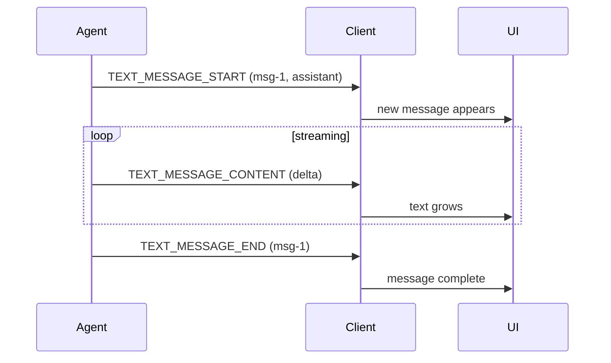

import DraftNotice from "/snippets/draft-notice.mdx";

<DraftNotice />

文本消息就是对话本身：用户读到的那些话。生产者在每条消息生成的同时把它流式传输，UI 因此可以随到随渲染，而不必等消息结束。

## 用户交互模型

文本消息通常渲染为对话记录，每条消息随其内容流式到达而逐步显现。协议不强制任何具体呈现方式——消费者 MAY 缓冲整条消息再展示，也可以逐 token 渲染。

## 事件

文本消息遵循[流式模式](/spec/draft/basic/patterns/streaming)，以 `messageId` 配对。该模式的规则——先开启后内容、运行结束前关闭、不得重开已开启的 id——按其原文适用。

### `TEXT_MESSAGE_START`

开启一条消息。

```json
{
  "type": "TEXT_MESSAGE_START",
  "messageId": "msg-1",
  "role": "assistant"
}
```

- `role` 是 OPTIONAL 的；角色缺省表示 `assistant`。角色可以取哪些值归 [schema](/spec/draft/schema#textmessagerole) 管辖。
- `name` 是 OPTIONAL 的，在角色之内标注说话者，供区分多个说话者的生产者使用。

### `TEXT_MESSAGE_CONTENT`

延展开启中的消息。`delta` 携带消息文本的下一段；delta 按到达顺序拼接。

```json
{
  "type": "TEXT_MESSAGE_CONTENT",
  "messageId": "msg-1",
  "delta": "Hello, world."
}
```

### `TEXT_MESSAGE_END`

关闭消息。已关闭的消息是关闭了，不是封死了：生产者 MAY 用新的 `TEXT_MESSAGE_START` 重开同一个 `messageId`，消息继续，其后的内容追加到已有内容之后。重开的 `TEXT_MESSAGE_START` MUST 与它重开的消息一致——同一个所有者、相同的 `role`、相同的 `name`；消息已确立的值继续有效，消费者无须检测其中的不一致。其后的 [`MESSAGES_SNAPSHOT`](/spec/draft/events/state) 也 MAY 整体重述这条消息。任何事件都不能做的，是用任何其他手段更改一条已关闭消息的内容。

<Note>
  在一次运行内，换个所有者重开就是[子智能体规则](/spec/draft/events/subagents)已然拒绝的归因不匹配。跨运行时消费者的所有权跟踪已经重置，因此跨运行不匹配的检测不作要求——但两种情况下生产者的义务是一样的。
</Note>

### `TEXT_MESSAGE_CHUNK`

紧凑写法。消费者 MUST 按[流式模式](/spec/draft/basic/patterns/streaming#chunk-形式)的规定把 chunk 展开为上述三个事件，包括首个 chunk 的要求与冲突重复规则。

## 消息流



## 数据类型

事件形态由 [schema 参考](/spec/draft/schema)定义：[`TextMessageStartEvent`](/spec/draft/schema#textmessagestartevent)、[`TextMessageContentEvent`](/spec/draft/schema#textmessagecontentevent)、[`TextMessageEndEvent`](/spec/draft/schema#textmessageendevent) 与 [`TextMessageChunkEvent`](/spec/draft/schema#textmessagechunkevent)。组装完成的消息按其角色作为 [`AssistantMessage`](/spec/draft/schema#assistantmessage)、[`UserMessage`](/spec/draft/schema#usermessage)、[`SystemMessage`](/spec/draft/schema#systemmessage) 或 [`DeveloperMessage`](/spec/draft/schema#developermessage) 出现在对话历史中。

消息任何事件上的元数据都按[元数据规则](/spec/draft/basic/metadata)合并进消息：逐 key 进行，最后写入者胜出。

## 错误处理

为未开启的 `messageId` 发送 `TEXT_MESSAGE_CONTENT` 或 `TEXT_MESSAGE_END`，或为已开启的发送 `TEXT_MESSAGE_START`，都是格式错误的序列，对运行而言是致命的。运行结束时仍有消息开着，同样是违例。这些都是[流式模式](/spec/draft/basic/patterns/streaming)的规则；文本消息没有任何软化它们的特殊之处。
