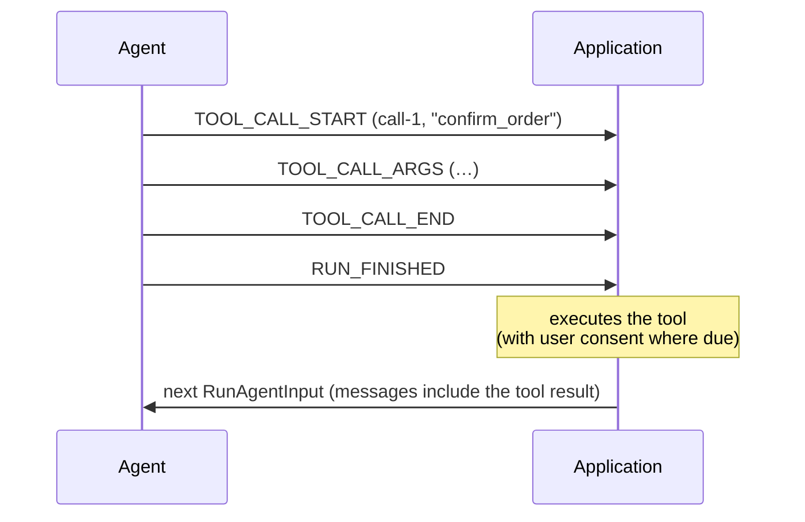

import DraftNotice from "/snippets/draft-notice.mdx";
import { Since } from "/snippets/since.mdx";

<DraftNotice />

工具调用是智能体在请求把某件事做成。当这个工具是应用在[运行输入](/spec/draft/basic/run-input)里声明过的那一个时，由应用执行它——这使工具调用成为协议的人在回路（human-in-the-loop）核心：智能体提议，应用裁决。

## 用户交互模型

应用通常在工具调用流式传输时就把它呈现出来——一张指名工具的卡片、逐渐填入的参数——并且对有副作用的工具，在执行前征求用户同意。协议不强制任何具体交互模型，但可参见下文的[安全考量](#安全考量)。

## 事件

工具调用遵循[流式模式](/spec/draft/basic/patterns/streaming)，以 `toolCallId` 配对。

### `TOOL_CALL_START`

开启一次调用。

```json
{
  "type": "TOOL_CALL_START",
  "toolCallId": "call-1",
  "toolCallName": "search",
  "parentMessageId": "msg-1"
}
```

- `toolCallName` 指名被调用的工具。
- `parentMessageId` 是 OPTIONAL 的，把这次调用挂到承载它的助手消息上。父消息归因于某个子智能体时，调用 MUST 与该归因一致——工具调用属于承载它的那条消息（见[子智能体](/spec/draft/events/subagents)）。

### `TOOL_CALL_ARGS`

延展开启中的调用。`delta` 携带调用参数的下一段；拼接起来的 delta 构成调用的参数文本，按惯例是一份 JSON 文档——但协议以文本承载它且不校验，这是有意的：提供方会发出格式错误的参数字符串，让应用来决定如何处置，总好过传输层直接杀掉运行。

消费者 MUST NOT 在 `TOOL_CALL_END` 之前就据参数行事：调用关闭之前，那些文本只是生产者正在发送内容的前缀，不是东西本身。

### `TOOL_CALL_END`

关闭调用。参数文本已完整——关闭确立的是完整性，不是有效性。执行工具的一方负责解析它，如何处置解析不了的文本是应用的决定，不是协议违例。

已关闭的调用与已关闭的消息一样，MAY 由携带同一 `toolCallId` 的新 `TOOL_CALL_START` 重开，后续参数继续追加。重开的 start MUST 与它重开的调用一致——相同的 `toolCallName`、相同的 `parentMessageId`、同一个所有者。消费者无须检测不一致；而且与[重开的文本消息](/spec/draft/events/text-messages#text_message_end)不同，协议不承诺漏检违例的消费者最终手里拿着的是两个值中的哪一个。

### `TOOL_CALL_CHUNK`

紧凑写法。消费者 MUST 按[流式模式](/spec/draft/basic/patterns/streaming#the-chunked-form)的规定展开 chunk：首个 chunk MUST 携带 `toolCallId` 与 `toolCallName`，延续 chunk 以冲突值重复 `toolCallName` 或 `parentMessageId` 则是致命的。

### `TOOL_CALL_RESULT`

携带调用的结果。它本身就是一条消息——一条带着自己 `messageId` 的工具消息——并且不会重开它所应答的调用。

```json
{
  "type": "TOOL_CALL_RESULT",
  "messageId": "msg-2",
  "toolCallId": "call-1",
  "content": "3 results found."
}
```

结果 MAY 与它的调用在同一次运行中到达——智能体自己执行的工具——也可能根本不出现在流里：客户端执行的工具，其结果在下一次运行的输入中作为工具消息返回给生产者。

#### 结果内容

`content` MUST 是字符串，或 [`ContentPart`](/spec/draft/schema#contentpart) 的有序列表——与[用户消息](/spec/draft/basic/run-input#messages)所携带的部分相同：`text`、`image`、`audio`、`video` 与 `document`，每个媒体部分带一个 `source`，为内联数据、URL 或[提供方文件句柄](/spec/draft/basic/run-input#provider-file-handles)。事件生成的工具消息形态与之完全一致，因此结果可以原封不动地进入下一次运行的 `messages`。

```json
{
  "type": "TOOL_CALL_RESULT",
  "messageId": "msg-2",
  "toolCallId": "call-1",
  "content": [
    { "type": "text", "text": "Invoice INV-2291 attached." },
    {
      "type": "document",
      "source": { "type": "url", "value": "https://example.com/INV-2291.pdf", "mimeType": "application/pdf" },
      "metadata": { "title": "INV-2291" }
    }
  ]
}
```

- 返回结构化数据的工具——比如一个 JSON 对象——会把它序列化为字符串形式，或放进一个 `text` 部分。协议没有 JSON 部分：每个提供方都接受文本形式的工具结果，而一个带类型的对象横竖都要在提供方边界变成文本。
- 部分不建模的东西——搜索命中的来源与标题、文档的文件名——放进该部分的 `metadata`。协议不为提供方专属的结果块下定义（带引用的搜索结果、浏览器状态等）；需要这类东西的生产者，要么把它映射到这些部分上，要么作为透传携带。
- 把输出上传到了模型提供方的工具——生成的报告如今躺在提供方的文件库里——以 `file` 来源返回句柄，而不是重发那些字节；[同样的规则](/spec/draft/basic/run-input#provider-file-handles)与输入端一样适用，渲染结果的消费者把句柄视为不透明。
- 拿到自己的模型无法接受的部分的生产者——把图像交给纯文本模型、把音频交给工具结果中一概不收的提供方、拿到别的提供方签发的文件句柄——MUST NOT 因此让运行失败。它丢弃该部分并继续，正如[运行输入规则](/spec/draft/basic/run-input#messages)对用户内容已经说过的那样；并且它 MUST 仍然应答这次调用：每个部分都被丢弃的结果以空字符串应答，因为未获应答的工具调用是多数模型会直接拒绝的东西。
- 只能持有字符串的消费者——渲染器、存储、旧桥接——把部分列表渲染为其 `text` 部分按序拼接的结果，忽略其余。这样做是有损的，SHOULD 予以宣告，如同任何降级一样（[版本管理](/spec/draft/basic/versioning)）。
- 内容部分出现之前的对端不发送 `protocolVersion`；知道自己正在与这种对端通信的生产者，MAY 在发出前以同样方式把结果压平，并在压平丢弃了部分时 MUST 给出警告。它 MUST NOT 在被丢弃部分的位置放占位物：降级是重塑，不是捏造。

#### `error`

<Since version="1.1" pr="3232" />

工具消息可以借 [`ToolMessage.error`](/spec/draft/schema#toolmessage) 说明它的工具失败了。但生成这条消息的事件此前说不了这话，于是在 `MESSAGES_SNAPSHOT` 重述这条消息之前——通常要等到运行结束之后——渲染事件流的消费者没有办法把一次失败的调用显示为失败，而对用户亲眼所见的一切来说，那都太迟了。`TOOL_CALL_RESULT` 上的 `error` 把这个值带到了事件上。

```json
{
  "type": "TOOL_CALL_RESULT",
  "messageId": "msg-2",
  "toolCallId": "call-1",
  "content": "Error: weather service timed out after 10s",
  "error": "weather service timed out after 10s"
}
```

- `error` 中的字符串把该结果标记为失败——是工具调用的失败，不是运行的失败，它不触碰运行的 outcome。生产者 MUST NOT 发送空的 `error`：它会被复制上去的 `ToolMessage.error` 从未定义过空字符串是什么意思，而且有些序列化器会丢掉空字符串。工具没有给出原因时，生产者 SHOULD 用文字说明这一点。
- 即便收到空的 `error`，消费者仍把该调用视为失败，视为未给出原因，并 SHOULD 发出警告。schema 有意接受空字符串，为的是让生产者的缺陷只花掉一条警告，而不是整场运行。过了事件这一关，缺陷并不会自愈：复制到工具消息上之后，空的 `error` 没有任何已定义的含义——这正是生产者 MUST NOT 发送它、也是警告之所以重要的原因。
- `error` 缺省表示生产者在本事件上未报告失败——并不表示调用成功。1.1 之前的生产者没有这个字段可发，而其后的 `MESSAGES_SNAPSHOT` 仍 MAY 把该调用标记为失败。消费者 MUST NOT 把缺省当作成功的证明。
- `error` 与 `content` 并行传输，绝不取而代之，因此部分结果可以在失败中存活。`content` 仍然是模型被告知的关于这次调用的内容，生产者 SHOULD 让它描述失败。丢弃 `error` 的对端能否保留那段解释，取决于生产者是否保留；无论如何这个标记本身都没有了（[版本管理](/spec/draft/basic/versioning)）。
- 从事件流构建消息的消费者 MUST 把 `error` 原样复制到事件生成的工具消息上——空字符串也包括在内。
- 重述那条工具消息的生产者——比如在 `MESSAGES_SNAPSHOT` 里——MUST 携带它在事件上发送的 `error`，除非它是在修正结果。被修正的结果以新内容、以及如今适用的 `error`（或没有 `error`）重述该消息。无论哪种方式，快照都会替换消费者手中的消息副本，一如 [`MESSAGES_SNAPSHOT`](/spec/draft/events/state#messages_snapshot) 的常态，因此更早的 `error` 不会比丢弃它的那次修正活得更久。
- 遵循自身处理模型的 1.0 消费者会剥离 `error`，运行继续。在 JSON 线上格式（wire）上，该模型建议剥离时给出警告；protobuf 解码则静默跳过其构建早于该字段的字段（[HTTP protobuf](/spec/draft/basic/transports/http-protobuf)）。宽松解析的消费者也可能一言不发地保留或丢弃该字段，因此生产者不能指望那条警告。
  知道对端更旧的生产者 MAY 干脆不在事件上携带 `error`；该降级是有损的，MUST 按[版本管理规则](/spec/draft/basic/versioning)给出警告。这样的生产者 SHOULD 在自己重述的每条工具消息上设置 `error`——那正是该对端仍能看见失败的地方。

## 前端工具

[运行输入](/spec/draft/basic/run-input#tools)里的 `tools` 列表是应用的地盘：智能体提议调用，应用执行。协议没有从消费者到运行的中途通道，因此答案只能跨越运行边界——这赋予了这一往返它的形状：

- 调用前端工具的生产者 MUST NOT 自己应答它：没有 `TOOL_CALL_RESULT`，没有伪造的工具消息。结果是应用的事。
- 生产者在调用未获应答的情况下结束运行。它 MUST 使用 success outcome 或不携带 outcome，且 MUST NOT 把运行报告为被中断——并且，一旦剩下的东西都不再依赖该结果，它 SHOULD 尽快结束。一次运行 MAY 留下多个未应答的前端调用；应用一次性应答它们全部。
- success outcome 的 `pendingToolCallIds` 按发起顺序列名未获应答的调用。运行留有待应答调用时，生产者 SHOULD 发送它；发送时，该列表 MUST 恰好包含运行发起过、且未以 `TOOL_CALL_RESULT` 应答的那些工具调用。光凭 `RUN_FINISHED` 说不出运行是否给应用留了活：列表缺省或为空时，需要知道的消费者从事件流推导——本次运行发起过、却未收到结果的每个工具调用——且 MUST NOT 把缺省读作"没有待办"。被中断的运行按同样方式推导待应答调用；interrupt outcome 不携带它们。
- 运行结束后，应用对每个未应答的前端调用作出处置——执行它或拒绝它，采用其自身规则所要求的同意流程。要延续的线程 MUST 先把它们每一个都答掉：下一次运行的 `messages` 为每次调用携带一条工具消息，以 `toolCallId` 为键——失败也是应答，即一条设置了 `error` 的工具消息；用户拒绝的调用则明说拒绝。工具消息的 `content` 是字符串或部分列表，与 [`TOOL_CALL_RESULT`](#结果内容) 上完全一致：产出了截图或选好了文件的前端工具，用媒体部分作答，而不是用对它的描述作答。未获应答的调用会让智能体停在半截思绪上，而带着悬空调用的历史是多数模型会直接拒绝的那种。抛弃线程什么也不回答，也不违反什么——这条规则约束的是延续，与 resume 覆盖规则的约束方式相同。

这与[中断](/spec/draft/basic/patterns/interrupt-resume)是两种不同的往返：中断是生产者明确停下来发问，由 resume 条目应答；前端工具调用则搭普通消息循环的便车，由对话历史应答。

<Note>
  因前端工具调用而停止的运行是一次已完成的运行，不是被中断的运行，也不是第三种结束方式。outcome 报告的是生产者对运行结束原因的了解，而这里生产者并不知道自己是否在等待：前端工具往往是一个终态效果——渲染图表、跳转、高亮——它的结果是否开启另一次运行，是应用依照自己对那个工具的规则作出的决定。所以生产者只说自己确实知道的——运行已完成，这些调用未获应答——作为 success outcome 上的细节；剥离该字段的旧消费者照样读到一次成功的运行，并像从前一样推导待应答调用。
</Note>

生产者 SHOULD 只调用声明列表里的前端工具；指名输入未声明工具的调用，其本身并不构成协议违例——如何处置是消费者的决定。生产者自己的工具在智能体一侧执行，从来无须声明，并经流内的 `TOOL_CALL_RESULT` 应答。

## 消息流

客户端执行的工具横跨两次运行：



## 数据类型

事件形态由 [schema 参考](/spec/draft/schema)定义：[`ToolCallStartEvent`](/spec/draft/schema#toolcallstartevent)、[`ToolCallArgsEvent`](/spec/draft/schema#toolcallargsevent)、[`ToolCallEndEvent`](/spec/draft/schema#toolcallendevent)、[`ToolCallChunkEvent`](/spec/draft/schema#toolcallchunkevent) 与 [`ToolCallResultEvent`](/spec/draft/schema#toolcallresultevent)。在对话历史中，一次调用表现为 [`AssistantMessage`](/spec/draft/schema#assistantmessage) 上的一个 [`ToolCall`](/spec/draft/schema#toolcall)，一个结果表现为一条 [`ToolMessage`](/spec/draft/schema#toolmessage)，其 content 是字符串或 [`ContentPart`](/spec/draft/schema#contentpart) 列表。声明过的工具是 [`RunAgentInput`](/spec/draft/schema#runagentinput) 上的 [`Tool`](/spec/draft/schema#tool) 对象。

这些部分按它们是什么来命名——`TextPart`、`ImagePart`——而不是按传输方向命名，因为同一个部分会随用户消息进入模型，又随工具结果从事件流中出来。`ReasoningPart`、`ToolCallPart` 与 `AssistantPart` 这些名字保留给后续次要版本——助手消息也开始携带部分的那一版；目前没有任何东西定义它们，生产者 MUST NOT 发出它们。

## 错误处理

[流式模式](/spec/draft/basic/patterns/streaming)的序列规则原样适用：延续或关闭未开启的调用、重开已开启的调用，都是致命的。运行结束时仍有调用开着是违例。

## 安全考量

工具调用是协议最大的攻击面，因为它把模型输出变成动作。

- 参数由模型生成，MUST 被当作不可信输入：声明过参数 schema 的工具，对照该 schema 校验；没声明的，像对待任何不可信负载一样细查；并且绝不未经转义就插值进 shell 命令、查询或标记。
- 应用 SHOULD 在执行有副作用的工具调用之前取得用户同意，且 MUST NOT 在调用并非用户批准时声称已获批准。
- 工具结果是从工具拿到数据的任何地方来的数据。消费者 MUST NOT 把结果里的文本当作协议材料，或当作携带用户授权的指令。
- 指名未声明工具的调用，未经与新工具同等的细查，SHOULD NOT 被执行。
