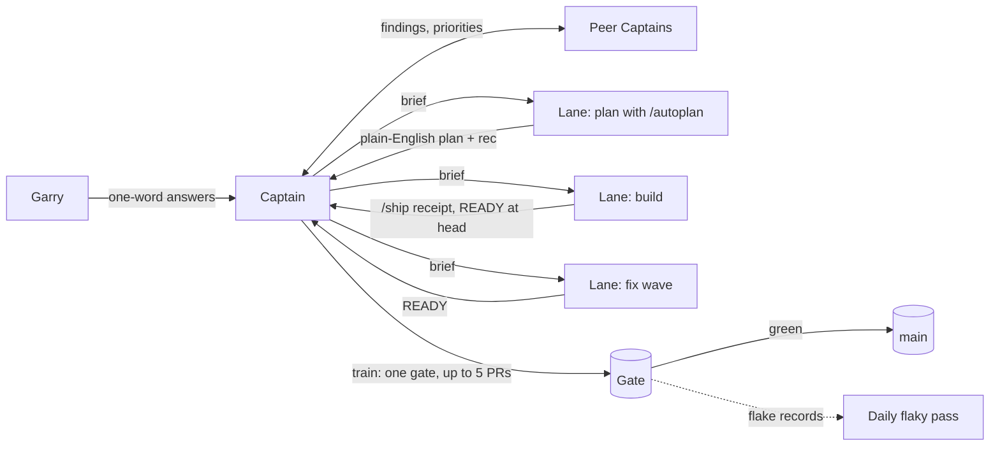
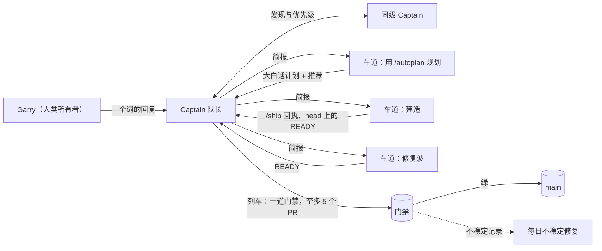

gstack 是一套工程技能：规划评审、`/ship`、`/review`、`/qa`、评测。Capy 在云端
运行 agent。它给每条线程一台自己的机器，并加上指挥线程编队的 Captain、共享的
Drive 和各种自动化。合在一起，一个人就能跨多个仓库带领一支 agent 工程师团队，
工作以他选定的顺序落到 main 上：经过评审、保持绿灯。

本页讲我们造了什么、各部分如何咬合、为什么我们认为这是今天运营软件工厂
（software factory）的最佳方式、我们付出了哪些代价才学到、以及 Garry 实际
怎么用它。分步设置见 [docs/recommended-harness.md](/recommended-harness/)；
控制器参考见 [docs/captain.md](/captain/)。

## 数据

以 2026-10-15 修复波（fix wave，Captain 次日接管）起的 14 天对比之前的 14 天，
数据取自 git 和 GitHub[^1]：

- **197 个 PR 合并进 gstack 的 main，此前是 65 个（3.0 倍）。** 即每周 98.5 个。
- **194 个版本发布，日均 13.9 个，此前是 62 个（3.1 倍）。** 几乎每个合并的
  PR 都在合并时拿到自己的版本号。
- **接近 Capy 之前 gstack 最好两周的两倍。** 三月发布期最忙的 14 天发布了
  99 个版本；这两周发布了 194 个。
- **一天（UTC）内 36 个 PR 合并、36 个版本发布**，10 月 25 日一次，10 月 26 日
  又一次。
- **一个被报告的 issue 中位 2.4 天修复**，从 issue 开出到修复 PR 合并，统计
  窗口内经 PR 关闭的 52 个 issue。
- **同一 14 天里，Garry 的八个仓库共合并 1,874 个 PR。**

数字没说的是：PR 变小了。gstack 的 PR 中位变更行数从 1,292 降到 422，所以
"3 倍的 PR"是真的，"3 倍的代码"不是。PR 小正是目的（每个都独立经过评审、
门禁、可独立回滚），但总产出并没有更多。从开 PR 到合并的时间反而上升了，
中位数从 1.1 小时到 5.6 小时，因为列车是批量合并的。

## 我们做了什么

Capy 线程从 2026-09-15 开始写 gstack 的 PR。2026-10-15 Garry 批准了两轮修复波，
次日他把 gstack 的开发交给了 Capy Captain——GStack Minder。它的常务是让
`garrytan/gstack` 持续有进展、main 保持绿灯。两周之内一共有了七位 Captain
（gstack、gbrain、alphaclaw、两个评测项目、一个游戏、一本杂志），各自指挥
自己的线程编队。

让这套东西跑通的机制，大多不是第一天就有的。它们来自 Garry 的一条条回复，
每条先变成规则，再变成 gstack 本身：

- "yes merge when green"（绿灯就合并）变成了 Captain 的常设合并许可，随后变成
  [合并列车](/captain/#合并列车)：一个付费门禁最多覆盖五个 READY PR，
  Captain 按槽位在精确的 head 上逐个合并。
- "失败的测试重跑一次就行，注明它不稳定，然后我们每天应该有一轮不稳定测试
  修复" 变成了单次重跑规则和[每日不稳定修复](/captain/#每日不稳定修复)
  自动化。
- "每次规划审批，我要前后对比、为什么重要、是什么让我们开始做这件事、以及
  你被迫做的大决定" 变成了 `gstack-owner-brief` 和
  [三种审批形态](/captain/#审批三种形态)。
- "另外合并 PR 之前我们真该用 gstack 的 ship 技能" 变成了每个 READY 必须在
  head 携带的 `SHIP_RECEIPT`。
- "开新线程或接手新功能时，能不能记得用 gstack autoplan 先做规划，再 eli5 给
  我审批？" 变成了[先规划再建造](/captain/#先规划再建造)。
- "gstack 才是做事方法的真正持有者，不该是一次性的 Capy 文件"——这就是以上
  一切都放在本仓库、而不是任何人的 Drive 里的原因。

## Capy 与 gstack 如何咬合

**Captain、编队与车道。** Captain 是一条长期运行的 Capy 线程，掌管一个仓库的
流程。它拉起编队线程（车道），每条车道有自己的机器和分支、文件各有其名，因此
任何两条车道都不会改同一个文件。Captain 的 Drive 存放编队契约（`CREW.md`）、
编队摘要和每条车道的报告；里面的每条规则都能指回一份 gstack 文档。车道绝不
直接问 Garry。一切都经 Captain 中转：它用大白话去问，再原样带回他的回复。

**先规划，用大白话拿到首肯。** 新功能从 `/autoplan` 开始：CEO 评审、工程评审，
工作涉及设计与开发者体验（DX）时再加这两道，每道都有本模型与跨模型
（cross-model）两路声音。门禁结果以一段大白话摘要发给 Garry，默认答案是
"rec"，另给一个"do it"选项——全量采纳每条建议。一个"do it"曾在上午批掉八份
规划，随后各车道并行开工。评审在代码存在之前就拦下昂贵的错误。有一份规划
因此发现 12 个任务少到证明不了任何事，另一份发现它的适配器需要一个没人
规划过的翻译层。

**READY 之前先 `/ship`，绿灯即合并。** 车道在其最终推送的 head 上跑 `/ship`：
执行测试、按 diff 大小配比评审、在要紧处加一路跨模型声音，并写一张绑定该
head 的回执。车道发出一个不打戳的 READY 然后停手。Captain 把 READY PR 攒成
列车，读一次完整门禁，在合并时打版本戳，并以 `--match-head-commit` 逐个合并，
因此任何东西都不会落在没人评审过的 head 上。评审发现只有"会导致测试失败、
弄坏生产、丢失数据或机密"时才阻断（Garry 的底线）；其余写进 PR 描述。

**修复波。** main 变红时，各车道暂停 `/ship`，一名 owner 查根因，所有人各合并
一次 main。被推迟的评审发现和只涉及测试的后续工作折进一个修复波 PR，而不是
各开一个。有一个编队靠一处 audit-pin 修复就清掉了波及整个 main 的红灯，十个
PR 一小时内落地。

**每日不稳定修复。** 红的测试在同一棵树上重跑一次。转绿就记为不稳定（flaky），
PR 继续走；第二次红才是真的。每天早上，一个自动化拉起一条车道，修掉最严重的
惯犯，PR 先展示红再展示绿。任何东西都不会被重试到变绿，任何阈值都不会挪动。

**同级 Captain 传的是发现，不是闲聊。** Captain 之间互发消息只带证据。
gstack-evals 的回放显示 `/review` 把真实 bug 降级，一小时内 gstack 就开了条
车道处理。另一位评测 Captain 的 $5.78 评审面板发现 OpenClaw 拒绝加载一个
78 KB 的 gstack 技能，gstack 当天就挂出了修复
（[#3610](https://github.com/garrytan/gstack/pull/3610)）。Garry 对一位 Captain
说"hurry up"（抓紧），另一位就为它重排了合并队列，并逐个回传合并提交。

**带预注册门槛的评测。** 任何自称有益的提示词或技能改动，都要靠固定试验次数、
且在第一次付费调用之前就写好门槛（预注册）的前后对比来判定
（[/eval-plan](/skills/#eval-plan)），绝不凭感觉。这里的好评测要有无技能组与
等长安慰剂对照组、验证处理确实送达的检查、核验干净的诱饵，以及按计量器报出
的花费。它们报告失败与报告胜利同样直白。一次预注册评测发现：即便每次都加载
该技能，gstack 在廉价模型上仍输给安慰剂——这个结果如今驱动着 gstack 对评审
准则的改进。在 gbrain，一个事实块在留出集上赢了 16 分，也只是在那之后才默认
开启。

## 为什么我们认为它是最好的软件工厂

- **所有者只做决策，且只做决策。** Garry 的工作是用一个词回答大白话问题。
  凡是一条命令、一次度量或一个测试能解决的事，都在到他那里之前解决掉。
- **量再大 main 也保持绿灯。** 回执绑定精确 head、以 `--match-head-commit`
  合并、列车在落地前先测组合，再加一道 main 变红就冻结队列的兜底。
- **每条规则都是代码。** 规则活在 gstack 里：拒绝过期回执的 bin、给提示大小
  封顶的测试、一份 ship 策略文件。新编队装上 gstack 就继承它们，不用去读谁
  的笔记。
- **它度量自己。** `gstack-factory-scorecard` 每周对照行业基准（DORA）报告
  前置时间、门禁成本、红灯列车比例和不稳定事件，读不到的东西说
  `unavailable` 而不是 0。
- **它对成本诚实。** 相对坏掉的 main，付费门禁很便宜（"没关系，$93 的付费
  门禁想跑多少跑多少，谁在乎"），但每个 PR 的 token 花费被跟踪、封顶，一旦
  涨起来就当 bug 处理。

## 技巧与窍门

1. **每台机器、每个会话都装 gstack。** 每条线程和子 agent 的第一个动作都是
   安装检查；没有 `gstack: ok` 这一行，那台机器上就没有 gstack 工作流。
2. **永远给一个"do it"。** Garry 接受的是建议。把推荐回复做成一个词的默认项，
   绝不把"规划初稿原样执行"当安全选项端出来。
3. **三轮评审之前先问"值不值"。** 所有者可能搁置的规划先做廉价检查。一次
   测出 83 秒启动开销的部署回放，毙掉了一份三轮评审都点过头的规划。
4. **版本在合并时定，不写在 PR 里。** 在 READY 改为不打戳之前，版本与
   CHANGELOG 冲突是第二大时间黑洞。
5. **别 main 一动就合并。** 每次合并都会重新制造 CHANGELOG 冲突并作废回执。
   等到你的槽位，合并一次。
6. **评审按 diff 配比。** 文档 PR 不需要红队。小 diff 上做全深度评审，正是
   `/ship` 曾在一个需要完整测试门禁的 PR 上花掉约 50M token 的原因。
7. **线程保持小。** 一条长寿的父上下文曾达到 1.36B token。长步骤交给全新的
   子线程，读 token 计数器，别靠估。
8. **用后台操作，别用盯梢子 agent**，只在有决策、有阻塞、有 READY 或一个
   阶段完成时才发消息。Captain 以前被唤醒大多是"无事可报"。
9. **先度量再选择。** 给队列计时、数 PR、跑真实系统。一个清闲时段看似更省的
   runner 选项，在繁忙时段败下阵来。
10. **严重修复优先，走同样的门禁。** gbrain 的一个信任提权 bug 从报告到合并
    修复约三小时，回执、绿灯检查与合并 owner 一概不变。

## Garry 怎么用它

- **他用一个词回答，从手机上。** "rec"、"do it"、"Take all
  recommendations"。回复一长，说明问题问坏了。
- **他要解释，不要行话。** "把这些建议 eli5 讲明白，以后注意你都需要解释。"
  门禁编号和槽位号永远到不了他那里。
- **他要看到改了什么。** 每次合并请求都附上改动内容与原因的前后对比图。
- **他花钱买时间，花 token 买钱。** 付费门禁预先批准；token 浪费是 P-1
  （"能不能拿到 95% 的结果，但只用 50% 的 token？"）。
- **他推动并行。** "确保我们把所有实际可行的都并行起来"：只要有积压，就让
  五到八条车道在互不相交的文件上跑。
- **他把每个烦扰变成规则，把每条规则变成 gstack。** "你是不是发现 ship 的
  评审循环过于较真了？"当天就变成了阻断底线。
- **他要求工厂自我改进。** "问问所有 captain，事情是快是慢、能不能在保住质量
  的前提下更快"，接着是"你能把 GStack 改掉来吸收这些反馈吗"。本页就来自
  同一类要求。

## 接下来去哪里

- [docs/recommended-harness.md](/recommended-harness/)：从零搭建，第 0 天到第一列合并列车。
- [docs/captain.md](/captain/)：控制器参考（READY 契约、列车、审批、摘要、不稳定修复）。
- [capy/skill/gstack/](https://github.com/garrytan/gstack/tree/main/capy/skill/gstack/)：每条线程都加载的 Capy 技能，其 [factory.md](https://github.com/garrytan/gstack/blob/main/capy/skill/gstack/factory.md) 是编队运作方式的一页摘要，[captain.md](https://github.com/garrytan/gstack/blob/main/capy/skill/gstack/captain.md) 面向车道。
- [docs/why-gstack.md](/why-gstack/)：gstack 本身背后更长的故事。

[^1]: 统计窗口为 UTC 时间，前段 [2026-10-01, 2026-10-15)，后段
    [2026-10-15, 2026-10-29)。合并 PR 取 GitHub 的 `mergedAt` 且 base 为
    `main`（`gh pr list --state merged --limit 1000 --search 'merged:2026-10-15..2026-10-28 base:main'`
    返回 197；同一查询对 10-01..10-14 返回 65）。版本数是 main 首父历史上
    `VERSION` 出现的不同新值。三月对比取 2026-03-01 至 2026-09-15 之间最忙的
    14 天窗口。issue 到修复的时间经 GitHub 的关闭引用和 "fixes #n" 行把 issue
    关联到 PR；前段窗口的中位数（35.9 天）未计入，因为那些 PR 清的是旧积压。
    八仓库总量覆盖 gstack、gbrain、gbrain-evals 和 alphaclaw 加四个私有仓库，
    后者合并了 1,874 个 PR 中的 1,243 个且创建于窗口期内，因此那是体量而非
    提速。窗口之前 Capy 线程已经在写 gstack 的大部分 PR（65 个中的 57 个），
    因此这里度量的是迈向 Captain、合并列车和 READY 前先 `/ship` 的一步，不是
    Capy 对无 agent。量测于 2026-10-29。
