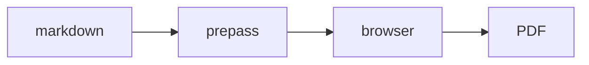

本指南介绍随 `/make-pdf` 与 `/diagram`（v1.58.0.0+）发布的图表与多格式
引擎。这里的一切都完全离线运行：mermaid 与 excalidraw 运行时内嵌在
`lib/diagram-render/` 中，由 `bin/gstack-render.ts` 加载进浏览器——它在你
本机的回环地址上、在一次渲染的时长内提供这套 bundle。没有 CDN，渲染时
没有网络。浏览器优先用你打开着的 Aside 浏览器（macOS 15+）；没有打开
时——Linux、Windows 或应用已关闭——同一套 bundle 会在 gstack 自带的内置
浏览器里渲染，因此在每个平台都能离线出图（回退路径下 PNG 以 1x 输出，
经 Aside 则是 2x）。

## 在 PDF 中渲染 mermaid 图

在你的 markdown 里放一个 fence。就这样。

````markdown

````

```bash
make-pdf generate doc.md out.pdf
```

fence 会渲染为**矢量**图（任意缩放都清晰、文字可选中），`title` 用作
题注与无障碍标签。原始 mermaid 源码会以 base64 编码保存在 figure 的
`data-gstack-source` 属性里，供调试与往返编辑（HTML 注释会破坏 mermaid
的 `-->` 箭头，所以不能用）。一个注意点：fence 必须从**第 0 列**开始——
缩进的 fence（比如在列表里）按设计保持为普通代码块。

**Fence 选项**（在信息串中以空格分隔）：

| 选项 | 效果 |
|---|---|
| `title="..."` | 图表下方的题注 + `aria-label` |
| `render=false` | 让 fence 保持为普通代码块 |
| `page=landscape` | 强制此图独占一页横向页 |
| `page=portrait` | 对此图否决自动横排 |

解析失败的 fence 会渲染成一个醒目的红色诊断块，带解析错误与源码摘录
——文档照常构建，而错误绝不可能被错过。

` ```excalidraw ` fence 的用法相同；正文是一个完整的 `.excalidraw`
场景文件（excalidraw.com 用 File → Save 保存的那种）。

## 控制图片尺寸与方向

本地图片自动内联（相对路径以 markdown 文件为基准解析）且**绝不会被
裁断**——每张图片都封顶在内容框内。超大的照片会降采样到打印分辨率
（内容宽度下 300dpi），手机照片不会把文档撑爆。

图片安全默认值：远程（http/https）图片默认**以可见占位符拦截**，除非
你传 `--allow-network`。解析到 markdown 目录之外的图片路径（即使经由
符号链接）仍会内联，但会大声警告。超过 64MB 的文件与非普通文件
（fifo、设备）降级为占位符，而不是挂死渲染。

逐图指令紧跟在图片后面：

```markdown
{width=full}
{width=2in}
{page=landscape}
{page=portrait}
```

`width=` 接受 `full`、百分比（`50%`）或尺寸（`3in`、`8cm`、`200px`）。
`page=` 强制或否决独占横向页。

**自动横排**：一张宽的、小字号的、像图表的图片会自动获得自己的垂直
居中横向页——即使整篇文档是纵向的。启发式刻意保守（宽高比 ≥ 1.8、
固有宽度超过内容框约 2.5 倍，且 alt 文字里有图表类词：diagram /
architecture / flowchart / chart / graph）。想触发而没触发时，加
`{page=landscape}`；不想触发却触发了，加 `{page=portrait}`。

## 导出单文件 HTML 或 Word

```bash
make-pdf generate doc.md out.html --to html
make-pdf generate doc.md out.docx --to docx
```

- **`--to html`** 写出的是一个自包含文件：图表为内联 SVG，图片为
  data URI，零网络引用（在默认的离线姿态下——`--allow-network` 会刻意
  保留远程图片标签为活引用），外加一层屏幕阅读排版（居中行宽、留白）。
  邮件发它、附件传它、在哪里都能打开。
- **`--to docx`** 是内容保真导出：标题、表格、代码块、列表与图表
  （以带 alt 文本的 300dpi PNG 内嵌）都带过去。像素级版式不带——文件
  打开后那是 Word 的事。

提醒：`--to` 是输出格式。`--format` 是 `--page-size` 的旧别名——两码事。

## 从英文生成图表

```
/diagram make a flowchart of our deploy pipeline: build, test, canary, promote
```

该技能撰写 mermaid 并产出一套**三件套**：

| 文件 | 用途 |
|---|---|
| `<slug>.mmd` | 唯一事实源——编辑后重新渲染 |
| `<slug>.excalidraw` | 在 excalidraw.com 打开（File → Open），挪动方框，交回 |
| `<slug>.svg` / `<slug>.png` | 文档、issue、README、聊天 |

流程图会转换为完全可编辑的 excalidraw 场景。其他 mermaid 类型
（sequence、state、gantt）渲染 SVG/PNG 没问题，但跳过 `.excalidraw`
产物——这是上游转换器的限制，技能会主动告知你。

写文档时，请在 markdown 里内嵌 `.mmd` 源码而不是 PNG——`/make-pdf`
会渲染成矢量，图表永远保持可编辑。

## CI：宁可大声失败，不悄悄发占位符

```bash
make-pdf generate docs.md --strict
```

缺失的本地图片、被拦截的远程图片、树外图片读取（路径或符号链接解析到
markdown 目录之外）、超大文件（>64MB）与非普通文件，全部以非零码退出，
而不是降级为警告或占位符——适用于"坏图片就该搞挂构建"的文档流水线。

## 排障

- **"diagram-render bundle not found"** → 在 gstack 仓库里运行
  `bun run build:diagram-render`，或重跑 `./setup`。
- **图渲染出来了但内联显示被压扁** → 它太宽了；在 fence 上加
  `page=landscape` 给它空间。
- **出现两行的"跑道"环而不是一条长线**：mermaid subgraph 技巧——顶层
  `flowchart TB`，两个 subgraph 分别 `direction LR` 与 `direction RL`，
  连接*subgraph 本身*（跨 subgraph 边界的节点级连线会静默禁用
  `direction`）。
- **"[remote image blocked]" 占位符** → 默认（离线姿态）从不抓取远程
  图片；标签被替换为可见占位符，浏览器在打印时也抓不到它。要放开就传
  `--allow-network`。
