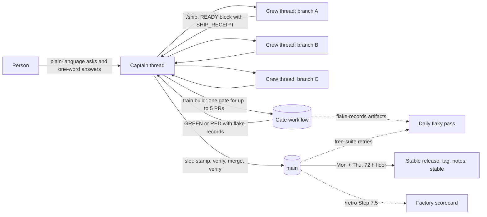

这是一个团队在 Capy Captain 之下运行 gstack 时采用的运营模型：一个人、一条掌管编队的 Captain 线程、各自拥有一个分支并止步于不打戳 READY 的编队线程、一个经列车合并的控制器、一轮每日不稳定修复、一周两次的发布，以及一张说明工厂是否在变好的计分卡。它写自两个在各自仓库上跑了一周的编队（各约每周 100 次合并），以及四位 Captain 在此期间上报的反复出现的问题。下文每个路径与检查名都可配置；这里没有任何东西依赖 gstack 自己的仓库。

两层，刻意分开：

- **工作流通用**（在 Claude Code、Codex 及任何读取 SKILL.md 文件的宿主上可用）：`/ship`、`gstack-ship-queue`、`gstack-restamp`、`gstack-pregate`、ship 回执、列车协议、不稳定重跑规则、`release-cut`、`gstack-factory-scorecard`、`/retro`。
- **Capy 专属**：用户级技能目录及其安装检查、Captain 及其 Drive、编队线程、自动化、`tools.pr.create`、审批中继。每处在下文标有 **Capy**；末节列出哪些只是 Capy 的。



## 第 0 天：安装

### 1. 用户级 gstack 技能（Capy）

把 gstack 检出里的 `capy/skill/gstack/` 拷进此人的用户级 Drive 作 `skills/gstack/`（SKILL.md、`captain.md`、`scripts/install.sh`）。在用户级 `AGENTS.md` 里加：

> At the start of each session on a Capy cloud machine, load the user-scoped `gstack` skill and perform its installation check before starting work. If the check fails, follow the skill's session-start steps. Treat a session with no `gstack: ok` line from this machine as having no gstack: run no gstack workflow, claim none works, and report any blocker. Repeat this check on each separate task machine.

（译：在 Capy 云机上每个会话开始时，加载用户级 `gstack` 技能并在开工前执行其安装检查。检查失败时按技能的会话启动步骤处理。本机没有 `gstack: ok` 行的会话视为没有 gstack：不跑任何 gstack 工作流、不声称任何工作流可用、上报任何阻塞。每台独立任务机都重复该检查。——此块为复制粘贴材料，保留原文）

这买到的是：每条线程先跑 `bash scripts/install.sh --check [--for <skill>]` 并精确报告一个尾注，`gstack: ok <revision> for=<skill>` 或 `gstack: fail <ids>`。冷安装约 30 秒，并打印后续所有命令需要的 `GSTACK_LAUNCH:` 赋值（[docs/capy-install.md](https://github.com/garrytan/gstack/blob/main/docs/capy-install.md)）。要跑 `/ship` 的线程以 `--for ship` 安装；纯规划的裁决（`SKIP pins (planning-only)`）不承认 `/ship`、`/review` 或 `/qa`。

第一周教给每个编队两件事：

- **多数线程从不安装**。规则在首个工作流之前一刻才安装，因此不规划工作流的线程也永远拿不到 `/review` 或 `/investigate`。如果一个项目里多数线程都要跑工作流，就把 gstack 烘进项目的 Capy Setup 快照（[capy-install.md#bake-into-a-capy-snapshot](https://github.com/garrytan/gstack/blob/main/docs/capy-install.md#bake-into-a-capy-snapshot)）：每个会话就只付一次检查。
- **每线程一个修订版**。新机器上的子 agent 各自安装，可能相差一个补丁。把编队所需的最低修订版写进编队规则，并让每份首报告引用尾注——落后的车道自己会暴露。

### 2. 仓库

工作流从仓库读四个文件。团队可以一次采纳一个；每个都独立。

| 文件 | 作用 | 缺了它 |
|---|---|---|
| `.gstack/pregate.json` | 把改动路径映射到测试车道，让 `/ship` 跑覆盖 diff 的测试、远程门禁正确选组（[docs/pregate.md](https://github.com/garrytan/gstack/blob/main/docs/pregate.md)） | `/ship` 对每个没有测试车道的碰过文件警告（`PREGATE_NO_POLICY`）并打印入门策略；所选测试照跑。只设 `timeout_s` 等键而没有 `dependencies`、`empty_lanes`、`selection` 或 `local` 的策略同样如此。在编队开工前由一个所有者一次性写好。 |
| `.gstack/ship-policy.json` | `queue_mode`、`train` 块（门禁与免费工作流名、完整门禁检查、列车规模与填充等待）、打戳文件（[docs/ship-policy.md](https://github.com/garrytan/gstack/blob/main/docs/ship-policy.md)） | 按 PR 队列；`train …` 以 `QUEUE_TRAIN_OFF` 拒绝。 |
| `CHANGELOG.md` + `VERSION` | 每次合并一个打戳、一周两次带说明的发布（[docs/releases.md](/releases/)） | 跳过版本与 changelog 步骤；列车照样基于树回执工作。 |
| `AGENTS.md` 验证纪律 | 先诊断再修复、修复期间用聚焦检查、最后在冻结树上跑一次全量套件 | 线程盲目重试、引用旧修订版的通过结果。 |

一个列车可分发的 `.github/workflows` 门禁是列车唯一的硬性要求：接受带列车 nonce 的 `workflow_dispatch`、并在列车 head 上发布一个检查（`full_gate_check`）与记录工件的工作流。gstack 自己的 `evals.yml` 是参考；只有普通测试工作流的仓库把 `gate_workflow` 指过去，就能得到一列没有付费用例的列车。

### 3. Captain 及其 Drive（Capy）

从 Capy 应用（New Captain）或用 `tools.captain.create` 创建 Captain。其 Drive 以读写挂载到每条编队线程；以下布局是各编队收敛出的：

```
captain-<name>/
  AGENTS.md        the Captain's standing rules: mandate, severity bar, standing approvals, every decision quoted verbatim with its date
  CREW.md          the crew rules every thread reads at start (install check, validation discipline, READY shape, stamp-on-call, flaky rule, approvals)
  DIGEST.md        the state of the crew, "Needs you" first; rewritten, never appended
  NOTES.md         the Captain's running log
  skills/          procedures the crew runs: merge-train/, captain-approvals/, and any repo-specific runbook
  reports/<code>.md   one per thread: Outcome, PR (with head SHAs), Needs, Cost, Lesson, Approvals
  handoffs/        datasets and files the next thread needs (the flaky ledger lives here)
  plans/           plans brought for approval
```

这些文件的第一阶段模板（`AGENTS.md`、`CREW.md`、`DIGEST.md`、报告、READY 块、审批表、叫号）随 `/captain` 技能放在 `captain/templates/`，`docs/captain.md` 讲 Captain 的一天怎么运转。把模板放进去、替换占位符（仓库、编队登录清单、门禁工作流名、最低修订版、谁可批准什么），编队在第一条线程启动前就有了规则。审批形态本身（规划请示带前后对比、为什么、成因、大决定，以及作为字母请示行、以 "do it" 收口的选项；每份报告与 PR 正文里的 `## Approvals` 表）是工作流通用部分，文档在 [capy/skill/gstack/captain.md](https://github.com/garrytan/gstack/blob/main/capy/skill/gstack/captain.md)。

## 第一列列车

一条车道（一条编队线程、一个分支）按序做这些。每条命令都是工作流通用；只有线程与 PR 工具是 Capy 的。

1. **从默认分支开分支，构建，用聚焦检查测试**。把 CHANGELOG 条目写在 `## [Unreleased]` 下（`changelog_fragments` 之下则写进策略的片段目录）；VERSION 保持 main 的值。绝不预先选定版本。
2. **推送最终 head**。以下一切绑定到已推送的 head；晚一步的推送会作废回执、预门禁记录与评审绑定。
3. **开 PR**：用宿主的 PR 工具（Capy：`tools.pr.create`，绝不用 `gh pr create`，CI 与评审回调才能到达线程），基础分支选默认分支。
4. **无人值守跑 `/ship`**，并导出 `GSTACK_LAUNCH` 赋值：它跑预门禁（8 核以下的机器上，基础分支声明 `remote_gate_runs` 时测试档由已推送树上已核验的 CI 运行清账（[CI 搬运](https://github.com/garrytan/gstack/blob/main/docs/pregate.md#ci-carry)）；否则需要 `gstack-pregate --stage tests --remote`，Ubicloud VM 上约 $0.06、小选组本地免费）、两轮评审、门禁完整性清单、文档审计，并把 ship 回执写进 PR 正文（`gstack-ship-receipt write --pr <n>`）。`queue_mode: stamp-at-merge` 之下 `/ship` 不升版本。`/ship` 从不合并、也从不把 main 合进分支。
5. **READY**。`gstack-ship-queue ready --pr <n> --no-screen`（技能自己的付费用例已聚焦跑过之后）或 `--screen`（在合并 SHA 上做一次付费筛查）。把打印的块原样发出：`READY #<n> <head> STAMP_VERSION=unstamped`、该 head 上的 CI、`PREGATE: pass`、筛查行与 `SHIP_RECEIPT: pr=<n> head=<head>`。带 `SHIP_RECEIPT: none` 的块不是 READY。从现在起 head 冻结：一次推送会把 PR 从任何列车上摘下（`QUEUE_TRAIN_MOVED`），车道必须重新 READY。
6. **把 READY 块也作为 PR 评论贴出**。Captain 在线程里读它；计分卡（见下）从第一条携带它的 PR 评论度量 READY → 合并。只在线程里上报的编队没有 READY-to-merge 数字。

控制器（Captain，或它指定的线程）做这些；Captain 的 `skills/merge-train/` 手册是编队副本，[ship-policy.md#run-a-merge-train](https://github.com/garrytan/gstack/blob/main/docs/ship-policy.md#run-a-merge-train) 是参考：

1. `gstack-ship-queue train build --prs 41@<sha>,42@<sha> --dry-run`，然后去掉 `--dry-run`。至多 5 个 READY 钉定，先筛过的优先；不足 5 个时等到最老的 READY 满足 `fill_hours`，`--urgent` 用于单个 PR。拒绝发生在任何花费之前：head 移动了、回执缺失、fork head、真实冲突（输出行点名 PR 与文件；不含它重建，并把它打回车道去合 main）。
2. `train verdict`：GREEN（可能带 `FLAKY N`——某用例失败一次并在同场运行的重跑中通过；那是绿，flake 记录进每日修复）、RED（失败两次的用例：在其上二分、剔除归因 PR，或全绿二分后至多重建一次，绝不超过）、或 INCOMPLETE（纯 INFRA 的清点补一次分发）。
3. **逐槽按序**：叫号车道（"#41 slot <version>, base <sha>, order <…>"）。车道按需合 main（CHANGELOG 按小节），跑 `gstack-restamp --next --base main --pr 41 --expect-base <sha> --expect-order <…> --allow-repo-commands`，提交**仅含**打戳文件，推送，等必需 CI，上报 `READY #41 <stamped sha> STAMP_VERSION=<X>`。控制器跑 `gstack-ship-queue verify --pr 41 --train <nonce>`，以精确 head 合并（`gh pr merge 41 --squash --match-head-commit <sha>`；保留合并提交的仓库用 `--merge`），再核验一次。打了戳文件之外任何东西的打戳提交过不了 `verify --train`、冻结队列、并搭上一道后盾门禁。`changelog_fragments` 之下没有叫号也没有车道打戳：控制器每槽跑 `gstack-ship-queue train land --train <nonce> --pr 41`，推送门禁覆盖过的打戳前缀、等检查、合并并确认 main（[ship-policy.md#train-land](https://github.com/garrytan/gstack/blob/main/docs/ship-policy.md#train-land)）。
4. 每槽合并后 `train prune`。

**谁来合并**。一个控制器，绝不是车道。跑过这套的两个编队以同一种方式学到这点：一个 PR 依据从未通过门禁的绿色清单状态被合并；一个多了一行的打戳提交冻结了队列。

## 每日不稳定修复

规则（所有者定一次、编队规则引用）：按自身裁决失败的用例，在同一棵树上、同一场运行内重跑一次。通过即绿并记 flake；第二次失败是真红；harness、INFRA 与 INCOMPLETE 的红永远不算 flake。任何东西不重试第二次，任何阈值、预算或试验次数不为制造一次通过而挪动。

修复读两个来源，计分卡数的也是这两个：

- **付费**：门禁工作流的 `flake-records-a<attempt>` 工件（`flake-records.jsonl`，每个不稳定用例一条：用例、类别、PR、head、运行、两次尝试、症状、重跑成本）。
- **免费**：免费工作流的 `flake-ledger-*` 工件（每个失败又在串行重试中通过的文件一条 `flaky-pass` 行）。

它把每个事件追加进编队可读的台账（编队放在 Captain Drive 的 `handoffs/flaky-ledger.md`：日期、用例、层级、PR 与 head、两次运行、一行症状），重复者优先排序，每天开一条修复线程，以台账的 Open 节为简报。修复线程把条目挪到 Fixed（附 PR）或 Won't fix（附理由），绝不删除。`bun run test:health` 是免费车道上的每周免费检查（20 次以上 main 运行中 flake 超过 5% 的文件不过）。

**作为 Capy 自动化**（Capy）：一个自动化、按所有者时区每天一个计划触发，提示词大意是「读最新门禁运行的 `flake-records-a*` 工件与上次以来免费运行的 `flake-ledger-*` 工件，把新事件追加进 `handoffs/flaky-ledger.md`，重复者优先，开一条以 Open 节为简报的修复线程，并向 Captain 报数」。传 `thread: "this"` 把历史留在同一处，启用前先手动跑一次。

## 稳定发布

`.github/workflows/weekly-release.yml`（"Stable release"）每周一与周四 14:00 UTC 运行 `scripts/release-cut.ts`，除已核验的安全或回归修复（带 `--ref` 的 `--security` 或 `--regression`）外，每 72 小时至多移动一次 `stable`：取 main 首父历史上最新的绿色提交（其必需检查成功、后盾检查成功、每个检查运行完成且无失败、无生效冻结），打 `v<VERSION>` 标签，发布一份说明为上一发布以来每个 CHANGELOG 版本一行的 GitHub Release，并把 `stable` 快进过去。团队模式安装跟随 `stable`；`gstack-config set update_channel main` 跟随每次合并。热修复是 `--ref <main 上的 sha>`，受同一 72 小时下限约束。细节、下限的拒绝码与"窗口内无绿色"失败形态见 [docs/releases.md](/releases/)。采纳这套的仓库拷贝该工作流、设好必需检查与后盾检查名（`REQUIRED_CHECK`、`BACKSTOP_CHECK`），并保留 CHANGELOG 标题惯例（[docs/CHANGELOG_STYLE.md](https://github.com/garrytan/gstack/blob/main/docs/CHANGELOG_STYLE.md)）。

提防发布饥饿：当列车合并快过后盾尘埃落定，多数 main 提交在被门禁前就被取代，一周可能没有任何候选。修复在工具侧（接受绿色列车记录覆盖的提交），不在人工扣槽。

## 工厂计分卡

`bin/gstack-factory-scorecard` 经 `gh` 读一个窗口（默认 7 天），打印 Markdown 表与 CSV；`gh` 已登录时 `/retro` 把它作为第 7.5 步运行。只读、无付费工作；它下载很小的裁决与 flake 工件，繁忙仓库要花几分钟（`--max-artifact-runs` 封顶）。每行打印自己的计数规则，输入读不出的行写 `unavailable (<原因>)` 而不是 0。

```bash
gstack-factory-scorecard --repo owner/name --since-days 7 \
  [--crew login,login] [--gate-workflow evals.yml] [--free-workflow free-tests.yml] \
  [--train-prefix train/] [--ready-marker 'READY #\d+|SHIP_RECEIPT:'] [--pass-marker '"passes": (\d+)|passes=(\d+)'] \
  [--pass-cap 2] [--out-dir .context/factory-scorecard] [--now <iso>]
```

`--repo` 默认取 origin 远程的 owner/name（github.com 或 `GH_HOST`），没有则必填。每次运行把本窗口的 `scorecard.md` 与 `scorecard.csv` 写进 `--out-dir`，并把同样的行追加到那里的 `trend.csv`——每周复盘无需改文件名就积累自己的趋势。

窗口为 `[now - since-days, now)`：`--now`（默认当前时间）定其末端，每行只计窗口内的条目，因此过后补测的某一周不会计入那周之后发生的事。

| 行 | 怎么计 | 最好的软件工厂之一会显示什么 |
|---|---|---|
| 合并的 PR | 窗口内 `merged_at`、base 为默认分支；编队按 `--crew` 登录名，否则按 OWNER/MEMBER/COLLABORATOR | 每天多次合并、天天如此；外部贡献同一周内落地 |
| 前置时间，创建 → 合并 | PR 的 `created_at` 到 `merged_at`，中位数与 p90 | 中位数 24 小时内、p90 三天内（DORA "elite" 变更前置时间不到一天） |
| 前置时间，READY → 合并 | `merged_at` 之前第一条匹配 `--ready-marker` 的 PR 评论；没有该评论的 PR 被排除并计数 | 2 小时内；每个合并的 PR 都带 READY 评论 |
| 每 PR 评审轮数 | `--pass-marker` 在 PR 正文（/ship 写入的 ship 回执里的 `"passes": N`）或 PR 评论（`passes=N`、`REVIEW_PASSES: N`）里抓到的最大计数，中位数与 p90，外加多少 PR 到达 `--pass-cap`（2，[评审策略](https://github.com/garrytan/gstack/blob/main/docs/review-policy.md)两轮上限，含一次 fix-check：第 1 轮评审整个 diff、第 2 轮只评其后的范围，一轮无所阻断即退出） | 中位数 1 轮；到上限的很少 |
| 门禁运行绿/红/取消 | 门禁工作流已完成的运行（默认 `workflow_dispatch`；`--gate-event any`）；成本取运行的 `report-verdict-a*` 工件（`collector-outcomes.json` 的 `.verdict.costUsd`），否则 PR 裁决评论里的 `**$N** rule/judge cost` 或 `cost=$N` 行 | 95%+ 运行绿、取消接近 0、每次运行成本已知 |
| 每合并 PR 的已知门禁成本 | 已知成本 / 合并 PR；未知成本的运行使其成为下限 | 已知、周同比稳定或下降 |
| 红车率 | head 分支以 `--train-prefix` 开头的运行，取消除外；红 = success 以外的结论；红后盾与红筛查单列 | 5% 以下（每列红车是一次二分加重build，约两道门禁） |
| 不稳定事件 | 最新门禁运行的 `flake-records-a*` 记录（数量、已知重跑花费）与默认分支免费运行的 `flake-ledger-*` 条目；工件读不出的运行被计数并点名、绝不记 0 分；复用其 PR 运行的 main 推送（无工件、`reuse` job 绿）被排除并点名 | 重复用例 0；每 10 次门禁不稳定用例低于 1；免费重跑低于运行数的 1% |
| 开出/关闭的 issue | GitHub 搜索，窗口内创建与关闭 | 关闭 ≥ 开出；没有超过一周的严重项 |
| 切出的发布 | 窗口内发布的发布，草稿除外 | 每周至少一次按期的打标发布 |

第三列是标杆不是自夸：它是 DORA 精英档与运营最好的开源项目所显示的，放进表里是为了让读者在数字旁边看见差距。

### gstack 自己的数字现在如何

用该工具在 gstack 仓库上测 2026-10-19 至 2026-10-25 那一周（UTC；`--now 2026-10-26T00:00:00Z --since-days 7`；列车与 READY 前先 `/ship` 的第一个完整周；83 个合并 PR、54 次门禁运行、54 次全部读到工件）：

| 行 | gstack，那一周 | 对照标杆 |
|---|---|---|
| 合并的 PR | 83（编队 80、外部 3） | 量在那里；3 个外部 PR 都是机器人（github-actions 2 个、dependabot 1 个），外部贡献由编队移植而不是从 fork 合并 |
| 前置时间，创建到合并 | 中位 6.5h、p90 20.0h | 两项都在标杆内 |
| 前置时间，READY 到合并 | 无数字：83 个 PR 中 0 个带 READY 评论 | 编队在线程里报 READY；上面的第 6 步（贴到 PR 上）才让它可测 |
| 每 PR 评审轮数 | 无数字：83 个 PR 中 0 个带轮数 | 回执的 `passes` 字段随 /ship 的收敛规则落地；在那之前编队在 READY 块里记轮数，标记从 PR 评论里读它 |
| 门禁运行 | 52 绿 / 2 红 / 0 取消；54 次中 52 次已知成本 $1,361.94 | 绿率 96%；只有 2 次红运行（红车与红筛查）成本未知 |
| 每合并 PR 的已知门禁成本 | $16.41（下限） | 列车平均每列 $32.48 覆盖至多 5 个 PR（21 列已知成本）；筛查每个 $21.18（29 次已知成本） |
| 红车率 | 5%（22 列中 1 红；红后盾 0、红筛查 1） | 工具把 1/22（4.5%）取整到 5%，恰好压在 5% 标杆下；1 次红筛查与列车分开计 |
| 不稳定事件 | 11 个用例共 17 条付费 flake 记录，各自的一次重跑通过（重跑花费 $7.20）；83 次运行中 17 次免费套件重跑 | 三项都在标杆之外：每门禁 0.31 条 flake 记录对 0.1，多次 flake 的用例 4 个对 0，免费运行重跑率 20% 对 1%。一个用例（`ship-docsync-current`）三天里犯了四次 |
| 开出/关闭的 issue | 28 / 51 | 在标杆内 |
| 切出的发布 | 0 | 一周内没有：首次周发布 v1.91.242.0 在 2026-10-26 12:01 UTC 发布，恰在窗口关闭之后（见上面的饥饿告诫） |

诚实地读差距：前置时间与吞吐量到位，门禁是绿的且成本基本已知，不稳定是唯一不达标的行。每日修复正是为那一行存在的；计分卡的职责是显示它下周是否移动。Captain Drive 里 inventory 车道的逐 PR 基线 CSV 持有这些数字背后更长的历史；从此以后 `--out-dir` 的 `trend.csv` 承载各周。

## 哪些是 Capy 专属、哪些不是

| 关注点 | 工作流通用（任意宿主） | Capy 专属 |
|---|---|---|
| 安装与健康 | `./setup`、`gstack-doctor`、`gstack-upgrade` | 用户级技能目录、`scripts/install.sh --check` 及其尾注、项目 Setup 快照 |
| 运行工作流 | SKILL.md 文件、`GSTACK_SESSION_KIND=unattended`、`GSTACK_RESULT:` 行 | `GSTACK_LAUNCH` 赋值、`GSTACK_CAPY=1` 与 `capy-asks` 块、无强制钩子（安全技能是建议性的） |
| 审批 | `gstack-approvals`、`gstack-owner-brief render --captain`、`## Approvals` 表 | Captain 中继（`needs_you`）、Captain Drive 的 `approvals/` 镜像 |
| Pull request | `/ship`、ship 回执、`gstack-pr-shots` | `tools.pr.create`（回调）、`tools.pr.uploadAsset`（前后对比图） |
| 合并 | `gstack-ship-queue`（ready、train build、verdict、verify；`changelog_fragments` 下的 train land 与 land）、`gstack-restamp`、`gh pr merge --match-head-commit` | 控制器是 Captain 线程；叫号是线程消息 |
| 不稳定修复 | 重跑规则、`flake-records-a*` 与 `flake-ledger-*` 工件、`test:health` | 每日自动化与 Captain Drive 里的台账 |
| 发布 | `release-cut`、`weekly-release.yml`、`stable` 渠道 | 无 |
| 计分卡 | `gstack-factory-scorecard`、`/retro` 第 7.5 步 | 无（CSV 可放 Captain Drive） |
| 记忆 | `reports/<code>.md`、`DIGEST.md`、不稳定台账 | 它们所在的 Drive 范围 |

## 编队有分歧之处的选项

两个编队在各自仓库上跑了一周，在几点上保留了不同习惯。选适合仓库的那种；两者都受支持。

| 点 | 选项 A | 选项 B |
|---|---|---|
| 合并方式 | squash 加 `--match-head-commit`（每 PR 一个提交；CHANGELOG 按小节合并） | 合并提交加 `--match-head-commit`（保留车道的提交；策略里 `history: merge`） |
| 每 PR 的付费证据 | 一列车门禁覆盖至多 5 个 PR；车道自选 `--screen` 或自己聚焦的用例 | 交接时每 PR 一道完整门禁，外加 "gate-ahead"：PR N+1 在（其分支 + N 的 head）上过门禁，N 的合并无需第二道门禁 |
| 复用门禁 | 树规则：与被门禁树的 diff 只碰打戳文件的 head 复用门禁（`gstack-tree-receipt`） | 同一规则，由控制器在每次合并前用 `git diff <gated> <head>` 核验 |
| 严重修复抢槽 | 下一列车，单 PR 用 `--urgent` | 对全部叫号；第一份完整 READY 赢，其余重打戳到下一补丁 |
| PR 推送上的廉价 CI | 每次推送跑免费测试；付费工作只在列车与筛查里 | 推送上跑廉价档、`full-ci` 标签在精确 head 上分发全套件；廉价档绝不做合并证据 |
| 基础设施 flake | 绝不重跑 harness/INFRA 红；纯 INFRA 清点补一次分发 | 一个点名的 infra flake（如已知的 runner 卡死）可重跑一次、必须在 READY 里声明；第二次卡死升级 |
| 小修复 | 每个 PR 一个，由列车攒批 | 攒成波次 PR——串行槽每个约 30 分钟 |
| 合并之后 | main 后盾对列车未覆盖的每次推送做门禁，变红即冻结队列 | 控制器盯 main 的测试、e2e 与发布运行直到发布上线；main 变红即冻结队列直到根因查明 |
| 严重项分流 | Captain 盯 issue 与 PR，为每个无主的严重项开线程 | 定时严重项清扫（每 4–8 小时）配固定严重度门槛、对已认领车道去重、每批一条热修线程 |
| 贡献者 PR | 移植到编队分支、保留作者提交与 `Co-authored-by`；fork PR 以致谢关闭并链接移植，经 `tools.pr.comment` 以 `capy-ai[bot]` 发出，绝不用 `gh` | 经波次 PR 落地，带 "Contributed by @handle"、`Co-Authored-By` 与 `Supersedes` 行 |
| 隐私 | 每次推送前预门禁的密封输出与密钥扫描 | 另加对任何公开工件之前按用户的拒绝清单 grep（名字、主机名、来自私有来源的可识别计数） |

## 已知的 Capy 限制

收集自五位 Captain 在 2026-10-26、于五个仓库上运行这套工作流一周后写的 issue 文件。每条都是当日平台或其上工作流的限制，附编队使用的绕行办法。

**安装与版本**

- 每台机器（含子 agent）都需要自己的安装与尾注；新机器为此花 30 秒到几分钟，每次运行九个分片子 agent 的编队要付九次。绕行：把 gstack 烘进项目 Setup 快照。
- 不规划工作流的线程从不安装，`/review` 与 `/investigate` 因此闲置。绕行：编队规则点名每条线程要跑的工作流，或用快照。
- 同一线程内各机器的 gstack 版本漂移（一台 `behind=1`、另一台最新）；每次最低版本上调都是全编队广播（一个编队十天广播了八次）。绕行：编队规则里的最低修订版，每份首报告引用。
- 以 `--for review-voice` 安装的评审者被每个工作流拒绝，之后被叫去跑工作流时必须 `--for <skill>` 重装。

**机器与长任务**

- 机器睡眠与重启杀死分离的服务器、本地驱动与长验证循环；`/tmp` 撑不过一次唤醒。绕行：受监视的后台操作（保持机器清醒）、运行目录放 `~/.capy/work` 下、长驱动放远程 VM、每个计费运行一个 worktree。
- 共享树上的提交会卷进另一个子 agent 未提交的 hunk。绕行：每棵树一个提交者。
- Capy 的 git 包装器强制关联身份，设置并断言 `GIT_AUTHOR_NAME` 的测试在每台 Capy 机器上失败、在 CI 里通过（gstack 自己的 `test/gstack-retro-metrics.test.ts` 就是一个）。绕行：把这些失败读作环境因素，验收跑在远程 VM 上的免费套件。
- 一行坏 shell 可能把环境（含密钥）打进工具日志。绕行：绝不裸跑 `env`、`printenv`、`set`、`export`；密钥只查已设/未设（gstack 的 launch-env 棘轮在自己的文件里强制这一点）。

**Pull request 与评审**

- 不带 `index` 或 `head` 的 `tools.pr.create` 发布主检出的分支而非 worktree 的，且指向配置的 base——在以非默认分支工作的项目里每次都要传。
- Capy 的逐推送自动评审加 `/ship` 的两轮评审让评审时间翻倍，P0 上一个评审循环能跑五轮以上，每次推送冒出一个新发现。绕行：第一次推送前先跑评审声音；P0 上只修 P0 路径上的发现，其余推给后续。
- 干净的评审不被带到树相同的合并 head 上，后者可能"运行"十分钟以上。
- PR 监视与 CI 回调只对 Capy 项目内的仓库生效；等项目外仓库的线程会睡到定时器唤醒。
- 看不到按子 agent 的成本，`/ship` 与规划报告说不出宿主子 agent 花了什么（"六个宿主子 agent，花费未知"）。
- 以"head 上的 ship 回执"为键的合并规则在平台侧没有可机读的形态：控制器 grep PR 正文。`gstack-ship-queue ready` 与 `train build` 在工作流侧检查它。

**审批**

- 编队线程里的 autoplan 门禁哪怕所有者的常设答案是"全盘采纳"也要走一趟 Captain 往返；用 `gstack-approvals` 把常设答案记录一次并引用它。Captain 创建过 `approvals/` 目录时，各行镜像到 Captain Drive，其他编队线程可读；没有的话它们留在私有项目用户 Drive，Captain 把文字带进 PR 正文。

**同一批文件点名的工具缺口（已在 gstack 修复或有主，列出以便读者知道日期**）：预门禁对没有 `.gstack/pregate.json` 的仓库里每个碰过的文件失败；`/ship` 在无人值守模式下不打印 `GSTACK_RESULT: skill=ship` 行；晚到的推送使回执过期（现被 `ready` 拒绝）；回执写入步骤截断 PR 正文；`/ship` 的文档审计阻塞在所有者必须手工接受的风险上；预门禁的密钥扫描拒绝每试验的良性假令牌而没有白名单；autoplan 门禁没有浮现成本上限。

## 一切在哪里

| 什么 | 路径 |
|---|---|
| 用户级技能与 Captain 指南 | `capy/skill/gstack/SKILL.md`、`capy/skill/gstack/captain.md`、`capy/skill/gstack/scripts/install.sh` |
| Captain 模板与 Captain 的一天 | `captain/templates/`、`docs/captain.md`（随 `/captain` 技能发布） |
| Capy 上的安装、快照、启动行 | `docs/capy-install.md` |
| Ship 策略、队列与列车 | `docs/ship-policy.md`、`lib/ship-queue*.ts`、`bin/gstack-ship-queue`、`bin/gstack-restamp` |
| 预门禁与车道 | `docs/pregate.md`、`bin/gstack-pregate` |
| 不稳定重跑与记录 | `docs/TESTING_INTERNALS.md#flaky-reruns`、`scripts/lib/paid-rerun.ts`、`scripts/lib/ci-history.ts` |
| 稳定发布 | `docs/releases.md`、`scripts/release-cut.ts`、`.github/workflows/weekly-release.yml` |
| 计分卡 | `bin/gstack-factory-scorecard`、`lib/factory-scorecard.ts`、`retro/SKILL.md.tmpl` 第 7.5 步、`test/factory-scorecard.test.ts` |
