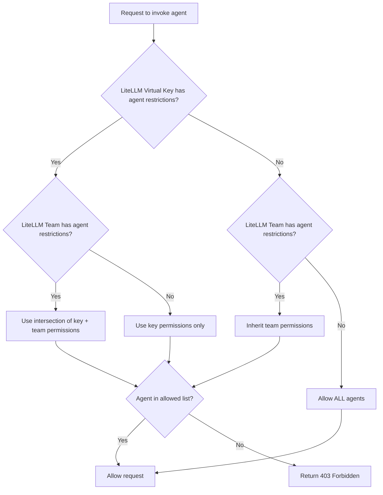

import Tabs from '@theme/Tabs';
import TabItem from '@theme/TabItem';
import Image from '@theme/IdealImage';

# Agent 权限管理

在 LiteLLM 中控制特定密钥或团队可以访问哪些 A2A（Agent-to-Agent）Agent。

## 概述

Agent 权限管理让你可以限制 LiteLLM 虚拟密钥（virtual key）或团队能访问哪些 Agent。适用场景包括：

- **多租户环境**：让不同团队访问不同的 Agent
- **安全性**：防止密钥调用其无权访问的 Agent
- **合规性**：对敏感的 Agent 工作流强制执行访问策略

配置权限后：
- `GET /v1/agents` 只返回该密钥/团队可访问的 Agent
- `POST /a2a/{agent_id}`（调用 Agent）在访问被拒绝时返回 `403 Forbidden`

## 为密钥设置权限

下面的示例演示如何创建带 Agent 权限的密钥并测试访问。

### 1. 获取 Agent ID

<Tabs>
<TabItem value="ui" label="UI">

1. 在侧边栏进入 **Agents** 页面
2. 点击进入目标 Agent
3. 复制 **Agent ID**

<Image 
  img={require('../img/agent_id.png')}
  style={{width: '80%', display: 'block', margin: '0', borderRadius: '8px'}}
/>

</TabItem>
<TabItem value="api" label="API">

```bash title="List all agents" showLineNumbers
curl "http://localhost:4000/v1/agents" \
  -H "Authorization: Bearer sk-master-key"
```

响应：
```json title="Response" showLineNumbers
{
  "agents": [
    {"agent_id": "agent-123", "name": "Support Agent"},
    {"agent_id": "agent-456", "name": "Sales Agent"}
  ]
}
```

</TabItem>
</Tabs>

### 2. 创建带 Agent 权限的密钥

<Tabs>
<TabItem value="ui" label="UI">

1. 进入 **Keys** → **Create Key**
2. 展开 **Agent Settings**
3. 勾选要允许访问的 Agent

<Image 
  img={require('../img/agent_key.png')}
  style={{width: '80%', display: 'block', margin: '0', borderRadius: '8px'}}
/>

</TabItem>
<TabItem value="api" label="API">

```bash title="Create key with agent permissions" showLineNumbers
curl -X POST "http://localhost:4000/key/generate" \
  -H "Authorization: Bearer sk-master-key" \
  -H "Content-Type: application/json" \
  -d '{
    "object_permission": {
      "agents": ["agent-123"]
    }
  }'
```

</TabItem>
</Tabs>

### 3. 测试访问

**允许访问的 Agent**（调用成功）：
```bash title="Invoke allowed agent" showLineNumbers
curl -X POST "http://localhost:4000/a2a/agent-123" \
  -H "Authorization: Bearer sk-your-new-key" \
  -H "Content-Type: application/json" \
  -d '{"message": {"role": "user", "parts": [{"type": "text", "text": "Hello"}]}}'
```

**被阻止的 Agent**（返回 403）：
```bash title="Invoke blocked agent" showLineNumbers
curl -X POST "http://localhost:4000/a2a/agent-456" \
  -H "Authorization: Bearer sk-your-new-key" \
  -H "Content-Type: application/json" \
  -d '{"message": {"role": "user", "parts": [{"type": "text", "text": "Hello"}]}}'
```

响应：
```json title="403 Forbidden Response" showLineNumbers
{
  "error": {
    "message": "Access denied to agent: agent-456",
    "code": 403
  }
}
```

## 为团队设置权限

将团队下所有密钥可访问的 Agent 限制在指定范围内。

### 1. 创建带 Agent 权限的团队

<Tabs>
<TabItem value="ui" label="UI">

1. 进入 **Teams** → **Create Team**
2. 展开 **Agent Settings**
3. 勾选要允许该团队访问的 Agent

<Image 
  img={require('../img/agent_key.png')}
  style={{width: '80%', display: 'block', margin: '0', borderRadius: '8px'}}
/>

</TabItem>
<TabItem value="api" label="API">

```bash title="Create team with agent permissions" showLineNumbers
curl -X POST "http://localhost:4000/team/new" \
  -H "Authorization: Bearer sk-master-key" \
  -H "Content-Type: application/json" \
  -d '{
    "team_alias": "support-team",
    "object_permission": {
      "agents": ["agent-123"]
    }
  }'
```

响应：
```json title="Response" showLineNumbers
{
  "team_id": "team-abc-123",
  "team_alias": "support-team"
}
```

</TabItem>
</Tabs>

### 2. 为团队创建密钥

<Tabs>
<TabItem value="ui" label="UI">

1. 进入 **Keys** → **Create Key**
2. 在下拉框中选择所属 **Team**

<Image 
  img={require('../img/agent_team.png')}
  style={{width: '80%', display: 'block', margin: '0', borderRadius: '8px'}}
/>

</TabItem>
<TabItem value="api" label="API">

```bash title="Create key for team" showLineNumbers
curl -X POST "http://localhost:4000/key/generate" \
  -H "Authorization: Bearer sk-master-key" \
  -H "Content-Type: application/json" \
  -d '{
    "team_id": "team-abc-123"
  }'
```

</TabItem>
</Tabs>

### 3. 测试访问

该密钥会继承团队的 Agent 权限。

**允许访问的 Agent**（调用成功）：
```bash title="Invoke allowed agent" showLineNumbers
curl -X POST "http://localhost:4000/a2a/agent-123" \
  -H "Authorization: Bearer sk-team-key" \
  -H "Content-Type: application/json" \
  -d '{"message": {"role": "user", "parts": [{"type": "text", "text": "Hello"}]}}'
```

**被阻止的 Agent**（返回 403）：
```bash title="Invoke blocked agent" showLineNumbers
curl -X POST "http://localhost:4000/a2a/agent-456" \
  -H "Authorization: Bearer sk-team-key" \
  -H "Content-Type: application/json" \
  -d '{"message": {"role": "user", "parts": [{"type": "text", "text": "Hello"}]}}'
```

## Agent 访问组

随着 Agent 数量增长，为每个密钥或团队逐一授予单个 Agent 会变得难以维护。**Agent 访问组**（access group）让你可以在仪表板中给 Agent 打上逻辑标签，再把整个**组**授予密钥或团队。新 Agent 加入组后，持有该组的所有密钥/团队会自动获得对它的访问权限。

### 1. 为 Agent 打上一个或多个组标签

在 LiteLLM 仪表板中：

1. 进入 **Agents** 页面。
2. 创建或编辑一个 Agent。
3. 在 **Access Groups** 下输入组名（如 `clinical-tools`）并按回车。

:::note
目前只能通过仪表板为 Agent 打访问组标签。`POST /v1/agents` 的请求体模式（schema）尚未把 `agent_access_groups` 暴露为顶层字段；组标签会持久化到底层数据库列中，并在权限判定时被读取。
:::

### 2. 将组授予密钥或团队

```bash title="Key with access to two agent groups" showLineNumbers
curl -X POST "http://localhost:4000/key/generate" \
  -H "Authorization: Bearer sk-master-key" \
  -H "Content-Type: application/json" \
  -d '{
    "object_permission": {
      "agent_access_groups": ["clinical-tools", "research-tools"]
    }
  }'
```

现在该密钥可以访问打上任一组的所有 Agent，无需逐个枚举。`agent_access_groups` 字段同样可用于团队的 `object_permission`。

当密钥**同时**拥有直接的 `agents` 列表和 `agent_access_groups` 时，会先取并集（两条路径中任一路径可达的 Agent 都允许访问），再按下文所述应用团队层级的交集。

## 工作原理



A2A 权限判定分为密钥和团队两个层级。（MCP 的[权限层级](./mcp_control#权限层级)还额外延伸到终端用户 / Agent / 组织；目前的 Agent 权限是一个更窄的模型。）

| 密钥权限 | 团队权限 | 结果 | 说明 |
|-----------------|------------------|--------|-------|
| 无 | 无 | 密钥可访问**所有** Agent | 未设置任何限制时默认完全开放 |
| `["agent-1", "agent-2"]` | 无 | 密钥可访问 `agent-1` 和 `agent-2` | 密钥使用自身权限 |
| 无 | `["agent-1", "agent-3"]` | 密钥可访问 `agent-1` 和 `agent-3` | 密钥继承团队权限 |
| `["agent-1", "agent-2"]` | `["agent-1", "agent-3"]` | 密钥仅可访问 `agent-1` | 取两个列表的交集（最严格者生效） |
| `agent_access_groups: ["clinical"]` | 无 | 密钥可访问打上 `clinical` 标签的所有 Agent | 访问组会被解析为具体的 Agent ID |
| `agent_access_groups: ["clinical"]` | `agents: ["agent-1"]` | 取（打上 `clinical` 标签的所有 Agent）与 `["agent-1"]` 的交集 | 支持直接授予与组授予混用 |

## 查看权限

<Tabs>
<TabItem value="ui" label="UI">

1. 进入 **Keys** 或 **Teams** 页面
2. 点击进入要查看的密钥/团队
3. Agent 权限会显示在信息视图中

</TabItem>
<TabItem value="api" label="API">

```bash title="Get key info" showLineNumbers
curl "http://localhost:4000/key/info?key=sk-your-key" \
  -H "Authorization: Bearer sk-master-key"
```

</TabItem>
</Tabs>
