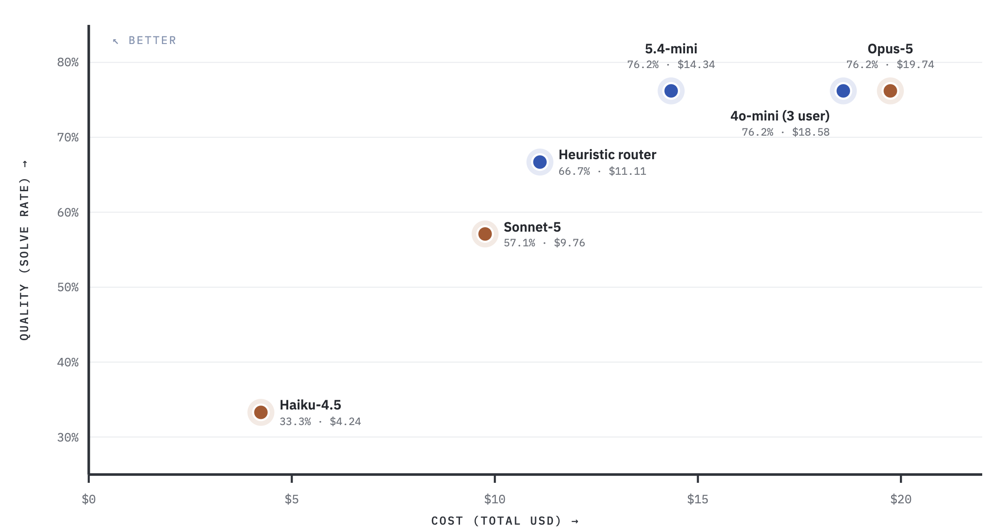
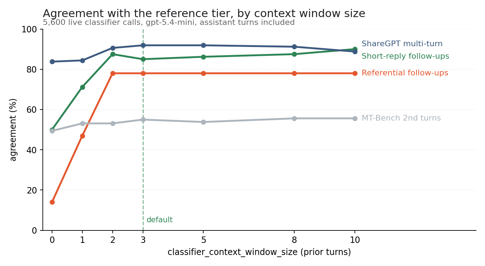

import NavigationCards from '@site/src/components/NavigationCards';

这些文章发布的测量均使用真实的提供商 API 及其配置完成。JEV 分类器对比直接对分类器计时，并附带一次独立的在线代理验证。下文数字均引自这些文章。

## JEV 分类器：速度是 Haiku 的 5.43 倍，成本低 96%

2026-09-18，TypeSafe `jev-1.13.0` 与 `anthropic/claude-haiku-4-5-20251001` 对同一批 80 条人工编写的合成用例做了分类，三组配对重复，并发数为 1。

| 指标 | JEV | Haiku |
| --- | ---: | ---: |
| 与人工标注预期分层的匹配 | 95.00% (228/240) | 73.75% (177/240) |
| 分类器 p50 延迟 | 126.81 ms | 688.40 ms |
| 分类器 p95 延迟 | 231.16 ms | 896.94 ms |
| 按注册价计算的分类器成本（240 次调用） | $0.007706664 | $0.198534 |
| 提供商错误 / 超时 / 回退 | 0 / 0 / 0 | 0 / 0 / 0 |

按中位延迟计，JEV 分类请求的速度是 Haiku 的 5.43 倍，p95 下是 3.88 倍，按注册价计算的分类器成本低 96.12%。两个分类器之间的分层一致率为 78.75%，这是与人工标注匹配率相互独立的另一项指标。八个边界用例的匹配率差异区间包含零。

上述结果衡量的是分类器在该语料上的表现，使用同一套自定义评分标准与明确的上下文设置。请求内容、分层定义、指令与上下文都可能改变任一分类器的匹配率。预期标签未经独立审核，也未评估其他版本的分类器提示词。这些结果不能证明分类的总体准确率、下游回答质量、账单节省，或并发负载下的表现。另项网关检查对每个分层都使用同一个下游模型，因此无法证明切换补全模型带来的节省。

[阅读方法说明、分层结果、不确定度与局限性](https://docs.litellm.ai/blog//blog/jev-auto-router-benchmark)，或[下载冻结的证据与复现脚本](/benchmarks/jev-live-evidence-20260918.tar.gz)。

## Terminal-Bench 2.0：Opus 级质量，成本低 27%

- 路由器与 Claude Opus-5 单模型都**解出 16/21**，解题率相同。
- 总成本 **$14.34 对 $19.74**，低 27%。
- 分类器：gpt-5.4-mini，只读当前这条消息。
- 把上下文拓宽到最近 3 条用户消息：解题率从 66.7% 升到 76.2%，成本 +44%。
- 把助手回复也纳入分类器视野：质量下降，成本上升。默认配置不纳入它们。

<NavigationCards
columns={2}
items={[
  {
    title: "Auto Router：Opus 级质量，成本最多低 27%",
    description: "按上下文窗口划分的完整结果、路由器与各单一模型的对比，以及确切配置。",
    to: "https://docs.litellm.ai/blog/auto-router-terminal-bench-benchmark",
  },
  {
    title: "LiteLLM Fusion 亮相：比 Fable 5 多解 56% 的任务",
    description: "同样 21 个任务，三个模型并行再加一个合成器：花费 +36%，每个解题任务省 12%，回合延迟 5 倍。",
    to: "https://docs.litellm.ai/blog/fusion-terminal-bench-benchmark",
  },
]}
/>

## Heuristic v2：多解 27% 的任务，单任务成本低 45%

| 分类器 | 解题率 | 解题/21 | 总成本 | $/解题 | 平均调用延迟 | p90 调用延迟 | 任务耗时中位数 |
|---|---:|---:|---:|---:|---:|---:|---:|
| **Heuristic v2** | **66.7%** | **14/21** | **$9.78** | **$0.70** | **13.1s** | **30.7s** | **7m08s** |
| Heuristic v1 | 52.4% | 11/21 | $14.06 | $1.28 | 14.5s | 34.1s | 8m53s |

- 同样是 21 个任务的 Terminal-Bench 2.0 子集，分层相同，只有 `classifier_type` 不同。
- 请求路径上**没有任何 LLM 分类器调用**。它基于已评分的响应数据预训练，因此没有冷启动。
- 输入 Token 中 **87%** 来自缓存读取，v1 为 82%：分层选择更稳定，缓存未命中就更少。
- 两组共 933 次 LLM 调用，失败请求为零。
- 通过 `classifier_type: heuristic_v2` 启用。

<NavigationCards
columns={2}
items={[
  {
    title: "AutoRouter Heuristic v2 亮相：多解 27% 任务，成本低 45%",
    description: "分类器改了什么、分层结果、延迟，以及免费试用范围。",
    to: "https://docs.litellm.ai/blog/heuristic-v2",
  },
]}
/>

## 六项公开基准与 RouterArena：便宜 40% 到 75%

| 评测 | 样本 | 相对全 Opus-5 的成本 | 相对前沿模型的质量 |
| --- | --- | --- | --- |
| 六项公开基准，在线代理 | 220 条已评分提示词 | 便宜 40.4% | 97.1%（91.8% 对 94.5% 通过） |
| RouterArena | 8,399 次查询 | 便宜 74.5% | 87.3% |
| WildChat-1M 模拟 | 12,000 段对话 | 便宜 64.9% | 未测量 |
| DevGPT 模拟 | 2,056 段对话 | 便宜 65.4% | 未测量 |
| 代码过滤后的 WildChat | 993 段对话 | 便宜 20.0% | 未测量 |

<NavigationCards
columns={2}
items={[
  {
    title: "以接近前沿模型的质量，砍掉 75% 的 Claude Code 成本",
    description: "各基准评分、对话模拟，以及节省从何而来。",
    to: "https://docs.litellm.ai/blog/auto-router-cost-quality-benchmark",
  },
]}
/>

## 分类器上下文：后续追问一致率 14% 到 78%

- **5,600 次分类器在线调用**。
- 只有结合历史才能解析的后续追问一致率：**0 轮时 14%，1 轮时 47%，2 轮时 78%**，此后直到 10 轮都持平。
- 分类器成本：**每 1,000 次请求至多 $0.61**。
- 相对无上下文的延迟差：每个 95% 区间都包含零。
- 发布的默认值：前 3 轮用户消息，每条 200 字符，不含助手消息。

<NavigationCards
columns={2}
items={[
  {
    title: "Auto Router v1.97：用量基准与更低成本的更好质量",
    description: "一致率与窗口大小的关系、分类器单请求成本、延迟差异，以及 Benchmarks 视图。",
    to: "https://docs.litellm.ai/blog/auto-router-context-and-benchmarks",
  },
]}
/>

## 生产环境：272,876 次请求节省 51%

- **450+ 用户**，横跨开发、预发布与生产环境，2026-04-15 至 2026-08-09。
- **272,876 次请求、70.8 亿 Token**。
- 实际花费 **$11,736**，对照仅用旗舰模型的假想支出 **$23,985**： **节省 $12,249，即 51.1%**。
- 随着分层映射不断调优，节省率从第一个完整月的 42.9% 升至最后一个月的 60.7%。
- 95% 的请求从未触及旗舰分层。

<NavigationCards
columns={2}
items={[
  {
    title: "一次真实生产部署报告的成本节省达 51%",
    description: "逐月节省、分层分布、他们运行的配置，以及改动了什么。",
    to: "https://docs.litellm.ai/blog/auto-router-production-savings",
  },
]}
/>

## 影子评估：88.1% 持平或胜过现有模型

- 在我们自己的在线网关流量上做盲评 LLM 评审，且在任何面向用户的响应改变之前完成。
- **评审 143 个回合，评审开销 $1.55**。
- 路由器胜 9.8%，平局 78.3%，现有模型胜 11.9%。
- 如何在自己的流量上跑一次：[在你的流量上评估](/docs/auto_router/evaluate)。

<NavigationCards
columns={2}
items={[
  {
    title: "影子评估：用你自己的生产流量测试 Auto Router",
    description: "抽样、去重、盲评与结果卡片。",
    to: "https://docs.litellm.ai/blog/auto-router-shadow-evaluations",
  },
]}
/>

## 提示词缓存：比单纯缓存便宜 37% 到 69%

- 五个数据集，其中包括按提供商自身缓存口径计费的在线网关流量。
- 路由器加缓存在每个数据集上都胜过只缓存一个固定模型。
- 完整说明：[提示词缓存](/docs/auto_router/prompt_caching)。
