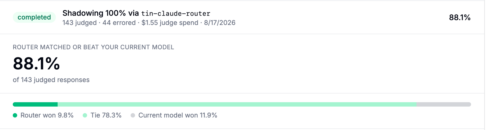
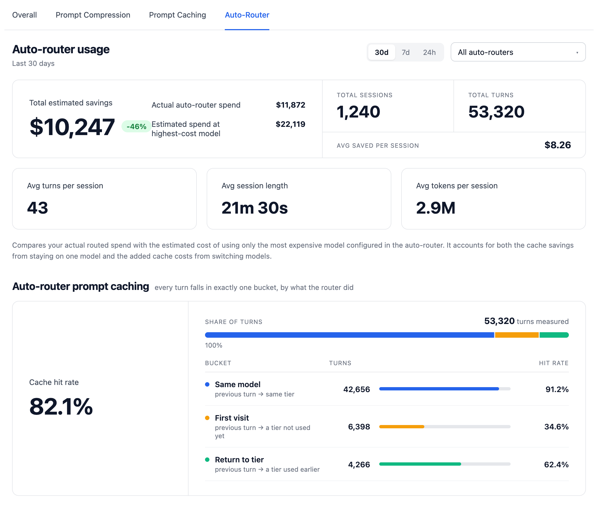

import NavigationCards from '@site/src/components/NavigationCards';

公开基准测试衡量的是别人的提示词。有两个功能衡量你自己的流量：切换前的**影子评估**（shadow evaluation），以及切换后的**节省核算**。

## 影子评估

- **抽样**：取某个密钥、团队或用户真实流量中的一小部分。
- **复制**：每条被抽样的请求都会经由路由器再发一次，影子响应永远不会到达客户端。
- **盲评**：由一个 LLM 把路由器的回答与当前模型给出的回答做对比。
- **运行**：最长 30 天（默认 7 天），或直到每个目标自身的影子与评审花费达到 `max_budget`（默认 10 美元，上限 10,000 美元）。`max_turns` 已不再支持。
- **比较**：一个任务即可在同一批抽样流量上对比多套路由配置，在做出任何改动之前就敲定分层映射（tier map）与分类器的选择。
- 在我们自己的流量上：**88.1%** 追平或超过了当前模型，共评审 143 个回合，评审花费 1.55 美元。

<NavigationCards
columns={2}
items={[
  {
    title: "影子评估：在自己的生产流量上测试 Auto-Router",
    description: "如何创建评估任务、回合与时长的默认值、选择评审模型、读取结果卡片。",
    to: "https://docs.litellm.ai/blog/auto-router-shadow-evaluations",
  },
  {
    title: "按上下文长度与模态路由",
    description: "多配置影子任务，以及密钥、团队、用户三类目标。",
    to: "https://docs.litellm.ai/blog/auto-router-more-routing-configurations",
  },
]}
/>

## 在自己的提示词上评估 JEV

先用[测试路由](/docs/auto_router/setup#jev-分类器typesafe-ai)检查分层选择，再用影子评估对比实际回答。分类器与你的分层标签对得上，并不能说明所选模型回答得好。在把 JEV 与其他分类器做比较之前，先冻结你的评分规则与标签，并把分歧情况与正确率分开上报

[JEV 基准测试](https://docs.litellm.ai/blog//blog/jev-auto-router-benchmark)在人工编写的合成用例上测量了分类器延迟，以及按注册表（registry）定价的分类器成本。要评估一次部署，就应把分类器花费、下游补全、启用时的嵌入（embedding）调用，以及影子与评审请求都算进去。除了成功调用的平均值，还要记录回退率与 p95 延迟

JEV 会为 `typesafe/<model>` 分类器调用单独记录一条日志，并通过父请求的元数据归因。成功的 JEV 路由决策也会携带 `classifier_cost`，并从上报的路由器节省金额中扣除。这段元数据描述的是已经单独记账的分类器费用：汇总花费记录时不要重复计算。缺少用量数据或注册表中没有对应条目时，分类器成本就无从得知；请求被取消也不代表提供商的计费为零

## 切换之后的节省

- **按请求**：路由器选了哪个模型、为什么这么选，以及同一请求在所配置最难分层中最贵的模型上会花多少钱。两者的差额（扣除分类器调用费用后）会标记在该请求上。
- **汇总**：计入每日花费表，可按密钥、团队、标签和组织分头查看。
- **用量标签页**：预计节省总额、会话数与回合数、按回合类型划分的提示词缓存命中率。对 40 万个会话做 30 天窗口的查询，38 毫秒即可返回。
- **分类器成本**：只要记录了分类器成本，就会通过 `x-litellm-classifier-cost` 响应头按请求返回，包括一次成功的 JEV 分类。
- **诚实的基线**：续接回合按热缓存计价；切换之后的首次缓存写入会从节省中扣除，因此单条请求的节省可能显示为负数。计算公式与所有展示位置见[上报的节省金额](/docs/proxy/auto_routing#节省额报告)。

<NavigationCards
columns={2}
items={[
  {
    title: "AutoRouter：轻松看清你的节省金额",
    description: "用量标签页、按请求的分类器成本，以及针对你自己部署的预设匹配。",
    to: "https://docs.litellm.ai/blog/auto-router-spend-visibility",
  },
  {
    title: "决策日志",
    description: "每次路由决策输出一行可检索日志：原因、分层、分数、信号、所选模型。",
    to: "/docs/proxy/auto_routing#decision-log",
  },
]}
/>

## 解读单次决策

- 日志中每条经过路由的请求都以一张路由决策卡片开头：分层、原因（含 `jev_classifier`），以及实际服务的模型。
- 添加模型（Add Model）表单中的测试路由会显示同样的卡片，生产环境中遇到令人意外的决策时，可以用同一个提示词在表单里复现验证。
