import NavigationCards from '@site/src/components/NavigationCards';
import { SlidersHorizontal, Gauge, BrainCircuit, GitBranch, Split, Target, Combine, Server, Braces } from 'lucide-react';

Auto Router 的分类器决定由哪个分层（tier）来处理一次请求。

## 选择分类器

<NavigationCards
columns={3}
variant="cards"
items={[
  { title: "Heuristic v1", icon: <SlidersHorizontal size={18} />, tone: "local", description: "本地关键词与模式打分，权重可调。不调用分类器 API。", to: "#调优启发式-v1" },
  { title: "Heuristic v2", icon: <Gauge size={18} />, tone: "local", description: "对四个分层做本地成功率估计。可调最低成功阈值。", to: "#调优启发式-v2" },
  { title: "Always use the judge", icon: <BrainCircuit size={18} />, tone: "judge", description: "每次分类运行都由 LLM 选择分层。", to: "#调优-llm-裁判" },
  { title: "Heuristic first", icon: <GitBranch size={18} />, tone: "chain", description: "v1 或 v2 本地判到分层上限，其余请求交给 LLM。", to: "#启发式优先" },
  { title: "Hybrid", icon: <Split size={18} />, tone: "chain", description: "v1 或 v2 本地判断；接近决策边界时询问 LLM。", to: "#混合模式" },
  { title: "Capability", icon: <Target size={18} />, tone: "forecast", description: "预测高效求解器能否完成任务；不能则改用能力更强的求解器。", to: "#capability-模式" },
  { title: "Fuse v2", icon: <Combine size={18} />, tone: "forecast", description: "比较两份求解器预测，在可接受的质量差距内做出选择。", to: "#fuse-v2" },
  { title: "OSS classifier", icon: <Server size={18} />, description: "连接自托管的 Laya 或 Bespoke Nimble，或托管的 Jev 分类器。", to: "#接入自托管分类器" },
  { title: "Custom classifier", icon: <Braces size={18} />, description: "用你自己的 Python 插件路由，在网关启动时配置。", to: "#自定义分类器仅限启动配置" },
]}
/>

启发式 v2、自定义评分、自定义分层/指令以及预测模式都受网关所显示额度的约束。请查看 **View limits**，不要想当然地把被禁用的选项当成缺失的功能。内置 v1 与内置 OSS 分类不需要许可证。v2 链消耗的 v2 额度与独立 v2 路由器相同。

## 找到设置入口

先选择适合你流量的分类器，度量它的决策，再调优它的阈值、上下文或指令。被选中分层所配置的模型负责生成回答；裁判模型只做路由决策。

本指南把仪表板上的控件与 `config.yaml` 中的对应配置一一对照。内容先讲分类，再讲可以覆盖或复用决策的路由规则。初次部署请看 [Admin Setup](./setup.md)；度量质量与节省成本请看 [Evaluate](./evaluate.md)。

:::info 界面与版本可用性

截图来自 [LiteLLM #44928](https://github.com/BerriAI/litellm/pull/44928) 中更新后的编辑器，使用的是本地演示路由器。独立的调优分区以及可选择的 v1/v2 本地启发式，要求网关和仪表板的构建版本包含该改动。不要以为旧版本也会暴露这些控件或接受 `local_heuristic`。

示例描述的是该实现。不同版本之间默认值可能变化；可选项不设置时遵循你所安装构建中的默认值。截图中的模型名称是演示用的部署别名，不是提供商的模型 ID。

:::

打开 **Models + Endpoints > Auto-Routers > Add Auto Router**。对于已保存的路由器，展开其所在行并选择 **Edit Auto Router**。选择 **What classifies your requests?**，分配各分层的模型，然后展开 **Advanced settings**。

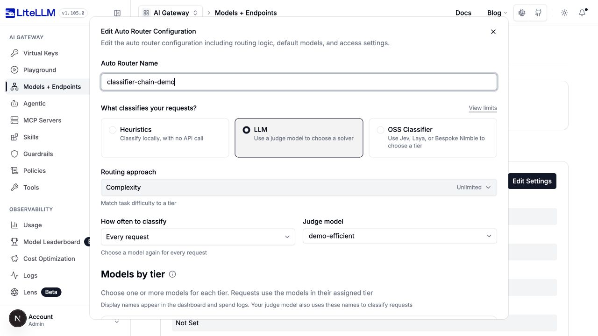

对于 LLM 复杂度路由器，**Local checks before the judge** 用于选择链式方式。**Heuristic tuning** 存放所选本地评分器的设置，**LLM tuning** 存放裁判设置。**Always use the judge** 会隐藏启发式调优。OSS 提供商使用单独的 **Classifier tuning** 分区。

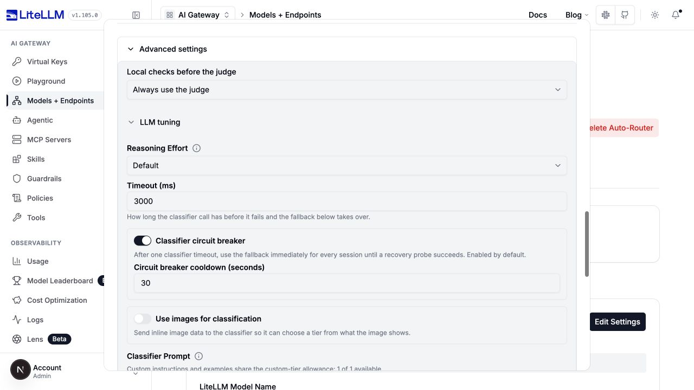

**Always use the judge** 会禁用本地优先阶段，但不会禁用关键词覆盖、会话复用，以及裁判失败后的启发式恢复。切换模式可能保留未生效的调优值；它不会重置所有设置。

## 从一份完整配置开始

下文所有设置都位于 `model_list[].litellm_params.complexity_router_config` 内，除非另有明确说明。`complexity_router_default_model` 是 `litellm_params` 下的同级字段。

这个示例对应启发式优先 v2 的截图：成功阈值 `0.6`、本地上限 `MEDIUM`。这些值只是演示控件用法；采用前请先在自己的流量上评估。

```yaml title="config.yaml"
model_list:
  - model_name: demo-efficient
    litellm_params:
      model: openai/{{openai_small}}
      api_key: os.environ/OPENAI_API_KEY
  - model_name: demo-capable
    litellm_params:
      model: openai/{{openai_large}}
      api_key: os.environ/OPENAI_API_KEY
  - model_name: classifier-chain-demo
    litellm_params:
      model: auto_router/complexity_router
      complexity_router_default_model: demo-efficient
      complexity_router_config:
        tiers:
          SIMPLE: demo-efficient
          MEDIUM: demo-efficient
          COMPLEX: demo-capable
          REASONING: demo-capable
        classifier_type: heuristic_first
        local_heuristic: heuristic_v2
        heuristic_first_max_tier: MEDIUM
        heuristic_v2_success_threshold: 0.6
        classifier_llm_config:
          model: demo-efficient
          timeout_ms: 3000
          classification_rubric: agentic
        classifier_fallback: heuristic
        classifier_context_window_size: 3
        classifier_context_budget_chars: 8000
```

在网关上设置 `OPENAI_API_KEY`，启动 `litellm --config config.yaml`，让客户端请求指向 `model: classifier-chain-demo`。分层取值和裁判的 `model` 必须是已部署的模型组名称。裁判可以像上面那样与求解器共用一个部署，也可以使用单独的别名。

后面的示例都是配置片段：请替换 `complexity_router_config` 内的对应字段，同时保留你已部署的分层模型。切换模式时应删除该模式特有的字段，而不是把每个示例的设置都堆积在一起。

## 将启发式与 LLM 串联

选择 **LLM > Routing approach > Complexity**。展开 **Advanced settings**，选择 **Heuristic first** 或 **Hybrid**，再选择 **Heuristic before the judge**。两种模式都支持 **Heuristic v1 (rule-based)** 和 **Heuristic v2**。

### 启发式优先

**Decide locally up to** 设定启发式在不调用裁判的情况下能选到的最贵分层。v1 还要求至少存在一个评分信号；v2 要求某个分层达到其成功阈值。更高分层的结论、缺失 v1 信号，或 v2 预测中没有任何分层达标的情况，都交给裁判。

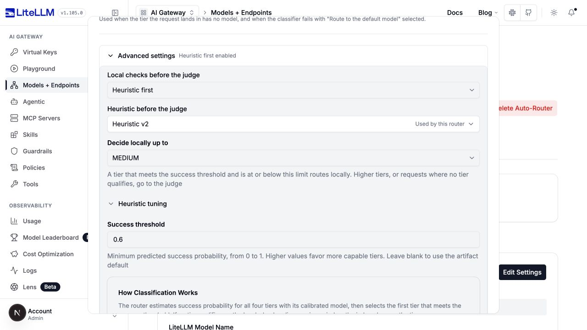

```yaml title="启发式优先配合 v2"
classifier_type: heuristic_first
local_heuristic: heuristic_v2
heuristic_first_max_tier: MEDIUM
heuristic_v2_success_threshold: 0.6
classifier_llm_config:
  model: demo-efficient
  classification_rubric: agentic
```

设置 `local_heuristic: heuristic` 即使用 v1，并在下文调它的权重。`local_heuristic` 省略或为 `null` 时保持 v1 行为。`heuristic_first_max_tier` 在 YAML 中必填，且必须是低于最高分层的已配置内置分层；UI 初始选择 `SIMPLE`。

### 混合模式

混合模式可以接受任意本地分层。配合 v1 时，**Boundary margin** 度量与加权分数分层边界的距离。分数落在任一生效边界的余量之内（含恰好相等）就交给裁判。没有任何评分信号的请求同样交给裁判。

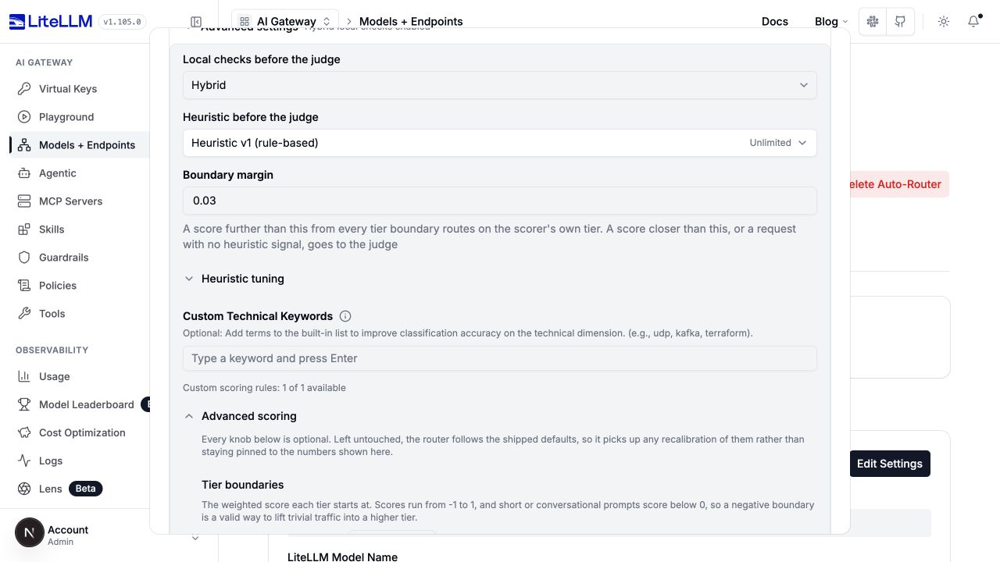

```yaml title="混合模式配合 v1"
classifier_type: hybrid
local_heuristic: heuristic
hybrid_boundary_margin: 0.03
classifier_llm_config:
  model: demo-efficient
  classification_rubric: agentic
```

配合 v2 时，标签变为 **Success threshold margin**。只有当最低达标分层的概率以及所有更低分层的概率都离成功阈值超过余量时，才接受该分层。没有任何分层达标就询问裁判。更高分层的概率不影响这项边界检查。

```yaml title="混合模式配合 v2"
classifier_type: hybrid
local_heuristic: heuristic_v2
hybrid_boundary_margin: 0.03
heuristic_v2_success_threshold: 0.75
classifier_llm_config:
  model: demo-efficient
  classification_rubric: agentic
```

`hybrid_boundary_margin` 在 YAML 中必填，取值 `0` 到 `1`，UI 中初始为 `0.03`。余量越大，交给裁判的边界情况越多；`0` 仍会把恰好落在边界的结果交给裁判。不要同时设置混合模式的余量和启发式优先的上限。`local_heuristic` 只对这两种链式类型有效。

对裁判可见的图片和加密任务会绕过本地捷径。裁判出错时，`classifier_fallback: heuristic` 会使用所选的本地版本。v2 链用 v2 恢复，而不是 v1。

## 调优启发式 v1

选择 **Heuristics > Rule-based**（即 `classifier_type: heuristic`），YAML 省略该字段时的默认值。打开 **Advanced settings > Heuristic tuning > Advanced scoring**。v1 用七个内置维度给当前提问打分，另可加自定义维度。它按文本长度除以四来估算 token 数；分类时不会调用分词器或 LLM。

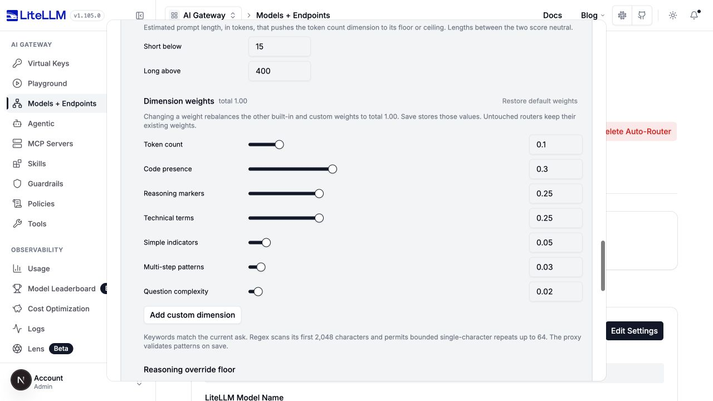

### 权重、阈值与边界

| UI 标签 / 键 | 出厂默认值 | 调整后的效果 |
| --- | --- | --- |
| Token count / `dimension_weights.tokenCount` | `0.10` | 改变较短或较长请求对评分的贡献。 |
| Code presence / `dimension_weights.codePresence` | `0.30` | 改变代码相关词汇对评分的贡献。 |
| Reasoning markers / `dimension_weights.reasoningMarkers` | `0.25` | 改变推理类短语对评分的贡献。 |
| Technical terms / `dimension_weights.technicalTerms` | `0.25` | 改变技术词汇对评分的贡献。 |
| Simple indicators / `dimension_weights.simpleIndicators` | `0.05` | 改变问候、释义等简单请求特征对评分的贡献。 |
| Multi-step patterns / `dimension_weights.multiStepPatterns` | `0.03` | 改变步骤序列和编号任务对评分的贡献。 |
| Question complexity / `dimension_weights.questionComplexity` | `0.02` | 改变多问题请求对评分的贡献。 |
| Simple to Medium / `tier_boundaries.simple_medium` | `0.15` | 低于此值的分数保持 `SIMPLE`。调低它会让更多请求升级。 |
| Medium to Complex / `tier_boundaries.medium_complex` | `0.35` | 达到或超过此值的分数至少为 `COMPLEX`。 |
| Complex to Reasoning / `tier_boundaries.complex_reasoning` | `0.60` | 达到或超过此值的分数为 `REASONING`。 |
| Short below / `token_thresholds.simple` | `15` | 估算 token 数低于此值时，token 维度打 `-1` 分。 |
| Long above / `token_thresholds.complex` | `400` | 估算 token 数高于此值时，token 维度打 `1` 分；介于两个阈值之间打 `0` 分。 |
| Minimum score / `reasoning_override_min_score` | 跟随 `simple_medium` | 达到此下限后，两个及以上推理标记即可升级到 `REASONING`。设为 `0` 恢复仅凭标记升级。 |

UI 接受 `-1` 到 `1` 的边界值和推理下限，以及非负整数 token 阈值。边界要保持递增，短文本阈值要低于长文本阈值。分数恰好等于分层边界时选择更高的那一层。

在 UI 中改动一个权重后，其他内置与自定义权重会重新配平，总和为 `1.00`。**Restore default weights** 会移除覆盖值和自定义维度。未触碰的控件沿用出厂默认。

在 YAML 中，提供 `dimension_weights` 映射会**整体替换**该映射：省略的维度权重为 0。要保留哪些维度就写出全部七个键。相比之下，边界和 token 阈值的部分映射会与默认值合并。后端不会自动归一化 YAML 权重映射。

<details>
<summary>分层边界与 token 阈值控件</summary>

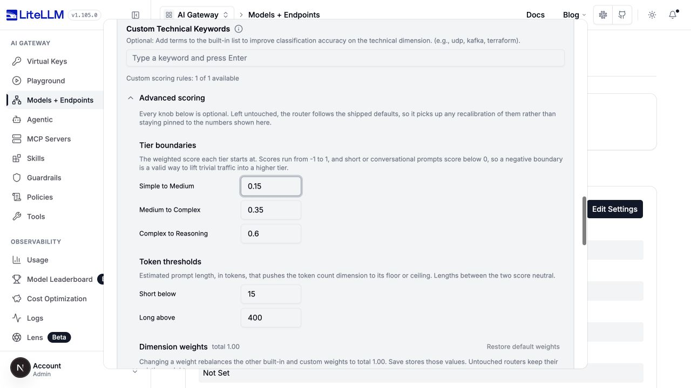

</details>

```yaml title="v1 评分设置（complexity_router_config 下）"
tier_boundaries:
  simple_medium: 0.15
  medium_complex: 0.35
  complex_reasoning: 0.60
token_thresholds:
  simple: 15
  complex: 400
dimension_weights:
  tokenCount: 0.10
  codePresence: 0.30
  reasoningMarkers: 0.25
  technicalTerms: 0.25
  simpleIndicators: 0.05
  multiStepPatterns: 0.03
  questionComplexity: 0.02
```

### 关键词列表

**Custom Technical Keywords** 追加到生效的技术词列表。**Heuristic Keyword Overrides** 则替换对应的内置列表。匹配不区分大小写；单个词通常按词边界匹配，短语和 CJK 词汇按子串匹配。覆盖列表留空时保留内置词表，而不是禁用该维度。

| UI 标签 | 键 | 默认值 / 效果 |
| --- | --- | --- |
| Custom Technical Keywords | `custom_technical_keywords` | 无。追加词条，按不区分大小写去重。 |
| Code keywords | `code_keywords` | 出厂代码相关词表；用你的列表替换它。 |
| Reasoning keywords | `reasoning_keywords` | 出厂推理词表；同时提供推理覆盖标记。 |
| Technical keywords | `technical_keywords` | 出厂技术词表；自定义技术关键词追加到这份替换后的列表。 |
| Simple keywords | `simple_keywords` | 出厂简单请求词表；用你的列表替换它。 |

```yaml title="追加领域词汇而不替换内置词表"
custom_technical_keywords: [kafka, terraform, postgresql]
```

<details>
<summary>关键词覆盖控件</summary>

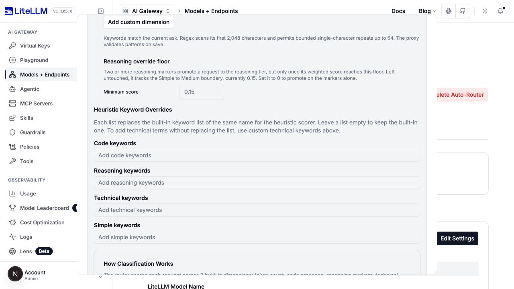

</details>

### 自定义维度

在 **Advanced scoring > Dimension weights** 下选择 **Add custom dimension**。每一行都有自己的内联权重，以及关键词或受限正则匹配器。

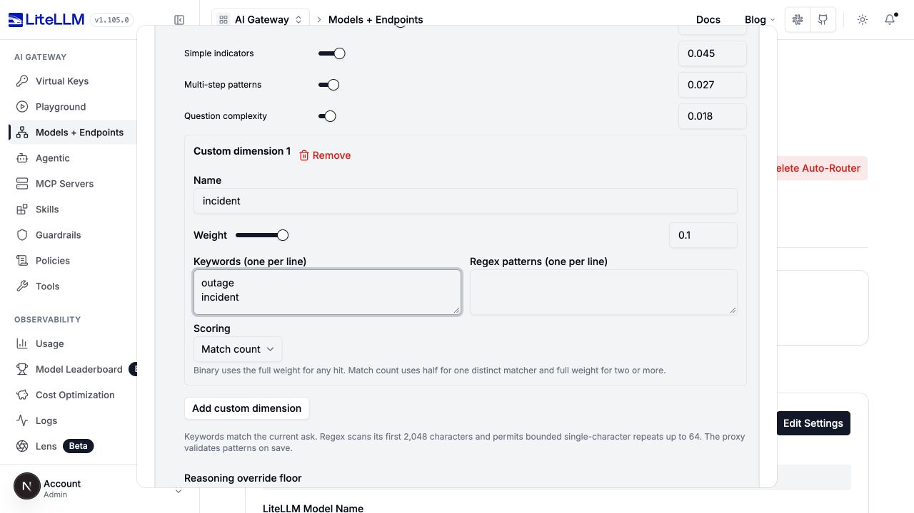

上面截图对应的配置如下，包含 UI 重新配平后的内置权重：

```yaml title="一个 v1 自定义维度"
dimension_weights:
  tokenCount: 0.09
  codePresence: 0.27
  reasoningMarkers: 0.225
  technicalTerms: 0.225
  simpleIndicators: 0.045
  multiStepPatterns: 0.027
  questionComplexity: 0.018
custom_dimensions:
  - name: incident
    weight: 0.1
    keywords: [outage, incident]
    scoring_mode: match_count
```

| 行字段 | `custom_dimensions[]` 下的键 | 约束与行为 |
| --- | --- | --- |
| Name | `name` | 不区分大小写的唯一 ASCII 标识符，以字母开头，后接字母、数字或下划线；最长 64 个字符。不能与内置维度重名。 |
| Weight | `weight` | 大于 `0` 且不超过 `1` 的有限数。不要同时把该维度放进 `dimension_weights`。 |
| Keywords | `keywords` | 非空白关键词字符串。至少提供一个关键词或一个正则。 |
| Regex patterns | `patterns` | 作用于提问前 2,048 个字符的不区分大小写正则。 |
| Scoring | `scoring_mode` | `binary`：任一匹配即计入全部权重。`match_count`：一个匹配的匹配器计一半权重，两个及以上计满权重。同一匹配器重复出现不增加计数。 |

YAML 默认 `binary`；UI 新增行默认 `match_count`。上限为最多 16 个维度、每个维度合计 32 个匹配器、每个匹配器 256 个字符、每个维度 4,096 个匹配器字符。正则允许有界的单字符或字符类重复，最多 64 次；无界量词、重复分组、反向引用和环视都会被拒绝。额外的正则工作量限制用于保护路由路径。

自定义维度只适用于独立或链式 v1。v2 不接受它们；仅为调 LLM/OSS/自定义分类器的失败回退时同样不接受。

## 调优启发式 v2

选择 **Heuristics > Heuristic v2**。**Heuristic tuning > Success threshold** 对应 `heuristic_v2_success_threshold`，取值 `0` 到 `1`。留空时使用所选产物的 `routing_threshold`，目前内置 `ultrafeedback` 产物为 `0.75`。

v2 预测每个内置分层的成功概率，并选择第一个达到阈值的分层。调高阈值总体上偏向更强的分层，或在链式中产生更多裁判调用。这些是任务成功率估计，不是 v1 分数，也不是类别标签的置信度。v1 的权重、关键词、token 阈值和自定义维度对 v2 不起作用。

```yaml title="独立 v2"
classifier_type: heuristic_v2
heuristic_v2_success_threshold: 0.75
```

没有任何分层达标时，独立 v2 选择 `REASONING`；v2 链则询问裁判。[v2 链截图](#启发式优先)展示了阈值控件和本地上限。

### 自定义训练产物（仅限 YAML）

`heuristic_v2_artifact` 默认为 `ultrafeedback`，也接受内联的训练产物对象；不接受文件名或 URL。请用实测的任务结果来构造；直接改它的统计量并不等价于调 UI 权重。

| 产物字段 | 默认值 / 约定 |
| --- | --- |
| `schema_version` | `1` |
| `global_statistics` | 分层 `1` 到 `4` 各恰好一条记录，`observations` 为正数，`successes` 介于 0 与 observations 之间。 |
| `domain_statistics`, `cohort_statistics` | 可选的领域与相似性分组统计，键必须唯一。 |
| `domain_prior_mass`, `cohort_prior_mass` | `200`, `20`；严格为正的平滑强度。数值越大越偏向更广的先验统计而非稀疏观测。 |
| `routing_threshold` | `0.75`；设置了 `heuristic_v2_success_threshold` 时被覆盖。 |
| `datasets`, `success_definition`, `split_method` | 训练来源信息，描述证据与评估切分。 |

全局记录包含 `tier`、`successes` 和 `observations`。领域记录额外带一个 `request_type`；分组记录额外带一个非空 `cohort` 标识，由预测器的特征分组生成。每个领域/分层或分组/分层组合必须唯一。数据集记录包含非空的 `name`、`url`、`license`，可选的 `success_definition`，以及正数 `rows`。这些字段只是记录证据；不会据此下载数据集或在上面训练。默认切分描述为 `sha256(prompt): 70% train, 15% validation, 15% test`。

嵌套统计约定见[产物 schema](https://github.com/BerriAI/litellm/blob/2b634df9d1f7005963faa2a983430f2bbe09cebc/litellm/router_strategy/complexity_router/tier_predictor.py)。特征提取是内置的，预测器会保证各分层成功概率的单调性。

## 调优 LLM 裁判

纯裁判路由：选择 **LLM > Routing approach > Complexity**，再选 **Advanced settings > Local checks before the judge > Always use the judge**。在主表单中选择 **Judge model**，然后打开 **LLM tuning**。这些设置同样适用于启发式优先和混合链；它们与各分层模型的推理力度和生成设置相互独立。

| UI 标签 | `classifier_llm_config` 下的键 | 默认值 / 效果 |
| --- | --- | --- |
| Judge model | `model` | 必填，已部署的模型组别名。选择支持分类器结构化响应的模型。 |
| Reasoning Effort | `reasoning_effort` | 不设置时用部署/提供商默认值。可选值取决于所选模型。更多推理可能增加裁判延迟和成本。 |
| Timeout (ms) | `timeout_ms` | `3000`；正整数。过短会增加回退频率；过长会让请求在慢裁判上被拖延。 |
| Classifier circuit breaker | `circuit_breaker_enabled` | `true`。超时会打开该路由器实例的分类器熔断器，后续请求立即走回退。 |
| Circuit breaker cooldown (seconds) | `circuit_breaker_cooldown_seconds` | `30`，严格为正。冷却结束后，由一个请求探测，并发请求继续走回退。探测成功则闭合熔断器；探测失败重新开始冷却。 |
| Use images for classification | `vision.enabled` | `false`。当裁判声明支持视觉时，转发最新用户轮次中的内联图片数据。 |
| Maximum images per request | `vision.max_images` | `1`，正整数；启用图片分类后显示。限制裁判额外增加的成本。 |

```yaml title="始终裁判，并显式写出生效默认值"
classifier_type: llm
classifier_llm_config:
  model: demo-efficient
  timeout_ms: 3000
  circuit_breaker_enabled: true
  circuit_breaker_cooldown_seconds: 30
  classification_rubric: agentic
  vision:
    enabled: false
    max_images: 1
```

图片分类只转发内联 `data:` URI，不转发远程 HTTP(S) 图片 URL，也不转发之前轮次的图片。不支持视觉的裁判仍只收到文本。**Use images for classification** 改变裁判能看到什么；**Modality Routing** 则单独保证回答模型能接收图片。

### 提示词与评分标准

打开 **Classifier Prompt > Customize prompt**。选择一个 **Base rubric**，可选地替换 **Classification instructions** 或 **Calibration examples**，保存前检查 **What this router sends**。

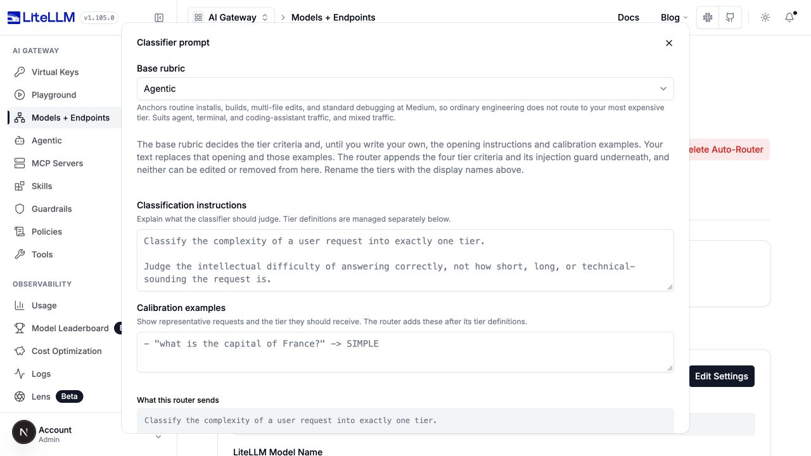

| 控件 / 键 | 选项或限制 | 用途 |
| --- | --- | --- |
| Base rubric / `classifier_llm_config.classification_rubric` | `legacy`, `agentic`, `chat`, `business` | `agentic` 把常规工程任务锚定在 Medium；`chat` 去掉工程锚点；`business` 使用业务标准和示例；`legacy` 保留原始未校准的评分标准。 |
| Classification instructions / `classification_prompt` | 可选非空白文本，最长 2,000 字符 | 替换开头指令，保留分层标准和附带的提示注入防御。 |
| Calibration examples / `classification_examples` | 可选非空白文本，最长 4,000 字符 | 只替换示例行。小节标题由路由器提供。 |

UI 中新建的 LLM 配置以 `agentic` 开头。**YAML 省略时用 `legacy`**，想要与 UI 一致的行为就显式设置评分标准。评分标准和这些分节覆盖同样适用于复杂度链。Capability 和 Fuse v2 使用各自的内置提示词。

```yaml title="自定义开头与示例而不替换分层标准"
classifier_llm_config:
  model: demo-efficient
  classification_rubric: business
classification_prompt: >-
  Classify the work needed to answer this support request correctly.
  Prefer the cheapest tier that can complete it.
classification_examples: |-
  "Summarize this support conversation" -> MEDIUM
  "Diagnose why retries caused duplicate charges across services" -> COMPLEX
```

**Reset to default** 移除自定义开头/示例，保留所选评分标准。自定义分层标准通过 **Edit tiers** 编辑，而不是在开头提示词里改写。

<details>
<summary>旧版整段系统提示词替换</summary>

`classifier_llm_config.system_prompt` 替换整个系统角色，包括分层标准和内置的注入防御。它与 `classification_rubric`、`classification_prompt`、`classification_examples` 互斥。已有的整段提示词配置会使用旧版 UI 编辑器；新配置通常应使用上面的分节编辑器。

如果使用整段替换，请自行提供指令，要求把调用方的引述文本当作数据而不是路由指令。当你的分类体系不再是复杂度时，使用 `classifier_fallback: default_model`。分层重命名不会改写冻结在整段系统提示词字符串里的文本。

</details>

### 失败策略与对话上下文

复杂度 LLM/链的这些控件位于 **LLM tuning**，OSS 的位于 **Classifier tuning**。它们不是预测模式的回退策略编辑器。

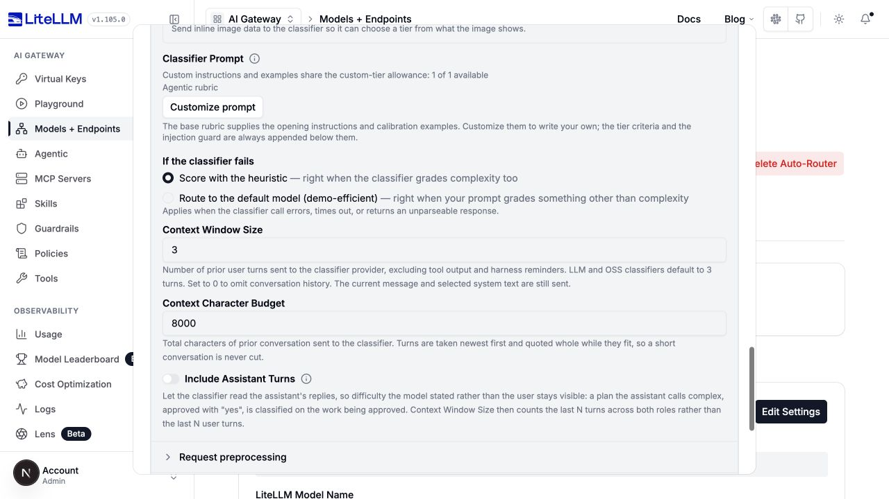

| UI 标签 | 键 | 默认值 / 行为 |
| --- | --- | --- |
| If the classifier fails | `classifier_fallback` | `heuristic` 在出错、超时、响应无效或插件拒绝后本地打分。`default_model` 直接路由到配置的默认模型。 |
| Context Window Size | `classifier_context_window_size` | `3`；之前用户轮次的非负计数。`0` 会省略历史及其深度摘要，但不省略当前提问或所选系统文本。 |
| Context Character Budget | `classifier_context_budget_chars` | `8000`；之前轮次文本的非负字符预算。放得下时整轮保留；边界轮次过大且剩余空间不足以截断时会被整轮省略。 |
| Include Assistant Turns | `classifier_context_include_assistant_turns` | `false`。启用后窗口跨两种角色统计之前的轮次。当用户回复 "yes" 是在确认助手描述的工作时很有用。 |
| Per-turn cap（仅限 YAML） | `classifier_context_per_turn_chars` | 未设置；对每个之前轮次的可选正数上限，先于总预算应用。被截断的轮次保留开头和结尾。 |

```yaml title="上下文与失败策略（complexity_router_config 下）"
classifier_fallback: heuristic
classifier_context_window_size: 3
classifier_context_budget_chars: 8000
classifier_context_include_assistant_turns: false
```

历史会排除工具输出和 harness 提醒。路由器先取最近的轮次，尽量整轮保留，必要时截断所保留的最老一轮。当前提问和所选系统文本不计入之前轮次的预算。Claude Code 系统文本不参与分类，但回答模型仍会收到它。

增加历史会把更多数据发给裁判的提供商，它可能与回答方不同。不想发送之前轮次就用窗口大小 `0`。即便如此，分类也不是零数据。

使用 `classifier_fallback: default_model` 时，请配置 **Default Model**，最好通过完整示例中展示的同级字段 `litellm_params.complexity_router_default_model`。在归一化的路由器配置中，它叫 `default_model`。纯 LLM/OSS/自定义的启发式回退使用 v1；链使用其选定的本地版本。自定义分类体系使用 `fallback_tier`。Capability 和 Fuse v2 总是恢复到各自的 capable solver。

## 接入自托管分类器

选择 **OSS Classifier**，选择 **OSS provider**，然后展开 **Advanced settings > Classifier tuning**。这一步连接到已有服务器；不会部署或启动服务器。安装与连通性细节见 [Self-hosted classifiers](./decision_classifiers.md)。

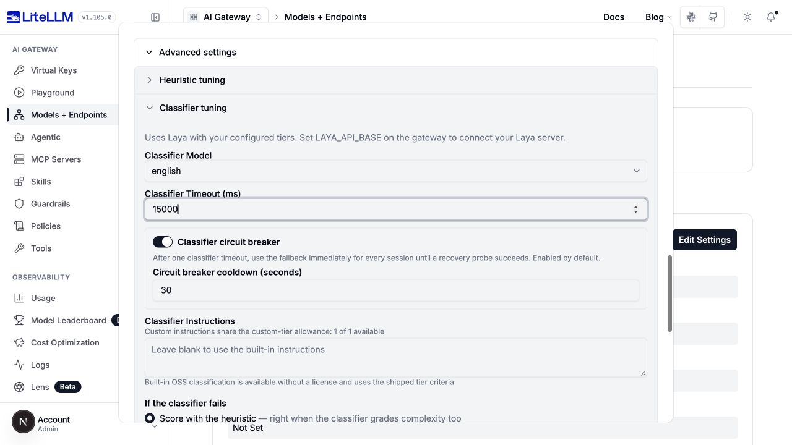

| 提供商 | `provider` | 分类器模型 | 网关环境变量 |
| --- | --- | --- | --- |
| Laya，自托管 | `laya` | `english`, `multilingual`, `typed-decisions` | `LAYA_API_BASE`，可选 `LAYA_API_KEY` |
| Bespoke Nimble，自托管 | `bespoke` | `nimble-latest`, `nimble`, `bespokelabs/Bespoke-Nimble-9B` | `BESPOKE_API_BASE`，可选 `BESPOKE_API_KEY` |
| Jev，托管的 TypeSafe API | `jev` | 默认 `jev-latest` | `TYPESAFE_API_KEY`；可选 `TYPESAFE_API_BASE`，默认 `https://api.typesafe.ai` |

环境变量要设置在网关上。内部主机名由网关所在主机/容器解析，而不是你的浏览器。三者都用 `POST /v1/systemone`；设置 base URL 时不要带这个后缀。

```bash title="网关上的 Laya 连接"
export LAYA_API_BASE="http://laya-server:8000"
# Supply LAYA_API_KEY through your secret manager if the server requires it.
```

```yaml title="Laya 分类器（complexity_router_config 下）"
classifier_type: oss_classifier
opensource_classifier_config:
  provider: laya
  model: english
  timeout_ms: 15000
  circuit_breaker_enabled: true
  circuit_breaker_cooldown_seconds: 30
classifier_context_window_size: 3
classifier_context_budget_chars: 8000
```

Nimble：把 provider 改为 `bespoke`，model 改为你的服务器实际支持的名称。`30000` ms 超时是该服务器合理的初始测试值，不是后端默认值。Jev：选择 `jev` 配 `jev-latest`，并配置 TypeSafe 密钥。

| UI 标签 | `opensource_classifier_config` 下的键 | 默认值 / 行为 |
| --- | --- | --- |
| OSS provider | `provider` | `jev`；接受 `jev`、`laya`、`bespoke`。 |
| Classifier Model | `model` | 后端默认 `jev-latest`；Laya/Nimble 需显式选择合适模型。UI 中切换 provider 会选中该 provider 的预设默认值。 |
| Classifier Timeout (ms) | `timeout_ms` | `3000`，正整数。自托管推理冷启动或较慢时调高，然后实测。 |
| Classifier Instructions | `instructions` | 内置分类器可省略；非空白文本替换开头指令。自定义指令受自定义分层额度约束。 |
| Classifier circuit breaker | `circuit_breaker_enabled` | `true`；超时保护与 LLM 裁判处所述一致。 |
| Circuit breaker cooldown (seconds) | `circuit_breaker_cooldown_seconds` | `30`，严格为正。 |
| Endpoint（仅限 YAML/管理 API） | `api_base` | 来自提供商环境变量/默认值。Laya/Nimble 要求可达的 HTTP(S) base，且不得内嵌凭据、查询或片段。 |
| Credential（仅限 YAML/管理 API） | `api_key` | 使用提供商环境 base 时取自其环境变量。无鉴权的自托管服务器可不填；Jev 必填。 |

显式 `api_base` **不会**继承环境变量里的 API 密钥。端点需要鉴权时请提供配套的显式密钥；Jev 拒绝只有显式 base 而没有显式密钥的配置。仪表板有意不提供端点/密钥字段。团队成员无法通过管理 API 设置这些覆盖值。

规范键名是 `oss_classifier` 和 `opensource_classifier_config`。既有的 `jev`、`jev_classifier_config` 以及 provider `typesafe` 别名仍被接受；不要同时提供两套分类器配置。

### 自托管 OpenAI 兼容裁判

通用 vLLM 或其他 OpenAI 兼容对话端点是另一种集成方式：把它注册为普通模型并选择 **LLM**，而不是 OSS System One 提供商。把这个部署加到现有求解器旁边，然后在 `classifier_llm_config.model` 中使用它的别名：

```yaml title="额外的 model_list 条目"
- model_name: local-routing-judge
  litellm_params:
    model: openai/your-served-model-name
    api_base: http://judge-server:8000/v1
    api_key: os.environ/LOCAL_JUDGE_API_KEY
```

```yaml title="使用已注册的自托管 LLM"
classifier_type: llm
classifier_llm_config:
  model: local-routing-judge
  timeout_ms: 5000
  classification_rubric: agentic
```

使用你的服务器接受的鉴权值，并确认它支持结构化输出。同一个别名也可用于启发式优先/混合链。自托管裁判不会改变所选补全模型的运行位置。

## 预测求解器成功率

在 **LLM > Routing approach** 下，**Capability** 和 **Fuse v2** 预测任务能否成功，而不是直接选择复杂度标签。两者都有 **Efficient solver**、**Capable solver** 和 **Judge model** 控件。两者都使用打包好的提示词，并在预测无效或分类器失败时选择 capable solver。不要给这两种模式添加通用的提示词/评分标准覆盖、本地启发式链或 `classifier_fallback: default_model`。

### Capability 模式

在主表单中设置 **Solve probability threshold**。在 **LLM tuning** 中，**Capability boundary step** 会对不确定/未匹配任务提高一次所需概率，对不支持任务提高两次。

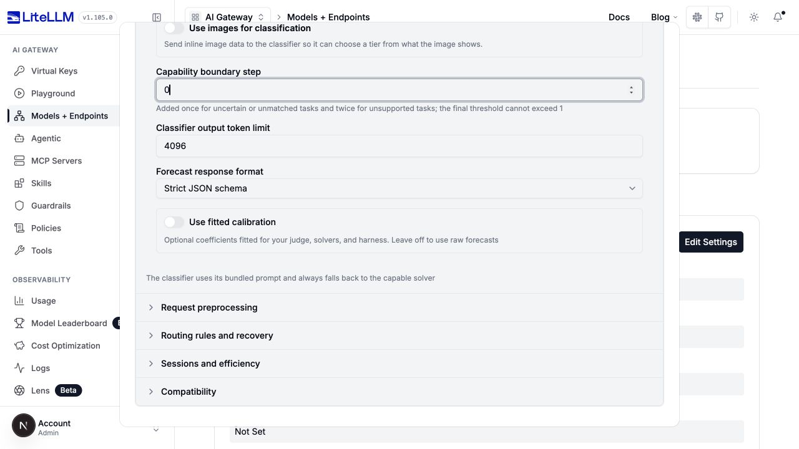

```yaml title="Capability 示例（整体替换 complexity_router_config）"
tiers:
  SIMPLE: demo-efficient
  REASONING: demo-capable
classifier_type: capability
classifier_llm_config:
  model: demo-efficient
  timeout_ms: 3000
capability_classifier_config:
  efficient_tier: SIMPLE
  capable_tier: REASONING
  base_threshold: 0.5
  threshold_step: 0.0
  max_output_tokens: 4096
  response_format: json_schema
```

| `capability_classifier_config` 下的键 | 默认值 / 限制 | 效果 |
| --- | --- | --- |
| `efficient_tier`, `capable_tier` | 必填的已配置内置分层，capable 必须更高 | 选择求解器池与失败去向。UI 在选择模型时保留这些名称。 |
| `base_threshold` | 必填，`[0, 1]` 内的数值 | 预测成功率达到调整后阈值时选择 efficient。 |
| `threshold_step` | `0.0`，非负 | 支持：base。不确定/未匹配：base + step。不支持：base + 2 x step。**base + 2 x step 不得超过 1**。 |
| `max_output_tokens` | `4096`，正整数 | 限制裁判的预测响应，而不是求解器的回答。 |
| `response_format` | `json_schema`；或 `json_object` | JSON 对象模式兼容不支持严格 schema 的裁判；返回的预测仍会校验。 |
| `calibration` | 未设置 | 可选的拟合概率变换，在阈值比较之前应用。 |

Capability 使用内置的能力卡片，而不是可在仪表板编辑的求解器档案。请对照观测到的整任务成功率来调概率阈值，不要把它当作分类置信度。

### Fuse v2

提供 **Efficient solver profile**、**Capable solver profile** 和 **Harness and budget**，可用预设选择器或自定义文本。**Maximum quality gap** 设为可接受的预测 capable 与 efficient 成功概率之差。

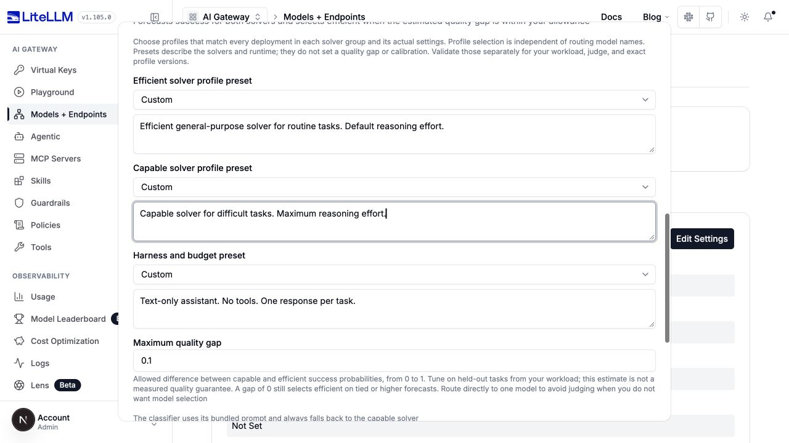

```yaml title="Fuse v2 示例（整体替换 complexity_router_config）"
tiers:
  SIMPLE: demo-efficient
  REASONING: demo-capable
classifier_type: llm_v2
adaptive: false
classifier_llm_config:
  model: demo-efficient
llm_v2_config:
  efficient_tier: SIMPLE
  capable_tier: REASONING
  efficient_profile: Efficient general-purpose solver for routine tasks. Default reasoning effort.
  capable_profile: Capable solver for difficult tasks. Maximum reasoning effort.
  harness: Text-only assistant. No tools. One response per task.
  max_quality_gap: 0.1
  max_output_tokens: 1024
  response_format: json_schema
```

上面的档案文本只是演示字段。请替换为关于你实际模型、推理设置、工具、验证方式和预算的证据。档案描述不会配置求解器参数；那些参数要在求解器部署或分层模型条目上单独设置。

| `llm_v2_config` 下的键 | 默认值 / 限制 | 效果 |
| --- | --- | --- |
| `efficient_tier`, `capable_tier` | `SIMPLE`, `REASONING` | 恰好两个非空内置分层，capable 高于 efficient，各自一个不同的模型组别名。 |
| `efficient_profile`, `capable_profile`, `harness` | 非空白文本，各最长 4,000 字符，或对应预设 | 描述被预测的对象。 |
| `efficient_profile_preset`, `capable_profile_preset`, `harness_preset` | 未设置；网关预设目录中的已知 ID | 提供带版本的描述。显式文本优先于预设文本；未知预设仍然无效。 |
| `max_quality_gap` | 必填，`[0, 1]` 内的数值 | capable 概率减去 efficient 概率不超过该差距时，efficient 胜出。差距越大，容忍的预估质量损失越多。为 0 时仍允许 efficient 打平或更高的预测。 |
| `max_output_tokens` | `1024`，正整数 | 裁判响应预算。 |
| `response_format` | `json_schema`；或 `json_object` | 结构化响应模式；两种都会校验判定结果。 |
| `calibration` | 未设置 | 可选的拟合变换，对 efficient 与 capable 概率分别配置。 |

UI 从 `/public/complexity_router/fuse_presets` 加载预设，并显示其模型、版本和来源。预设不提供实测的质量保证、质量差距设置或拟合校准。Fuse 要求 `adaptive: false`，不支持自定义分层和 Non-Reasoning 分层。

### 拟合预测校准

**Use fitted calibration** 启用已拟合好的系数；它不会运行训练任务。两种模式在选择求解器前都会应用 `sigmoid(slope * logit(clipped_probability) + intercept)`。请针对你的裁判、求解器、提示词版本和执行配置去拟合并验证系数。

| 模式 | 校准字段 | 约束 |
| --- | --- | --- |
| Capability | `calibration.version`, `.slope`, `.intercept` | version 为 1-128 个字符且两端无空白；slope 为有限数，`0` 到 `20`；intercept 为有限数，`-20` 到 `20`。 |
| Fuse v2 | `calibration.version`, `.prompt_version`, `.efficient.slope`, `.efficient.intercept`, `.capable.slope`, `.capable.intercept` | version 非空白，最长 512 字符；prompt version 为 `llm-v2-1`；slope 为严格大于 0 的有限数；intercept 为有限数。prompt version 由 UI 提供。 |

没有这个配置块时，路由使用原始预测值。复杂度提示词里的校准示例与这些数值系数无关。

## 自定义分层或使用插件

**Models by tier** 把 `tiers` 映射到已部署的模型别名或池。**Display name** 写入 `tier_labels`；配置键保持规范名称，LLM 评分标准则能看到你的标签。按模型的推理力度和 fast mode 配置的是回答模型，不是分类器。

| 控件 / 键 | 默认值 / 适用范围 |
| --- | --- |
| `tiers` | 显式设置为你的已部署别名。单个别名固定一个模型组；列表提供一个池。 |
| `tier_model_configs` | 空；按分层、按模型存储 `litellm_params`。YAML 也可以在 `tiers` 中使用结构化模型条目。 |
| `tier_labels` | 空的部分映射。在 UI/日志和 LLM 评分标准中重命名内置分层，不改 YAML 键。 |
| Add a non-reasoning tier / `enable_non_reasoning_tier` | `false`。在 `SIMPLE` 之下增加 `NON_REASONING`；需要映射模型以及纯 LLM、OSS 或自定义分类器。启发式/链/预测都无法产出它。 |
| Edit tiers / `tier_definitions` | 未设置。2-8 个分层的有序自定义分类体系；自定义名称需要描述，且必须与 `tiers` 完全一致。需要 LLM、OSS 或自定义分类器。 |
| Fallback Tier / `fallback_tier` | 自定义分类体系下必填；必须是其中某个分层的名称。取代启发式/默认模型的分类器恢复。 |

自定义分类体系不能与评分标准预设、整段系统提示词替换、分层标签、自适应路由、会话亲和、非空升级关键词、停滞任务升级或路由插件组合使用。请使用分节级指令/示例和一个回退分层。

```yaml title="自定义客服分类体系（整体替换 complexity_router_config）"
classifier_type: llm
classifier_llm_config:
  model: demo-efficient
tiers:
  routine: demo-efficient
  specialist: demo-capable
tier_definitions:
  - name: routine
    description: Routine support answers and summaries with established procedures.
  - name: specialist
    description: Diagnosis requiring specialist technical investigation.
fallback_tier: specialist
classification_prompt: Choose the support category needed to answer the request correctly.
escalation_keywords: []
```

### 自定义分类器（仅限启动配置）

代理 YAML 中 `classifier_type: custom` 需要 `classifier_plugin`，即指向已安装 Python 实例的点分路径。它实现 `async classify(context)`，返回分层名称，或返回 `None` 以走回退策略。其 `RoutingContext` 包含原始与结构化消息、元数据，以及仅供参考的候选模型。

```yaml title="自定义插件（complexity_router_config 下）"
classifier_type: custom
classifier_plugin: classifiers.my_classifier
classifier_plugin_timeout_ms: 3000
classifier_fallback: heuristic
```

`classifier_plugin_timeout_ms` 是正整数，默认 `3000`，已有自定义路由器中显示为 **Classifier plugin timeout (ms)**。插件要在代理启动时安装并配置；HTTP 模型管理和路由测试 API 不会导入任意插件路径。UI 不提供插件失败策略选择器；请在 YAML 中配置。

`classifier_plugin` 负责选分层。单独的 `plugins` 列表存放路由插件，其 `run(context)` 在分类之后收窄候选模型。实现契约见[分类参考](/docs/proxy/auto_routing#分类)与[路由插件指南](/docs/routing_plugins)。

## 控制分类的运行时机

**How often to classify** 位于主表单中模型分层的上方。

| UI 选项 | 配置 | 行为 |
| --- | --- | --- |
| Every request | `classification_mode: every_request`, `session_affinity: false` | 默认。包含工具结果续接请求。 |
| Every new user message | `classification_mode: user_turn`, `session_affinity: false` | 对新的人类提问重新分类；续接请求沿用已持有的决策。 |
| Once per session | `classification_mode: every_request`, `session_affinity: true` | 固定首个模型，固定有效期间跳过后续分类。 |

复用需要可解析的客户端会话 ID 和有效的持有决策。状态缺失或过期时仍会分类。路由插件会抑制常规重放路径，自定义分类体系不支持每会话一次模式。

在 **Sessions and efficiency > Affinity** 中，**Pin one model deployment per tier** 对应 `deployment_affinity`（默认 `true`）。它在每个已分类分层内复用模型/部署，同时仍允许重新分类和分层切换。**How long a pin survives idle** 对应 `session_affinity_ttl_seconds`（默认 `3600`，正整数），复用时刷新。即使 `deployment_affinity` 为 false，会话亲和也隐含部署固定。

```yaml title="对每个用户提问重新分类，同时复用续接决策"
classification_mode: user_turn
session_affinity: false
deployment_affinity: true
session_affinity_ttl_seconds: 3600
```

<details>
<summary>会话与效率控件</summary>

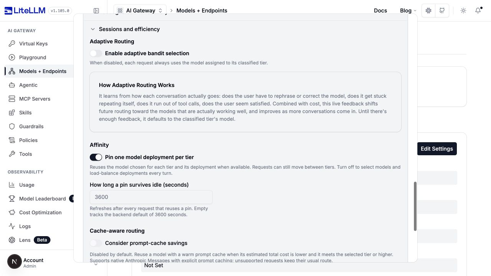

</details>

## 预处理与路由覆盖

这些设置影响被分类的输入或最终路由。它们独立于分类器的权重和提示词。**Always use the judge** 的路由器仍可能跳过裁判调用，因为关键词规则、日常事务规则或会话决策已经给出了路由。

### 请求预处理

**Request preprocessing > Ignore Custom Tags** 写入 `reminder_markers`，即非空的 `{open, close}` 对列表。匹配不区分大小写。自定义对会替换内置对，包括为 Codex user agent 启用的 Codex 信封对；你的 harness 仍需要的每个内置对都要包含进去。省略该设置则保留所有适用的默认值。

```yaml title="显式的 reminder-marker 对"
reminder_markers:
  - open: <system-reminder>
    close: </system-reminder>
```

所选回答模型仍会收到完整消息。这只是分类前的清理，不是脱敏，也不是访问控制边界。

<details>
<summary>标签排除控件</summary>

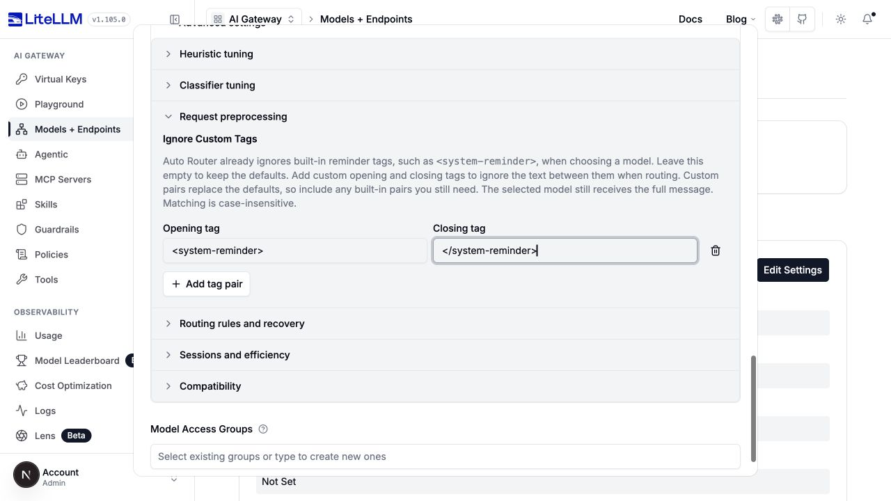

</details>

### 规则与恢复

打开 **Routing rules and recovery**。下面的默认值和键适用于普通复杂度路由；预测/自定义分层模式会隐藏或拒绝不兼容的控件。

| UI 分区 | 键与默认值 | 效果 |
| --- | --- | --- |
| Keyword Tier Overrides | `keyword_tier_rules: null`；行包含 `keywords` 和 `tier` | 在分类之前匹配。多条规则同时命中时取最高的分层。 |
| Semantic keyword matching | `semantic_keyword_matching: false`, `embedding_model: null`, `match_threshold: 0.5` | 对同一组规则改用嵌入相似度而非字面匹配。需要嵌入模型；阈值 `0` 到 `1`。会增加一次嵌入调用。 |
| Escalation Keywords | `escalation_keywords` 默认 `["LITELLM ESCALATE"]` | 精确且区分大小写的短语使分层提升一级。`[]` 关闭该功能。 |
| Plan-Mode Override | `plan_mode_min_tier: null`, `plan_mode_patterns: null` | 存在代理 plan-mode 标记时的可选最低分层。附加 pattern 是区分大小写的字面哨兵值。不改写会话固定。 |
| Housekeeping Routing | `route_housekeeping_to_cheapest_tier: true`, `housekeeping_patterns: null` | 识别出的会话标题调用跳过分类，用最便宜的分层；关键词规则/固定仍优先，升级可以抬高结果。附加哨兵值区分大小写。 |
| Modality Routing | `modality_routing: false`, `modality_pin_override: false` | 图片轮次上把明确不支持视觉的模型替换为能力更强的高分层/默认模型。该覆盖允许在已固定会话中仅对该轮次生效。视觉支持未知不视为明确不支持。 |
| Context Window Escalation | `enable_context_window_escalation: false`, `context_window_escalation_buffer: 0.95` | 只在装得下的模型中选择，或移到已证实装得下的最近更高分层。buffer 大于 `0` 且不超过 `1`。上下文窗口未知的模型不能证明装得下或装不下。 |
| Stalled Task Escalation | `stall_escalation_enabled: false`, `stall_escalation_window: 6`, `stall_escalation_repeat_threshold: 3` | 把最近重复/失败的工具调用提升一层。重复次数至少 `2`，且不超过为正的窗口。与会话亲和或 `classification_mode: user_turn` 不兼容。 |

```yaml title="关键词路由与可选的停滞任务恢复"
keyword_tier_rules:
  - keywords: [invoice, refund, billing]
    tier: MEDIUM
semantic_keyword_matching: false
escalation_keywords: [LITELLM ESCALATE]
classification_mode: every_request
session_affinity: false
stall_escalation_enabled: true
stall_escalation_window: 6
stall_escalation_repeat_threshold: 3
```

语义匹配失败时，路由器继续正常分类，不会回头重试字面匹配。自定义分类器插件不走日常事务捷径。同一次请求中，显式升级关键词和停滞任务检测各自都能把结果抬高一级。plan-mode 哨兵是对调用方可见的字符串，不是鉴权控制。

<details>
<summary>恢复控件</summary>

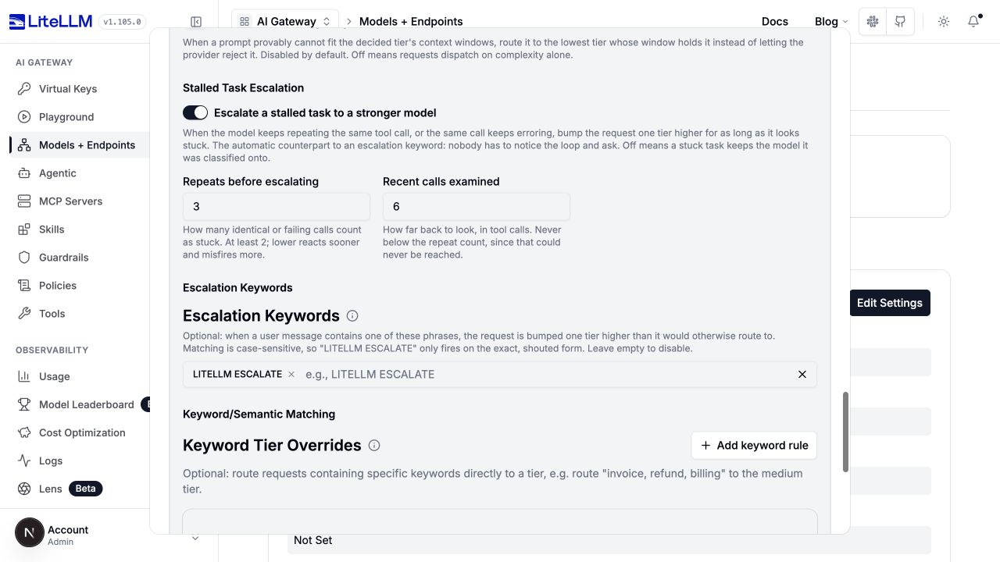

</details>

### 模型选择、压缩与兼容性

这些设置不改变 v1 分数、v2 阈值或裁判提示词的含义。完整工作流见[路由参考](/docs/proxy/auto_routing)与[提示词缓存指南](./prompt_caching.md)。

| 设置组 | 键与默认值 | 用途 |
| --- | --- | --- |
| Adaptive Routing | `adaptive: false`; `adaptive_weights: {quality: 0.3, cost: 0.7}`; `tier_distance_penalty: 0.5`; `adaptive_eligible: all` | 从反馈中学习模型选择。权重 `0` 到 `1` 且总和为 `1`；惩罚非负。`classified_tier` 把采样限制在所选池；`all` 使用软分层距离惩罚。 |
| Cache-aware routing | `cache_aware_routing: false`; `cache_aware_routing_output_tokens: 1024`; `cache_aware_routing_timeout_ms: 2000` | 在受支持的 Anthropic 原生请求上比较热缓存成本。输出估值为非负；超时为正。不受支持的请求保持正常路由。 |
| Compression | 同级字段 `litellm_params.auto_router_routing_compression` 与 `auto_router_model_compression`，均未设置 | 为每一跳选择一个已配置的防护栏。两者都未设置时保持继承行为。任一设置后，省略的跳表示不压缩；`none` 显式禁用某跳。 |
| Context compaction（仅限 YAML） | `context_compaction`，默认启用 | 在接近所选部署输入上限时压缩完整对话历史。区别于分类器的之前轮次窗口和压缩防护栏。`false` 或 `null` 关闭它。 |
| Compatibility | `return_raw_model_name: false`; `max_tokens_from_tier_model: true` | 返回解析后的模型名而非路由器别名；或控制所选模型的输出上限是否取代调用方的 token 限制。分层级 token 覆盖仍然优先。 |
| Routing plugins（启动配置） | `plugins: null` | 分类后收窄候选模型；区别于选择分层的 `classifier_plugin`。 |

缓存感知路由还有额外的资格要求：内置分层、受支持的 Anthropic 原生请求及已分类成因、无路由插件/自适应/会话亲和、`classification_mode: every_request`、每分层一个字符串模型别名、无按分层参数覆盖、每个候选拥有一个合格的受支持部署。仅打开开关并不能让所有请求都符合资格。Adaptive 的 `all` 是软分层偏好，不是硬性最低分层保证。

完整历史压缩方面，`context_compaction.model` 可选指定一个兼容的原生压缩模型；未设置时由路由器选择一个已配置的合格模型。`trigger_ratio` 默认 `0.9`，必须严格介于 `0` 和 `1` 之间；`max_tokens` 默认 `4096`，至少 `512`；`timeout_seconds` 默认 `120`，必须为正。由提供商/客户端管理的原生历史保持原有行为。压缩进行期间会抑制上下文窗口升级。

## 验证更改

保留一组留出的真实请求形态：简单查询、困难的短问题、长上下文配简单提问、"yes" 之类的追问、图片任务、工具续接，以及领域专有词。每次只改一项策略或一组相关设置，再与上一个配置对比。

用 **Test Routing** 查看所选分层/模型，而不生成最终回答。裁判、OSS 分类器或语义嵌入调用仍可能产生成本。**Test Connection** 也可能调用补全模型。回退成功不代表预期分类器作答。

检查决策成因、分类器模型、回退/错误信息，以及可用的概率值。即使使用 Laya 和 Nimble，OSS 决策也保留 `cause: jev_classifier`。度量下游任务质量、裁判调用率、回退率、分类延迟，以及包含分类器调用的总成本。自托管分类器仍会产生基础设施成本。

保存后重新打开路由器，确认所选模式、启发式版本、阈值和提示词。用 [Evaluate](./evaluate.md) 评估生产环境的质量与节省，而不要把更低的裁判调用次数或更高的预测值当作质量结果。
