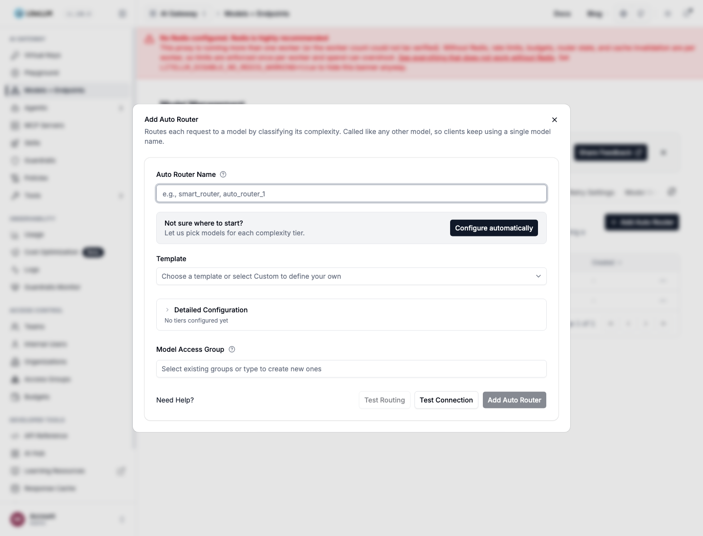

import NavigationCards from '@site/src/components/NavigationCards';

用下面任意一种方法为你的团队创建 Auto Router。要把编码 Agent 接入已有的路由器，请参阅[用户设置](/docs/auto_router/user_setup)。

完成设置后，[自定义分类器](./optimize_classifier.md)会逐一讲解所有分类设置，附仪表板截图和配套的 YAML，涵盖启发式/LLM 链、提示词、上下文与自托管分类器。

共有五种创建方式，最终生成的都是同一个 `auto_router/complexity_router` 部署。

<NavigationCards
columns={5}
items={[
  { title: "添加 Auto Router", description: "进入 Models + Endpoints → Auto Router，测试后保存。", to: "#在-models--endpoints-中添加-auto-router" },
  { title: "Agent 技能", description: "给你的编码 Agent 加一行指令。", to: "#agent-技能" },
  { title: "config.yaml", description: "在 model_list 里加一条路由器条目。", to: "#configyaml" },
  { title: "模型管理 API", description: "POST /model/new，适合 CI/CD。", to: "#模型管理-api" },
  { title: "lite autoroute", description: "本地试用，不动代理配置。", to: "#lite-autoroute" },
]}
/>

## 在 Models + Endpoints 中添加 Auto Router



- 在 LiteLLM 仪表板中进入 **Models + Endpoints**，打开 **Auto Router** 标签页，添加新的 Auto Router 模型，或启用并配置已有的模型。
- 输入 Auto Router 名称，然后选择 **自动配置**（Configure automatically）或挑选一个模板。检查生成的分层，测试路由，最后保存。
- **自动配置**会检查你的代理已在服务的模型，为全部四个复杂度分层挑出最合适的可用模型，并自动填好表单。
- 模板包括：1M Context、Anthropic Family、OpenAI Family、Gemini Family、Lite。每个模板都会用代理已在服务的模型填满全部四个分层。
- 所需模型尚未部署的模板会置灰显示，并列出缺失的模型名称。
- **测试路由**（Test Routing）会把一条提示词送入分类器，并显示它会选中的模型。不会创建任何东西，也不会真正调用选中的模型。
- **测试连接**（Test Connection）会对每个分层的模型组发起一个最小请求。绿色表示凭你的凭据可以连通。
- 详细配置（Detailed Configuration）里包含其余选项：关键词规则、LLM 分类器及其提示词、升级关键词（escalation keywords）、自适应池。

各模板对应的 config.yaml 见[推荐配置](/docs/auto_router/recommended_configurations)。发布博文见 [AutoRouter：一键部署](https://docs.litellm.ai/blog//blog/auto-router-setup-and-testing)。

## Agent 技能

```
run curl -fsSL https://docs.litellm.ai/skills/auto-router and follow the instructions
```

- 读取你的代理已在服务的模型。
- 询问路由器名称以及每个分层各用哪个模型。
- 在写入任何内容之前，先说明它准备采用的默认值。

## config.yaml

```yaml title="config.yaml"
model_list:
  - model_name: {{openai_small}}
    litellm_params: {model: openai/{{openai_small}}, api_key: os.environ/OPENAI_API_KEY}
  - model_name: {{openai_large}}
    litellm_params: {model: openai/{{openai_large}}, api_key: os.environ/OPENAI_API_KEY}
  - model_name: {{anthropic}}
    litellm_params: {model: anthropic/{{anthropic}}, api_key: os.environ/ANTHROPIC_API_KEY}
  - model_name: {{anthropic_large}}
    litellm_params: {model: anthropic/{{anthropic_large}}, api_key: os.environ/ANTHROPIC_API_KEY}

  - model_name: smart-router
    litellm_params:
      model: auto_router/complexity_router
      complexity_router_config:
        tiers:
          SIMPLE:    {{openai_small}}
          MEDIUM:    {{openai_large}}
          COMPLEX:   {{anthropic}}
          REASONING: {{anthropic_large}}
      complexity_router_default_model: {{openai_large}}
```

- 各分层引用的是同一文件里其他的 `model_name` 条目，因此每个分层都是代理已经认识的部署。
- 路由器无法做出判断时，由 `complexity_router_default_model` 提供服务。
- 不写 `classifier_type` 就是启发式打分器：零成本，不增加延迟。
- 用一个小模型配置 `classifier_type: llm`，可以在 Agent 流量上提升准确率，每次请求成本不足一美分。参见[基准测试](/docs/auto_router/benchmarks)。
- 其余所有配置项（关键词规则、分层池、会话亲和性、打分器调优）：见[配置参考](/docs/proxy/auto_routing)。

## JEV 分类器（TypeSafe AI）

本节介绍的是已发布版本所支持的 Jev 配置与仪表板标签。新的 **OSS Classifier** 配置需要 [backend #43626](https://github.com/BerriAI/litellm/pull/43626)，对应的仪表板需要 [UI #43768](https://github.com/BerriAI/litellm/pull/43768)。托管版 Jev、自托管的 Nimble 与 Laya 见 [OSS 分类器](/docs/auto_router/decision_classifiers)，其中也包含[从现有名称迁移](/docs/auto_router/decision_classifiers#迁移已有的-jev-或-nimble-路由器)的说明。新后端仍然接受下文的配置。

`classifier_type: jev` 使用 TypeSafe System One Choice 评估，在现有 Auto Router 内部选择一个分层。LiteLLM 会把分类器输入作为 `state` 发送到 `POST /v1/systemone`，其中携带一个 `questions.tier` 问题，其评判标准即所配置的各个分层。选中的分层模型将为这次补全提供服务。

### 设置服务器密钥

通过部署所用的密钥管理器（secret manager）在代理进程中配置 `TYPESAFE_API_KEY`。仪表板不需要这个提供商密钥，客户端继续使用 LiteLLM 虚拟密钥（virtual key）。

```bash
export TYPESAFE_API_BASE="https://api.typesafe.ai"
litellm --config config.yaml
```

`TYPESAFE_API_BASE` 是可选的，默认为 `https://api.typesafe.ai`。不写 `jev_classifier_config.api_key` 和 `api_base` 时，就会使用上述服务器设置。缺少 TypeSafe 密钥会导致 JEV 无法初始化。显式设置 `api_base` 时必须同时显式设置 `api_key`，因此配置覆盖无法把服务器的环境变量密钥转向别的主机。通过管理 API 操作的团队成员也无法设置这两个字段。

### 在仪表板中创建或编辑

在 **Models + Endpoints** 中打开 **Auto Router**，添加一个路由器或编辑现有路由器。配置好各分层的模型，然后在详细配置的 **分类方法**（Classification Method）下选择 **JEV 分类器**（JEV Classifier）。

设置 **JEV 模型**（JEV Model，默认 `jev-latest`）与 **JEV 超时（毫秒）**（JEV Timeout (ms)，默认 `3000`）。检查熔断器、**分类器回退**、**上下文窗口大小**（Context Window Size）、**上下文字符预算**（Context Character Budget）以及助手轮次设置。企业版用户可以用 **JEV 指令**（JEV Instructions）替换内置评分标准，也可以恢复内置指令。

JEV 与 LLM 分类器使用相同的历史记录默认值：最多回看三条用户历史轮次，且先前行总字符不超过 8,000 字的预算，助手轮次不计入。这段历史会发送到所配置的 TypeSafe 端点，该端点可以与你的补全提供商不同。把 **上下文窗口大小** 设为 `0` 即可省略历史；当前请求与选定的系统提示词仍会发送。

把现有 JEV 路由器升级到[仪表板与上下文集成](https://github.com/BerriAI/litellm/pull/41886)时，不设置这些选项即启用上述默认值。如果希望路由器继续不发送任何先前对话，请在升级前把 `classifier_context_window_size` 设为 `0`。

**测试路由**会对你输入的内容做分类，但不会创建路由器，也不会调用所选的补全模型。它可能发起付费的 JEV 请求，语义关键词匹配也可能发起付费的嵌入（embedding）请求。**测试连接**会检查所配置模型的依赖项，并单独发起一次 JEV 分类探测。当路由实际使用了回退时，其 JEV 结果会报告错误，即使所选补全模型本身可达。这些探测可能产生提供商收费。

保存路由器后，通过普通的补全 API 调用它的模型名即可。要修改分类器设置，重新打开编辑表单。要排查某次分类决策，请查看路由决策卡片中的原因与分类器元数据，而不是想当然地认为补全成功就代表 JEV 参与了回答。

### 在 YAML 中配置

把下面这条路由器条目加到 `model_list` 中，与各分层的部署并列。分层取值与默认模型必须指向代理上已配置的部署。

```yaml title="config.yaml"
- model_name: jev-router
  litellm_params:
    model: auto_router/complexity_router
    complexity_router_default_model: {{openai_large}}
    complexity_router_config:
      tiers:
        SIMPLE: {{openai_small}}
        MEDIUM: {{openai_large}}
        COMPLEX: {{anthropic}}
        REASONING: {{anthropic_large}}
      classifier_type: jev
      jev_classifier_config:
        model: jev-latest
        timeout_ms: 3000
        circuit_breaker_enabled: true
        circuit_breaker_cooldown_seconds: 30
      classifier_fallback: default_model
      classifier_context_window_size: 3
      classifier_context_budget_chars: 8000
      classifier_context_include_assistant_turns: false
```

本例显式选择了 `default_model` 回退。出厂默认的 `classifier_fallback` 是 `heuristic`。先前行字符预算不会限制当前请求和系统提示词，因此分类器输入要与补全模型的上下文窗口分开审视。

内置 JEV 分类与内置 LLM 分类器采用相同的许可策略。自定义 `instructions` 与 `tier_definitions` 使用现有的企业版自定义分类器能力。JEV 也支持 `enable_non_reasoning_tier`。

默认值、上下文、恢复、鉴权与计费见 [JEV 参考](/docs/proxy/auto_routing#jev-分类器)；质量与成本范围的实测对比见[实测对比](https://docs.litellm.ai/blog//blog/jev-auto-router-benchmark)；直接调用 System One 见 [TypeSafe 透传](/docs/pass_through/typesafe)。

## 模型管理 API

在 CI/CD 或脚本场景中，用 `POST /model/new` 创建同样的部署。需要先启用 `store_model_in_db`；Auto Router 本身就是模型部署，因此没有单独的 `/auto_router/new` 端点。本例使用 [Anthropic Family 预设](/docs/auto_router/recommended_configurations#anthropic-家族)，请先创建其引用的各个模型部署。

```bash
curl -X POST "http://localhost:4000/model/new" \
  -H "Authorization: Bearer $LITELLM_MASTER_KEY" \
  -H "Content-Type: application/json" \
  -d '{
    "model_name": "claude-auto",
    "litellm_params": {
      "model": "auto_router/complexity_router",
      "complexity_router_config": {
        "tiers": {
          "SIMPLE": "claude-haiku-4-5",
          "MEDIUM": "{{anthropic}}",
          "COMPLEX": "{{anthropic_large}}",
          "REASONING": "claude-opus-5-high"
        },
        "classifier_type": "heuristic",
        "escalation_keywords": ["LITELLM ESCALATE"],
        "session_affinity": false
      },
      "complexity_router_default_model": "{{anthropic}}"
    }
  }'
```

响应中包含 `model_id`。配合 `PATCH /model/{model_id}/update` 可以做局部修改，调用时使用路由器的 `model_name`。保存前可用 `POST /auto_router/validate_complexity_router_config` 校验复杂度配置。部署的增删改查见[模型管理](/docs/proxy/model_management)，完整的路由器负载（payload）见[配置参考](/docs/proxy/auto_routing)。

## lite autoroute

- 启动一个一次性的本地代理，把每个请求都转发给你的真实代理。
- 本次会话中让 Claude Code 的流量经由它转发。没有任何请求绕过真实代理，真实代理的配置也原封不动。
- 指南：[lite autoroute](/docs/learn/autorouter_cli)。

## Claude Code 与 Claude Desktop

- Claude Code 从 `/v1/models` 填充模型选择列表，只保留名称中包含 `claude` 或 `anthropic` 的条目。请据此为路由器命名，或直接设置 `ANTHROPIC_MODEL`。
- 在 Claude for Teams 或企业版中，路由器的确切名称必须列入组织允许列表。该检查在客户端执行，因此被拒绝的路由器不会在网关日志中留下任何痕迹。
- 在 `model_info` 中显式声明之前，路由器不会对外宣告上下文窗口，而 Claude Code 无论如何都会套用自己的默认值。两侧的配置见[上下文窗口](/docs/proxy/auto_routing#上下文窗口)。
- 教程：[配合 Claude Code 与 Claude Desktop 使用 Auto Router](/docs/tutorials/claude_code_autorouter)。
