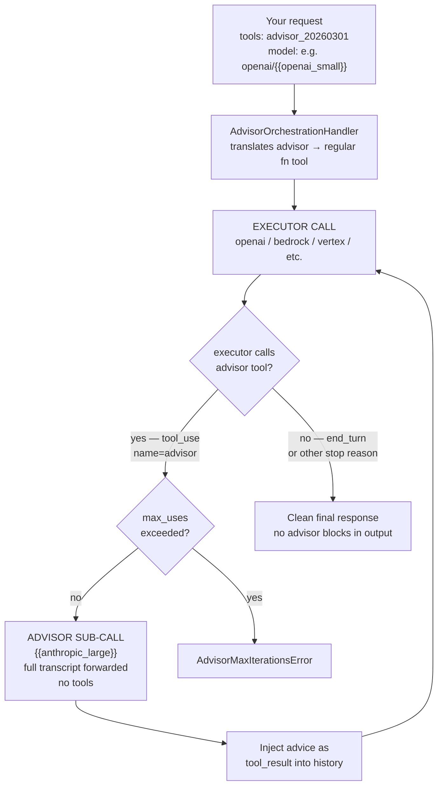

# Advisor 工具

把一个执行更快的执行模型（executor model）与一个智能水平更高的顾问模型（advisor model）配对，由顾问模型在生成中途提供战略层面的指导。

advisor 工具让快速、低成本的执行模型（Sonnet 或 Haiku）在生成中途咨询高智能的顾问模型（Opus 4.6）。顾问模型会读取完整对话，产出一份计划或一次纠偏建议，通常消耗 400 到 700 个文本 token，随后执行模型继续执行任务。

这种模式非常适合长程的智能体（agentic）工作负载（编码智能体、computer use、多步研究）：大多数回合只是机械操作，但一份出色的计划至关重要。token 生成的大头按执行模型的费率计费，而质量接近单独使用顾问模型的水平。

:::info[测试版]

advisor 工具目前处于测试版（beta）阶段。请在请求中包含 `anthropic-beta: advisor-tool-2026-03-01`；当 LiteLLM 在 `tools` 数组中检测到 advisor 工具时，会自动添加这个请求头。

:::

## 支持的提供商

| 提供商 | Chat Completions API | Messages API | 说明 |
|----------|---------------------|--------------|-------|
| **Anthropic API** | ✅ | ✅ | 原生支持；在服务端运行 |
| **OpenAI / Azure OpenAI** | ✅ | ✅ | LiteLLM 编排循环 |
| **Amazon Bedrock** | ✅ | ✅ | LiteLLM 编排循环 |
| **Google Vertex AI** | ✅ | ✅ | LiteLLM 编排循环 |
| **Groq / Mistral / 其他** | ✅ | ✅ | LiteLLM 编排循环 |

## 工作原理（LiteLLM 原生编排）

对于非 Anthropic 提供商，LiteLLM 会自己实现 advisor 循环。你调用的 API 完全相同，循环由 LiteLLM 代为运行。

当请求带有 `advisor_20260301` 工具且目标是非 Anthropic 提供商时，`AdvisorOrchestrationHandler` 会拦截该请求，把 advisor 工具翻译成提供商能理解的普通函数工具（function tool），然后运行一个编排循环：



**LiteLLM 为你做了这些**：

- 从发往提供商的请求中剥离 `advisor_20260301`，提供商只会看到一个名为 `advisor` 的标准函数工具
- 执行模型调用该工具时，在结果返回给你之前进行拦截，发起 advisor 子调用并注入建议
- 重新发送时从消息历史中剥离所有 `advisor_tool_result` / `server_tool_use` 块，非 Anthropic 提供商永远不会见到 Anthropic 专属的类型
- 如果你请求了 `stream=True`，会把最终响应包装成 SSE 流
- 将 `max_uses`（默认 5）作为硬上限严格执行：当执行模型请求的 advisor 调用次数超过 `max_uses` 允许的范围时，整个请求会以 `AdvisorMaxIterationsError` 失败，因此 `max_uses=0` 时第一次 advisor 调用就会失败。如果想完全不用 advisor，直接从 `tools` 中去掉该工具即可

## 模型兼容性

执行模型与顾问模型必须构成有效配对。顾问模型是 Opus 模型（`{{anthropic_large}}`），执行模型可以是 Opus 4.6 及以上、Sonnet 4.6 及以上，或 Haiku 4.5。

| 执行模型 | 顾问模型 |
|----------|---------|
| `claude-haiku-4-5-20251001` | `{{anthropic_large}}` |
| `{{anthropic}}` | `{{anthropic_large}}` |
| `{{anthropic_large}}` | `{{anthropic_large}}` |

---

## Chat Completions API

### SDK 用法

#### 基础示例

```python showLineNumbers title="Advisor 工具：litellm.completion()"
import litellm

response = litellm.completion(
    model="anthropic/{{anthropic}}",
    messages=[
        {"role": "user", "content": "Build a concurrent worker pool in Go with graceful shutdown."}
    ],
    tools=[
        {
            "type": "advisor_20260301",
            "name": "advisor",
            "model": "{{anthropic_large}}",
        }
    ],
    max_tokens=4096,
)

print(response.choices[0].message.content)
```

#### 可选参数用法

```python showLineNumbers title="Advisor 工具：max_uses 与缓存"
import litellm

response = litellm.completion(
    model="anthropic/{{anthropic}}",
    messages=[
        {"role": "user", "content": "Build a REST API with authentication in Python."}
    ],
    tools=[
        {
            "type": "advisor_20260301",
            "name": "advisor",
            "model": "{{anthropic_large}}",
            "max_uses": 3,                             # cap advisor calls per request
            "caching": {"type": "ephemeral", "ttl": "5m"},  # enable for 3+ calls per conversation
        }
    ],
    max_tokens=4096,
)
```

#### 流式输出

```python showLineNumbers title="Advisor 工具的流式输出"
import litellm

response = litellm.completion(
    model="anthropic/{{anthropic}}",
    messages=[
        {"role": "user", "content": "Implement a distributed rate limiter."}
    ],
    tools=[
        {
            "type": "advisor_20260301",
            "name": "advisor",
            "model": "{{anthropic_large}}",
        }
    ],
    max_tokens=4096,
    stream=True,
)

for chunk in response:
    if chunk.choices[0].delta.content:
        print(chunk.choices[0].delta.content, end="")
```

:::note[流式行为]

advisor 子推理（sub-inference）本身不流式输出。advisor 运行期间，执行模型的流会暂停，随后完整的 advisor 结果以单个事件送达，之后执行模型的输出恢复流式。

:::

#### 多轮对话

```python showLineNumbers title="配合 Advisor 工具的多轮对话"
import litellm

tools = [
    {
        "type": "advisor_20260301",
        "name": "advisor",
        "model": "{{anthropic_large}}",
    }
]

messages = [
    {"role": "user", "content": "Build a concurrent worker pool in Go with graceful shutdown."}
]

response = litellm.completion(
    model="anthropic/{{anthropic}}",
    messages=messages,
    tools=tools,
    max_tokens=4096,
)

# Append the full response (includes server_tool_use + advisor_tool_result blocks)
messages.append({"role": "assistant", "content": response.choices[0].message.content})

# Continue the conversation — keep the same tools array
messages.append({"role": "user", "content": "Now add a max-in-flight limit of 10."})

response2 = litellm.completion(
    model="anthropic/{{anthropic}}",
    messages=messages,
    tools=tools,
    max_tokens=4096,
)
```

:::tip[后续轮次自动剥离]

如果当前请求中没有 advisor 工具，LiteLLM 会自动从消息历史中剥离 `advisor_tool_result` 块，避免原本会触发的 Anthropic 400 错误。

:::

### AI 网关用法

#### 代理配置

```yaml showLineNumbers title="config.yaml"
model_list:
  - model_name: claude-sonnet
    litellm_params:
      model: anthropic/{{anthropic}}
      api_key: os.environ/ANTHROPIC_API_KEY
```

#### 通过代理发起客户端请求

```python showLineNumbers title="通过 AI 网关使用 Advisor 工具"
from openai import OpenAI

client = OpenAI(
    api_key="your-litellm-proxy-key",
    base_url="http://0.0.0.0:4000/v1"
)

response = client.chat.completions.create(
    model="claude-sonnet",
    messages=[
        {"role": "user", "content": "Implement a distributed rate limiter in Python."}
    ],
    tools=[
        {
            "type": "advisor_20260301",
            "name": "advisor",
            "model": "{{anthropic_large}}",
        }
    ],
    max_tokens=4096,
)
```

---

## Messages API

### SDK 用法

#### 基础示例

```python showLineNumbers title="Advisor 工具：litellm.anthropic.messages"
import asyncio
import litellm

async def main():
    response = await litellm.anthropic.messages.acreate(
        model="anthropic/{{anthropic}}",
        messages=[
            {"role": "user", "content": "Build a concurrent worker pool in Go with graceful shutdown."}
        ],
        tools=[
            {
                "type": "advisor_20260301",
                "name": "advisor",
                "model": "{{anthropic_large}}",
            }
        ],
        max_tokens=4096,
    )
    print(response)

asyncio.run(main())
```

#### 流式输出

```python showLineNumbers title="Messages API 的 Advisor 工具流式输出"
import asyncio
import json
import litellm

async def main():
    response = await litellm.anthropic.messages.acreate(
        model="anthropic/{{anthropic}}",
        messages=[
            {"role": "user", "content": "Implement a distributed rate limiter."}
        ],
        tools=[
            {
                "type": "advisor_20260301",
                "name": "advisor",
                "model": "{{anthropic_large}}",
            }
        ],
        max_tokens=4096,
        stream=True,
    )

    async for chunk in response:
        if isinstance(chunk, bytes):
            for line in chunk.decode("utf-8").split("\n"):
                if line.startswith("data: "):
                    try:
                        print(json.loads(line[6:]))
                    except json.JSONDecodeError:
                        pass

asyncio.run(main())
```

### AI 网关用法

#### 代理配置

```yaml showLineNumbers title="config.yaml"
model_list:
  - model_name: claude-sonnet
    litellm_params:
      model: anthropic/{{anthropic}}
      api_key: os.environ/ANTHROPIC_API_KEY
```

#### 通过代理发起客户端请求（Anthropic SDK）

```python showLineNumbers title="通过 AI 网关使用 Advisor 工具（Anthropic SDK）"
import anthropic

client = anthropic.Anthropic(
    api_key="your-litellm-proxy-key",
    base_url="http://0.0.0.0:4000"
)

response = client.beta.messages.create(
    model="claude-sonnet",
    max_tokens=4096,
    betas=["advisor-tool-2026-03-01"],
    messages=[
        {"role": "user", "content": "Build a concurrent worker pool in Go with graceful shutdown."}
    ],
    tools=[
        {
            "type": "advisor_20260301",
            "name": "advisor",
            "model": "{{anthropic_large}}",
        }
    ],
)
print(response)
```

#### 非 Anthropic 提供商（LiteLLM 编排循环）

```python showLineNumbers title="使用 OpenAI 执行模型的 Advisor 工具" keep-model-ids
import asyncio
import litellm

async def main():
    # executor: openai/gpt-5.6-luna  |  advisor: {{anthropic_large}}
    # LiteLLM runs the orchestration loop automatically
    response = await litellm.anthropic.messages.acreate(
        model="openai/gpt-5.6-luna",
        messages=[
            {"role": "user", "content": "Implement a Python LRU cache with O(1) get and put."}
        ],
        tools=[
            {
                "type": "advisor_20260301",
                "name": "advisor",
                "model": "{{anthropic_large}}",
                "max_uses": 3,
            }
        ],
        max_tokens=1024,
        custom_llm_provider="openai",
    )
    # Final response is clean — no advisor tool_use blocks
    print(response["content"][0]["text"])

asyncio.run(main())
```

---

## 响应结构

advisor 调用成功后，会在 assistant 内容中返回 `server_tool_use` 和 `advisor_tool_result` 块：

```json title="包含 advisor 块的响应"
{
  "role": "assistant",
  "content": [
    {
      "type": "text",
      "text": "Let me consult the advisor on this."
    },
    {
      "type": "server_tool_use",
      "id": "srvtoolu_abc123",
      "name": "advisor",
      "input": {}
    },
    {
      "type": "advisor_tool_result",
      "tool_use_id": "srvtoolu_abc123",
      "content": {
        "type": "advisor_result",
        "text": "Use a channel-based coordination pattern. The tricky part is draining in-flight work during shutdown: close the input channel first, then wait on a WaitGroup..."
      }
    },
    {
      "type": "text",
      "text": "Here's the implementation using a channel-based coordination pattern..."
    }
  ]
}
```

后续轮次请把包含 advisor 块在内的完整 assistant 内容原样传回。LiteLLM 会通过 `provider_specific_fields` 自动处理这件事。

---

## 成本控制

advisor 调用作为单独的子推理运行，按顾问模型的费率计费。用量通过 `usage.iterations[]` 上报：

```json title="包含 advisor 子推理的用量"
{
  "usage": {
    "input_tokens": 412,
    "output_tokens": 531,
    "iterations": [
      {
        "type": "message",
        "input_tokens": 412,
        "output_tokens": 89
      },
      {
        "type": "advisor_message",
        "model": "{{anthropic_large}}",
        "input_tokens": 823,
        "output_tokens": 1612
      },
      {
        "type": "message",
        "input_tokens": 1348,
        "output_tokens": 442
      }
    ]
  }
}
```

顶层的 `usage` 只统计执行模型的 token。advisor 的 token 出现在 `type: "advisor_message"` 的 `iterations` 条目里，按 Opus 费率计费。

**提示**：

- 只有预计每次对话会出现 3 次以上 advisor 调用时，才在工具定义中启用 `caching`；低于这个阈值，多花的比省下的多。
- 用 `max_uses` 限制每次请求的 advisor 调用次数。在 Anthropic API 上该值至少为 1，达到上限后 advisor 会返回 `max_uses_exceeded` 错误结果，执行模型在没有进一步建议的情况下继续任务。在 LiteLLM 编排循环（非 Anthropic 提供商）上，超出上限会抛出 `AdvisorMaxIterationsError`，整个请求失败。
- 对话级别的上限请在客户端自行统计 advisor 调用次数，到达上限后从 `tools` 中移除 advisor 工具。

---

## 推荐的系统提示词

针对编码和智能体任务，Anthropic 建议把下面几段前置到你的系统提示词中，以获得稳定的 advisor 调用时机和最优的成本/质量表现：

```text title="时机指引（前置到系统提示词）"
You have access to an `advisor` tool backed by a stronger reviewer model. It takes NO parameters — when you call advisor(), your entire conversation history is automatically forwarded. They see the task, every tool call you've made, every result you've seen.

Call advisor BEFORE substantive work — before writing, before committing to an interpretation, before building on an assumption. If the task requires orientation first (finding files, fetching a source, seeing what's there), do that, then call advisor. Orientation is not substantive work. Writing, editing, and declaring an answer are.

Also call advisor:
- When you believe the task is complete. BEFORE this call, make your deliverable durable: write the file, save the result, commit the change.
- When stuck — errors recurring, approach not converging, results that don't fit.
- When considering a change of approach.

On tasks longer than a few steps, call advisor at least once before committing to an approach and once before declaring done. On short reactive tasks where the next action is dictated by tool output you just read, you don't need to keep calling.
```

```text title="建议权重指引（加在时机块之后）"
Give the advice serious weight. If you follow a step and it fails empirically, or you have primary-source evidence that contradicts a specific claim, adapt. A passing self-test is not evidence the advice is wrong.

If you've already retrieved data pointing one way and the advisor points another: don't silently switch. Surface the conflict in one more advisor call — "I found X, you suggest Y, which constraint breaks the tie?"
```

若想在不损失质量的前提下把 advisor 输出长度缩短 35%～45%，可以再加上：

```text title="降低成本（可选，加在时机块之前）"
The advisor should respond in under 100 words and use enumerated steps, not explanations.
```

---

## 其他资源

- [Anthropic Advisor 工具文档](https://platform.claude.com/docs/en/agents-and-tools/tool-use/advisor-tool)
- [LiteLLM 工具调用指南](https://docs.litellm.ai/docs/completion/function_call)
