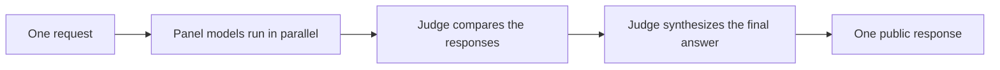

import Tabs from '@theme/Tabs';
import TabItem from '@theme/TabItem';

# Fusion 模型

:::caution 尚未发布

Fusion 尚未进入任何已发布的 litellm 版本，也不在 litellm `main` 分支上。它目前位于 `litellm_fusion_router` 分支，待 [litellm PR #39224](https://github.com/BerriAI/litellm/pull/39224) 合并后随版本发布。在此之前，本页的代码片段会报错 `BadRequestError: LLM Provider NOT provided ... You passed model=litellm/fusion-1`

:::

`litellm/fusion-1` 是 LiteLLM 提供的虚拟模型，适合需要独立模型视角的请求。它会将请求并行发送给一个可配置的模型面板，让裁决模型（judge）比较各个成功响应，再由裁决模型综合出一条对外响应。

请求与响应保留你所调用 SDK 方法的原生形态。Fusion 兼容 Chat Completions、Anthropic Messages 和 Responses 三种接口。



裁决模型首先生成一份结构化比较，涵盖共识、矛盾、覆盖缺口、独特见解与盲点。LiteLLM 会把这份私有分析回传给裁决模型，由它撰写最终答案。对外的 `response.model` 标识生成该答案的具体裁决模型。

## 快速上手

为面板和裁决模型用到的每个提供商配置好凭据。同一份 `fusion` 配置适用于全部三种 SDK 接口。

<Tabs>
<TabItem value="chat" label="Chat Completions" default>

```python showLineNumbers
import litellm

fusion = {
    "models": [
        "openai/gpt-4o-mini",
        "anthropic/claude-haiku-4-5",
    ],
    "judge": {
        "model": "openai/gpt-4o-mini",
        "criteria": "Prioritize correctness and verifiable evidence.",
    },
}

response = litellm.completion(
    model="litellm/fusion-1",
    messages=[
        {
            "role": "user",
            "content": "Review this database migration plan for operational risks.",
        }
    ],
    fusion=fusion,
)

print(response.model)
print(response.choices[0].message.content)
```

</TabItem>
<TabItem value="messages" label="Anthropic Messages">

```python showLineNumbers
import litellm

fusion = {
    "models": [
        "openai/gpt-4o-mini",
        "anthropic/claude-haiku-4-5",
    ],
    "judge": {
        "model": "openai/gpt-4o-mini",
        "criteria": "Prioritize correctness and verifiable evidence.",
    },
}

response = litellm.anthropic.messages.create(
    model="litellm/fusion-1",
    max_tokens=2048,
    messages=[
        {
            "role": "user",
            "content": "Review this database migration plan for operational risks.",
        }
    ],
    fusion=fusion,
)

print(response["model"])
print(response["content"][0]["text"])
```

</TabItem>
<TabItem value="responses" label="Responses">

```python showLineNumbers
import litellm

fusion = {
    "models": [
        "openai/gpt-4o-mini",
        "anthropic/claude-haiku-4-5",
    ],
    "judge": {
        "model": "openai/gpt-4o-mini",
        "criteria": "Prioritize correctness and verifiable evidence.",
    },
}

response = litellm.responses(
    model="litellm/fusion-1",
    input="Review this database migration plan for operational risks.",
    fusion=fusion,
)

print(response.model)
print(response.output_text)
```

</TabItem>
</Tabs>

调用 `litellm/fusion-1` 总会触发完整商议流程，没有单独的开关可以启用它。你可以省略 `fusion` 参数，改用默认的面板与裁决模型。

## 响应行为

Fusion 返回一条正常响应，格式与所调用的 SDK 方法一致。它不会返回各个面板的独立响应，也不会返回裁决模型的私有比较结果。响应中隐藏的 Fusion 元数据会报告商议是否进行，以及多少次面板调用成功或失败，但不包含其内容。隐藏的 `router` 字段标识 `litellm/fusion-1`。

## 配置

在 `model="litellm/fusion-1"` 旁边传入一个 `fusion` 字典，所有字段均可选。

| 字段 | 默认值 | 说明 |
|---|---|---|
| `models` | LiteLLM default panel | 并行独立作答的一到八个模型。 |
| `judge.model` | LiteLLM default judge | 比较各面板成功响应并撰写最终答案的模型。 |
| `judge.criteria` | `None` | 用于比较面板响应的指令。 |
| `max_completion_tokens` | `16000` | 每次内部调用的最大输出 Token 数（含推理）。 |
| `reasoning` | Provider default | 转发给面板与裁决调用的推理力度（reasoning effort）。 |
| `temperature` | Provider default | 转发给面板调用的温度。裁决模型固定使用温度 `0`。 |

## 工具与流式

公开请求上的标准工具仍然可用。客户端工具 schema 对面板与比较调用保持私有，裁决模型在撰写最终响应时才会收到它们。

流式需使用异步 SDK 方法：`litellm.acompletion()`、`litellm.anthropic.messages.acreate()` 或 `litellm.aresponses()`。同步流式会被拒绝，并提示改用对应的异步方法。

## 成本与递归

Fusion 为一次公开请求会发起多次提供商调用，成本与延迟随面板规模和所配置的模型而增加。面板与裁决模型不能递归调用 `litellm/fusion-1`；商议深度以一层为限。
