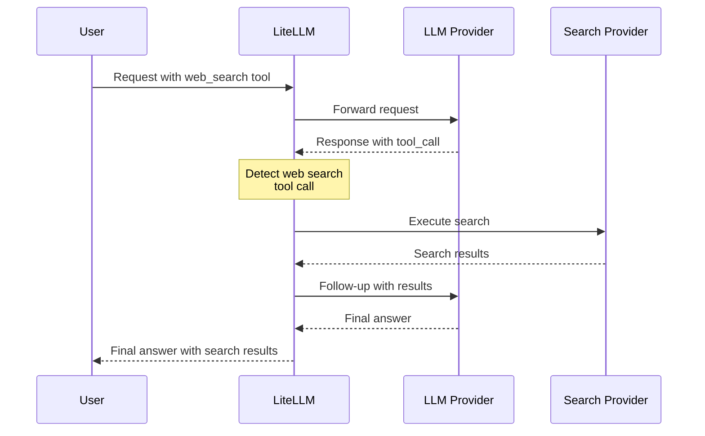

# 网络搜索集成

为任意 LLM 提供商（provider）启用透明的服务端网络搜索。LiteLLM 会自动拦截网络搜索的工具调用（tool calling），并用你配置的搜索提供商（search provider）来执行，支持 Parallel、Perplexity、Tavily 等。

## 快速上手

### 1. 配置网络搜索拦截

在你的 `config.yaml` 中添加：

```yaml
model_list:
  - model_name: {{openai_large}}
    litellm_params:
      model: openai/{{openai_large}}
      api_key: os.environ/OPENAI_API_KEY

litellm_settings:
  callbacks: ["websearch_interception"]
  websearch_interception_params:
    enabled_providers:
      - openai
      - minimax
      - anthropic
    search_tool_name: perplexity-search  # 可选

search_tools:
  - search_tool_name: perplexity-search
    litellm_params:
      search_provider: perplexity
      api_key: os.environ/PERPLEXITY_API_KEY
```

### 2. 搭配任意提供商使用

```python
import litellm

response = await litellm.acompletion(
    model="{{openai_large}}",
    messages=[
        {"role": "user", "content": "What's the weather in San Francisco today?"}
    ],
    tools=[
        {
            "type": "function",
            "function": {
                "name": "litellm_web_search",
                "description": "Search the web for information",
                "parameters": {
                    "type": "object",
                    "properties": {
                        "query": {"type": "string", "description": "Search query"}
                    },
                    "required": ["query"]
                }
            }
        }
    ]
)

# 响应会自动包含搜索结果！
print(response.choices[0].message.content)
```

## 工作原理

当模型发起网络搜索工具调用时，LiteLLM 会：

1. **检测**响应中的 `litellm_web_search` 工具调用
2. **调用**你配置的搜索提供商执行搜索
3. **携带搜索结果发起后续请求**
4. **向用户返回**最终答案



**结果**：用户只需一次 API 调用 → 拿到附带搜索结果的完整答案

## 模型看到的搜索工具

无论请求携带的是哪种网络搜索工具，LiteLLM 都会在模型看到之前把它替换为自己的 `litellm_web_search` 定义。无论是 Anthropic 的 `web_search_20250305`、Responses API 的 `web_search_preview`、Claude Code 的 `web_search`，还是你自己定义的只带一个 `query` 参数的 `litellm_web_search` 函数工具，到达模型时都是下面这个 schema，只是以你所调用 API 的工具格式呈现（Anthropic 的 `input_schema`、Chat Completions 的 `function.parameters`，或 Responses 的扁平函数工具）。

```json title="litellm_web_search 输入 schema"
{
  "type": "object",
  "properties": {
    "query": {
      "type": "string",
      "description": "The search query to execute"
    },
    "objective": {
      "type": "string",
      "description": "Natural-language description of the goal behind the search, including any source or freshness requirements."
    },
    "search_queries": {
      "type": "array",
      "items": {"type": "string"},
      "description": "Two to five short keyword queries (3-6 words each) covering different angles of the objective, e.g. varying names, synonyms, or phrasings. Provide together with objective for the best results."
    }
  },
  "required": ["query"]
}
```

`query` 为必填，也是大多数搜索提供商实际接收到的字段。`objective` 与 `search_queries` 是可选的：模型可以用它们说明这次搜索要达成什么，并在一次工具调用中扇出多个关键词搜索。LiteLLM 只会把这两个字段转发给原生支持这种入参形态的搜索提供商，目前即 [Parallel AI](../search/parallel_ai.md)。在 Parallel 那边，`search_queries` 列表会成为提供商侧的 queries，`objective` 随之一并传入；若搜索工具的 `litellm_params` 已设置 `objective`，则以配置值优先，覆盖模型给出的值。其余搜索提供商（Perplexity、Tavily、Exa 等）仍只收到单个 `query` 字符串；只填 `query` 的模型在各提供商下的行为与之前完全一致。

这些可选字段在转发前会经过校验：空的 `objective` 会被忽略；`search_queries` 必须是数组（裸字符串会被直接忽略，而不会拆成单个字符）；不是非空字符串的条目会被丢弃；只保留前五条查询，与 Parallel 自身的上限一致。

配置了 Parallel AI 搜索工具后，模型发出的工具调用与 LiteLLM 据此构造的请求如下所示。出站请求体就是 `--detailed_debug` 打印的、发送到 `https://api.parallel.ai/v1/search` 的请求。

```json title="模型发出的工具调用"
{
  "name": "litellm_web_search",
  "input": {
    "query": "latest stable Node.js release",
    "objective": "Find the most current stable Node.js release version and what changes were included in that release",
    "search_queries": ["latest stable Node.js release", "Node.js newest version changelog", "current Node.js LTS release"]
  }
}
```

```json title="LiteLLM 发送给 Parallel AI 的请求"
{
  "objective": "Find the most current stable Node.js release version and what changes were included in that release",
  "search_queries": ["latest stable Node.js release", "Node.js newest version changelog", "current Node.js LTS release"],
  "mode": "basic",
  "advanced_settings": {"max_results": 5}
}
```

换成 Tavily 搜索工具时，同一次工具调用只会向 Tavily 发送 `"query": "latest stable Node.js release"`，另外两个字段一概不传。对发送 Anthropic 原生 `web_search_*` 工具的客户端来说，最终响应中的 `server_tool_use` 块依然只显示 `query`。

## 支持的提供商

网络搜索集成可与使用以下处理器的**所有提供商**配合工作：
- ✅ **Base HTTP Handler**（`BaseLLMHTTPHandler`）
- ✅ **OpenAI Completion Handler**（`OpenAIChatCompletion`）

### 使用 Base HTTP Handler 的提供商

| 提供商 | 状态 | 说明 |
|--------|------|------|
| **OpenAI** | ✅ 支持 | GPT-4、GPT-3.5 等 |
| **Anthropic** | ✅ 支持 | 经由 HTTP handler 的 Claude 模型 |
| **MiniMax** | ✅ 支持 | 所有 MiniMax 模型 |
| **Mistral** | ✅ 支持 | Mistral AI 模型 |
| **Cohere** | ✅ 支持 | Command 系列模型 |
| **Fireworks AI** | ✅ 支持 | 所有 Fireworks 模型 |
| **Together AI** | ✅ 支持 | 所有 Together AI 模型 |
| **Groq** | ✅ 支持 | 所有 Groq 模型 |
| **Perplexity** | ✅ 支持 | Perplexity 模型 |
| **DeepSeek** | ✅ 支持 | DeepSeek 模型 |
| **xAI** | ✅ 支持 | Grok 模型 |
| **Hugging Face** | ✅ 支持 | Inference API 模型 |
| **OCI** | ✅ 支持 | Oracle Cloud 模型 |
| **Vertex AI** | ✅ 支持 | Google Vertex AI 模型 |
| **Bedrock** | ✅ 支持 | AWS Bedrock 模型（converse_like 路由） |
| **Azure OpenAI** | ✅ 支持 | Azure 托管的 OpenAI 模型 |
| **Sagemaker** | ✅ 支持 | AWS Sagemaker 模型 |
| **Databricks** | ✅ 支持 | Databricks 模型 |
| **DataRobot** | ✅ 支持 | DataRobot 模型 |
| **Hosted VLLM** | ✅ 支持 | 自托管 VLLM |
| **Heroku** | ✅ 支持 | Heroku 托管的模型 |
| **RAGFlow** | ✅ 支持 | RAGFlow 模型 |
| **Compactif** | ✅ 支持 | Compactif 模型 |
| **Cometapi** | ✅ 支持 | Comet API 模型 |
| **A2A** | ✅ 支持 | Agent-to-Agent 模型 |
| **Bytez** | ✅ 支持 | Bytez 模型 |

### 使用 OpenAI Handler 的提供商

| 提供商 | 状态 | 说明 |
|--------|------|------|
| **OpenAI** | ✅ 支持 | OpenAI 原生 API |
| **Azure OpenAI** | ✅ 支持 | Azure 托管的 OpenAI |
| **OpenAI-Compatible** | ✅ 支持 | 任意 OpenAI 兼容 API |

## 配置

### WebSearch 拦截参数

| 参数 | 类型 | 必填 | 说明 | 示例 |
|------|------|------|------|------|
| `enabled_providers` | List[String] | 是 | 要为其启用网络搜索的提供商列表 | `[openai, minimax, anthropic]` |
| `search_tool_name` | String | 否 | 使用 `search_tools` 配置中的某个特定搜索工具；未设置时使用第一个可用的搜索工具 | `perplexity-search` |

### 提供商取值

在 `enabled_providers` 中使用以下取值：

| 提供商 | 取值 | 提供商 | 取值 |
|--------|------|--------|------|
| OpenAI | `openai` | Anthropic | `anthropic` |
| MiniMax | `minimax` | Mistral | `mistral` |
| Cohere | `cohere` | Fireworks AI | `fireworks_ai` |
| Together AI | `together_ai` | Groq | `groq` |
| Perplexity | `perplexity` | DeepSeek | `deepseek` |
| xAI | `xai` | Hugging Face | `huggingface` |
| OCI | `oci` | Vertex AI | `vertex_ai` |
| Bedrock | `bedrock` | Azure | `azure` |
| Sagemaker | `sagemaker_chat` | Databricks | `databricks` |
| DataRobot | `datarobot` | VLLM | `hosted_vllm` |
| Heroku | `heroku` | RAGFlow | `ragflow` |
| Compactif | `compactif` | Cometapi | `cometapi` |
| A2A | `a2a` | Bytez | `bytez` |

## 搜索提供商

配置要使用哪个搜索提供商。LiteLLM 支持多种搜索提供商：

| 提供商 | `search_provider` 取值 | 环境变量 |
|--------|------------------------|----------|
| **Perplexity AI** | `perplexity` | `PERPLEXITYAI_API_KEY` |
| **Tavily** | `tavily` | `TAVILY_API_KEY` |
| **Exa AI** | `exa_ai` | `EXA_API_KEY` |
| **Brave Search** | `brave` | `BRAVE_API_KEY` |
| **Parallel AI** | `parallel_ai` | `PARALLEL_AI_API_KEY` |
| **Google PSE** | `google_pse` | `GOOGLE_PSE_API_KEY`、`GOOGLE_PSE_ENGINE_ID` |
| **DataForSEO** | `dataforseo` | `DATAFORSEO_LOGIN`、`DATAFORSEO_PASSWORD` |
| **Firecrawl** | `firecrawl` | `FIRECRAWL_API_KEY` |
| **SearXNG** | `searxng` | `SEARXNG_API_BASE`（必填） |
| **Linkup** | `linkup` | `LINKUP_API_KEY` |
| **Serper** | `serper` | `SERPER_API_KEY` |
| **SearchAPI.io** | `searchapi` | `SEARCHAPI_API_KEY` |

详细配置步骤参见[搜索提供商文档](../search/index.md)。

## 完整配置示例

```yaml
model_list:
  # OpenAI
  - model_name: {{openai_large}}
    litellm_params:
      model: openai/{{openai_large}}
      api_key: os.environ/OPENAI_API_KEY

  # MiniMax
  - model_name: minimax
    litellm_params:
      model: minimax/MiniMax-M2.1
      api_key: os.environ/MINIMAX_API_KEY

  # Anthropic
  - model_name: claude
    litellm_params:
      model: anthropic/{{anthropic}}
      api_key: os.environ/ANTHROPIC_API_KEY

  # Azure OpenAI
  - model_name: azure-gpt
    litellm_params:
      model: azure/{{openai_large}}
      api_base: https://my-azure.openai.azure.com
      api_key: os.environ/AZURE_API_KEY

litellm_settings:
  callbacks: ["websearch_interception"]
  websearch_interception_params:
    enabled_providers:
      - openai
      - minimax
      - anthropic
      - azure
    search_tool_name: perplexity-search

search_tools:
  - search_tool_name: perplexity-search
    litellm_params:
      search_provider: perplexity
      api_key: os.environ/PERPLEXITY_API_KEY

  - search_tool_name: tavily-search
    litellm_params:
      search_provider: tavily
      api_key: os.environ/TAVILY_API_KEY

  - search_tool_name: parallel-search
    litellm_params:
      search_provider: parallel_ai
      api_key: os.environ/PARALLEL_API_KEY
```

要使用 Parallel 搜索，请在 `websearch_interception_params` 中设置 `search_tool_name: parallel-search`。

## 使用示例

### Python SDK

```python
import litellm

# 配置回调
litellm.callbacks = ["websearch_interception"]

# 携带网络搜索工具发起补全
response = await litellm.acompletion(
    model="{{openai_large}}",
    messages=[
        {"role": "user", "content": "What are the latest AI news?"}
    ],
    tools=[
        {
            "type": "function",
            "function": {
                "name": "litellm_web_search",
                "description": "Search the web for current information",
                "parameters": {
                    "type": "object",
                    "properties": {
                        "query": {
                            "type": "string",
                            "description": "Search query"
                        }
                    },
                    "required": ["query"]
                }
            }
        }
    ]
)

print(response.choices[0].message.content)
```

### 代理服务器

```bash
# 使用配置文件启动代理
litellm --config config.yaml

# 发起请求
curl http://localhost:4000/v1/chat/completions \
  -H "Content-Type: application/json" \
  -H "Authorization: Bearer $LITELLM_API_KEY" \
  -d '{
    "model": "{{openai_large}}",
    "messages": [
      {"role": "user", "content": "What is the weather in San Francisco?"}
    ],
    "tools": [
      {
        "type": "function",
        "function": {
          "name": "litellm_web_search",
          "description": "Search the web",
          "parameters": {
            "type": "object",
            "properties": {
              "query": {"type": "string"}
            },
            "required": ["query"]
          }
        }
      }
    ]
  }'
```

## 搜索工具的选择逻辑

1. **指定了 `search_tool_name`** → 使用该特定搜索工具
2. **未指定 `search_tool_name`** → 使用 `search_tools` 列表中的第一个搜索工具

```yaml
search_tools:
  - search_tool_name: perplexity-search  # ← 未指定 search_tool_name 时会使用这一项
    litellm_params:
      search_provider: perplexity
      api_key: os.environ/PERPLEXITY_API_KEY

  - search_tool_name: tavily-search
    litellm_params:
      search_provider: tavily
      api_key: os.environ/TAVILY_API_KEY
```

## 故障排查

### 网络搜索不生效

1. **检查提供商是否已启用**：
   ```yaml
   enabled_providers:
     - openai  # 确认你的提供商已列入这份清单
   ```

2. **确认搜索工具已配置**：
   ```yaml
   search_tools:
     - search_tool_name: perplexity-search
       litellm_params:
         search_provider: perplexity
         api_key: os.environ/PERPLEXITY_API_KEY
   ```

3. **检查 API 密钥是否已设置**：
   ```bash
   export PERPLEXITY_API_KEY=your-key
   ```

4. **启用调试日志**：
   ```python
   litellm.set_verbose = True
   ```

### 常见问题

**问题**：模型返回 tool_calls 而不是最终答案
- **原因**：提供商不在 `enabled_providers` 清单中
- **解决方法**：把提供商加入 `enabled_providers`

**问题**：出现 “No search tool configured” 报错
- **原因**：`search_tools` 配置中没有任何搜索工具
- **解决方法**：至少添加一条搜索工具配置

**问题**：出现 “Invalid function arguments json string” 报错（MiniMax）
- **原因**：最新版本已修复，此前参数未被正确做 JSON 序列化
- **解决方法**：升级到最新版 LiteLLM

## 相关文档

- [搜索提供商](../search/index.md)：搜索提供商的详细配置
- [Claude Code WebSearch](../tutorials/claude_code_websearch.md)：在 Claude Code 中使用
- [工具调用](../completion/function_call.md)：工具调用通用文档
- [回调](../observability/custom_callback.md)：自定义回调文档

## 技术细节

### 架构

网络搜索集成以自定义回调（custom callback，`WebSearchInterceptionLogger`）的形式实现，它会：

1. **请求前钩子**（pre-request hook）：把原生的网络搜索工具转换为 LiteLLM 标准格式
2. **响应后钩子**（post-response hook）：检测响应中的网络搜索工具调用
3. **智能体循环**（agentic loop）：自动执行搜索并发起后续请求

### 支持的 API

- ✅ **Chat Completions API**（OpenAI 格式）
- ✅ **Anthropic Messages API**（Anthropic 格式）
- ✅ **流式**（streaming，自动转换）
- ✅ **非流式**

### 响应格式检测

处理器会自动检测响应格式：
- **OpenAI 格式**：assistant 消息中的 `tool_calls`
- **Anthropic 格式**：content 中的 `tool_use` 块

### 性能

- **延迟**：多出一次额外的 LLM 调用（携带搜索结果的后续请求）
- **缓存**：搜索结果可以缓存（取决于搜索提供商）
- **并行搜索**：多条搜索查询并行执行

## 参与贡献

发现了 bug，或想为新的提供商添加支持？参见[贡献指南](https://github.com/BerriAI/litellm/blob/main/CONTRIBUTING.md)。
