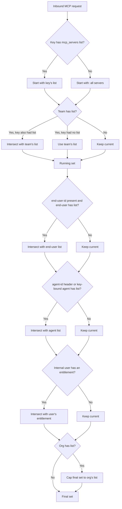

import Tabs from '@theme/Tabs';
import TabItem from '@theme/TabItem';
import Image from '@theme/IdealImage';

# MCP 权限管理

在 LiteLLM 中，你可以控制特定密钥、团队或组织能够访问哪些 MCP（Model Context Protocol）服务器与工具。当客户端尝试列出或调用工具时，LiteLLM 会依据已配置的权限执行访问控制。

## 概览

LiteLLM 为 MCP 服务器提供细粒度的权限管理，让你可以：

- **按实体限制 MCP 访问**：控制哪些密钥、团队或组织可以访问特定的 MCP 服务器
- **工具级过滤**：根据实体权限自动过滤可用工具
- **集中管控**：在 LiteLLM 管理界面（Admin UI）或 API 中统一管理所有 MCP 权限
- **一键公开 MCP**：不需要按密钥做限制时，可将特定服务器标记为对所有 LiteLLM API 密钥可用

这能确保只有获得授权的实体才能发现并使用 MCP 工具，为你的 MCP 基础设施再添一层安全保障。

:::info[相关文档]
- [MCP 概览](./mcp.md)：了解 LiteLLM 中的 MCP
- [为密钥和团队授予 MCP 服务器访问权限](./mcp_grant_access.md)：通过管理界面与 API 为密钥和团队授权的分步操作
- [MCP 成本追踪](./mcp_cost.md)：追踪 MCP 工具调用的成本
- [MCP 防护栏（guardrails）](./mcp_guardrail.md)：为 MCP 调用应用安全防护栏
- [使用 MCP](./mcp_usage.md)：如何在 LiteLLM 中使用 MCP
:::

## 工作原理

LiteLLM 支持按密钥、团队、组织这三类实体（entity）管理 MCP 服务器的权限。当 MCP 客户端尝试列出工具时，LiteLLM 只会返回该实体有权访问的工具。

创建密钥、团队或组织时，你可以勾选允许该实体访问的 MCP 服务器。

<Image 
  img={require('../img/mcp_key.png')}
  style={{width: '80%', display: 'block', margin: '0'}}
/>

## 权限层级

权限可以在六个不同的层级上设置。当同一个请求命中多个层级时，LiteLLM 会对各层级的列表取**交集**（以最严格的为准），唯独组织层级例外，它充当的是**上限**。

| 层级 | 来源 | 组合方式 |
|---|---|---|
| **密钥** | 虚拟密钥（virtual key）上的 `object_permission.mcp_servers` / `object_permission.mcp_access_groups` | 如果密钥带有显式列表，则直接采用该列表。 |
| **团队** | 团队上的相同字段 | 如果密钥与团队都有列表，结果为两者的**交集**（仅保留同时出现在两个列表中的服务器）。如果只有团队有列表，则密钥继承该列表。 |
| **终端用户** | 与 `x-litellm-end-user-id` 匹配的 `LiteLLM_EndUserTable` 行上的相同字段 | 与当前结果取交集。如果请求中没有终端用户 ID，则跳过该层级。 |
| **Agent** | 由 `x-litellm-agent-id` 识别的 Agent，或密钥绑定的 Agent（生成密钥时设置 `agent_id`）上的相同字段 | 与当前结果取交集。如果没有适用的 Agent，则跳过该层级。 |
| **内部用户** | 请求所认证的内部用户（即真人用户）上的相同字段 | 与当前结果取交集，因此只会缩小范围。如果该用户没有任何授权记录，则跳过该层级。 |
| **组织** | 密钥/团队所属组织上的相同字段 | 充当**上限**；最终允许的服务器集合会与组织列表取交集。如果组织没有列表，则不追加任何限制。 |

如果所有层级都没有列表，请求就可以访问**全部** MCP 服务器（默认开放）。

绑定了 Agent 的密钥（调用 `/key/generate` 时传入 `agent_id`）与携带 `x-litellm-agent-id` 的请求享受同等待遇：该密钥发出的每个请求，都会把 Agent 的列表与密钥的列表取交集。仅向密钥授予某台服务器并不够，Agent 自身也必须持有该授权（通过管理界面的 Agent 编辑表单或 `PATCH /v1/agents/{agent_id}`），否则针对该服务器的请求会被拒绝，报错信息中会点名对应的 Agent。



同样的交集模型也适用于每台服务器的工具级字典 `mcp_tool_permissions`（见下文 [按实体配置工具级权限](#per-entity-tool-level-permissions)）。

### 要求密钥自行定义 MCP 访问权限

默认情况下，`mcp_servers` 列表为空或未设置的密钥会继承所在团队的列表，因此团队实际上就是所有密钥回退到的默认值。在 `general_settings` 下设置 `require_key_mcp_access_defined: true` 可以颠倒这层关系：团队从默认值变成上限，列表为空的密钥将拿不到任何 MCP 服务器，除非它显式授权（直接写在 `object_permission.mcp_servers` 中，或通过[访问组（access group）](#mcp-分组访问组)）。

```yaml title="config.yaml" showLineNumbers
general_settings:
  require_key_mcp_access_defined: true
```

推荐开启此设置。在继承模式下，团队下签发的每个密钥都会悄悄够到该团队所能到达的所有 MCP 服务器，访问权限被隐式授予，而且团队列表一扩大范围就跟着变宽；开启此开关后，密钥只能访问被显式授予的服务器，团队列表起的是封顶作用，而不是定义授权范围。我们计划在未来的版本中把它变成默认行为，欢迎在[弃用讨论](https://github.com/BerriAI/litellm/discussions/32090)中跟进并发表意见。请等到你的密钥都带有自己的 `object_permission.mcp_servers`（或已加入访问组）之后再开启，否则此前依赖继承的密钥会立刻失去 MCP 访问权限。

无论此开关如何设置，团队的 `mcp_servers` 列表为空仍然表示"不限制"，因为空的团队列表从不产生约束。该开关只改变一件事：当团队确有列表时，密钥的空列表意味着什么，是继承团队列表（默认），还是什么都不授予（开启后）。密钥上的访问组授权仍然是叠加式的，因此即使开启了该开关，加入某个访问组依然可以访问组内的服务器。

终端用户层级的等价控制见 [`require_end_user_mcp_access_defined`](./proxy/config_settings#general_settings-参考)。

### 将密钥排除在所有 MCP 服务器之外（`no-mcp-servers`）

要显式拒绝某个密钥访问所有 MCP 服务器，可以在它的 `mcp_servers` 列表中填入哨兵值 `no-mcp-servers`。这与模型访问使用的 `no-default-models` 哨兵值如出一辙。空列表会继承团队的服务器，而 `no-mcp-servers` 不同：它会覆盖团队继承以及一切叠加式的访问组授权，因此无论团队允许什么，这个密钥最终可用的 MCP 服务器都是零个。

```bash title="无 MCP 访问权限的密钥" showLineNumbers
curl -X POST "http://localhost:4000/key/generate" \
  -H "Authorization: Bearer sk-master-key" \
  -H "Content-Type: application/json" \
  -d '{
    "object_permission": {
      "mcp_servers": ["no-mcp-servers"]
    }
  }'
```

## 允许/禁止 MCP 工具
  
控制 MCP 服务器上哪些工具可用。你可以只放行特定工具，也可以封禁危险工具。

<Tabs>
<TabItem value="allowed" label="仅允许特定工具">

用 `allowed_tools` 精确指定用户可以访问哪些工具，其余工具一律封禁。

```yaml title="config.yaml" showLineNumbers
mcp_servers:
  github_mcp:
    url: "https://api.githubcopilot.com/mcp"
    auth_type: oauth2
    oauth2_flow: authorization_code
    authorization_url: https://github.com/login/oauth/authorize
    token_url: https://github.com/login/oauth/access_token
    client_id: os.environ/GITHUB_OAUTH_CLIENT_ID
    client_secret: os.environ/GITHUB_OAUTH_CLIENT_SECRET
    scopes: ["public_repo", "user:email"]
    allowed_tools: ["list_tools"]
    # only list_tools will be available
```

**适用场景**
- 你需要对可用工具进行严格管控
- 你身处高安全要求的环境
- 你正在测试一个工具数量有限的全新 MCP 服务器

</TabItem>
<TabItem value="blocked" label="封禁特定工具">

用 `disallowed_tools` 封禁特定工具，其余工具全部可用。

```yaml title="config.yaml" showLineNumbers
mcp_servers:
  github_mcp:
    url: "https://api.githubcopilot.com/mcp"
    auth_type: oauth2
    oauth2_flow: authorization_code
    authorization_url: https://github.com/login/oauth/authorize
    token_url: https://github.com/login/oauth/access_token
    client_id: os.environ/GITHUB_OAUTH_CLIENT_ID
    client_secret: os.environ/GITHUB_OAUTH_CLIENT_SECRET
    scopes: ["public_repo", "user:email"]
    disallowed_tools: ["repo_delete"]
    # only repo_delete will be blocked
```

**适用场景**
- 大多数工具是安全的，但你希望封禁其中少数危险工具
- 你想避免触发高昂的 API 调用
- 你正在逐步给现有服务器增加限制

</TabItem>
</Tabs>

### 重要说明

- 如果同时指定了 `allowed_tools` 和 `disallowed_tools`，允许列表优先生效
- 工具名称区分大小写

## 固定服务器的工具列表

`allowed_tools` 信任的是上游对每个工具用途的自我描述。固定（pin）则把工具列表连同描述、输入 schema 一起冻结：网关只提供已固定的工具及其固定的描述与输入 schema，拒绝调用任何其他工具名，并在上游偏离固定内容时发出告警。这封堵了工具投毒（OWASP LLM01）的攻击面：上游悄悄改写描述、向其中夹带给模型的指令，或者新增一个你的客户端从未批准的工具，客户端看到的都不会有任何变化。

<Tabs>
<TabItem value="api" label="从 API 固定">

把网关当前看到的工具目录固定下来（仅管理员可用，需要数据库）。先通过 `GET /v1/mcp/server` 找到 `server_id`。响应就是保存下来的快照：每个工具的名称、描述与输入 schema：

```bash title="固定" showLineNumbers
curl -s -X POST http://localhost:4000/v1/mcp/server/$SERVER_ID/pin \
  -H "Authorization: Bearer $LITELLM_MASTER_KEY"
```

```json
{
  "get_note": {
    "description": "Return the saved note with the given id",
    "input_schema": {"type": "object", "properties": {"id": {"type": "string"}}, "required": ["id"]}
  }
}
```

快照在[发现阶段防护栏扫描](./mcp_guardrail#发现时扫描工具描述)之后采集，因此被防护栏拦截的描述永远不会被固定，被防护栏遮蔽的描述则以遮蔽后的形态固定；如果服务器没有任何工具可供固定，则返回 `400`。固定时生效的 `tool_name_to_description` 覆盖项就是被固定的内容。

取消固定即可恢复提供上游的实时目录：

```bash title="取消固定" showLineNumbers
curl -s -X DELETE http://localhost:4000/v1/mcp/server/$SERVER_ID/pin \
  -H "Authorization: Bearer $LITELLM_MASTER_KEY"
```

```json
{"server_id": "<server_id>", "status": "unpinned"}
```

</TabItem>
<TabItem value="config" label="在 config.yaml 中固定">

`pinned_tools` 把每个工具名映射到希望客户端看到的描述与输入 schema。它的结构与上面固定接口的响应完全一致，因此只需在带数据库的部署上固定一次，再把响应粘贴到这里：

```yaml title="config.yaml" showLineNumbers
mcp_servers:
  notes:
    url: http://notes.internal/mcp
    transport: http
    pinned_tools:
      get_note:
        description: "Return the saved note with the given id"
        input_schema:
          type: object
          properties:
            id: {type: string}
          required: [id]
```

</TabItem>
</Tabs>

服务器被固定后，客户端看到的是：

- `tools/list`（无论是 `/mcp`、`/mcp-rest/tools/list` 还是 LLM 驱动的发现流程）只返回已固定的工具，每个工具都带有固定的描述与输入 schema
- 固定之后上游新增的工具不会出现在列表中，调用它会返回 `403`
- 固定之后上游移除的工具同样不会出现在列表中，因为网关已经无工具可调
- 固定之后上游改动的描述或输入 schema，仍按固定版本提供

每当列出工具时发现上游与固定内容不一致，网关都会记录一条警告，并发送 `mcp_pinned_tools_changed` [告警](./proxy/alerting#所有可用告警类型)，注明新增、移除和变更的工具；同一台服务器的同一种差异只告警一次，下次列出时保持安静，差异不同才会再次告警，而一旦上游与固定内容重新一致，告警会自动消除。审核并接受某个变更后，重新固定一次即可。

```text
MCP server `notes`: upstream tool list drifted from the pinned catalog; serving the pinned tools and descriptions until an admin re-pins the server
added: `delete_all_notes`
changed: `get_note`
```

### 重要说明

- 固定覆盖工具名称、描述与输入 schema；上游报告的工具其他信息（注解、输出 schema）仍实时提供
- `allowed_tools`、`disallowed_tools` 以及按密钥的工具权限仍然叠加在固定之上生效
- [发现阶段防护栏扫描](./mcp_guardrail#发现时扫描工具描述)在固定服务器上依旧执行，扫描对象是代理即将提供的固定文本：上游文本被投毒时，已固定的工具继续提供其固定描述（并报告为已变更）；如果固定描述本身被防护栏拦截，则会被隐藏并报告为已拦截，直到管理员重新固定该服务器
- 固定之后再修改 `tool_name_to_description` 覆盖项，会被视为工具发生了变更：在重新固定之前，继续提供固定文本

## 公共 MCP 服务器（allow_all_keys）

有些 MCP 服务器天生就是要大范围共享的：内部知识库、日历集成，或其他所有团队都应当无需申请即可连接的低风险工具。与其把这些服务器逐一加到每个密钥、团队或组织上，不如启用新的 `allow_all_keys` 开关。

<Tabs>
<TabItem value="ui" label="UI">

1. 在管理界面中打开 **MCP Servers → Add / Edit**。
2. 展开 **Permission Management / Access Control**。
3. 打开 **Allow All LiteLLM Keys** 开关。

<Image 
  img={require('../img/mcp_allow_all_ui.png')}
  style={{width: '80%', display: 'block', margin: '1rem auto'}}
  alt="管理界面中的 MCP 服务器配置"
/> 

该开关会把服务器标记为"公共"，且不触及现有的访问组。

</TabItem>
<TabItem value="config" label="config.yaml">

设置 `allow_all_keys: true` 把服务器标记为公共：

```yaml title="将 MCP 服务器设为公共" showLineNumbers
mcp_servers:
  deepwiki:
    url: https://mcp.deepwiki.com/mcp
    allow_all_keys: true
```

</TabItem>
</Tabs>

### 何时使用

- 共享型 MCP 工具本身不需要精细的 ACL，硬配只是徒增管理负担。
- 希望内部用户开箱即得"默认可用"的体验，同时仍能叠加工具级限制。
- 正在接入新团队，想让最安全的 MCP 开箱即用。

启用后，LiteLLM 会在工具发现/调用时自动把该服务器包含进每个密钥，无需任何额外的虚拟密钥或团队配置。

---

## 允许/禁止 MCP 工具参数

通过 `allowed_params` 配置，可以控制特定 MCP 工具允许使用哪些参数。它限制了每个工具可接收的参数，从而实现对工具使用的细粒度管控。

### 配置

`allowed_params` 是一个字典，把工具名映射到允许的参数名列表。配置之后，该工具只接受指定的参数，其余参数一律拒绝并返回 403 错误。

```yaml title="使用 allowed_params 的 config.yaml" showLineNumbers
mcp_servers:
  deepwiki_mcp:
    url: https://mcp.deepwiki.com/mcp
    transport: "http"
    auth_type: "none"
    allowed_params:
      # Tool name: list of allowed parameters
      read_wiki_contents: ["status"]
  
  my_api_mcp:
    url: "https://my-api-server.com"
    auth_type: "api_key"
    auth_value: "my-key"
    allowed_params:
      # Using unprefixed tool name
      getpetbyid: ["status"]
      # Using prefixed tool name (both formats work)
      my_api_mcp-findpetsbystatus: ["status", "limit"]
      # Another tool with multiple allowed params
      create_issue: ["title", "body", "labels"]
```

### 工作原理

1. **按工具过滤**：每个工具都可以有自己允许的参数列表
2. **命名灵活**：工具名可以带服务器前缀，也可以不带（例如 `"getpetbyid"` 与 `"my_api_mcp-getpetbyid"` 两种写法都有效）
3. **白名单机制**：只有允许列表中的参数才会被放行
4. **未配置的工具**：如果未设置 `allowed_params`，则所有参数都放行
5. **错误处理**：带有被禁参数的请求会收到 403 错误，并附有允许参数的详细信息

### 请求行为示例

按照上面的配置，请求会被这样处理：

**✅ 允许的请求**
```json
{
  "tool": "read_wiki_contents",
  "arguments": {
    "status": "active"
  }
}
```

**❌ 被拒绝的请求**
```json
{
  "tool": "read_wiki_contents",
  "arguments": {
    "status": "active",
    "limit": 10  // This parameter is not allowed
  }
}
```

**错误响应**
```json
{
  "error": "Parameters ['limit'] are not allowed for tool read_wiki_contents. Allowed parameters: ['status']. Contact proxy admin to allow these parameters."
}
```

### 使用场景

- **安全**：防止用户访问敏感参数或危险操作
- **成本控制**：限制开销大的参数（例如限制返回结果的数量）
- **合规**：按监管要求强制执行参数使用策略
- **分阶段上线**：随着工具测试的推进逐步放开参数
- **多租户隔离**：为不同用户组分配不同的参数访问权限

### 与工具过滤结合使用

`allowed_params` 可以与 `allowed_tools`、`disallowed_tools` 搭配，实现完整的管控：

```yaml title="组合过滤示例" showLineNumbers
mcp_servers:
  github_mcp:
    url: "https://api.githubcopilot.com/mcp"
    auth_type: oauth2
    oauth2_flow: authorization_code
    authorization_url: https://github.com/login/oauth/authorize
    token_url: https://github.com/login/oauth/access_token
    client_id: os.environ/GITHUB_OAUTH_CLIENT_ID
    client_secret: os.environ/GITHUB_OAUTH_CLIENT_SECRET
    scopes: ["public_repo", "user:email"]
    # Only allow specific tools
    allowed_tools: ["create_issue", "list_issues", "search_issues"]
    # Block dangerous operations
    disallowed_tools: ["delete_repo"]
    # Restrict parameters per tool
    allowed_params:
      create_issue: ["title", "body", "labels"]
      list_issues: ["state", "sort", "perPage"]
      search_issues: ["query", "sort", "order", "perPage"]
```

这份配置确保：
1. 只有列出的三个工具可用
2. `delete_repo` 工具被显式封禁
3. 每个工具只能使用各自指定的参数

---

## MCP 服务器访问控制

LiteLLM 代理服务器提供两种方法来控制对特定 MCP 服务器的访问：

1. **基于 URL 的命名空间**：通过 URL 路径直接访问特定服务器或访问组
2. **基于请求头的命名空间**：用 `x-mcp-servers` 请求头指定要访问的服务器

---

### 方法 1：基于 URL 的命名空间

LiteLLM 代理服务器支持基于 URL 的 MCP 服务器命名空间，格式为 `/<servers or access groups>/mcp`。这让你可以：

- **URL 直接访问**：通过 URL 把 MCP 客户端直接指向特定服务器或访问组
- **配置简化**：用 URL 而不是请求头来选择服务器
- **支持访问组**：在 URL 中使用访问组名称即可按组访问服务器

#### URL 格式

```
<your-litellm-proxy-base-url>/<server_alias_or_access_group>/mcp
```

**示例**
- `/github_mcp/mcp`：访问 "github_mcp" MCP 服务器的工具
- `/zapier/mcp`：访问 "zapier" MCP 服务器的工具
- `/dev_group/mcp`：访问 "dev_group" 访问组内所有服务器的工具
- `/github_mcp,zapier/mcp`：访问多个指定服务器的工具

#### 使用示例

<Tabs>
<TabItem value="openai" label="OpenAI API">

```bash title="使用 URL 命名空间的 cURL 示例" showLineNumbers
curl --location 'https://api.openai.com/v1/responses' \
--header 'Content-Type: application/json' \
--header "Authorization: Bearer $OPENAI_API_KEY" \
--data '{
    "model": "{{openai_large}}",
    "tools": [
        {
            "type": "mcp",
            "server_label": "litellm",
            "server_url": "<your-litellm-proxy-base-url>/github_mcp/mcp",
            "require_approval": "never",
            "headers": {
                "x-litellm-api-key": "Bearer YOUR_LITELLM_API_KEY"
            }
        }
    ],
    "input": "Run available tools",
    "tool_choice": "required"
}'
```

本例通过 URL 命名空间只访问 "github" 这台 MCP 服务器。

</TabItem>

<TabItem value="litellm" label="LiteLLM Proxy">

```bash title="使用 URL 命名空间的 cURL 示例" showLineNumbers
curl --location '<your-litellm-proxy-base-url>/v1/responses' \
--header 'Content-Type: application/json' \
--header "Authorization: Bearer $LITELLM_API_KEY" \
--data '{
    "model": "{{openai_large}}",
    "tools": [
        {
            "type": "mcp",
            "server_label": "litellm",
            "server_url": "litellm_proxy",
            "require_approval": "never",
            "headers": {
                "x-litellm-api-key": "Bearer YOUR_LITELLM_API_KEY"
            }
        }
    ],
    "input": "Run available tools",
    "tool_choice": "required"
}'
```

本例用 `x-mcp-servers` 请求头访问 "dev_group" 访问组内的所有服务器。调用代理的 `/v1/responses` 端点时请使用 `server_url: "litellm_proxy"`，不要填完整的代理 URL。

</TabItem>

<TabItem value="cursor" label="Cursor IDE">

```json title="使用 URL 命名空间的 Cursor MCP 配置" showLineNumbers
{
  "mcpServers": {
    "LiteLLM": {
      "url": "<your-litellm-proxy-base-url>/github_mcp,zapier/mcp",
      "headers": {
        "x-litellm-api-key": "Bearer sk-<your-litellm-api-key>"
      }
    }
  }
}
```

此配置通过 URL 命名空间同时访问 "github" 与 "zapier" 两台 MCP 服务器的工具。

</TabItem>
</Tabs>

#### URL 命名空间的优势

- **直接访问**：无需额外的请求头即可指定服务器
- **URL 简洁自明**：URL 本身就能清楚表明可访问哪些服务器
- **支持访问组**：在 URL 中使用访问组名称即可按组访问服务器
- **多服务器**：单个 URL 内以逗号分隔即可指定多台服务器
- **配置简化**：偏好 URL 式配置的 MCP 客户端接入起来更省事

---

### 方式 2：基于请求头的命名空间

你也可以改用 `x-mcp-servers` 请求头来访问特定的 MCP 服务器、只列出它们的工具。这个请求头能帮你：
- 将工具访问范围限定在一台或多台特定的 MCP 服务器
- 按环境或使用场景控制可用的工具

请求头的值是逗号分隔的服务器别名列表：`"alias_1,Server2,Server3"`

**注意：**
- 未提供该请求头时，所有可用 MCP 服务器的工具都可以访问
- 该方式适用于标准的 LiteLLM MCP 端点

<Tabs>
<TabItem value="openai" label="OpenAI API">

```bash title="cURL 示例：基于请求头的命名空间" showLineNumbers
curl --location 'https://api.openai.com/v1/responses' \
--header 'Content-Type: application/json' \
--header "Authorization: Bearer $OPENAI_API_KEY" \
--data '{
    "model": "{{openai_large}}",
    "tools": [
        {
            "type": "mcp",
            "server_label": "litellm",
            "server_url": "<your-litellm-proxy-base-url>/mcp/",
            "require_approval": "never",
            "headers": {
                "x-litellm-api-key": "Bearer YOUR_LITELLM_API_KEY",
                "x-mcp-servers": "alias_1"
            }
        }
    ],
    "input": "Run available tools",
    "tool_choice": "required"
}'
```

在这个例子里，请求只能访问来自 "alias_1" 这台 MCP 服务器的工具。

</TabItem>

<TabItem value="litellm" label="LiteLLM Proxy">

```bash title="cURL 示例：基于请求头的命名空间" showLineNumbers
curl --location '<your-litellm-proxy-base-url>/v1/responses' \
--header 'Content-Type: application/json' \
--header "Authorization: Bearer $LITELLM_API_KEY" \
--data '{
    "model": "{{openai_large}}",
    "tools": [
        {
            "type": "mcp",
            "server_label": "litellm",
            "server_url": "litellm_proxy",
            "require_approval": "never",
            "headers": {
                "x-litellm-api-key": "Bearer YOUR_LITELLM_API_KEY",
                "x-mcp-servers": "alias_1,Server2"
            }
        }
    ],
    "input": "Run available tools",
    "tool_choice": "required"
}'
```

这份配置把请求限定为只能使用指定 MCP 服务器上的工具。调用代理的 `/v1/responses` 端点时，请使用 `server_url: "litellm_proxy"`。

</TabItem>

<TabItem value="cursor" label="Cursor IDE">

```json title="Cursor MCP 配置：基于请求头的命名空间" showLineNumbers
{
  "mcpServers": {
    "LiteLLM": {
      "url": "<your-litellm-proxy-base-url>/mcp/",
      "headers": {
        "x-litellm-api-key": "Bearer sk-<your-litellm-api-key>",
        "x-mcp-servers": "alias_1,Server2"
      }
    }
  }
}
```

在 Cursor IDE 设置中加入这份配置后，工具访问范围将只限于指定的 MCP 服务器。

</TabItem>
</Tabs>

---

### 对比：请求头 vs URL 命名空间

| 功能 | 基于请求头的命名空间 | 基于 URL 的命名空间 |
|---------|-------------------|-----------------|
| **方式** | 使用 `x-mcp-servers` 请求头 | 使用 URL 路径 `/<servers>/mcp` |
| **端点** | 标准的 `litellm_proxy` 端点 | 自定义的 `/<servers>/mcp` 端点 |
| **配置** | 需要额外的请求头 | 全部包含在 URL 中 |
| **多服务器** | 请求头内以逗号分隔 | URL 路径中以逗号分隔 |
| **访问组** | 通过请求头支持 | 通过 URL 路径支持 |
| **客户端支持** | 适用于所有 MCP 客户端 | 适用于支持 URL 的 MCP 客户端 |
| **适用场景** | 动态选择服务器 | 固定的服务器配置 |

<Tabs>
<TabItem value="openai" label="OpenAI API">

```bash title="cURL 示例：服务器隔离" showLineNumbers
curl --location 'https://api.openai.com/v1/responses' \
--header 'Content-Type: application/json' \
--header "Authorization: Bearer $OPENAI_API_KEY" \
--data '{
    "model": "{{openai_large}}",
    "tools": [
        {
            "type": "mcp",
            "server_label": "litellm",
            "server_url": "<your-litellm-proxy-base-url>/mcp/",
            "require_approval": "never",
            "headers": {
                "x-litellm-api-key": "Bearer YOUR_LITELLM_API_KEY",
                "x-mcp-servers": "alias_1"
            }
        }
    ],
    "input": "Run available tools",
    "tool_choice": "required"
}'
```

在这个例子里，请求只能访问来自 "alias_1" 这台 MCP 服务器的工具。

</TabItem>

<TabItem value="litellm" label="LiteLLM Proxy">

```bash title="cURL 示例：服务器隔离" showLineNumbers
curl --location '<your-litellm-proxy-base-url>/v1/responses' \
--header 'Content-Type: application/json' \
--header "Authorization: Bearer $LITELLM_API_KEY" \
--data '{
    "model": "{{openai_large}}",
    "tools": [
        {
            "type": "mcp",
            "server_label": "litellm",
            "server_url": "litellm_proxy",
            "require_approval": "never",
            "headers": {
                "x-litellm-api-key": "Bearer YOUR_LITELLM_API_KEY",
                "x-mcp-servers": "alias_1,Server2"
            }
        }
    ],
    "input": "Run available tools",
    "tool_choice": "required"
}'
```

这份配置把请求限定为只能使用指定 MCP 服务器上的工具。

</TabItem>

<TabItem value="cursor" label="Cursor IDE">

```json title="Cursor MCP 配置：服务器隔离" showLineNumbers
{
  "mcpServers": {
    "LiteLLM": {
      "url": "litellm_proxy",
      "headers": {
        "x-litellm-api-key": "Bearer sk-<your-litellm-api-key>",
        "x-mcp-servers": "alias_1,Server2"
      }
    }
  }
}
```

在 Cursor IDE 设置中加入这份配置后，工具访问将只限于指定的这台 MCP 服务器。

</TabItem>
</Tabs>

### MCP 分组（访问组）

MCP 访问组（Access Groups）可以把多台 MCP 服务器归到一组，方便统一管理。

#### 1. 创建访问组

##### A. 通过配置文件创建访问组

```yaml title="通过配置文件为 MCP 创建访问组" showLineNumbers
mcp_servers:
  "deepwiki_mcp":
    url: https://mcp.deepwiki.com/mcp
    transport: "http"
    auth_type: "none"
    access_groups: ["dev_group"]
```

在配置中添加 `mcp_servers` 时：
- 在 `access_groups` 里传入一个字符串列表
- 之后即可用这些组，配合密钥、团队以及带请求头的 MCP 客户端来做访问隔离

要把 IdP 用户组接到某个访问组上，就把它授予 SCIM 为该用户组预配的团队，参见[通过 SCIM 预配的团队授予 MCP 访问权限](./mcp_grant_access#通过-scim-预配的团队授予-mcp-访问权限)。

##### B. 通过 UI 创建访问组

创建访问组的步骤：
- 在 LiteLLM UI 中进入 MCP Servers 页面
- 点击 "Add a New MCP Server"
- 在 "MCP Access Groups" 下，直接输入名称即可创建新组（例如 "dev_group"）
- 给其他服务器填上相同的组名，就能把它们归入同一组

<Image 
  img={require('../img/mcp_create_access_group.png')}
  style={{width: '80%', display: 'block', margin: '0'}}
/>

#### 2. 在 Cursor 中使用访问组

在 `x-mcp-servers` 请求头中填入访问组名称：

```json title="使用访问组的 Cursor 配置" showLineNumbers
{
  "mcpServers": {
    "LiteLLM": {
      "url": "litellm_proxy",
      "headers": {
        "x-litellm-api-key": "Bearer sk-<your-litellm-api-key>",
        "x-mcp-servers": "dev_group"
      }
    }
  }
}
```

这样你就能访问 "dev_group" 访问组里的所有服务器。
- 也就是说，凡是挂上了 `dev_group` 访问组的服务器（deepwiki 以及其他任何服务器），都可用于工具调用

#### 进阶：将访问组关联到 API 密钥

创建 API 密钥时，可以把它指派到特定的访问组以便管理权限：

- 在 LiteLLM UI 中进入 "Keys" 页面，点击 "Create Key"
- 在下拉框中选择所需的 MCP 访问组
- 该密钥即可访问这些组内的所有 MCP 服务器
- Test Key 页面上也会体现这一授权

<Image 
  img={require('../img/mcp_key_access_group.png')}
  style={{width: '80%', display: 'block', margin: '0'}}
/>


## 按实体划分的工具级权限 {#per-entity-tool-level-permissions}

可以控制不同团队能访问同一台 MCP 服务器上的哪些工具。例如，让工程团队能用 `list_repositories`、`create_issue` 和 `search_code`，而销售团队只有 `search_code` 和 `close_issue`。

这个视频演示了如何为密钥、团队或组织设置可用工具。

<iframe width="840" height="500" src="https://www.loom.com/embed/7464d444c3324078892367272fe50745" frameBorder="0" allowFullScreen></iframe>

### `mcp_tool_permissions` API

`object_permission.mcp_tool_permissions` 是挂在密钥、团队、终端用户、Agent、内部用户或组织上的一个 `Dict[server_id, List[tool_name]]`。它在服务器级访问关系确定**之后**求值（参见上文的[权限层级](#权限层级)），并套用同样的六级交集逻辑：最严格者生效，组织充当上限。

它不同于服务器注册级的 `allowed_tools` / `disallowed_tools`（后者对这台服务器的**所有**调用者生效）。`mcp_tool_permissions` 让你不必改动服务器配置，就能给各团队划出各自的工具子集。

<Tabs>
<TabItem value="key" label="密钥级">

```bash title="工程团队密钥：完整 GitHub 访问权限" showLineNumbers
curl -X POST "http://localhost:4000/key/generate" \
  -H "Authorization: Bearer sk-master-key" \
  -H "Content-Type: application/json" \
  -d '{
    "object_permission": {
      "mcp_servers": ["github_mcp"],
      "mcp_tool_permissions": {
        "github_mcp": ["list_repositories", "create_issue", "search_code"]
      }
    }
  }'
```

```bash title="销售密钥：同一台服务器上只读" showLineNumbers
curl -X POST "http://localhost:4000/key/generate" \
  -H "Authorization: Bearer sk-master-key" \
  -H "Content-Type: application/json" \
  -d '{
    "object_permission": {
      "mcp_servers": ["github_mcp"],
      "mcp_tool_permissions": {
        "github_mcp": ["search_code", "close_issue"]
      }
    }
  }'
```

</TabItem>
<TabItem value="team" label="团队级">

```bash title="团队级工具子集（所有密钥继承）" showLineNumbers
curl -X POST "http://localhost:4000/team/new" \
  -H "Authorization: Bearer sk-master-key" \
  -H "Content-Type: application/json" \
  -d '{
    "team_alias": "engineering",
    "object_permission": {
      "mcp_servers": ["github_mcp", "deepwiki_mcp"],
      "mcp_tool_permissions": {
        "github_mcp": ["list_repositories", "create_issue", "search_code"]
      }
    }
  }'
```

如果密钥自己也为 `github_mcp` 设置了 `mcp_tool_permissions`，最终工具列表取两者的**交集**。

</TabItem>
<TabItem value="agent" label="Agent 级">

当 Agent（通过 `x-litellm-agent-id` 识别）调用 MCP 工具时，Agent 自身的 `mcp_tool_permissions` 也参与交集运算。这有助于约束自主 Agent 能做什么，无论它最初由哪把密钥发起调用。

```bash showLineNumbers
curl -X PATCH "http://localhost:4000/v1/agents/{agent_id}" \
  -H "Authorization: Bearer sk-master-key" \
  -H "Content-Type: application/json" \
  -d '{
    "object_permission": {
      "mcp_servers": ["github_mcp"],
      "mcp_tool_permissions": {
        "github_mcp": ["search_code"]
      }
    }
  }'
```

</TabItem>
<TabItem value="user" label="内部用户级">

挂在内部用户上的授权规定的是这个*人*可以运行哪些工具，与他手里恰好拿的是哪把密钥无关。它只会收窄范围：某人在一台服务器上能用的工具，是其授权与密钥、团队、Agent 和组织已允许范围的交集。

```bash title="给某个人授予一台服务器上的单个工具" showLineNumbers
curl -X POST "http://localhost:4000/user/update" \
  -H "Authorization: Bearer sk-master-key" \
  -H "Content-Type: application/json" \
  -d '{
    "user_id": "alice",
    "object_permission": {
      "mcp_servers": ["github_mcp"],
      "mcp_tool_permissions": {"github_mcp": ["list_issues"]}
    }
  }'
```

`/user/new` 在创建时也接受同样的 `object_permission` 块。回读方式与解析细节见下文的[授权给人，而非授权给凭证](#per-user-tool-permissions)。

</TabItem>
</Tabs>

### 授权给人，而非授权给凭证 {#per-user-tool-permissions}

其余各级描述的都是凭证或群体：密钥的范围、团队的范围、组织的上限。内部用户这一级描述的则是人本身，管理员因此可以直接规定哪些人能执行哪些 MCP 工具调用，而不必去追查这些人手里持有的每一把密钥。

这份授权保存在内部用户的 `object_permission` 上，使用的字段与其它层级一致：`mcp_servers`、`mcp_access_groups` 和 `mcp_tool_permissions`。它在两个维度上都按上限参与解析：这个人能触达哪些服务器，要与其密钥、团队、Agent 和组织允许的范围取交集；他在这些服务器上能运行哪些工具，同样取交集。即使某人被单独授予了某台服务器，只要他的密钥没有授权，依然访问不了。解析顺序为：先密钥和团队，再终端用户，再 Agent，再内部用户，最后是组织上限。

没有授权的用户不构成任何上限，因此在管理员授予之前，现有部署的行为不会有任何变化。只作为 `mcp_tool_permissions` 的键出现的服务器也算作已授权，所以给某个工具授权时，不必把其所在的服务器再写一遍。

授权可通过 `GET /v2/user/info` 回读，该接口现在会返回关联的 `object_permission`：

```bash showLineNumbers
curl -X GET "http://localhost:4000/v2/user/info?user_id=alice" \
  -H "Authorization: Bearer sk-master-key" \
  | jq '.object_permission | {mcp_servers, mcp_tool_permissions}'
```

```json
{
  "mcp_servers": ["github_mcp"],
  "mcp_tool_permissions": {"github_mcp": ["list_issues"]}
}
```

完整的返回块还包含 `object_permission_id`、`mcp_access_groups` 及其余对象权限字段。

这份授权在 `tools/list` 时生效一次，在 `tools/call` 时再生效一次：授权之外的工具不会被列举出来，硬编码了工具名的客户端照样会被拒绝。拒绝信息通过 MCP 结果返回，带 `isError: true`：

```text
Tool 'delete_repo' is not allowed for your key/team on server 'issue_tracker'. Contact proxy admin for access.
```

同样的授权也可以在 Admin UI 中编辑：进入 **Internal Users** 下的内部用户详情页。

<Image 
  img={require('../img/mcp_user_entitlements.png')}
  style={{width: '80%', display: 'block', margin: '0'}}
  alt="内部用户详情页上的 MCP 授权区域"
/>

:::info[只有代理管理员能设置此项]
`/user/new` 和 `/user/update` 只接受来自代理管理员（proxy admin）的 `object_permission`。非管理员修改自己的记录会被拒绝，因为空的授权列表意味着"不设限"，若允许自行写入，就等于解除了管理员对其施加的上限。
:::

:::note[管理员角色不等于豁免]
拥有管理员角色、且密钥级没有显式 `mcp_servers` 列表的调用者，通常能看到整个 MCP 服务器注册表。一旦这个人自己身上带有授权，这条捷径就不再适用，授权照样约束他；管理员角色拓宽的是凭证能触达的范围，挂在人身上的范围不受影响。
:::


## MCP 服务器级速率限制

用 `mcp_rpm_limit` 可以限制密钥或团队每分钟能向某台 MCP 服务器发起多少请求。它是一个以 MCP 服务器名称为键的 `Dict[str, int]`：设了别名就用别名，否则用配置中的服务器名。每个条目只约束对应那一台服务器的每分钟请求数，因此对 `github` 的限制不影响对 `slack` 的调用。没有条目的服务器不受限制。

发往这台服务器的所有 MCP 操作都计入：`tools/call`、`tools/list`、`prompts/list`、`prompts/get`、`resources/list`、`resources/templates/list` 和 `resources/read`，外加 `/mcp-rest/tools/list` 的 REST 工具列举。窗口期内一旦超限，后续发往该服务器的请求都会被拒绝，直到窗口滚动更新。走 `/mcp` 时，拒绝以 MCP 错误的形式返回并指明是哪个限额被耗尽；REST 路由则返回 `429 Too Many Requests`。该限额对普通 LLM 请求没有影响。

<Tabs>
<TabItem value="key" label="密钥级">

```bash title="把密钥限制为每分钟 100 次 github 加 200 次 slack 调用" showLineNumbers
curl -X POST "http://localhost:4000/key/generate" \
  -H "Authorization: Bearer sk-master-key" \
  -H "Content-Type: application/json" \
  -d '{
    "mcp_rpm_limit": {"github": 100, "slack": 200},
    "object_permission": {"mcp_servers": ["github", "slack"]}
  }'
```

</TabItem>
<TabItem value="team" label="团队级">

```bash title="把团队限制为每分钟 500 次 github 调用（所有密钥共用计数器）" showLineNumbers
curl -X POST "http://localhost:4000/team/new" \
  -H "Authorization: Bearer sk-master-key" \
  -H "Content-Type: application/json" \
  -d '{
    "team_alias": "engineering",
    "mcp_rpm_limit": {"github": 500},
    "object_permission": {"mcp_servers": ["github"]}
  }'
```

</TabItem>
</Tabs>

`/key/update`、`/team/update`、`/user/new` 和 `/user/update` 也接受 `mcp_rpm_limit`。对同一台服务器，密钥级限额优先于团队级限额；若没有密钥级限额，团队限额则作为共享计数器作用于该团队的所有密钥。

### MCP 服务器上的全局限额

直接在 MCP 服务器上设置 `rpm`，即可限制它从所有调用者那里收到的请求总量，作用方式与模型部署上的 `rpm` 相同。计数器只以服务器 ID 为键，因此所有密钥、团队和用户共用同一个桶；代理使用 Redis 时，这个桶还会在所有代理实例之间共享。它与密钥或团队级的 `mcp_rpm_limit` 叠加生效：服务器限额或任何适用的密钥、团队限额被耗尽时，请求即被拒绝。不设 `rpm` 表示服务器级不限量；`rpm: 0` 会拒绝发往该服务器的所有请求。

<Tabs>
<TabItem value="config" label="config.yaml">

```yaml title="把 github 的所有调用者限制在每分钟 300 次请求" showLineNumbers
mcp_servers:
  github:
    url: "https://api.githubcopilot.com/mcp"
    rpm: 300
```

</TabItem>
<TabItem value="api" label="API">

```bash title="为已有的 MCP 服务器设置服务器级限额" showLineNumbers
curl -X PUT "http://localhost:4000/v1/mcp/server" \
  -H "Authorization: Bearer sk-master-key" \
  -H "Content-Type: application/json" \
  -d '{"server_id": "<server_id>", "rpm": 300}'
```

</TabItem>
</Tabs>

在 Admin UI 中，同样的设置就是 MCP 服务器表单里的 **RPM limit (all callers)** 字段，位于 Max Concurrent Requests 旁边。

请求如何计数。分页列举的每一页，对它读到的每台服务器各算一次请求，因此客户端翻阅大型目录时，每翻一页就对每台服务器消耗一个单位。在跨多台服务器的列举中，如果某台服务器在第一页就已超限，它会被跳过并以 `rate_limited` 状态报告，其它服务器照常返回条目；如果是翻到后面的页才触限，整个请求会被拒绝，因为列举中途丢掉一台服务器会让分页游标失去一致性。一次 `server/discover` 请求对每台服务器只计一次，即使它内部执行了多次列举。在到达限流器之前就被拒绝的调用（例如密钥无权使用的工具、无效参数）不计入。被这些限额之一拒绝的请求也不会计入任何限额，因此密钥超过自身 `mcp_rpm_limit` 的重试不会消耗团队或服务器的配额。对 `tools/call`，会先检查密钥普通的 `rpm_limit` 和防护栏（guardrails），被它们拒绝的调用同样不计入 MCP 限额。内部列举同样不计入：包括代理在首次工具调用前的目录预热，以及管理端查看某服务器工具（含已禁用工具）的配置视图。

窗口默认 60 秒，从第一个计入的请求开始计时；可通过 `LITELLM_RATE_LIMIT_WINDOW_SIZE`（单位为秒）调整。这些 MCP 限额仅由默认限流器执行。设为 `LEGACY_MULTI_INSTANCE_RATE_LIMITING=true` 时，`mcp_rpm_limit` 和服务器级 `rpm` 都不生效。


## 仪表板视图模式

代理管理员还可以通过 `general_settings.user_mcp_management_mode` 控制非管理员在 MCP 仪表板中能看到什么：

- `restricted` *（默认）*：用户只能看到其团队被明确授权访问的服务器。
- `view_all`：每个仪表板用户都能看到完整的 MCP 服务器列表。

```yaml title="配置示例"
general_settings:
  user_mcp_management_mode: view_all
```

当你希望 MCP 服务可被发现、但又不想授予额外的执行权限时，这个模式很有用。


## 发布 MCP 注册表

如果你希望其它系统（例如运行在你网络之外、支持 MCP 的 IDE 等外部 agent 框架）能自动发现 LiteLLM 上托管的 MCP 服务器，可以对外暴露一个 Model Context Protocol Registry 端点。该注册表按照[官方 MCP Registry 规范](https://github.com/modelcontextprotocol/registry)列出内置的 LiteLLM MCP 服务器以及你配置的每一台服务器。

1. 在代理配置（或数据库设置）的 `general_settings` 下设置 `enable_mcp_registry: true`，然后重启代理。
2. LiteLLM 会在 `GET /v1/mcp/registry.json` 提供注册表。
3. 每个条目要么指向 `/mcp`（内置服务器），要么对自定义服务器指向 `/{mcp_server_name}/mcp`，客户端可直接用其中通告的 Streamable HTTP URL 连接。

:::note[权限校验仍然生效]
注册表只通告服务器 URL。客户端连接 `/mcp` 或 `/{server}/mcp` 时，实际的访问控制仍由 LiteLLM 强制执行，因此发布注册表不会绕过按密钥的权限控制。
:::
