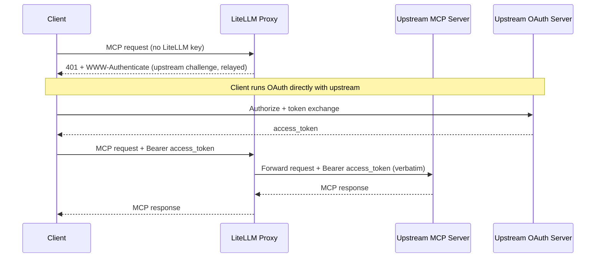
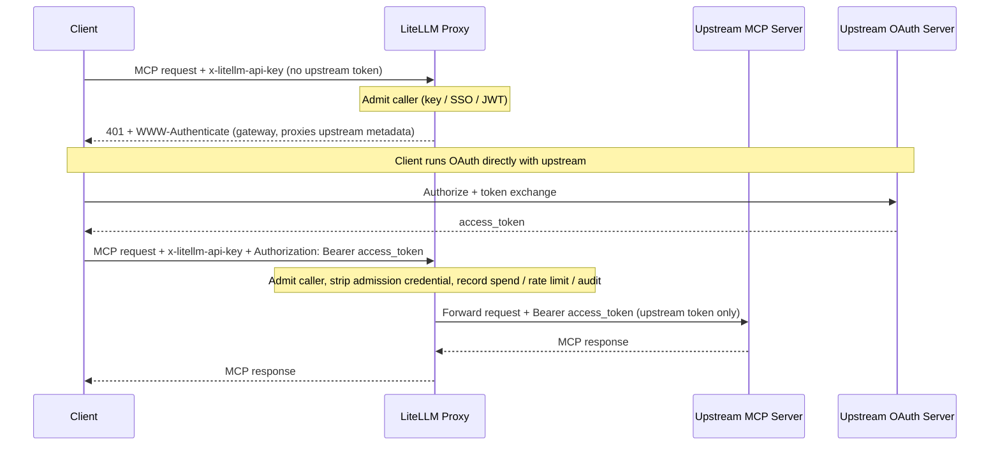
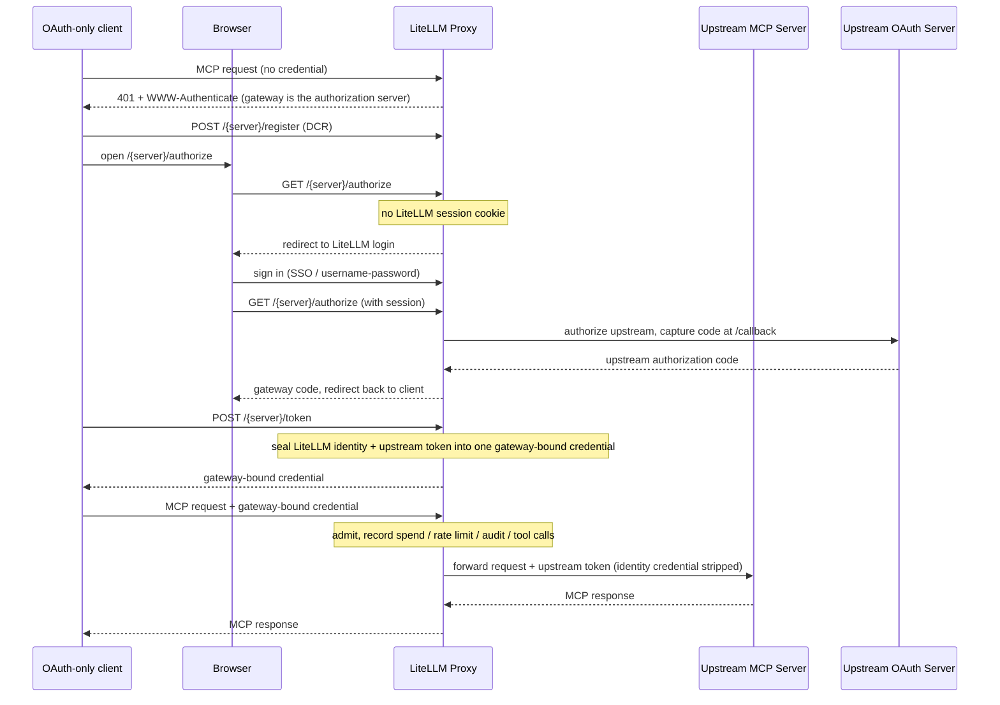
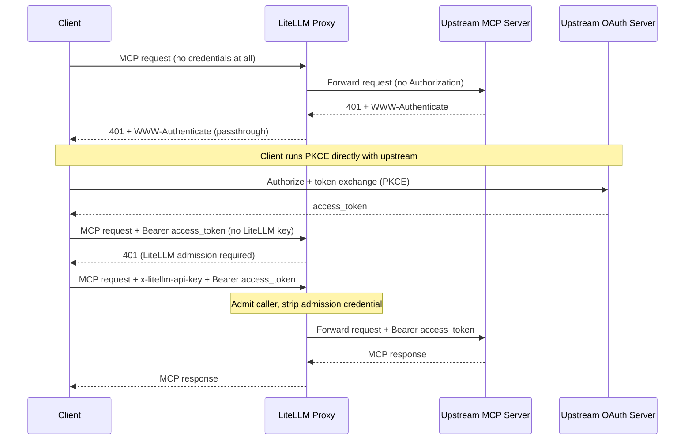

# MCP OAuth 透传

有些 MCP（Model Context Protocol）服务器自己运行 OAuth issuer（发证方），并期望客户端（Claude Code、Cursor、ChatGPT 等）直接向它完成认证。对这类服务器，LiteLLM 可以让客户端自有的上游令牌直接透传，而自己不去铸造、存储或刷新任何令牌。

有两个 `auth_type` 取值用于这种场景，两者的区别只有一点：LiteLLM 是否还在自家入口对调用方做认证。

| 模式 | LiteLLM 准入 | 转发到上游的凭据 | 花费 / 速率限制 / 审计 | 适用场景 |
|------|-------------------|-------------------------------|-----------------------------|----------|
| `true_passthrough` | 无；在 LiteLLM 层匿名 | 客户端的 `Authorization`，原样转发 | 不记录 | 希望 LiteLLM 完全不参与认证，由上游作为唯一的关口 |
| `oauth_delegate` | 必须（LiteLLM 密钥 / SSO / JWT） | 调用方在准入凭据之外另发的一个上游 bearer 令牌 | 记录，按准入身份归属 | 希望上游掌握工具级授权，同时 LiteLLM 继续把关并观测这条链路 |

两种模式在发现阶段都会原样返回上游的受保护资源元数据（protected-resource metadata），因此客户端始终是对真实的上游 issuer 做授权。

两者都会把令牌按调用方发来的样子原样转发。LiteLLM 不解码，也不检查它的受众（audience）或作用域（scopes），更不会拿它去做交换；上游 MCP 服务器是唯一校验方。如果调用方的令牌是为别的资源签发的，这两种模式都无能为力，此时你应该改用 [`oauth2_token_exchange`](#audience-locked-tokens-passthrough-or-token-exchange)。

两者还接受一个正交的 `dcr_bridge` 开关，用于改变仅支持 OAuth 的客户端到哪里发现其授权服务器。对那些无法自行向上游 IdP 注册、或无法发送两份独立凭据的客户端，比如 OpenCode、Claude Code、Cursor 和 Claude Desktop，请打开它。参见 [网关托管的登录（DCR 桥接）](#gateway-hosted-sign-in-dcr-bridge)。

## 受众锁定的令牌：透传还是令牌交换 {#audience-locked-tokens-passthrough-or-token-exchange}

OAuth 访问令牌携带一个受众（`aud`，即申请令牌时指向的资源）。行为规范的上游 MCP 服务器会拒绝任何受众指向其他资源的令牌，例如智能体先为某个 SaaS API 拿到令牌、再拿去请求 MCP 服务器的情形。由于 `true_passthrough` 和 `oauth_delegate` 都原样转发令牌，这类拒绝会表现为上游自己的 `401` 被原路转回客户端。这是防止"混乱代理"（confused deputy）问题的正确结果：网关没有把为某个资源签发的令牌洗成对另一个资源的访问权，因此这并不是需要上报的 LiteLLM bug。

根据你实际持有的令牌来选模式：

| 调用方令牌的签发对象 | 采用 | LiteLLM 对它的处理方式 |
|-----------------------------------|-----|---------------------------|
| 上游 MCP 服务器本身（客户端直接对该服务器的 issuer 跑了 OAuth） | `true_passthrough` 或 `oauth_delegate` | 原样转发；由上游校验受众和作用域 |
| 另一个资源（你的 IdP、内部 API 或某个 SaaS API），且你的 IdP 支持 RFC 8693 或 Entra On-Behalf-Of | `oauth2_token_exchange` | 把它作为 `subject_token` 发给 IdP，换回受众为该 MCP 服务器的令牌（服务器配置中的 `audience: ...`），缓存后只转发换来的令牌。参见 [MCP OBO 认证](./mcp_obo_auth.md) |
| 仅向网关证明身份的 LiteLLM 虚拟密钥（virtual key）、SSO 会话或 IdP JWT | 两种透传模式都不适用 | 准入凭据绝不会转发到上游。请改为配置服务端凭据（`oauth2` 客户端凭据、静态 `authentication_token` 或令牌交换） |

一个实用的判断方法：如果你得请求 IdP 放宽令牌的受众、上游才肯接受，那就停下来，改用令牌交换。放宽受众等于把一个 bearer 变成打开多个资源的钥匙，而透传模式存在的意义，恰恰是让网关绝不替调用方做这种事。

## true_passthrough

LiteLLM 充当透明代理：不做准入检查，不铸造也不存储任何东西，客户端的 `Authorization` 原样转发。当访问控制以上游为准、而你又不想让 LiteLLM 对同一条链路重复把关时，选它。

### 配置

```yaml title="config.yaml" showLineNumbers
mcp_servers:
  notion_passthrough:
    url: "https://mcp.notion.com/mcp"
    auth_type: true_passthrough
```

这就是全部配置。没有客户端凭据，也没有令牌端点，因为 LiteLLM 从不参与令牌交换。

### 工作原理

- 客户端发送 MCP 请求，不带 LiteLLM API 密钥。
- 上游令牌还没有时，LiteLLM 原样转达上游自己的 `401` 和 `WWW-Authenticate`。
- 客户端直接向上游 issuer 跑 OAuth 流程。
- 客户端带着 `Authorization: Bearer <upstream-token>` 重试，LiteLLM 原封不动地转发。



### 失败关闭行为

只有当所有目标服务器都解析为 `true_passthrough` 时，透明路径才会生效。出现以下情况时，回退为常规的 LiteLLM 准入：

- 服务器的 `auth_type` 是其他取值。
- 请求指向多台服务器（`x-mcp-servers: a,b`），而其中任何一台不是 `true_passthrough`。
- 无法从 URL 路径或 `x-mcp-servers` 请求头解析出目标服务器。

### 安全权衡

- 在 LiteLLM 层，这条 MCP 路由成为一个无需认证的入口。
- 花费追踪、按密钥的速率限制，以及任何依赖 `user_api_key_auth.user_id` 的防护栏（guardrails）都不会运行。
- LiteLLM 无法分辨调用方是谁，按用户的审计只能依赖上游服务器的日志。
- `available_on_public_internet: false` 在这里不提供任何认证；它主要控制基于 IP 的发现（[参见指南](./mcp_public_internet.md)）。
- 只在你信任其上游 OAuth issuer 会严格执行访问控制的服务器上启用它。

### 配置参考

| 字段 | 是否必填 | 说明 |
|-------|----------|-------------|
| `auth_type` | 是 | 必须为 `true_passthrough`。 |
| `url` | 是 | 上游 MCP 服务器的 URL。 |
| `allowed_tools` | 否 | 服务器级工具白名单。没有调用方身份，就没有按密钥或按团队的工具权限，这份列表因此成为唯一的工具限制，对所有调用方一视同仁。 |

```yaml title="config.yaml" showLineNumbers
mcp_servers:
  notion_passthrough:
    url: "https://mcp.notion.com/mcp"
    auth_type: true_passthrough
    allowed_tools:
      - search
      - fetch
```

## oauth_delegate

LiteLLM 仍会对调用方做准入（LiteLLM API 密钥、SSO 或 JWT），然后转发调用方另行提供的上游 bearer 令牌。LiteLLM 不铸造任何令牌，也绝不把准入凭据转发到上游。当工具级授权由上游负责、但你仍希望 LiteLLM 把关这条链路并保留花费、限流与审计归属时，用它。

### 配置

```yaml title="config.yaml" showLineNumbers
mcp_servers:
  notion_delegate:
    url: "https://mcp.notion.com/mcp"
    auth_type: oauth_delegate
```

和 `true_passthrough` 出于同样的原因，这里也没有客户端凭据。变化在请求上：调用方要发送两份凭据。

### 工作原理

- 调用方用放在 `x-litellm-api-key` 里的 LiteLLM 凭据完成准入。
- 上游令牌放在 `Authorization` 里（聚合请求则用 `x-mcp-<alias>-authorization`）。
- LiteLLM 校验准入，然后只转发上游 bearer，绝不转发准入凭据。
- 上游令牌还没有时，LiteLLM 返回一个 `401`，指向网关的 `oauth-protected-resource` well-known 端点，该端点原样代理上游元数据。



:::warning[两份凭据要放在不同的请求头里]

如果调用方只在 `Authorization` 里放了一份凭据、又没带 `x-litellm-api-key`，LiteLLM 会把它当作准入凭据，即虚拟密钥、IdP JWT 或 SSO 会话令牌，绝不转发到上游。这正是防止 LiteLLM 或 IdP 令牌流落到第三方 MCP 服务器的泄露防线。

:::

### 安全权衡

- 准入始终执行，因此不存在匿名入口。
- 花费、速率限制和审计都按准入身份归属。
- LiteLLM 转发上游令牌时不做任何检查，因此工具级授权和令牌校验仍由上游负责。

### 配置参考

| 字段 | 是否必填 | 说明 |
|-------|----------|-------------|
| `auth_type` | 是 | 必须为 `oauth_delegate`。 |
| `url` | 是 | 上游 MCP 服务器的 URL。 |

请求时：准入凭据放 `x-litellm-api-key`，上游令牌放 `Authorization: Bearer <upstream-token>`（聚合请求中指定某台服务器则用 `x-mcp-<alias>-authorization`）。

由于准入始终执行，LiteLLM 完整的权限模型会叠加在上游自身的限制之上：[按密钥和按团队的工具权限](./mcp_control.md#per-entity-tool-level-permissions)、服务器级 `allowed_tools` 列表、按密钥的速率限制，以及在准入身份下对每次工具调用的花费记录。

## 多服务器聚合请求 {#multi-server-aggregate-requests}

发往聚合端点 `/mcp` 的请求（或带 `x-mcp-servers: a,b` 的请求）会扇出到多台上游，但一个请求只能带一个 `Authorization` 请求头。如果其中两台上游都要转发调用方的令牌，把这个请求头同时发给两边，就等于让同一个 bearer 出现在多个互不相关的资源上（正是 RFC 9700 警告的跨资源重放）。因此，LiteLLM 对聚合范围内的 `true_passthrough` 和 `oauth_delegate` 服务器施加两条规则。

用 `x-mcp-{alias}-authorization` 把一个上游令牌绑定到一台服务器。别名会转为小写，`a-z0-9_` 之外的字符一律变成 `_`，所以别名为 `Jira Cloud` 的服务器要用 `x-mcp-jira_cloud-authorization` 来指定。这个值会原样转发，因此要带上方案前缀（`Bearer <token>`）。按服务器的请求头在任何操作下都不会被扣留，因为每个头都明确指向唯一的接收方。

当同一范围内还有另一台服务器也要消费请求级的 `Authorization` 时，在列表类扇出（`tools/list`，以及提示词和资源列表）期间，这个请求头不会发给由客户端转发令牌的那台服务器。此时该服务器在没有上游凭据的情况下参与列表，需要凭据的服务器会返回自己的 `401`，聚合层把它吸收掉（见下文）。显式指定目标的操作不受影响，例如对指定工具的 `tools/call`、`/{server_name}/mcp` 这类单服务器路由，或者同一范围内只有一台服务器要转发调用方令牌的情况：客户端已经点名了唯一接收方，请求级请求头会转发给它。

实际效果是：一个对多台上游都有效的 bearer，可以通过聚合端点执行工具，却不出现在聚合的 `tools/list` 里。原因就在这里：工具调用点名了一台服务器，而列表请求没有。解决办法是按服务器逐个发送令牌，而不是只在请求级发一份。

```bash title="聚合 tools/list：按服务器分别携带令牌" showLineNumbers
curl -X POST "https://litellm.example.com/mcp" \
  -H "Content-Type: application/json" \
  -H "x-litellm-api-key: Bearer $LITELLM_API_KEY" \
  -H "x-mcp-servers: jira,confluence" \
  -H "x-mcp-jira-authorization: Bearer <token-for-jira>" \
  -H "x-mcp-confluence-authorization: Bearer <token-for-confluence>" \
  -d '{"jsonrpc":"2.0","id":1,"method":"tools/list","params":{}}'
```

在两个按服务器请求头里放同一个令牌值，是你自己做出的、逐服务器明确的决定，LiteLLM 会尊重它。它拒绝做的是替你做这个决定，也就是把一个未指定目标的 `Authorization` 扇出出去。

对 `true_passthrough` 还有一条额外约束：透明准入路径只在范围内每台服务器都是 `true_passthrough` 时才生效。把一台 `true_passthrough` 服务器混入含其他模式的聚合，会回退为常规 LiteLLM 准入，因此调用方在这个请求里需要持有 LiteLLM 凭据。

## 在管理界面（Admin UI）中预览工具 {#previewing-tools-in-the-admin-ui}

LiteLLM 不为这类服务器保存上游令牌，所以新建和编辑表单自己列不出工具。对 `true_passthrough` 和 `oauth_delegate`，两个表单都会显示一个"Authorize & Fetch Tools (browser-only)"（授权并获取工具，仅限浏览器）按钮。它会在管理员的浏览器里跑上游 OAuth 流程，拿到的令牌只留在该浏览器会话中，并按服务器分别转发，用于工具预览和配置 `allowed_tools`。令牌不会写入服务器记录、按用户的凭据存储或任何缓存；关掉标签页即被丢弃。

按钮旁可选的 OAuth Client ID 和 Client Secret 则是另一回事：它们会作为声明的配置随服务器一起保存。当上游 issuer 不支持动态客户端注册（Dynamic Client Registration）、且希望所有管理员都通过同一个预注册应用授权时，就设置它们。

## 有意为之的限制 {#intentional-limits}

以下是原样转发令牌且不做检查带来的必然结果，属于设计取舍而非缺陷。

在多服务器聚合上，没有按服务器的"需要重新认证"信号。单服务器路由会如实转达上游的 `401` 和 `WWW-Authenticate`，而聚合会把一台服务器的认证失败吸收成该服务器的空列表，让其余服务器照常列出。当你需要看清是哪台上游拒绝了令牌时，请改用单服务器路由或按服务器的请求头。

发送方约束型令牌（如 DPoP、RFC 9449，或 mTLS 绑定令牌、RFC 8705）无法被转达。这种绑定证明的是请求来自获取令牌的那个 TLS 客户端或密钥持有者，而七层代理两者都不是。上游会拒绝这类令牌；请为 MCP 服务器获取普通 bearer，或改用令牌交换。

已吊销的令牌不会在连接建立时被察觉。LiteLLM 不保存任何关于已转发令牌的状态，也不对令牌做内省，因此在 issuer 处已被吊销的令牌仍会被转发，并在实际使用它的那个请求上被上游拒绝。客户端那时看到的是上游的 `401`，与直连上游时的表现完全一致。

## 网关托管的登录（DCR 桥接） {#gateway-hosted-sign-in-dcr-bridge}

仅支持 OAuth 的 MCP 客户端（OpenCode、Claude Code、Cursor、Claude Desktop）的接入方式，是对发现元数据所通告的任何授权服务器，跑一遍动态客户端注册（RFC 7591）加 PKCE 的流程。它们：

- 没有在上游 IdP 预先配置好的客户端凭据。
- 无法在上游令牌之外再附带一份单独的 LiteLLM 凭据。

所以，普通的 `true_passthrough` 请求和双请求头的 `oauth_delegate` 请求都不适合它们。`dcr_bridge` 开关正是用来补上这个缺口的：

- **开启**：LiteLLM 在发现阶段把自己通告为授权服务器，并托管 `/{server_name}/register`、`/{server_name}/authorize` 和 `/{server_name}/token`。客户端通过网关注册并登录，而 LiteLLM 在这些端点背后替它运行上游 OAuth。
- **关闭**：LiteLLM 原样转达上游服务器自己的 OAuth 元数据。适合已在上游 IdP 注册过、或能直接对上游跑 DCR 的客户端。

在哪里设置：

- 只对 `true_passthrough` 和 `oauth_delegate` 有效；在其他任何 `auth_type` 上，创建、更新和加载配置时都会被拒绝。
- 在管理界面里，它是 MCP 服务器表单上的"Gateway-hosted sign-in (DCR bridge)"（网关托管的登录，DCR 桥接）开关，对这两种模式默认开启。
- 在配置文件里它是一个布尔字段。

### 配合桥接的 true_passthrough

```yaml title="config.yaml" showLineNumbers
mcp_servers:
  miro:
    url: "https://mcp.miro.com/"
    transport: http
    auth_type: true_passthrough
    dcr_bridge: true
```

这是面向仅支持 OAuth 客户端的透明选项：

- 客户端把网关发现为它的授权服务器，并通过 `POST /{server_name}/register` 注册。
- 它对 `GET /{server_name}/authorize` 和 `POST /{server_name}/token` 运行 PKCE。
- 上游支持 DCR 时，LiteLLM 会把客户端的注册转达给它。
- 服务器没有存 `client_id` 时，LiteLLM 会为该流程铸造一个临时客户端，且不持久化任何内容。
- 整个过程不涉及 LiteLLM 登录，也不记录调用方身份或花费。

### 配合桥接的 oauth_delegate

```yaml title="config.yaml" showLineNumbers
mcp_servers:
  miro:
    url: "https://mcp.miro.com/"
    transport: http
    auth_type: oauth_delegate
    dcr_bridge: true
```

这种组合让 LiteLLM 始终留在仅支持 OAuth 客户端的可观测路径上，因此花费、速率限制、审计以及逐次工具调用的归属都能落账。当你想在 LiteLLM 里看清调用方用了哪台服务器、调了哪些工具时，选它。

仅支持 OAuth 的客户端无法内联出示 LiteLLM 密钥，所以身份改由 LiteLLM 浏览器会话提供：

- 在授权这一步，LiteLLM 会查找 LiteLLM UI 的会话 cookie。
- 没有 cookie 时，先重定向到 LiteLLM 登录页（`/sso/key/generate`）。
- 登录后用户重新发起连接。
- LiteLLM 把这份身份连同上游令牌一起封进一个绑定网关的凭据。
- 客户端保存该凭据，并在之后的每个请求里重复出示；准入、花费和审计都以它为准。

:::warning[两个前提条件]

- **网关需要可用的浏览器登录**（SSO 或用户名/密码）。没有它就没有可绑定的身份，授权步骤无法进行。网关登录缺失是 `oauth_delegate` 桥接连接卡在登录页的最常见原因。
- **客户端的 OAuth 流程必须运行在交互式浏览器会话里**。OpenCode、Claude Code、Cursor 和 Claude Desktop 都满足。

如果需要完全脚本化、非交互的委托，请把 `dcr_bridge` 关掉，改用双请求头的 `oauth_delegate` 请求。

:::



### 如何选择该开关

| 场景 | `dcr_bridge` |
|-----------|--------------|
| 仅支持 OAuth 的客户端（OpenCode、Claude Code、Cursor、Claude Desktop、ChatGPT），没有上游 `client_id`，也无法发送两份凭据 | `true` |
| 已在上游 IdP 注册过的客户端，或能直接对上游运行 DCR 的客户端 | `false` |
| 能发送 `x-litellm-api-key` 加上游 `Authorization` bearer 的脚本化、非交互调用方 | `false`，配合 `auth_type: oauth_delegate`（双请求头形式） |

### 连接客户端

- 把客户端指向 `https://<gateway-host>/<server_name>/mcp`，让它从那里自行发现 OAuth。
- 不要在客户端上配置 `client_id` 或密钥；注册和令牌交换都由网关处理。
- 在 `true_passthrough` 桥接服务器上，浏览器流程只与上游完成授权。
- 在 `oauth_delegate` 桥接服务器上，浏览器会先登录 LiteLLM，再与上游完成授权。

确切的字段名会随时间变化，请以各客户端自己的 MCP 文档为准。

Claude Code 在首次使用时完成注册并运行浏览器流程：

```bash
claude mcp add --transport http miro https://<gateway-host>/miro/mcp
```

Cursor 从 `~/.cursor/mcp.json` 读取远程 MCP 服务器：

```json
{
  "mcpServers": {
    "miro": {
      "url": "https://<gateway-host>/miro/mcp"
    }
  }
}
```

OpenCode 则从 `opencode.json` 读取：

```json
{
  "mcp": {
    "miro": {
      "type": "remote",
      "url": "https://<gateway-host>/miro/mcp",
      "enabled": true
    }
  }
}
```

### 配置参考

| 字段 | 是否必填 | 说明 |
|-------|----------|-------------|
| `auth_type` | 是 | 必须为 `true_passthrough` 或 `oauth_delegate`；其他取值会拒绝 `dcr_bridge`。 |
| `url` | 是 | 上游 MCP 服务器的 URL。 |
| `dcr_bridge` | 是 | 设为 `true` 表示由网关为仅支持 OAuth 的客户端托管登录。关闭时改为原样转达上游自己的 OAuth 元数据。 |

## 将认证委托给上游（PKCE 透传） {#delegate-auth-to-upstream-pkce-passthrough}

:::warning[已弃用]

`delegate_auth_to_upstream` 是客户端转发 OAuth 最早基于开关的实现形式，现已弃用。它不再能绕过 LiteLLM 准入：在当前版本上，凡是携带 bearer 的请求，LiteLLM 仍然要求提供自己的 API 密钥、SSO 或 JWT；当服务器以 `auth_type: oauth2` 加 `delegate_auth_to_upstream: true` 加载时，代理会记录一条弃用警告。新建服务器应使用 `auth_type: oauth_delegate`（需要准入，转发上游令牌）或 `auth_type: true_passthrough`（不需要准入）。已有配置应迁移到这两者之一。下文介绍这个旧开关目前仍有的行为。

:::

对于客户端直接向上游服务器自身 OAuth issuer 认证的 OAuth2 MCP 服务器，这个旧开关让没有凭据的客户端能经由 LiteLLM 收到上游的 OAuth 质询，从而启动 PKCE。客户端一旦持有上游令牌，就必须同时出示 LiteLLM 凭据，与 `oauth_delegate` 完全一致。

### 配置

```yaml title="config.yaml" showLineNumbers
mcp_servers:
  notion_mcp:
    url: "https://mcp.notion.com/mcp"
    auth_type: oauth2
    oauth2_flow: authorization_code
    delegate_auth_to_upstream: true
```

被委托的服务器走交互式流程，因此要配 `oauth2_flow: authorization_code`。该开关**只在** `auth_type: oauth2` 时生效；配到其他认证类型上会被静默忽略。

:::warning[仅内网（`available_on_public_internet: false`）与匿名发现步骤]

`available_on_public_internet: false` 并不会让无凭据的冷启动变成已认证。不带 `Authorization` 请求头的匿名调用方，仍然能触达符合条件的服务器（`auth_type: oauth2` 且 `delegate_auth_to_upstream: true`，且不是 `oauth2_flow: client_credentials`）的上游 OAuth2 `/authorize` 质询。仅内网开关主要控制基于 IP 的发现及相关行为（[参见指南](./mcp_public_internet.md)）。工具调用不受影响：任何携带 bearer 的请求都要经过 LiteLLM 准入。

:::

### 工作原理

1. 客户端向 LiteLLM 发送不带 `Authorization` 请求头也不带 `x-litellm-api-key` 的 MCP 请求。
2. 由于所有目标服务器都是 `auth_type: oauth2` 且 `delegate_auth_to_upstream: true`，LiteLLM 会匿名放行这个无凭据请求，让上游自己的 `401` + `WWW-Authenticate` 流回客户端。
3. 客户端直接与上游 OAuth issuer 完成 PKCE。
4. 客户端带着 `Authorization: Bearer <upstream-token>` 重试。LiteLLM 会对这个请求执行自己的准入；没有 LiteLLM 凭据时请求以 `401` 失败，客户端必须在 `x-litellm-api-key` 里附上 LiteLLM 密钥、与上游 bearer 并列发送，也就是 `oauth_delegate` 的请求形态。
5. 准入通过后，LiteLLM 原封不动地转发上游 bearer，绝不转发 LiteLLM 凭据。



### 失败关闭行为

匿名冷启动只在请求不带任何 bearer 且**所有**目标都选择加入时才生效。出现以下情况时，执行常规的 LiteLLM 认证：

- 请求带有 `Authorization` 请求头（任何 bearer，包括上游令牌）。
- 服务器的 `auth_type` 不是 `oauth2`。
- `delegate_auth_to_upstream` 没有显式设为 `true`。
- 服务器实际生效的 `oauth2_flow` 是 `client_credentials`。
- 请求指向多台服务器（`x-mcp-servers: a,b`），而其中任何一台未被委托。
- 无法从 URL 路径或 `x-mcp-servers` 请求头解析出目标服务器。

### 安全权衡

- 只有无凭据的发现这一步是匿名的。工具调用在 LiteLLM 身份下执行，因此花费追踪、按密钥的速率限制和防护栏的适用方式与 `oauth_delegate` 相同。
- LiteLLM 转发上游令牌时不做检查，因此工具级授权和令牌校验仍由上游负责。
- 这个开关已弃用，且一旦请求带上 bearer，行为就等同 `oauth_delegate`，所以请迁移到 `auth_type: oauth_delegate`，不要继续依赖它。

### 配置参考

| 字段 | 是否必填 | 说明 |
|-------|----------|-------------|
| `auth_type` | 是 | 必须为 `oauth2`。其他情况下该开关被忽略。 |
| `oauth2_flow` | 是 | 设为 `authorization_code`；委托让客户端的交互式 PKCE 流程能对上游服务器发起。 |
| `delegate_auth_to_upstream` | 是 | 设为 `true` 让该服务器加入旧版委托行为。已弃用，建议改用 `auth_type: oauth_delegate`。 |
