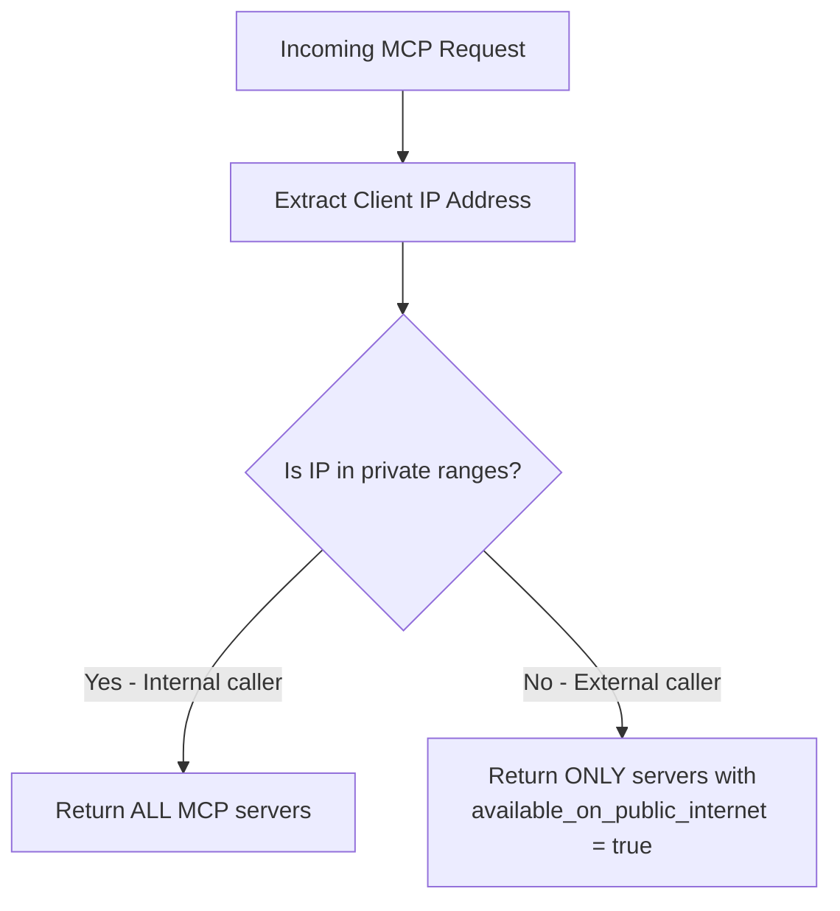

import Tabs from '@theme/Tabs';
import TabItem from '@theme/TabItem';

# 将 MCP 服务暴露到公共互联网

控制哪些 MCP（Model Context Protocol）服务器对外部调用者（如 ChatGPT、Claude Desktop）可见，哪些仅对内部调用者可见。当你希望一部分 MCP 服务器公开可用，同时把敏感服务器限制在私有网络内时，这个功能就很有用。

## 概览

| 属性 | 说明 |
|-------|-------|
| 描述 | 基于 IP 的 MCP 服务器访问控制；外部调用者只能看到标记为公共的服务器 |
| 设置项 | 每个 MCP 服务器上的 `available_on_public_internet` |
| 网络配置 | `general_settings` 中的 `mcp_internal_ip_ranges` |
| 支持的客户端 | ChatGPT、Claude Desktop、Cursor、OpenAI API 或任何 MCP 客户端 |

:::warning[与 `delegate_auth_to_upstream` 的交互]

如果某台 MCP 服务器设置为 **`available_on_public_internet: false`**（即在基于 IP 的发现中被视为内部），**且**同时设置了 **`delegate_auth_to_upstream: true`** 和 **`auth_type: oauth2`**（交互式 PKCE，而非 M2M），匿名调用者仍然可以在没有 LiteLLM 会话的情况下访问上游 OAuth 的 **`/authorize`** 路径。详情与缓解措施见 [MCP OAuth 透传：将认证委托给上游](./mcp_oauth_passthrough.md#delegate-auth-to-upstream-pkce-passthrough)。

:::

## 工作原理

当请求到达 LiteLLM 的 MCP 端点时，LiteLLM 会检查调用者的 IP 地址，判断它是**内部**还是**外部**调用者：

1. **提取客户端 IP**，从传入的请求中读取（在反向代理后部署时支持 `X-Forwarded-For`）。
2. **判定 IP 归属**，将 IP 与配置的私有 IP 网段比对，区分为内部或外部（默认为 RFC 1918 网段：`10.0.0.0/8`、`172.16.0.0/12`、`192.168.0.0/16`、`127.0.0.0/8`）。
3. **过滤服务器列表**：
   - **内部调用者**能看到所有 MCP 服务器（公共和私有）。
   - **外部调用者**只能看到 `available_on_public_internet: true` 的服务器。

这项过滤作用于每个 MCP 访问入口：MCP 注册表、工具列表、工具调用、动态服务器路由以及 OAuth 发现端点。



## 操作演练

本演练包含两个流程：
1. **添加公共 MCP 服务器**（DeepWiki），并从 ChatGPT 连接它
2. **将现有服务器设为私有**（Exa），并验证 ChatGPT 不再看到它

### 流程 1：添加公共 MCP 服务器（DeepWiki）

DeepWiki 是一个免费的 MCP 服务器，适合公开暴露，让 AI 网关用户可以从 ChatGPT 直接访问。

#### 步骤 1：创建 MCP 服务器

进入 MCP Servers 页面，点击 **"+ Add New MCP Server"**（新增 MCP 服务器）。


创建对话框打开后，在服务器名称中输入 **"DeepWiki"**。


在传输类型下拉框中选择 **HTTP**，因为 DeepWiki 使用 Streamable HTTP 传输。


接下来向下滚动到 MCP Server URL 字段。


输入 DeepWiki 的 MCP URL：`https://mcp.deepwiki.com/mcp`。


名称、传输类型和 URL 都填好后，服务器的基本配置就完成了。


#### 步骤 2：开启"在公共互联网上可用"

创建之前，向下滚动并展开 **Permission Management / Access Control**（权限管理 / 访问控制）区域，这里控制谁能看到这台服务器。


打开 **"在公共互联网上可用"**（Available on Public Internet）开关。这是关键设置：它告诉 LiteLLM，外部调用者（比如从公共互联网连入的 ChatGPT）应当能发现并使用这台服务器。


开关打开后，点击 **"Create"**（创建）保存服务器。


#### 步骤 3：从 ChatGPT 连接

下面验证它是否生效。打开 ChatGPT，找到 MCP 服务器图标来添加新连接。要填的端点是 `<your-litellm-url>/mcp`。


在下拉框中选择 **"Add an MCP server"**（添加 MCP 服务器）来配置新连接。


ChatGPT 会要求填写服务器标签，起一个容易辨认的名字，比如 "LiteLLM"。


接着输入 Server URL，即 LiteLLM 代理的 MCP 端点 `<your-litellm-url>/mcp`。


粘贴你的 LiteLLM URL，并确认无误。


ChatGPT 还需要认证。在认证字段中填入你的 LiteLLM API 密钥（API key），它才能连上代理。


点击 **"Connect"**（连接）建立连接。


ChatGPT 连接成功并列出可用工具。由于 DeepWiki 和 Exa 目前都标记为公共，ChatGPT 能看到两台服务器的工具。


---

### 流程 2：将现有服务器设为私有（Exa）

接下来做相反的操作：把一台当前公开的现有 MCP 服务器（Exa）限制为仅内部访问。改完之后，ChatGPT 应该就看不到 Exa 的工具了。

#### 步骤 1：编辑服务器

进入 MCP Servers 表格，点击 Exa 服务器打开详情视图。


切换到 **"Settings"**（设置）标签页进入编辑表单。


编辑表单会加载 Exa 当前的配置。


#### 步骤 2：关闭"在公共互联网上可用"

向下滚动并展开 **Permission Management / Access Control**（权限管理 / 访问控制）区域，找到公共互联网开关。


关闭 **"在公共互联网上可用"** 开关，这样私有网络之外的调用者就看不到 Exa 了。


点击 **"Save Changes"**（保存更改）使其生效。更改立即生效，无需重启代理。


#### 步骤 3：在 ChatGPT 中验证

回到 ChatGPT 确认 Exa 已不可见。需要重新连接一次，ChatGPT 才会重新拉取工具列表。


打开 MCP 服务器设置，选择添加或重新连接服务器。


输入与之前相同的 LiteLLM MCP URL。


设置服务器标签。


输入你的 API 密钥完成认证。


点击 **"Connect"**（连接）重新建立连接。


这一次只显示 DeepWiki 的工具，Exa 消失了。LiteLLM 检测到 ChatGPT 是从公共 IP 发起调用，而 Exa 已不再标记为公共，于是把它过滤掉了。私有网络内的内部用户仍然能看到两台服务器。


## 配置参考

### 单服务器设置

<Tabs>
<TabItem value="ui" label="UI">

创建或编辑 MCP 服务器时，在 Permission Management（权限管理）区域切换 **"在公共互联网上可用"** 开关。

</TabItem>
<TabItem value="config" label="config.yaml">

```yaml title="config.yaml" showLineNumbers
mcp_servers:
  deepwiki:
    url: https://mcp.deepwiki.com/mcp
    available_on_public_internet: true   # visible to external callers

  exa:
    url: https://exa.ai/mcp
    auth_type: api_key
    auth_value: os.environ/EXA_API_KEY
    available_on_public_internet: false  # internal only (default)
```

</TabItem>
<TabItem value="api" label="API">

```bash title="创建公共 MCP 服务器" showLineNumbers
curl -X POST <your-litellm-url>/v1/mcp/server \
  -H "Authorization: Bearer sk-..." \
  -H "Content-Type: application/json" \
  -d '{
    "server_name": "DeepWiki",
    "url": "https://mcp.deepwiki.com/mcp",
    "transport": "http",
    "available_on_public_internet": true
  }'
```

```bash title="更新现有服务器" showLineNumbers
curl -X PUT <your-litellm-url>/v1/mcp/server \
  -H "Authorization: Bearer sk-..." \
  -H "Content-Type: application/json" \
  -d '{
    "server_id": "<server-id>",
    "available_on_public_internet": false
  }'
```

</TabItem>
</Tabs>

### 自定义私有 IP 网段

默认情况下，LiteLLM 把 RFC 1918 私有网段视为内部网段。你可以在 MCP Servers 下的 **Network Settings**（网络设置）标签页中自定义，或通过配置文件修改：

```yaml title="config.yaml" showLineNumbers
general_settings:
  mcp_internal_ip_ranges:
    - "10.0.0.0/8"
    - "172.16.0.0/12"
    - "192.168.0.0/16"
    - "100.64.0.0/10"    # Add your VPN/Tailscale range
```

留空时使用标准私有网段（`10.0.0.0/8`、`172.16.0.0/12`、`192.168.0.0/16`、`127.0.0.0/8`）。

---

## 公共互联网与 MCP Hub 可见性的区别

`available_on_public_internet` 与 **MCP Hub**（`GET /public/mcp_hub`）是两套相互独立的机制，很容易混淆：

| 关注点 | 控制项 | 默认行为 |
|---|---|---|
| 外部（非私有 CIDR）调用者能否在 MCP 工具端点（列表/调用）看到这台服务器？ | 服务器上的 `available_on_public_internet` | `True`（默认可见；改为 `false` 可限制为仅私有 CIDR 可见） |
| 这台服务器是否会出现在无需认证的 `GET /public/mcp_hub` 公告中？ | `litellm.public_mcp_servers` 列表，受 `litellm.public_mcp_hub_strict_whitelist` 控制 | Hub 严格白名单默认**开启**，只有显式列在 `public_mcp_servers` 中的服务器才会被公告 |

在**默认的严格白名单模式**下，`available_on_public_internet: true`（默认值）不会让服务器出现在 Hub 中。要把服务器公告到 Hub，还需要把它加入 `public_mcp_servers`：

```yaml title="服务器同时在 Hub 公告且对外部调用者可见（默认）" showLineNumbers
litellm_settings:
  public_mcp_servers:
    - deepwiki
  # public_mcp_hub_strict_whitelist defaults to true

mcp_servers:
  deepwiki:
    url: https://mcp.deepwiki.com/mcp
    # available_on_public_internet defaults to true
```

如果设置 `litellm.public_mcp_hub_strict_whitelist: false`，Hub 会退回到公告所有 `available_on_public_internet: true` 的服务器。本页介绍的基于 IP 的访问过滤仍然独立作用于实际工具端点。
