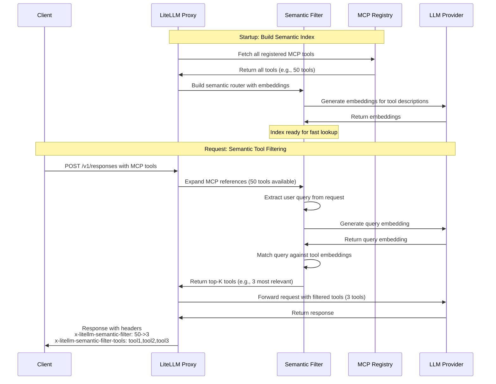

import Tabs from '@theme/Tabs';
import TabItem from '@theme/TabItem';

# MCP 语义工具过滤器

按语义相关性自动过滤 MCP（Model Context Protocol）工具。当注册的 MCP 工具较多时，LiteLLM 会把用户查询与工具描述做语义匹配，只将最相关的工具发给 LLM。

## 工作原理

工具搜索把"选工具"从提示词工程问题变成了检索问题。语义过滤器不再往每个提示词里注入一大串静态工具清单，而是：

1. 启动时为所有可用的 MCP 工具构建语义索引
2. 每次请求时，将用户查询与工具描述做语义匹配
3. 只把最相关的前 K 个工具返回给 LLM

这一方式既能提升上下文利用效率，又能通过减少工具混淆提高可靠性，还能从容扩展到拥有成百上千个 MCP 工具的生态。



## 配置

在 LiteLLM 配置文件中启用语义过滤：

```yaml title="config.yaml" showLineNumbers
litellm_settings:
  mcp_semantic_tool_filter:
    enabled: true
    embedding_model: "text-embedding-3-small"  # Model for semantic matching
    top_k: 5                                    # Max tools to return
    similarity_threshold: 0.3                   # Min similarity score
```

**配置项**：

- `enabled` - 启用/禁用语义过滤（默认：`false`）
- `embedding_model` - 用于生成嵌入（embedding）的模型（默认：`"text-embedding-3-small"`）
- `top_k` - 返回工具数量的上限（默认：`10`）
- `similarity_threshold` - 匹配的最低相似度分数（默认：`0.3`）

## 用法

在 Responses API 或对话补全（Chat Completions）中照常使用 MCP 工具即可，语义过滤器会自动运行：

<Tabs>
<TabItem value="responses" label="Responses API">

```bash title="带语义过滤的 Responses API" showLineNumbers
curl --location 'http://localhost:4000/v1/responses' \
--header 'Content-Type: application/json' \
--header "Authorization: Bearer $LITELLM_API_KEY" \
--data '{
    "model": "{{openai_large}}",
    "input": [
    {
      "role": "user",
      "content": "give me TLDR of what BerriAI/litellm repo is about",
      "type": "message"
    }
  ],
    "tools": [
        {
            "type": "mcp",
            "server_url": "litellm_proxy",
            "require_approval": "never"
        }
    ],
    "tool_choice": "required"
}'
```

</TabItem>
<TabItem value="chat" label="Chat Completions">

```bash title="带语义过滤的 Chat Completions" showLineNumbers
curl --location 'http://localhost:4000/v1/chat/completions' \
--header 'Content-Type: application/json' \
--header "Authorization: Bearer $LITELLM_API_KEY" \
--data '{
  "model": "{{openai_large}}",
  "messages": [
    {"role": "user", "content": "Search Wikipedia for LiteLLM"}
  ],
  "tools": [
    {
      "type": "mcp",
      "server_url": "litellm_proxy"
    }
  ]
}'
```

</TabItem>
</Tabs>

## 响应头

语义过滤器会在每个响应中附加诊断响应头：

```
x-litellm-semantic-filter: 10->3
x-litellm-semantic-filter-tools: wikipedia-fetch,github-search,slack-post
```

- **`x-litellm-semantic-filter`** - 展示过滤前后的工具数量变化（如 `10->3` 表示 10 个工具被过滤成 3 个）
- **`x-litellm-semantic-filter-tools`** - 过滤后工具名的 CSV 列表（最长 150 个字符，超长部分用 `...` 截断）

借助这些响应头，你可以弄清每次请求究竟选中了哪些工具，也能验证过滤器是否正常工作。

## 示例

假设你注册了 50 个 MCP 工具，然后发起一个询问 Wikipedia 相关内容的请求，语义过滤器会：

1. 将你的查询 `"Search Wikipedia for LiteLLM"` 与全部 50 个工具描述做语义匹配
2. 选出最相关的前 5 个工具（如 `wikipedia-fetch`、`wikipedia-search` 等）
3. 只把这 5 个工具传给 LLM
4. 附加响应头 `x-litellm-semantic-filter: 50->5`

这样既能大幅压缩提示词体积，又能确保 LLM 拿到完成任务所需的合适工具。

## 性能

语义过滤器为生产环境做了优化：
- Router 只在启动时构建一次（无逐请求开销）
- 语义匹配通常在 50ms 内完成
- 失败时优雅降级：过滤失败则返回全部工具
- 不含 MCP 工具的请求不受任何延迟影响

## 相关阅读

- [MCP 概览](./mcp.md) - 了解 LiteLLM 中的 MCP
- [MCP 权限管理](./mcp_control.md) - 按密钥/团队控制工具访问
- [使用 MCP](./mcp_usage.md) - 完整的 MCP 使用指南
