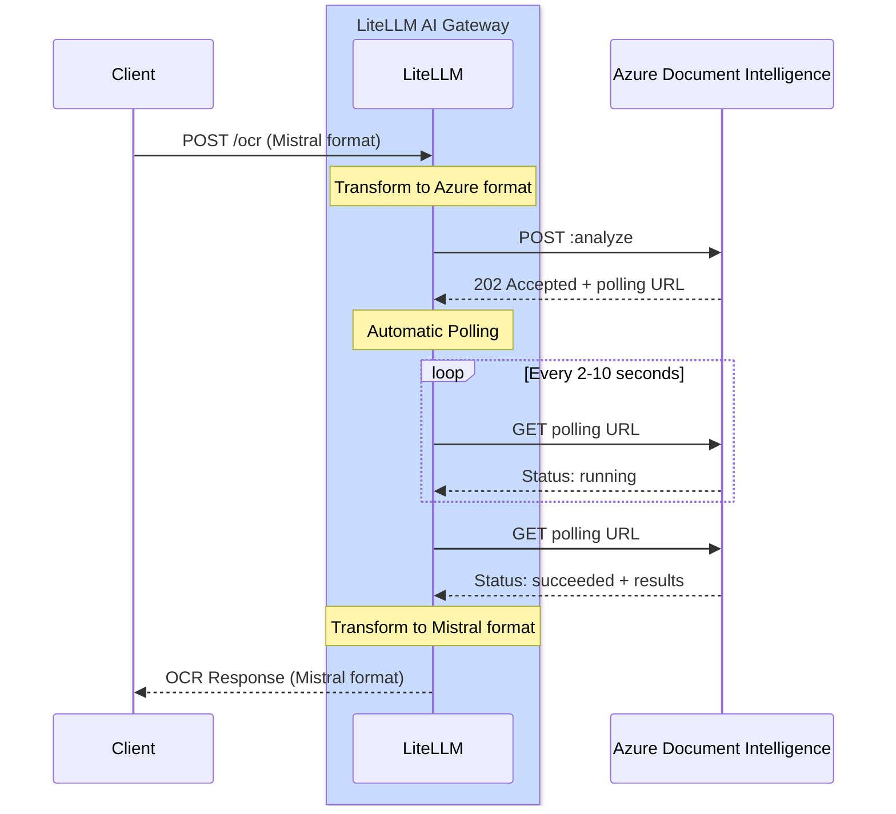

# Azure Document Intelligence OCR

## 概览

| 属性 | 详情 |
|-------|-------|
| 说明 | Azure Document Intelligence（前身为 Form Recognizer）提供高级的文档分析能力，包括文本提取、布局分析与结构识别 |
| LiteLLM 提供商路由 | `azure_ai/doc-intelligence/` |
| 支持的操作 | `/ocr` |
| 提供商文档链接 | [Azure Document Intelligence ↗](https://learn.microsoft.com/en-us/azure/ai-services/document-intelligence/)

借助 Azure Document Intelligence 强大的预置（prebuilt）模型，即可提取文本并分析文档结构。

## 快速上手

### **LiteLLM SDK**

```python showLineNumbers title="SDK 用法"
import litellm
import os

# Set environment variables
os.environ["AZURE_DOCUMENT_INTELLIGENCE_API_KEY"] = "your-api-key"
os.environ["AZURE_DOCUMENT_INTELLIGENCE_ENDPOINT"] = "https://your-resource.cognitiveservices.azure.com"

# OCR with PDF URL
response = litellm.ocr(
    model="azure_ai/doc-intelligence/prebuilt-layout",
    document={
        "type": "document_url",
        "document_url": "https://example.com/document.pdf"
    }
)

# Access extracted text
for page in response.pages:
    print(f"Page {page.index}:")
    print(page.markdown)
```

### **LiteLLM 代理服务器**

```yaml showLineNumbers title="proxy_config.yaml"
model_list:
  - model_name: azure-doc-intel
    litellm_params:
      model: azure_ai/doc-intelligence/prebuilt-layout
      api_key: os.environ/AZURE_DOCUMENT_INTELLIGENCE_API_KEY
      api_base: os.environ/AZURE_DOCUMENT_INTELLIGENCE_ENDPOINT
    model_info:
      mode: ocr
```

**启动代理服务器**
```bash
litellm --config proxy_config.yaml
```

**通过代理服务器调用 OCR**
```bash showLineNumbers title="cURL 请求"
curl -X POST http://localhost:4000/ocr \
  -H "Content-Type: application/json" \
  -H "Authorization: Bearer your-api-key" \
  -d '{
    "model": "azure-doc-intel",
    "document": {
      "type": "document_url",
      "document_url": "https://arxiv.org/pdf/2201.04234"
    }
  }'
```

## 工作原理

Azure Document Intelligence 采用异步 API 模式，请求/响应的转换与轮询均由 LiteLLM AI 网关自动完成。

### 完整流程图



### LiteLLM 为你做了什么

通过 SDK 调用 `litellm.ocr()`，或通过代理服务器调用 `/ocr` 时，LiteLLM 会：

1. **请求转换**：将 Mistral OCR 格式转换为 Azure Document Intelligence 格式
2. **提交文档**：把转换后的请求发送给 Azure DI API
3. **处理 202 响应**：从响应头中取出 `Operation-Location` URL
4. **自动轮询**：
   - 按 `retry-after` 响应头指定的时间间隔轮询操作 URL（默认 2 秒）
   - 一直轮询，直到状态变为 `succeeded` 或 `failed`
   - 通过 `retry-after` 响应头遵守 Azure 的速率限制
5. **响应转换**：将 Azure DI 格式转换回 Mistral OCR 格式
6. **返回结果**：把统一的 Mistral 格式响应发回给客户端

**轮询配置**：
- 默认超时时间：120 秒
- 可通过环境变量 `AZURE_OPERATION_POLLING_TIMEOUT` 配置
- 根据调用类型采用同步（`time.sleep()`）或异步（`await asyncio.sleep()`）等待

:::info
**典型处理时长**：2 到 10 秒，视文档大小与复杂度而定
:::

## 支持的模型

Azure Document Intelligence 提供多个针对不同场景优化的预置模型：

### prebuilt-layout（推荐）

最适合需要在保留结构的同时完成通用文档 OCR 的场景。

import Tabs from '@theme/Tabs';
import TabItem from '@theme/TabItem';

<Tabs>
<TabItem value="sdk" label="SDK">

```python showLineNumbers title="Layout 模型 - SDK"
import litellm
import os

os.environ["AZURE_DOCUMENT_INTELLIGENCE_API_KEY"] = "your-api-key"
os.environ["AZURE_DOCUMENT_INTELLIGENCE_ENDPOINT"] = "https://your-resource.cognitiveservices.azure.com"

response = litellm.ocr(
    model="azure_ai/doc-intelligence/prebuilt-layout",
    document={
        "type": "document_url",
        "document_url": "https://example.com/document.pdf"
    }
)
```

</TabItem>
<TabItem value="proxy" label="代理配置">

```yaml showLineNumbers title="proxy_config.yaml"
model_list:
  - model_name: azure-layout
    litellm_params:
      model: azure_ai/doc-intelligence/prebuilt-layout
      api_key: os.environ/AZURE_DOCUMENT_INTELLIGENCE_API_KEY
      api_base: os.environ/AZURE_DOCUMENT_INTELLIGENCE_ENDPOINT
    model_info:
      mode: ocr
```

**用法**：
```bash
curl -X POST http://localhost:4000/ocr \
  -H "Authorization: Bearer your-api-key" \
  -d '{"model": "azure-layout", "document": {"type": "document_url", "document_url": "https://example.com/doc.pdf"}}'
```

</TabItem>
</Tabs>

**功能特点**：
- 以 Markdown 格式提取文本
- 检测并提取表格
- 分析文档结构
- 识别段落与章节

**定价**：每 1,000 页 10 美元

### prebuilt-read

专为读取文档中的文本而优化，速度最快，成本也最低。

<Tabs>
<TabItem value="sdk" label="SDK">

```python showLineNumbers title="Read 模型 - SDK"
import litellm
import os

os.environ["AZURE_DOCUMENT_INTELLIGENCE_API_KEY"] = "your-api-key"
os.environ["AZURE_DOCUMENT_INTELLIGENCE_ENDPOINT"] = "https://your-resource.cognitiveservices.azure.com"

response = litellm.ocr(
    model="azure_ai/doc-intelligence/prebuilt-read",
    document={
        "type": "document_url",
        "document_url": "https://example.com/document.pdf"
    }
)
```

</TabItem>
<TabItem value="proxy" label="代理配置">

```yaml showLineNumbers title="proxy_config.yaml"
model_list:
  - model_name: azure-read
    litellm_params:
      model: azure_ai/doc-intelligence/prebuilt-read
      api_key: os.environ/AZURE_DOCUMENT_INTELLIGENCE_API_KEY
      api_base: os.environ/AZURE_DOCUMENT_INTELLIGENCE_ENDPOINT
    model_info:
      mode: ocr
```

**用法**：
```bash
curl -X POST http://localhost:4000/ocr \
  -H "Authorization: Bearer your-api-key" \
  -d '{"model": "azure-read", "document": {"type": "document_url", "document_url": "https://example.com/doc.pdf"}}'
```

</TabItem>
</Tabs>

**功能特点**：
- 快速提取文本
- 针对以文字为主的文档优化
- 具备基础的结构识别能力

**定价**：每 1,000 页 1.50 美元

### prebuilt-document

通用文档分析，支持键值对提取。

<Tabs>
<TabItem value="sdk" label="SDK">

```python showLineNumbers title="Document 模型 - SDK"
import litellm
import os

os.environ["AZURE_DOCUMENT_INTELLIGENCE_API_KEY"] = "your-api-key"
os.environ["AZURE_DOCUMENT_INTELLIGENCE_ENDPOINT"] = "https://your-resource.cognitiveservices.azure.com"

response = litellm.ocr(
    model="azure_ai/doc-intelligence/prebuilt-document",
    document={
        "type": "document_url",
        "document_url": "https://example.com/document.pdf"
    }
)
```

</TabItem>
<TabItem value="proxy" label="代理配置">

```yaml showLineNumbers title="proxy_config.yaml"
model_list:
  - model_name: azure-document
    litellm_params:
      model: azure_ai/doc-intelligence/prebuilt-document
      api_key: os.environ/AZURE_DOCUMENT_INTELLIGENCE_API_KEY
      api_base: os.environ/AZURE_DOCUMENT_INTELLIGENCE_ENDPOINT
    model_info:
      mode: ocr
```

**用法**：
```bash
curl -X POST http://localhost:4000/ocr \
  -H "Authorization: Bearer your-api-key" \
  -d '{"model": "azure-document", "document": {"type": "document_url", "document_url": "https://example.com/doc.pdf"}}'
```

</TabItem>
</Tabs>

**定价**：每 1,000 页 10 美元

## 文档类型

Azure Document Intelligence 支持多种文档格式。

### PDF 文档

```python showLineNumbers title="PDF OCR"
response = litellm.ocr(
    model="azure_ai/doc-intelligence/prebuilt-layout",
    document={
        "type": "document_url",
        "document_url": "https://example.com/document.pdf"
    }
)
```

### 图片文档

```python showLineNumbers title="Image OCR"
response = litellm.ocr(
    model="azure_ai/doc-intelligence/prebuilt-layout",
    document={
        "type": "image_url",
        "image_url": "https://example.com/image.png"
    }
)
```

**支持的图片格式**：JPEG、PNG、BMP、TIFF

### Base64 编码文档

```python showLineNumbers title="Base64 PDF"
import base64

# Read and encode PDF
with open("document.pdf", "rb") as f:
    pdf_base64 = base64.b64encode(f.read()).decode()

response = litellm.ocr(
    model="azure_ai/doc-intelligence/prebuilt-layout",
    document={
        "type": "document_url",
        "document_url": f"data:application/pdf;base64,{pdf_base64}"
    }
)
```

## 响应格式

```python showLineNumbers title="响应结构"
# Response has the following structure
response.pages          # List of pages with extracted text
response.model          # Model used
response.object         # "ocr"
response.usage_info     # Token usage information

# Access page content
for page in response.pages:
    print(f"Page {page.index}:")
    print(page.markdown)
    
    # Page dimensions (in pixels)
    if page.dimensions:
        print(f"Width: {page.dimensions.width}px")
        print(f"Height: {page.dimensions.height}px")
```

## 异步支持

```python showLineNumbers title="异步用法"
import litellm
import asyncio

async def process_document():
    response = await litellm.aocr(
        model="azure_ai/doc-intelligence/prebuilt-layout",
        document={
            "type": "document_url",
            "document_url": "https://example.com/document.pdf"
        }
    )
    return response

# Run async function
response = asyncio.run(process_document())
```

## 成本追踪

LiteLLM 会自动追踪 Azure Document Intelligence OCR 的成本：

| 模型 | 每 1,000 页成本 |
|-------|---------------------|
| prebuilt-read | $1.50 |
| prebuilt-layout | $10.00 |
| prebuilt-document | $10.00 |

```python showLineNumbers title="查看成本"
response = litellm.ocr(
    model="azure_ai/doc-intelligence/prebuilt-layout",
    document={"type": "document_url", "document_url": "https://..."}
)

# Access cost information
print(f"Cost: ${response._hidden_params.get('response_cost', 0)}")
```

## 更多资源

- [Azure Document Intelligence 文档](https://learn.microsoft.com/en-us/azure/ai-services/document-intelligence/)
- [定价详情](https://azure.microsoft.com/en-us/pricing/details/ai-document-intelligence/)
- [支持的文件格式](https://learn.microsoft.com/en-us/azure/ai-services/document-intelligence/concept-model-overview)
- [LiteLLM OCR 文档](https://docs.litellm.ai/docs/ocr)
