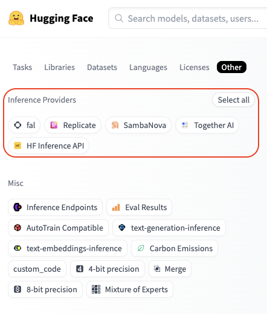

import Image from '@theme/IdealImage';
import Tabs from '@theme/Tabs';
import TabItem from '@theme/TabItem';

# Hugging Face
对于托管在 Hugging Face Hub 上的模型，LiteLLM 支持跨多个服务运行推理。

- **无服务器推理提供商**（Serverless Inference Providers）：Hugging Face 通过多家推理提供商（如 [Together AI](https://together.ai) 和 [Sambanova](https://sambanova.ai)）提供便捷且统一的无服务器 AI 推理接入。这是一种免维护、可扩展的方案，也是在产品中集成 AI 的最快途径。更多信息见[推理提供商文档](https://huggingface.co/docs/inference-providers/index)。
- **专用推理端点**（Dedicated Inference Endpoints）：一款可轻松把模型部署到生产环境的产品。推理由 Hugging Face 在你指定的云厂商上以专用、全托管的基础设施运行。按照[这些步骤](https://huggingface.co/docs/inference-endpoints/guides/create_endpoint)操作，即可把模型部署到 Hugging Face Inference Endpoints。


## 支持的模型

### 无服务器推理提供商
要查看某个推理提供商有哪些可用模型，可以访问 [huggingface.co/models](https://huggingface.co/models)，点击 "Other" 筛选页签，再选择想要的提供商：



例如，Fireworks 支持的全部模型可以在[这里](https://huggingface.co/models?inference_provider=fireworks-ai&sort=trending)找到。


### 专用推理端点
可用模型的完整列表请参考 [Inference Endpoints 目录](https://endpoints.huggingface.co/catalog)。

## 用法

<Tabs>
<TabItem value="serverless" label="无服务器推理提供商">

### 身份验证
只需一个 Hugging Face token，就能通过多家提供商访问推理。你的调用会经由 Hugging Face 路由，用量按各提供商的标准 API 费率直接计入你的 Hugging Face 账户。

把 Hugging Face token 设为 `HF_TOKEN` 环境变量即可；token 可以在这里创建：https://huggingface.co/settings/tokens。

```bash
export HF_TOKEN="hf_xxxxxx"
```
或者，也可以把 Hugging Face token 作为参数传入：
```python
completion(..., api_key="hf_xxxxxx")
```

### 入门

使用 Hugging Face 模型时，请按下面的格式同时指定要用的提供商和模型：
```
huggingface/<provider>/<hf_org_or_user>/<hf_model>
```
其中 `<hf_org_or_user>/<hf_model>` 是 Hugging Face 模型 ID，`<provider>` 是推理提供商。  
默认情况下，如果不指定提供商，LiteLLM 会使用 [HF Inference API](https://huggingface.co/docs/api-inference/en/index)。

示例：

```python
# Run DeepSeek-R1 inference through Together AI
completion(model="huggingface/together/deepseek-ai/DeepSeek-R1", messages=messages)

# Run Qwen2.5-72B-Instruct inference through Sambanova
completion(model="huggingface/sambanova/Qwen/Qwen2.5-72B-Instruct", messages=messages)

# Run Llama-3.3-70B-Instruct inference through HF Inference API
completion(model="huggingface/meta-llama/Llama-3.3-70B-Instruct", messages=messages)
```


<a target="_blank" href="https://colab.research.google.com/github/BerriAI/litellm/blob/main/cookbook/LiteLLM_HuggingFace.ipynb">
  
</a>

### 基础补全
下面是通过 Together AI 使用 DeepSeek-R1 模型进行对话补全（chat completion）的示例：

```python
import os
from litellm import completion

os.environ["HF_TOKEN"] = "hf_xxxxxx"

response = completion(
    model="huggingface/together/deepseek-ai/DeepSeek-R1",
    messages=[
        {
            "role": "user",
            "content": "How many r's are in the word 'strawberry'?",
        }
    ],
)
print(response)
```

### 流式输出
接下来看看流式请求长什么样。

```python
import os
from litellm import completion

os.environ["HF_TOKEN"] = "hf_xxxxxx"

response = completion(
    model="huggingface/together/deepseek-ai/DeepSeek-R1",
    messages=[
        {
            "role": "user",
            "content": "How many r's are in the word `strawberry`?",
            
        }
    ],
    stream=True,
)

for chunk in response:
    print(chunk)
```

### 图像输入
模型支持图像时，也可以在请求中传入图片。下面是通过 Sambanova 使用 [Llama-3.2-11B-Vision-Instruct](https://huggingface.co/meta-llama/Llama-3.2-11B-Vision-Instruct) 模型的示例。

```python
from litellm import completion

# Set your Hugging Face Token
os.environ["HF_TOKEN"] = "hf_xxxxxx"

messages=[
        {
            "role": "user",
            "content": [
                {"type": "text", "text": "What's in this image?"},
                {
                    "type": "image_url",
                    "image_url": {
                        "url": "https://awsmp-logos.s3.amazonaws.com/seller-xw5kijmvmzasy/c233c9ade2ccb5491072ae232c814942.png",
                    }
                },
            ],
        }
    ]

response = completion(
    model="huggingface/sambanova/meta-llama/Llama-3.2-11B-Vision-Instruct", 
    messages=messages,
)
print(response.choices[0])
```

### 函数调用
可以通过给模型提供工具来扩展其能力。下面是通过 Sambanova 使用 [Qwen2.5-72B-Instruct](https://huggingface.co/Qwen/Qwen2.5-72B-Instruct) 模型进行函数调用（function calling）的示例。

```python
import os
from litellm import completion

# Set your Hugging Face Token
os.environ["HF_TOKEN"] = "hf_xxxxxx"

tools = [
  {
    "type": "function",
    "function": {
      "name": "get_current_weather",
      "description": "Get the current weather in a given location",
      "parameters": {
        "type": "object",
        "properties": {
          "location": {
            "type": "string",
            "description": "The city and state, e.g. San Francisco, CA",
          },
          "unit": {"type": "string", "enum": ["celsius", "fahrenheit"]},
        },
        "required": ["location"],
      },
    }
  }
]
messages = [
    {
        "role": "user",
        "content": "What's the weather like in Boston today?",
    }
]

response = completion(
    model="huggingface/sambanova/meta-llama/Llama-3.3-70B-Instruct", 
    messages=messages,
    tools=tools,
    tool_choice="auto"
)
print(response)
```

</TabItem>

<TabItem value="endpoints" label="推理端点">

<a target="_blank" href="https://colab.research.google.com/github/BerriAI/litellm/blob/main/cookbook/LiteLLM_HuggingFace.ipynb">
  
</a>

### 基础补全
在专用基础设施上[部署好 Hugging Face Inference Endpoint](https://endpoints.huggingface.co/new)之后，把端点的基础 URL 填入 `api_base`，并将模型名指定为 `huggingface/tgi`，即可在上面运行推理。

```python
import os
from litellm import completion

os.environ["HF_TOKEN"] = "hf_xxxxxx"

response = completion(
    model="huggingface/tgi",
    messages=[{"content": "Hello, how are you?", "role": "user"}],
    api_base="https://my-endpoint.endpoints.huggingface.cloud/v1/"
)
print(response)
```

### 流式输出

```python
import os
from litellm import completion

os.environ["HF_TOKEN"] = "hf_xxxxxx"

response = completion(
    model="huggingface/tgi",
    messages=[{"content": "Hello, how are you?", "role": "user"}],
    api_base="https://my-endpoint.endpoints.huggingface.cloud/v1/",
    stream=True
)

for chunk in response:
    print(chunk)
```

### 图像输入

```python
import os
from litellm import completion

os.environ["HF_TOKEN"] = "hf_xxxxxx"

messages=[
        {
            "role": "user",
            "content": [
                {"type": "text", "text": "What's in this image?"},
                {
                    "type": "image_url",
                    "image_url": {
                        "url": "https://awsmp-logos.s3.amazonaws.com/seller-xw5kijmvmzasy/c233c9ade2ccb5491072ae232c814942.png",
                    }
                },
            ],
        }
    ]
response = completion(
    model="huggingface/tgi",
    messages=messages,
    api_base="https://my-endpoint.endpoints.huggingface.cloud/v1/"
)
print(response.choices[0])
```

### 函数调用

```python
import os
from litellm import completion

os.environ["HF_TOKEN"] = "hf_xxxxxx"

functions = [{
    "name": "get_weather",
    "description": "Get the weather in a given location",
    "parameters": {
        "type": "object",
        "properties": {
            "location": {
                "type": "string",
                "description": "The location to get weather for"
            }
        },
        "required": ["location"]
    }
}]

response = completion(
    model="huggingface/tgi",
    messages=[{"content": "What's the weather like in San Francisco?", "role": "user"}],
    api_base="https://my-endpoint.endpoints.huggingface.cloud/v1/",
    functions=functions
)
print(response)
```

</TabItem>
</Tabs>

## 在 LiteLLM 代理服务器中使用 Hugging Face 模型
你可以搭建一个 [LiteLLM 代理服务器](https://docs.litellm.ai/#litellm-proxy-server-llm-gateway)，通过任意受支持的推理提供商来提供 Hugging Face 模型服务。具体做法如下：

### 步骤 1：设置配置文件

这里我们配置一个代理，用 Together AI 作为后端推理提供商，来提供 Hugging Face 上的 `DeepSeek R1` 模型服务。

```yaml
model_list:
  - model_name: my-r1-model
    litellm_params:
      model: huggingface/together/deepseek-ai/DeepSeek-R1
      api_key: os.environ/HF_TOKEN # ensure you have `HF_TOKEN` in your .env
```

### 步骤 2：启动服务器
```bash
litellm --config /path/to/config.yaml
```

### 步骤 3：向服务器发起请求
<Tabs>
<TabItem value="curl" label="curl">

```shell
curl --location 'http://0.0.0.0:4000/chat/completions' \
    --header 'Content-Type: application/json' \
    --data '{
    "model": "my-r1-model",
    "messages": [
        {
            "role": "user",
            "content": "Hello, how are you?"
        }
    ]
}'
```

</TabItem>
<TabItem value="python" label="python">

```python
# uv add openai
from openai import OpenAI

client = OpenAI(
    base_url="http://0.0.0.0:4000",
    api_key="anything",
)

response = client.chat.completions.create(
    model="my-r1-model",
    messages=[
        {"role": "user", "content": "Hello, how are you?"}
    ]
)
print(response)
```

</TabItem>
</Tabs>


## 嵌入

LiteLLM 同样支持 Hugging Face 的 [text-embedding-inference](https://github.com/huggingface/text-embeddings-inference) 模型。

```python
from litellm import embedding
import os
os.environ['HF_TOKEN'] = "hf_xxxxxx"
response = embedding(
    model='huggingface/microsoft/codebert-base',
    input=["good morning from litellm"]
)
```

## 常见问题

**Hugging Face Inference Providers 是如何计费的**？

> 无论使用哪些提供商，计费都集中在你的 Hugging Face 账户上。费用按提供商的标准 API 费率收取，没有额外加价；Hugging Face 只是把提供商成本透传而已。注意：[Hugging Face PRO](https://huggingface.co/subscribe/pro) 用户每月可获得 $2 的推理额度，可在各提供商之间通用。

**每个推理提供商都需要单独创建账户吗**？

> 不需要，无需单独创建账户。所有请求都经由 Hugging Face 路由，你只需要一个 HF token。这样就能方便地对不同提供商做基准测试，选出最符合需求的那一个。

**Hugging Face 未来会支持更多推理提供商吗**？

> 会的！新的推理提供商（和模型）正在陆续加入。

我们欢迎任何改进 Hugging Face 集成的建议：创建 [issue](https://github.com/BerriAI/litellm/issues/new/choose) 或[加入 Discord](https://discord.com/invite/wuPM9dRgDw)！
