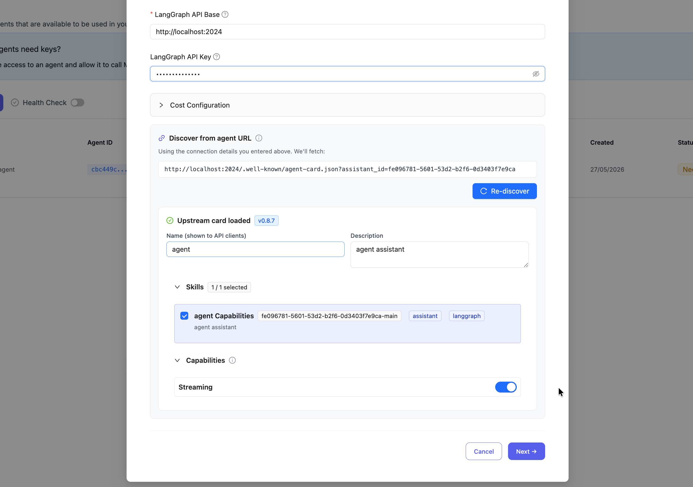
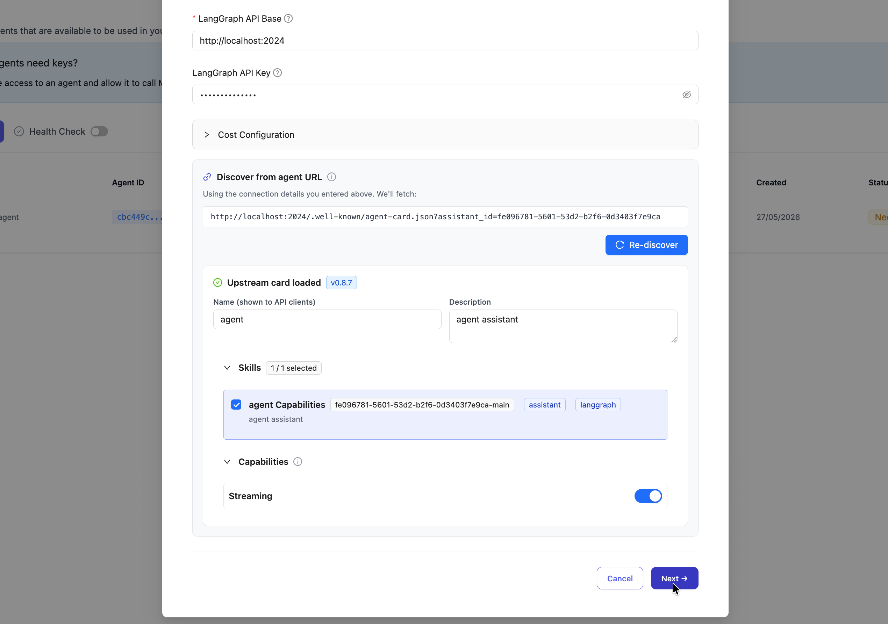

import Tabs from '@theme/Tabs';
import TabItem from '@theme/TabItem';

# LangGraph

通过 LiteLLM 以 OpenAI 对话补全（chat completions）格式调用 LangGraph 智能体（agent）。

| 属性 | 说明 |
|----------|---------|
| 说明 | LangGraph 是一个用于构建有状态、多智能体（multi-actor）LLM 应用的框架。LiteLLM 支持通过流式与非流式端点调用 LangGraph 智能体。 |
| LiteLLM 提供商路由 | `langgraph/{agent_id}` |
| 提供商文档 | [LangGraph Platform ↗](https://langchain-ai.github.io/langgraph/cloud/quick_start/) |

**前置条件**：你需要一个正在运行的 LangGraph 服务器，参见下文 [搭建本地 LangGraph 服务器](#搭建本地-langgraph-服务器)。

## 快速上手

### 模型格式

```shell showLineNumbers title="模型格式"
langgraph/{agent_id}
```

**示例**：
- `langgraph/agent`：调用默认智能体

### LiteLLM Python SDK

```python showLineNumbers title="基础 LangGraph 补全"
import litellm

response = litellm.completion(
    model="langgraph/agent",
    messages=[
        {"role": "user", "content": "What is 25 * 4?"}
    ],
    api_base="http://localhost:2024",
)

print(response.choices[0].message.content)
```

```python showLineNumbers title="流式获取 LangGraph 响应"
import litellm

response = litellm.completion(
    model="langgraph/agent",
    messages=[
        {"role": "user", "content": "What is the weather in Tokyo?"}
    ],
    api_base="http://localhost:2024",
    stream=True,
)

for chunk in response:
    if chunk.choices[0].delta.content:
        print(chunk.choices[0].delta.content, end="")
```

### LiteLLM 代理

#### 1. 在 config.yaml 中配置模型

<Tabs>
<TabItem value="config-yaml" label="config.yaml">

```yaml showLineNumbers title="LiteLLM 代理配置"
model_list:
  - model_name: langgraph-agent
    litellm_params:
      model: langgraph/agent
      api_base: http://localhost:2024
```

</TabItem>
</Tabs>

#### 2. 启动 LiteLLM 代理

```bash showLineNumbers title="启动 LiteLLM 代理"
litellm --config config.yaml
```

#### 3. 向 LangGraph 智能体发起请求

<Tabs>
<TabItem value="curl" label="Curl">

```bash showLineNumbers title="基础请求"
curl http://localhost:4000/v1/chat/completions \
  -H "Content-Type: application/json" \
  -H "Authorization: Bearer $LITELLM_API_KEY" \
  -d '{
    "model": "langgraph-agent",
    "messages": [
      {"role": "user", "content": "What is 25 * 4?"}
    ]
  }'
```

```bash showLineNumbers title="流式请求"
curl http://localhost:4000/v1/chat/completions \
  -H "Content-Type: application/json" \
  -H "Authorization: Bearer $LITELLM_API_KEY" \
  -d '{
    "model": "langgraph-agent",
    "messages": [
      {"role": "user", "content": "What is the weather in Tokyo?"}
    ],
    "stream": true
  }'
```

</TabItem>

<TabItem value="openai-sdk" label="OpenAI Python SDK">

```python showLineNumbers title="通过 OpenAI SDK 使用 LiteLLM 代理"
from openai import OpenAI

client = OpenAI(
    base_url="http://localhost:4000",
    api_key="your-litellm-api-key"
)

response = client.chat.completions.create(
    model="langgraph-agent",
    messages=[
        {"role": "user", "content": "What is 25 * 4?"}
    ]
)

print(response.choices[0].message.content)
```

```python showLineNumbers title="使用 OpenAI SDK 进行流式请求"
from openai import OpenAI

client = OpenAI(
    base_url="http://localhost:4000",
    api_key="your-litellm-api-key"
)

stream = client.chat.completions.create(
    model="langgraph-agent",
    messages=[
        {"role": "user", "content": "What is the weather in Tokyo?"}
    ],
    stream=True
)

for chunk in stream:
    if chunk.choices[0].delta.content is not None:
        print(chunk.choices[0].delta.content, end="")
```

</TabItem>
</Tabs>

## 环境变量

| 变量 | 说明 |
|----------|-------------|
| `LANGGRAPH_API_BASE` | LangGraph 服务器的 base URL（默认：`http://localhost:2024`） |
| `LANGGRAPH_API_KEY` | 可选，用于身份验证的 API 密钥 |

## 支持的参数

| 参数 | 类型 | 说明 |
|-----------|------|-------------|
| `model` | string | `langgraph/{agent_id}` 格式的智能体 ID |
| `messages` | array | OpenAI 格式的对话消息 |
| `stream` | boolean | 启用流式响应 |
| `api_base` | string | LangGraph 服务器 URL |
| `api_key` | string | 可选的 API 密钥 |


## 搭建本地 LangGraph 服务器

在将 LiteLLM 与 LangGraph 结合使用之前，你需要一个正在运行的 LangGraph 服务器。

### 前置条件

- Python 3.11+（LangGraph CLI 的内存服务器所需） {/* keep-python-version */}
- 一个 LLM API 密钥（OpenAI 或 Google Gemini）

### 1. 安装 LangGraph CLI

```bash
uv add "langgraph-cli[inmem]"
```

### 2. 创建新的 LangGraph 项目

```bash
langgraph new my-agent --template new-langgraph-project-python
cd my-agent
```

### 3. 安装依赖

```bash
uv add -e .
```

### 4. 设置 API 密钥

```bash
echo "OPENAI_API_KEY=your_key_here" > .env
```

### 5. 启动服务器

```bash
langgraph dev
```

服务器将运行在 `http://localhost:2024`。

### 验证服务器正在运行

```bash
curl -s --request POST \
  --url "http://localhost:2024/runs/wait" \
  --header 'Content-Type: application/json' \
  --data '{
    "assistant_id": "agent",
    "input": {
      "messages": [{"role": "human", "content": "Hello!"}]
    }
  }'
```


## LiteLLM A2A 网关

你可以在 LiteLLM 的 [A2A（Agent-to-Agent）网关](../a2a.md) 中注册 LangGraph 智能体，发现其上游智能体卡片（agent card），整理技能与能力，并通过 LiteLLM 代理调用它们。

### 1. 进入 Agents 页面

在侧边栏点击 "Agents" 打开智能体管理页面，然后点击 "+ Add New Agent"。


### 2. 选择 LangGraph 智能体类型

点击 "A2A Standard" 查看可用的智能体类型，然后搜索 "langgraph"，选择 "Connect to LangGraph agents via the LangGraph Platform API"。


### 3. 配置智能体

填写以下字段：

- **Agent Name**：唯一标识符（例如 `lan-agent`）
- **LangGraph API Base**：你的 LangGraph 服务器地址，通常是 `http://127.0.0.1:2024/`
- **API Key**：可选。LangGraph 默认不要求 API 密钥
- **Assistant ID**：LangGraph 不使用该字段，这里可以填任意字符串


### 4: 发现智能体卡片

填好 base URL 和 assistant ID 后会自动执行发现，你也可以在发现面板中手动触发。

预览内容是一个表单，你可以：

- **编辑**名称、描述、提供商、图标 URL 和文档 URL。
- **添加、删除或重新排序技能**，并编辑每个技能的名称、描述、标签、示例和输入/输出模式。
- **切换** LiteLLM 支持的能力开关。

保存前先勾选或取消勾选技能与能力。LiteLLM 只会保留你在表单中勾选的内容。

LiteLLM 不代理的字段不会显示。完整支持矩阵见 [智能体卡片支持](../a2a_agent_card.md#智能体卡片支持)。



### 5: 保存智能体

点击 Next 保存，然后完成其余步骤。



### 6: 验证已发布的卡片

在终端中获取 LiteLLM 正在提供的智能体卡片：

```bash
curl -H "Authorization: Bearer $LITELLM_API_KEY" \
  http://localhost:4000/a2a/{agent_id}/.well-known/agent.json | jq
```

你应该能看到保存的那张卡片，其中：

- `supportedInterfaces[0].url` 指向 LiteLLM 而非上游
- `securitySchemes` 显示 `LiteLLMKey`（HTTP bearer）
- 以及你在注册时保留的技能

### 7. 在 Playground 中测试
进入侧边栏的 "Playground" 测试你的智能体。把端点类型改为 `/v1/a2a/message/send`。


### 8. 选择你的智能体并发送消息
从下拉框中选择你的 LangGraph 智能体，然后发送一条测试消息。


### 9: 手动调用智能体

向 LiteLLM 代理 URL 发送 A2A `message/send` 请求：

```bash
curl -X POST http://localhost:4000/a2a/{agent_id} \
  -H "Authorization: Bearer $LITELLM_API_KEY" \
  -H "Content-Type: application/json" \
  -H "Accept: application/json" \
  -d '{
    "jsonrpc": "2.0",
    "id": "req-1",
    "method": "message/send",
    "params": {
      "message": {
        "messageId": "msg-001",
        "role": "user",
        "parts": [{"kind": "text", "text": "My order is urgent and still not delivered"}],
        "metadata": {"skillId": "triage_ticket"}
      }
    }
  }'
```

流式调用改用 `message/stream`，并在 curl 命令中加上 `-N -H "Accept: text/event-stream"`。

SDK 示例参见 [调用 A2A 智能体](../a2a_invoking_agents.md)。


## 延伸阅读

- [LangGraph Platform 文档](https://langchain-ai.github.io/langgraph/cloud/quick_start/)
- [LangGraph A2A 端点文档](https://docs.langchain.com/langsmith/server-a2a)
- [LangGraph GitHub](https://github.com/langchain-ai/langgraph)
- [A2A 智能体网关](../a2a.md)
- [LiteLLM 上的 A2A 智能体卡片](../a2a_agent_card.md)
- [A2A 成本追踪](../a2a_cost_tracking.md)
- [A2A 协议规范](https://a2a-protocol.org/latest/specification/)

