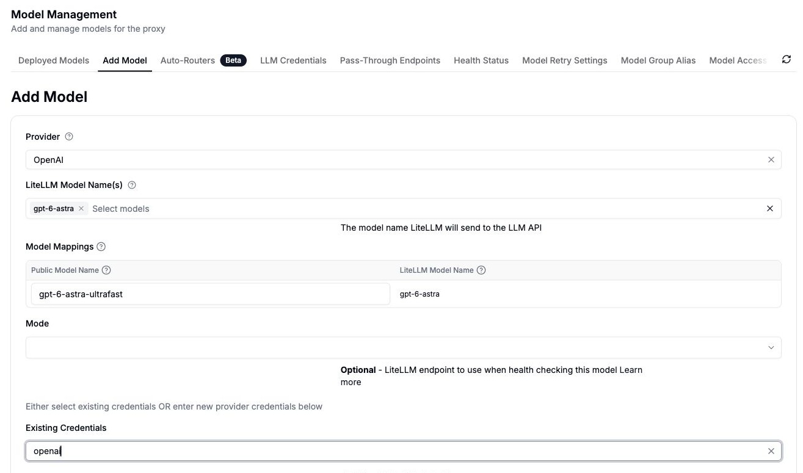
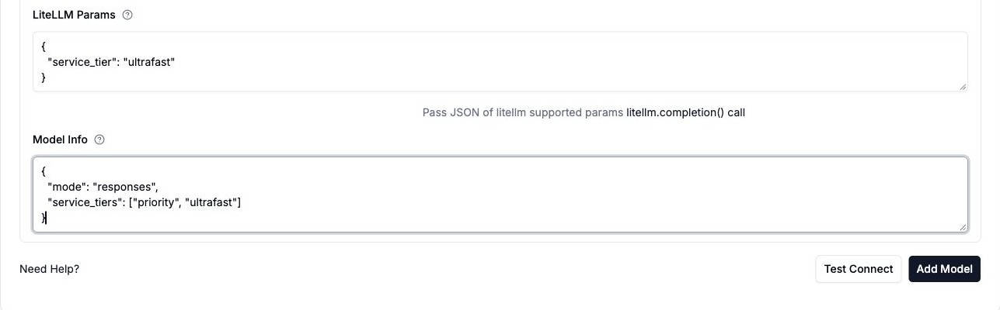
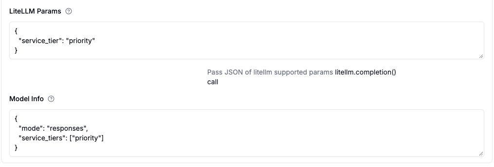

import Tabs from '@theme/Tabs';
import TabItem from '@theme/TabItem';

# OpenAI Fast 与 Ultrafast 模式

在 GPT-6 Astra 上，Fast 模式使用 `service_tier: "priority"`，Ultrafast 模式使用 `service_tier: "ultrafast"`。你可以在管理界面（Admin UI）或 `config.yaml` 中把该层级设为部署默认值，也可以按请求单独指定。下文示例使用 [Responses API](./responses_api.md)。

本文的演练会为 Astra Ultrafast 创建 `gpt-6-astra-ultrafast`，并给出一个名为 `gpt-6.1-sol-fast` 的 Fast 替代配置。这些网关别名由你自己命名；真正决定处理模式的是 `service_tier` 参数。

## 支持的模型与可用性

### Fast 模式

OpenAI 已将 Priority processing 更名为 [Fast mode](https://developers.openai.com/api/docs/guides/fast-mode)。`service_tier: "priority"` 与 `service_tier: "fast"` 选择的都是它。本指南使用 `priority`，这样也能保留 Codex 的 `/fast` 命令。

2026 年 10 月 6 日，以下模型均通过 LiteLLM 完成了完整的 Responses API 调用验证，返回的处理层级均为 Fast：

| OpenAI 模型 ID | LiteLLM 上游模型 | 返回的 `service_tier` |
| --- | --- | --- |
| `gpt-6-astra` | `openai/gpt-6-astra` | `fast` |
| `gpt-6.1-sol` | `openai/gpt-6.1-sol` | `fast` |
| `gpt-6-sol` | `openai/gpt-6-sol` | `fast` |
| `gpt-6-luna` | `openai/gpt-6-luna` | `fast` |
| `gpt-5.6-sol` | `openai/gpt-5.6-sol` | `priority` |
| `gpt-5.6-terra` | `openai/gpt-5.6-terra` | `priority` |
| `gpt-5.6-luna` | `openai/gpt-5.6-luna` | `priority` |

以上是本指南实测过的当前模型，并非完整清单。更多受支持的模型请查阅 OpenAI 的 [Fast 定价表](https://developers.openai.com/api/docs/pricing?latest-pricing=fast)。Fast 模式同样支持 Chat Completions。上文列出的 GPT-6 系列模型不支持 EU 数据驻留（data residency）下的 Fast 模式；详见 OpenAI 的[区域要求](https://developers.openai.com/api/docs/guides/fast-mode#is-fast-mode-compatible-with-data-residency-zero-data-retention-and-a-baa)。

### Ultrafast 模式

配合 `service_tier: "ultrafast"` 使用 **GPT-6 Astra**（`openai/gpt-6-astra`）。测试中，一次通过 LiteLLM 发出的完整 Responses API 调用返回了 `service_tier: "ultrafast"`。本指南的 Ultrafast 配置只使用 Astra。

OpenAI 向所有 API 用户开放 Astra Ultrafast，但初始速率限制较低。请通过 HTTP 或 WebSocket 使用 Responses API。Ultrafast 仅支持美国数据驻留与全球处理，不支持 EU 及其他非美国区域处理端点。当前的可用性与限制请查阅 OpenAI 的 [Ultrafast 指南](https://developers.openai.com/api/docs/guides/ultrafast-mode)。

所选层级必须得到你的 OpenAI 账号对该模型的支持。把某个层级写进 LiteLLM 的模型目录并不会在 OpenAI 侧启用它，支持 Fast 模式也不代表支持 Ultrafast。

## 开始之前

准备三样东西：支持 Responses API 的较新 LiteLLM 版本；能访问所选模型且有可用额度的 OpenAI API 凭证；向网关添加模型的权限。下文的界面演练截图取自 LiteLLM v1.105.0。网关如果是新建的，请先照 [Admin UI 快速上手](../../proxy/docker_quick_start.md)操作。

两种模式的花费都高于 Standard。请查看 OpenAI 的 [Fast 定价](https://developers.openai.com/api/docs/pricing?latest-pricing=fast)与 [Ultrafast 定价](https://developers.openai.com/api/docs/pricing?latest-pricing=ultrafast)。若要用 LiteLLM 做花费追踪（spend tracking），请确认所用模型在成本映射中的条目带有对应的费率：Fast 用 `*_priority`，Ultrafast 用 `*_ultrafast`，涵盖输入、输出、缓存与长上下文各项费率。如果定价缺失或与你签订的协议不符，请先配置[自定义定价](../../proxy/custom_pricing.md)，再依赖花费统计或预算。

## 在 Admin UI 中设置

### 1. 选择模型与凭证

打开 **Models + Endpoints**，再点 **Add Model**。提供商选择 **OpenAI**，**LiteLLM Model Name(s)** 填 `gpt-6-astra`。在 **Model Mappings** 中，把 **Public Model Name** 设为 `gpt-6-astra-ultrafast`。

配置 Fast 模式时，请从上文的 Fast 模型表中选一个（如 `gpt-6.1-sol`），公开名称可取 `gpt-6.1-sol-fast`。模型选择截图里展示的是 Astra，Fast 的设置在下方单独展示。

在 **Existing Credentials** 中选择你的 OpenAI 凭证，或在提供商凭证字段里填入 OpenAI API 密钥。截图用的是名为 `openai` 的现有凭证，请换成你自己的凭证名。

**Mode** 暂时留空。v1.105.0 的这个下拉框没有 Responses 选项，下一步通过 **Model Info** 来设置。



### 2. 设置服务层级

展开 **Advanced Settings**，按你的模式选择对应设置：

**LiteLLM Params** 里的 `service_tier`（单数）决定处理模式；**Model Info** 里的 `service_tiers`（复数）是可选的模式列表，用来向 Codex 等客户端宣告可用模式。

<Tabs groupId="openai-service-tier">
<TabItem value="ultrafast" label="Ultrafast（Astra）">

在 **LiteLLM Params** 中填入以下 JSON：

```json
{
  "service_tier": "ultrafast"
}
```

在 **Model Info** 中填入以下 JSON：

```json
{
  "mode": "responses",
  "service_tiers": ["priority", "ultrafast"]
}
```



</TabItem>
<TabItem value="fast" label="Fast">

在 **LiteLLM Params** 中填入以下 JSON：

```json
{
  "service_tier": "priority"
}
```

在 **Model Info** 中填入以下 JSON：

```json
{
  "mode": "responses",
  "service_tiers": ["priority"]
}
```



</TabItem>
</Tabs>

`mode: "responses"` 让连接测试走 Responses 端点。

### 3. 测试并保存

点击 **Test Connect**。测试会把所选上游模型和 `service_tier`（Fast 用 `priority`，Astra Ultrafast 用 `ultrafast`）发送到 OpenAI 的 `/v1/responses` 端点。解决测试暴露出的凭证、配额或访问权限错误，然后点击 **Add Model** 保存。

在 **Deployed Models** 下搜索你配置的公开名称，打开它的模型 ID，选择 **Raw JSON**。确认 `litellm_params.service_tier` 与所选层级一致，且 `model_info.mode` 为 `"responses"`。下面的请求请使用一个能访问该公开模型名称的[虚拟密钥（virtual key）](../../proxy/virtual_keys.md)。

## 用 config.yaml 设置

作为在界面里操作的替代方案，可以把以下部署加进网关配置：

<Tabs groupId="openai-service-tier">
<TabItem value="ultrafast" label="Ultrafast（GPT-6 Astra）">

```yaml title="config.yaml"
model_list:
  - model_name: gpt-6-astra-ultrafast
    litellm_params:
      model: openai/gpt-6-astra
      api_key: os.environ/OPENAI_API_KEY
      service_tier: ultrafast
    model_info:
      mode: responses
      service_tiers: ["priority", "ultrafast"]
```

</TabItem>
<TabItem value="fast" label="Fast（GPT-6.1 Sol）">

```yaml title="config.yaml"
model_list:
  - model_name: gpt-6.1-sol-fast
    litellm_params:
      model: openai/gpt-6.1-sol
      api_key: os.environ/OPENAI_API_KEY
      service_tier: priority
    model_info:
      mode: responses
      service_tiers: ["priority"]
```

</TabItem>
</Tabs>

在网关环境中设置 `OPENAI_API_KEY`，然后用更新后的配置重启。本地代理安装可直接用 `litellm --config config.yaml` 启动；部署方式详见[代理配置](../../proxy/configs.md)。

`openai/` 前缀用来选定上游提供商。客户端调用的是所选部署的公开 `model_name`，例如 `gpt-6-astra-ultrafast`。提供商密钥只留在网关侧；客户端用各自的 LiteLLM 虚拟密钥完成认证。

## 通过网关发送请求

下面的请求使用 Astra Ultrafast 别名。若走 Fast 部署，请改用 `model: "gpt-6.1-sol-fast"` 和 `service_tier: "priority"`。

把 `LITELLM_BASE_URL` 设为你的网关地址（结尾不带 `/v1`），把 `LITELLM_API_KEY` 设为一个能访问该模型的虚拟密钥：

```bash
export LITELLM_BASE_URL="http://localhost:4000"
export LITELLM_API_KEY="<your-litellm-virtual-key>"
```

<Tabs>
<TabItem value="curl" label="curl">

```bash
curl "${LITELLM_BASE_URL}/v1/responses" \
  -H "Authorization: Bearer ${LITELLM_API_KEY}" \
  -H "Content-Type: application/json" \
  -d '{
    "model": "gpt-6-astra-ultrafast",
    "service_tier": "ultrafast",
    "input": "Say hello in one sentence."
  }'
```

</TabItem>
<TabItem value="openai-sdk" label="OpenAI Python SDK">

安装或升级 `openai`，然后运行：

```python
import os
from openai import OpenAI

client = OpenAI(
    base_url=os.environ["LITELLM_BASE_URL"].rstrip("/") + "/v1",
    api_key=os.environ["LITELLM_API_KEY"],
)

response = client.responses.create(
    model="gpt-6-astra-ultrafast",
    service_tier="ultrafast",
    input="Say hello in one sentence.",
)

print(response.output_text)
print(response.service_tier)
```

</TabItem>
</Tabs>

两个示例都显式指定了层级。客户端省略 `service_tier` 时，会套用上面的部署默认值；请求里显式给出的层级则优先于默认值。如果只想对部分调用启用 Fast 或 Ultrafast，可以不在部署中设置 `service_tier`，只在这些调用里传。

## 直接使用 LiteLLM Python SDK

不经过网关时，在应用环境中设置 `OPENAI_API_KEY`，用 `litellm.responses()` 调用上游模型：

```python
import litellm

response = litellm.responses(
    model="openai/gpt-6-astra",
    service_tier="ultrafast",
    input="Say hello in one sentence.",
)

print(response)
```

Fast 模式请改用 `model="openai/gpt-6.1-sol"` 与 `service_tier="priority"`，或换成上文 Fast 表中的其他模型。

## 在 Codex 中提供 /fast 与 /ultrafast

用 `model_info.service_tiers: ["priority"]` 提供 `/fast`。对 Astra 则用 `["priority", "ultrafast"]`，同时提供 `/fast` 和 `/ultrafast`。Codex CLI 0.159 及以上版本还要求把 `model_catalog_url` 指向网关的 `/v1/models` 端点，并设置 `[features] api_key_model_discovery = true`。照着 [Codex 模型目录配置](../../proxy/client_setup/codex_cli.md#model-catalog-and-service-tiers)操作，选中你的网关模型，再选择模式。

如果用户可以随意开关模式，就省略部署里的 `litellm_params.service_tier`，只保留 `model_info.service_tiers`。否则，客户端停止发送层级时仍会继承部署默认值。宣告某个层级并不意味着在 OpenAI 侧获得了该层级的访问权限。

## 验证与故障排查

查看完整响应中的 `service_tier` 字段，确认实际服务该请求的层级：Fast 模式为 `fast` 或 `priority`，Ultrafast 为 `ultrafast`。OpenAI 的 [Fast 指南](https://developers.openai.com/api/docs/guides/fast-mode)解释了返回的层级名称，以及流量爬坡限制何时会把 Fast 请求降级为 `default`。流式场景下，请在 `response.completed` 事件中检查响应。仅仅保存了模型名称、写入了目录条目或发出了请求，都不足以证明实际服务的层级。

| 现象 | 排查要点 |
| --- | --- |
| `insufficient_quota` 或 `credit_balance_exhausted` | 检查 OpenAI 账号的额度与账单。LiteLLM 虚拟密钥的预算不会给上游账户充值。 |
| `Invalid service_tier argument`，或提供商拒绝该模型或层级 | 检查[支持的模型](#支持的模型与可用性)、账号权限、区域端点与所请求的层级。上文 Ultrafast 配置请使用 Astra。仅有模型访问权限不代表每个层级都能用。 |
| Fast 或 Ultrafast 请求的花费看起来与 Standard 相同 | 确认模型的 `*_priority` 或 `*_ultrafast` 定价字段，或配置自定义定价。提供商访问权限与 LiteLLM 成本追踪是两回事。 |
| 请求实际用了另一个层级 | 检查客户端传入的 `service_tier`，它会覆盖部署默认值。确认所选别名路由到了预期的部署。 |
| Fast 请求返回 `service_tier: "default"` | 流量爬坡过快时 OpenAI 会降级请求。请查看提供商的爬坡限制；仅凭 HTTP 200 不能证明走了 Fast 处理。 |
| Codex 不显示 `/fast` 或 `/ultrafast` | 同时检查目录设置与模型的 `service_tiers`。多个部署共用一个别名时，每个部署都要配置该列表。目录缓存与版本要求见 Codex 指南。 |

以上示例使用 HTTP Responses 请求。对于反复的智能体（agent）工具调用，OpenAI 建议保持 WebSocket 长连接以减少连接开销；参见 [LiteLLM 的 Responses WebSocket 指南](../../response_api.md#websocket-模式)。
