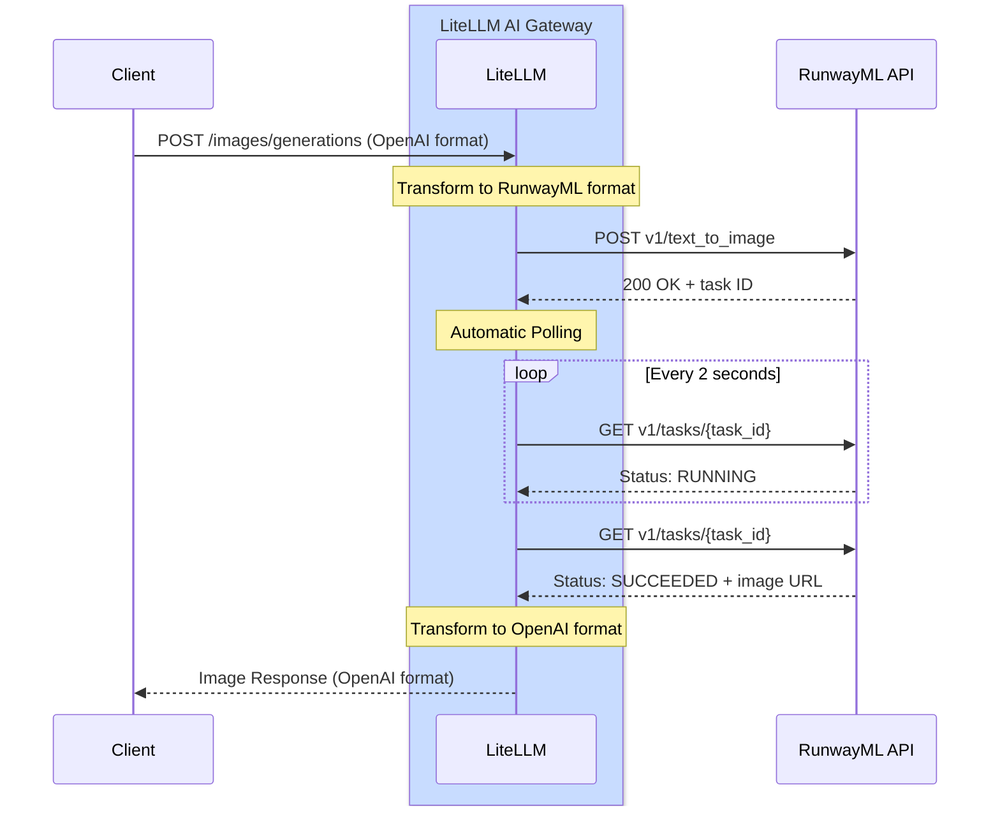

# RunwayML 图像生成

## 概述

| 属性 | 详情 |
|-------|-------|
| 描述 | RunwayML 提供先进的 AI 图像生成能力，生成结果质量出色 |
| LiteLLM 提供商路由 | `runwayml/` |
| 支持的操作 | [`/images/generations`](#快速上手) |
| 提供商文档链接 | [RunwayML API ↗](https://docs.dev.runwayml.com/) |

LiteLLM 支持 RunwayML 的 Gen-4 图像生成 API，用一段文本提示词就能生成高质量图像。

## 快速上手

```python showLineNumbers title="基础图像生成"
from litellm import image_generation
import os

os.environ["RUNWAYML_API_KEY"] = "your-api-key"

response = image_generation(
    model="runwayml/gen4_image",
    prompt="A serene mountain landscape at sunset",
    size="1920x1080"
)

print(response.data[0].url)
```

## 身份验证

设置你的 RunwayML API 密钥：

```python showLineNumbers title="设置 API 密钥"
import os

os.environ["RUNWAYML_API_KEY"] = "your-api-key"
```

## 支持的参数

| 参数 | 类型 | 必填 | 描述 |
|-----------|------|----------|-------------|
| `model` | string | 是 | 使用的模型（如 `runwayml/gen4_image`） |
| `prompt` | string | 是 | 图像的文字描述 |
| `size` | string | 否 | 图像尺寸（默认：`1920x1080`） |

### 支持的尺寸

- `1024x1024`
- `1792x1024`
- `1024x1792`
- `1920x1080`（默认）
- `1080x1920`

## 异步用法

```python showLineNumbers title="异步图像生成"
from litellm import aimage_generation
import os
import asyncio

os.environ["RUNWAYML_API_KEY"] = "your-api-key"

async def generate_image():
    response = await aimage_generation(
        model="runwayml/gen4_image",
        prompt="A futuristic city skyline at night",
        size="1920x1080"
    )
    
    print(response.data[0].url)

asyncio.run(generate_image())
```

## LiteLLM 代理用法

将 RunwayML 添加到你的代理配置中：

```yaml showLineNumbers title="config.yaml"
model_list:
  - model_name: gen4-image
    litellm_params:
      model: runwayml/gen4_image
      api_key: os.environ/RUNWAYML_API_KEY
```

启动代理：

```bash
litellm --config /path/to/config.yaml
```

通过代理生成图像：

```bash showLineNumbers title="代理请求"
curl --location 'http://localhost:4000/v1/images/generations' \
--header 'Content-Type: application/json' \
--header 'x-litellm-api-key: sk-<your-litellm-api-key>' \
--data '{
    "model": "runwayml/gen4_image",
    "prompt": "A serene mountain landscape at sunset",
    "size": "1920x1080"
}'
```

## 支持的模型

| 模型 | 描述 | 默认尺寸 |
|-------|-------------|--------------|
| `runwayml/gen4_image` | 高质量图像生成 | 1920x1080 |

## 成本追踪

LiteLLM 会自动追踪 RunwayML 图像生成成本（cost tracking）：

```python showLineNumbers title="成本追踪"
from litellm import image_generation, completion_cost

response = image_generation(
    model="runwayml/gen4_image",
    prompt="A serene mountain landscape at sunset",
    size="1920x1080"
)

cost = completion_cost(completion_response=response)
print(f"Image generation cost: ${cost}")
```

## 支持的功能

| 功能 | 支持 |
|---------|-----------|
| 图像生成 | ✅ |
| 成本追踪 | ✅ |
| 日志 | ✅ |
| 回退机制 | ✅ |
| 负载均衡 | ✅ |


## 工作原理

RunwayML 采用基于异步任务的 API 模式，轮询与响应转换均由 LiteLLM 自动处理。

### 完整流程图



### LiteLLM 为你做了什么

当你调用 `litellm.image_generation()` 或 `/v1/images/generations` 时，LiteLLM 会依次完成以下工作：

1. **请求转换**：将 OpenAI 图像生成格式转换为 RunwayML 格式
2. **提交任务**：将转换后的请求发送到 RunwayML API
3. **接收任务 ID**：从初始响应中提取任务 ID
4. **自动轮询**：
   - 每 2 秒轮询一次任务状态端点
   - 持续轮询，直到状态变为 `SUCCEEDED` 或 `FAILED`
   - 默认超时 10 分钟（可通过 `RUNWAYML_POLLING_TIMEOUT` 配置）
5. **响应转换**：将 RunwayML 格式转换回 OpenAI 格式
6. **返回结果**：将统一的 OpenAI 格式响应发送给客户端

**轮询配置**：
- 默认超时：600 秒（10 分钟）
- 可通过环境变量 `RUNWAYML_POLLING_TIMEOUT` 配置
- 根据调用类型自动使用同步（`time.sleep()`）或异步（`await asyncio.sleep()`）

:::info
**典型处理时长**：视图像尺寸与复杂度而定，通常需要 10 到 30 秒
:::
