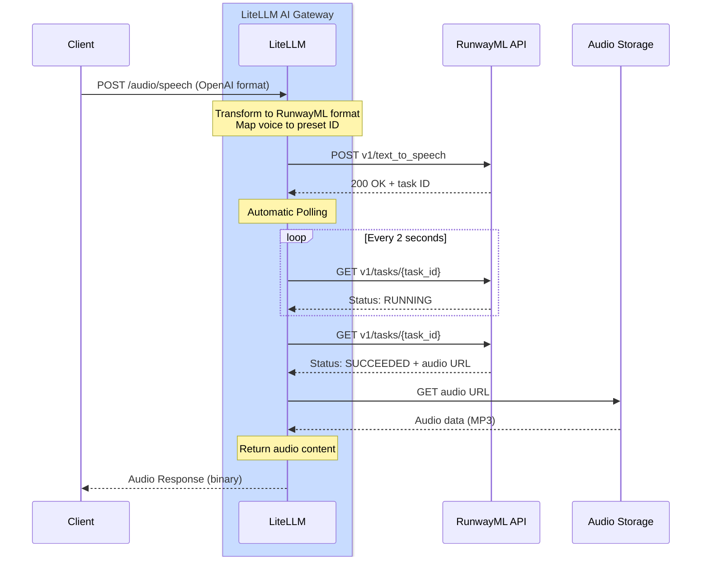

# RunwayML 文本转语音

## 概览

| 属性 | 说明 |
|-------|-------|
| 描述 | RunwayML 提供高质量的 AI 文本转语音，音色自然 |
| LiteLLM 提供商路由 | `runwayml/` |
| 支持的操作 | [`/audio/speech`](#快速上手) |
| 提供商文档链接 | [RunwayML API ↗](https://docs.dev.runwayml.com/) |

LiteLLM 支持 RunwayML 的文本转语音（text-to-speech）API，并自动处理任务轮询，让你可以用文本生成音色自然的音频。

## 快速上手

```python showLineNumbers title="Basic Text-to-Speech"
from litellm import speech
import os

os.environ["RUNWAYML_API_KEY"] = "your-api-key"

response = speech(
    model="runwayml/eleven_multilingual_v2",
    input="Step right up, ladies and gentlemen! Have you ever wished for a toaster that's not just a toaster but a marvel of modern ingenuity?",
    voice="alloy"
)

# Save the audio
with open("output.mp3", "wb") as f:
    f.write(response.content)
```

## 身份验证

设置你的 RunwayML API 密钥：

```python showLineNumbers title="Set API Key"
import os

os.environ["RUNWAYML_API_KEY"] = "your-api-key"
```

## 支持的参数

| 参数 | 类型 | 必填 | 说明 |
|-----------|------|----------|-------------|
| `model` | string | 是 | 要使用的模型（如 `runwayml/eleven_multilingual_v2`） |
| `input` | string | 是 | 要转成语音的文本 |
| `voice` | string or dict | 是 | 要使用的语音（OpenAI 名称、RunwayML 预设名或语音配置） |

## 语音选项

### 使用 OpenAI 语音名称

OpenAI 语音名称会自动映射到对应的 RunwayML 语音：

```python showLineNumbers title="OpenAI Voice Names"
from litellm import speech

# These OpenAI voice names work automatically
response = speech(
    model="runwayml/eleven_multilingual_v2",
    input="Hello, world!",
    voice="alloy"  # Maya - neutral, balanced female voice
)
```

**语音映射**：

- `alloy` → Maya（中性、均衡的女声）
- `echo` → James（男声）
- `fable` → Bernard（温暖、适合讲故事的嗓音）
- `onyx` → Vincent（低沉男声）
- `nova` → Serene（温暖、富有表现力的女声）
- `shimmer` → Ella（清晰、友好的女声）

### 使用 RunwayML 预设语音

直接把预设名作为字符串传入，即可指定任意 RunwayML 预设语音：

```python showLineNumbers title="RunwayML Preset Names"
from litellm import speech

# Pass the RunwayML voice name as a string
response = speech(
    model="runwayml/eleven_multilingual_v2",
    input="Hello, world!",
    voice="Maya"  # LiteLLM automatically formats this for RunwayML
)

# Try different RunwayML voices
response = speech(
    model="runwayml/eleven_multilingual_v2",
    input="Step right up, ladies and gentlemen!",
    voice="Bernard"  # Great for storytelling
)
```

**可用的 RunwayML 语音**：

Maya, Arjun, Serene, Bernard, Billy, Mark, Clint, Mabel, Chad, Leslie, Eleanor, Elias, Elliot, Grungle, Brodie, Sandra, Kirk, Kylie, Lara, Lisa, Malachi, Marlene, Martin, Miriam, Monster, Paula, Pip, Rusty, Ragnar, Xylar, Maggie, Jack, Katie, Noah, James, Rina, Ella, Mariah, Frank, Claudia, Niki, Vincent, Kendrick, Myrna, Tom, Wanda, Benjamin, Kiana, Rachel

:::tip
只需把语音名称作为字符串传入，LiteLLM 会自动完成 RunwayML 内部 API 的格式转换。
:::

## 异步用法

```python showLineNumbers title="Async Text-to-Speech"
from litellm import aspeech
import os
import asyncio

os.environ["RUNWAYML_API_KEY"] = "your-api-key"

async def generate_speech():
    response = await aspeech(
        model="runwayml/eleven_multilingual_v2",
        input="This is an asynchronous text-to-speech request.",
        voice="nova"
    )
    
    with open("output.mp3", "wb") as f:
        f.write(response.content)
    
    print("Audio generated successfully!")

asyncio.run(generate_speech())
```

## LiteLLM 代理用法

在代理配置中添加 RunwayML：

```yaml showLineNumbers title="config.yaml"
model_list:
  - model_name: runway-tts
    litellm_params:
      model: runwayml/eleven_multilingual_v2
      api_key: os.environ/RUNWAYML_API_KEY
```

启动代理：

```bash
litellm --config /path/to/config.yaml
```

通过代理生成语音：

```bash showLineNumbers title="Proxy Request"
curl --location 'http://localhost:4000/v1/audio/speech' \
--header 'Content-Type: application/json' \
--header 'x-litellm-api-key: sk-<your-litellm-api-key>' \
--data '{
    "model": "runwayml/eleven_multilingual_v2",
    "input": "Hello from the LiteLLM proxy!",
    "voice": "alloy"
}'
```

使用 RunwayML 专属语音：

```bash showLineNumbers title="Proxy Request with RunwayML Voice"
curl --location 'http://localhost:4000/v1/audio/speech' \
--header 'Content-Type: application/json' \
--header 'x-litellm-api-key: sk-<your-litellm-api-key>' \
--data '{
    "model": "runwayml/eleven_multilingual_v2",
    "input": "Hello with a custom RunwayML voice!",
    "voice": "Bernard"
}'
```

## 支持的模型

| 模型 | 说明 |
|-------|-------------|
| `runwayml/eleven_multilingual_v2` | 高质量的多语言文本转语音 |

## 成本追踪

LiteLLM 会对 RunwayML 文本转语音自动做成本追踪（cost tracking）：

```python showLineNumbers title="Cost Tracking"
from litellm import speech, completion_cost

response = speech(
    model="runwayml/eleven_multilingual_v2",
    input="Hello, world!",
    voice="alloy"
)

cost = completion_cost(completion_response=response)
print(f"Text-to-speech cost: ${cost}")
```

## 支持的功能

| 功能 | 是否支持 |
|---------|-----------|
| 文本转语音 | ✅ |
| 成本追踪 | ✅ |
| 日志 | ✅ |
| 回退机制 | ✅ |
| 负载均衡 | ✅ |
| 50+ 种预设语音 | ✅ |

## 工作原理

RunwayML 采用基于异步任务的 API 模式，轮询与响应格式转换都由 LiteLLM 自动完成。

### 完整流程图


