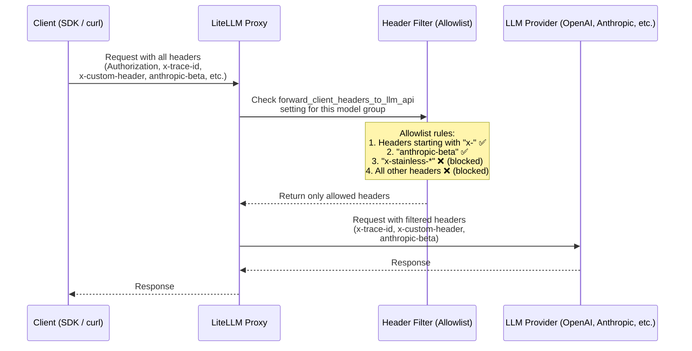

# 将客户端请求头转发给 LLM API

控制哪些模型组可以把客户端请求头转发给底层 LLM 提供商 API。

## 概述

出于安全考虑，LiteLLM 默认不会把客户端请求头转发给 LLM 提供商 API。不过，你可以通过 `forward_client_headers_to_llm_api` 设置，针对特定模型组选择性地开启请求头转发。

## 工作原理

LiteLLM **不会**把所有客户端请求头都转发给 LLM 提供商，而是采用**白名单**（allowlist）机制：只有匹配特定规则的请求头才会被转发。因此，敏感请求头（比如你的 LiteLLM API 密钥）绝不会意外发送到上游提供商。



### 请求头白名单规则

下列规则决定哪些请求头会被转发（参见 `litellm/proxy/litellm_pre_call_utils.py` 中的 [`_get_forwardable_headers`](https://github.com/litellm/litellm/blob/main/litellm/proxy/litellm_pre_call_utils.py)）：

| 规则 | 示例 | 是否转发 |
|---|---|---|
| 以 `x-` 开头的请求头 | `x-trace-id`、`x-custom-header`、`x-request-source` | 是 |
| `anthropic-beta` 请求头 | `anthropic-beta: prompt-caching-2024-07-31` | 是 |
| 以 `x-stainless-*` 开头的请求头 | `x-stainless-lang`、`x-stainless-arch` | 否（会导致 OpenAI SDK 出问题） |
| 标准 HTTP 请求头 | `Authorization`、`Content-Type`、`Host` | 否 |
| 其他提供商请求头 | `Accept`、`User-Agent` | 否 |

### 其他请求头机制

| 机制 | 说明 | 参考 |
|---|---|---|
| **`x-pass-` 前缀** | 带 `x-pass-` 前缀的请求头始终会被转发，且前缀会被剥掉，不受任何设置影响。例如 `x-pass-anthropic-beta: value` → `anthropic-beta: value`。对所有透传（passthrough）端点均有效。 | [源码](https://github.com/litellm/litellm/blob/main/litellm/passthrough/utils.py) |
| **`openai-organization`** | 仅当 `general_settings` 中设置了 `forward_openai_org_id: true` 时才转发。 | [转发 OpenAI 组织 ID](#全局启用) |
| **用户信息头** | 当 `add_user_information_to_llm_headers: true` 时，LiteLLM 会添加 `x-litellm-user-id`、`x-litellm-org-id` 等请求头。 | [用户信息头](#用户信息头可选) |
| **Vertex AI 透传** | 使用一套独立且更严格的白名单：只放行 `anthropic-beta` 和 `content-type`。 | [源码](https://github.com/litellm/litellm/blob/main/litellm/constants.py) |

## 配置

## 全局启用

```yaml
general_settings:
  forward_client_headers_to_llm_api: true
```

## 转发 LLM 提供商认证请求头

**v1.82 及以上版本新增**：出于安全考虑，LiteLLM 默认会从客户端请求中剥掉 `x-api-key`、`x-goog-api-key`、`api-key` 这类认证请求头（它们通常用于向代理本身做认证）。不过，你可以开启这些 LLM 提供商认证请求头的转发，从而支持**自带密钥**（BYOK，Bring Your Own Key）场景：客户端把自己的 API 密钥直接发给 LLM 提供商。

### 配置

在 `general_settings` 中加入 `forward_llm_provider_auth_headers: true`：

```yaml
general_settings:
  forward_client_headers_to_llm_api: true
  forward_llm_provider_auth_headers: true  # 👈 Enable BYOK
```

### 哪些请求头会被转发

当 `forward_llm_provider_auth_headers: true` 时，下列 LLM 提供商认证请求头会被保留并转发：

| 请求头 | 提供商 | 示例 |
|--------|----------|---------|
| `x-api-key` | Anthropic, Azure AI, Databricks | `x-api-key: sk-ant-api03-...` |
| `x-goog-api-key` | Google AI Studio | `x-goog-api-key: AIza...` |
| `api-key` | Azure OpenAI | `api-key: your-azure-key` |
| `ocp-apim-subscription-key` | Azure APIM | `ocp-apim-subscription-key: your-key` |

:::warning[重要安全提示]
即使开启了此设置，代理自身用于认证的 `Authorization` 请求头也**绝不会**被转发给 LLM 提供商。这保证了你的代理认证始终安全。
:::

### 使用场景：客户端自带 API 密钥（BYOK）

该功能适用于以下场景：
1. **客户端自带 LLM 提供商 API 密钥**，而不是使用代理中配置的密钥
2. **多租户应用**，每个租户都有自己的 Anthropic/OpenAI 账户
3. **开发环境**，开发者通过共享代理使用自己的个人 API 密钥

#### 示例：Anthropic BYOK

```yaml
# proxy_config.yaml
model_list:
  - model_name: {{anthropic}}
    litellm_params:
      model: anthropic/{{anthropic}}
      # No api_key configured! Will use client's key

general_settings:
  forward_client_headers_to_llm_api: true
  forward_llm_provider_auth_headers: true  # Enable BYOK
```

使用 **Claude Code** 时，参见 [Claude Code BYOK](../tutorials/claude_code_byok.md)。通过 `ANTHROPIC_CUSTOM_HEADERS="x-litellm-api-key: $LITELLM_API_KEY"` 传入你的 LiteLLM 密钥。已配置的 Anthropic API 密钥会以 `x-api-key` 发送，需要上面的 `forward_llm_provider_auth_headers` 开启后才会被转发；而 `/login` 发送的是以 `Authorization: Bearer <token>` 形式携带的 OAuth 令牌，无论是否开启该设置，LiteLLM 都会转发它。从 LiteLLM v1.105.0 起，每条花费日志都会在 `metadata.used_client_oauth_token` 中记录上游调用使用了哪种凭据（`true` 表示转发来的 OAuth 令牌，`false` 表示部署中配置的密钥，令牌本身永不记录），可在 Logs 页面用 **Credential** 下拉框筛选，或通过 `GET /spend/logs/ui?used_client_oauth_token=true` 查询。

客户端请求：
```bash
# Authorization: Proxy authentication (stripped)
# x-api-key: Client's Anthropic key (forwarded!)
curl -X POST "http://localhost:4000/v1/messages" \
  -H "Authorization: Bearer sk-proxy-auth-123" \
  -H "x-api-key: sk-ant-api03-YOUR-KEY..." \
  -H "Content-Type: application/json" \
  -d '{
    "model": "{{anthropic}}",
    "messages": [{"role": "user", "content": "Hello"}],
    "max_tokens": 100
  }'
```

#### 示例：Google AI Studio BYOK

```yaml
model_list:
  - model_name: {{gemini_pro}}
    litellm_params:
      model: gemini/{{gemini_pro}}
      # No api_key configured

general_settings:
  forward_client_headers_to_llm_api: true
  forward_llm_provider_auth_headers: true
```

客户端请求：
```bash
curl -X POST "http://localhost:4000/v1/chat/completions" \
  -H "Authorization: Bearer sk-proxy-auth-123" \
  -H "x-goog-api-key: AIza..." \
  -d '{
    "model": "{{gemini_pro}}",
    "messages": [{"role": "user", "content": "Hello"}]
  }'
```

#### 示例：自定义 Anthropic 兼容的 `api_base`

当模型部署在你自己的、兼容 Anthropic Messages API 的网关后面，且每个用户都持有自己的网关令牌时，可以采用这种配置。通配路由会把调用方指定的任意模型名直接传给网关，因此网关上新增的模型无需改配置。这里只需要设置 `forward_llm_provider_auth_headers`。

```yaml
model_list:
  - model_name: "my-gateway/*"
    litellm_params:
      model: "anthropic/*"
      api_base: "https://gateway.example.com/anthropic"
      # No api_key: each request supplies its own

general_settings:
  forward_llm_provider_auth_headers: true
```

用 `Authorization: Bearer` 或 `x-litellm-api-key` 向 LiteLLM 认证，并把用户的网关令牌放进 `x-api-key`：

```bash
curl -X POST "http://localhost:4000/v1/chat/completions" \
  -H "Authorization: Bearer $LITELLM_API_KEY" \
  -H "x-api-key: $USER_GATEWAY_TOKEN" \
  -H "Content-Type: application/json" \
  -d '{
    "model": "my-gateway/claude-sonnet-4-5",
    "messages": [{"role": "user", "content": "Hello"}]
  }'
```

LiteLLM 会去掉 `my-gateway/` 前缀，并以 `"model": "claude-sonnet-4-5"` 和 `x-api-key: $USER_GATEWAY_TOKEN` 调用 `https://gateway.example.com/anthropic/v1/messages`。发往 `/v1/messages` 和 `/v1/chat/completions` 的请求都会以这种方式到达网关。令牌始终以 `x-api-key` 发出，因此网关必须接受该请求头。要在 `/v1/models` 上列出网关的模型，参见[模型发现](./model_discovery.md#模型发现使用哪个密钥)。

#### 哪个密钥会送达提供商

对单个请求来说，转发来的提供商请求头优先于该部署配置的 `api_key`。如果请求没有携带提供商密钥，LiteLLM 会依次回退：先使用部署的 `api_key`，再使用代理主机上提供商对应的环境变量（例如 `ANTHROPIC_API_KEY`），调用会改用该密钥照常执行，不报任何错误。如果要求每个调用方都必须自带密钥，把这两处都留空即可；此时没有密钥的请求会在任何内容发往提供商之前，直接报 `Missing Anthropic API Key` 失败。

不要把 LiteLLM 密钥放在 `x-api-key` 里发送。LiteLLM 会把它当作代理认证接受，然后再将其移除，因此它不会被转发，请求会按上文描述的方式回退。

### 安全注意事项

**适合启用该功能的场景：**
-  所有客户端都可信的内部工具
-  开发/测试环境
-  已有妥善客户端认证的多租户应用
-  希望客户端使用自己 API 密钥的场景

**不适合启用的场景：**
-  并非所有客户端都可信的公开 API
-  需要集中计费/成本控制的场景
-  需要在代理层面强制实施限流的场景

### 向后兼容

为了向后兼容，如果你设置了 `forward_client_headers_to_llm_api: true`，但没有显式设置 `forward_llm_provider_auth_headers`，那么行为如下：
- **默认**：LLM 提供商认证请求头**不会**被转发（安全的默认值）
- **显式设为 `true`**：LLM 提供商认证请求头**会**被转发（即启用 BYOK）

```yaml
# Safe default - auth headers NOT forwarded
general_settings:
  forward_client_headers_to_llm_api: true

# BYOK enabled - auth headers ARE forwarded
general_settings:
  forward_client_headers_to_llm_api: true
  forward_llm_provider_auth_headers: true  # 👈 Opt-in required
```

## 针对模型组启用

在配置的 `model_group_settings` 下添加 `forward_client_headers_to_llm_api` 设置：

```yaml
model_list:
  - model_name: {{openai_small}}
    litellm_params:
      model: openai/{{openai_small}}
      api_key: "your-api-key"
  - model_name: "wildcard-models/*"
    litellm_params:
      model: "openai/*"
      api_key: "your-api-key"

litellm_settings:
  model_group_settings:
    forward_client_headers_to_llm_api:
      - {{openai_small}}
      - wildcard-models/*
```

## 支持的模型匹配模式

该配置支持多种模型匹配模式：

### 1. 精确模型名
```yaml
forward_client_headers_to_llm_api:
  - {{openai_small}}
  - {{anthropic}}
```

### 2. 通配模式
```yaml
forward_client_headers_to_llm_api:
  - "openai/*"          # All OpenAI models
  - "anthropic/*"       # All Anthropic models
  - "wildcard-group/*"  # All models in wildcard-group
```

### 3. 团队模型别名
如果你的团队配置了模型别名，那么无论请求使用原始模型名还是别名，转发都会生效。

## 被转发的请求头

对某个模型组启用后，LiteLLM 会转发以下几类请求头：

### 自定义请求头（x- 前缀）
- 任何以 `x-` 开头的请求头（`x-stainless-*` 除外，它会导致 OpenAI SDK 出问题）
- 例如：`x-custom-header`、`x-request-id`、`x-trace-id`

### 提供商特定请求头
- **Anthropic**：`anthropic-beta` 请求头
- **OpenAI**：`openai-organization`（需通过 `forward_openai_org_id: true` 开启）

### 用户信息头（可选）
启用 `add_user_information_to_llm_headers` 后，LiteLLM 会添加：
- `x-litellm-user-id`
- `x-litellm-org-id`
- 以及其他以 `x-litellm-*` 形式命名的用户元数据请求头

## 安全注意事项

⚠️ **重要安全提示：**

1. **敏感数据**：只对可信的模型组开启请求头转发，因为请求头可能包含敏感信息
2. **API 密钥**：切勿把 API 密钥或机密放进被转发的请求头
3. **PII**（个人身份信息）：转发可能包含个人身份信息的请求头时要格外谨慎
4. **提供商限制**：部分提供商对自定义请求头有额外限制

## 使用场景示例

### 1. 请求追踪
转发追踪请求头，在整个系统范围内跟踪请求：

```bash
curl -X POST "https://your-proxy.com/v1/chat/completions" \
  -H "Authorization: Bearer your-key" \
  -H "x-trace-id: abc123" \
  -H "x-request-source: mobile-app" \
  -d '{
    "model": "{{openai_small}}",
    "messages": [{"role": "user", "content": "Hello"}]
  }'
```

### 2. 自定义元数据
把自定义元数据传给你的 LLM 提供商：

```bash
curl -X POST "https://your-proxy.com/v1/chat/completions" \
  -H "Authorization: Bearer your-key" \
  -H "x-customer-id: customer-123" \
  -H "x-environment: production" \
  -d '{
    "model": "{{openai_small}}", 
    "messages": [{"role": "user", "content": "Hello"}]
  }'
```

### 3. Anthropic Beta 功能
为 Anthropic 模型启用 Beta 功能：

```bash
curl -X POST "https://your-proxy.com/v1/chat/completions" \
  -H "Authorization: Bearer your-key" \
  -H "anthropic-beta: tools-2024-04-04" \
  -d '{
    "model": "{{anthropic}}",
    "messages": [{"role": "user", "content": "Hello"}]
  }'
```

## 完整配置示例

```yaml
model_list:
  # Fixed model with header forwarding
  - model_name: byok-fixed-gpt-4o-mini
    litellm_params:
      model: openai/{{openai_small}}
      api_base: "https://your-openai-endpoint.com"
      api_key: "your-api-key"
      
  # Wildcard model group with header forwarding
  - model_name: "byok-wildcard/*"
    litellm_params:
      model: "openai/*"
      api_base: "https://your-openai-endpoint.com"
      api_key: "your-api-key"
      
  # Standard model without header forwarding
  - model_name: standard-gpt-4o
    litellm_params:
      model: openai/{{openai_large}}
      api_key: "your-api-key"

litellm_settings:
  # Enable user info headers globally (optional)
  add_user_information_to_llm_headers: true
  
  model_group_settings:
    forward_client_headers_to_llm_api:
      - byok-fixed-gpt-4o-mini
      - byok-wildcard/*
      # Note: standard-gpt-4o is NOT included, so no headers forwarded

general_settings:
  # Enable OpenAI organization header forwarding (optional)
  forward_openai_org_id: true
```

## 测试请求头转发

要验证请求头是否被转发：

1. **开启调试日志**：在配置中设置 `set_verbose: true`
2. **查看提供商日志**：留意 LLM 提供商的请求日志
3. **使用 Webhook 站点**：测试时可以把 webhook.site 的 URL 当作 api_base，查看转发过去的请求头

## 故障排查

### 请求头未被转发

1. **检查模型名**：确认请求中的模型名与配置一致
2. **核对模式匹配**：通配模式必须完全匹配
3. **检查日志**：开启详细日志，查看请求头的处理过程

### 提供商报错

1. **无效请求头**：部分提供商会拒绝不认识的请求头
2. **请求头限制**：提供商可能对请求头的数量/大小有限制
3. **认证**：确保被转发的请求头不会与认证发生冲突

## 相关功能

- [请求头](./request_headers.md) - 支持的请求头完整清单
- [响应头](./response_headers.md) - LiteLLM 返回的响应头
- [团队模型别名](./team_model_add.md) - 为团队配置模型别名
- [模型访问控制](./model_access.md) - 控制哪些用户可以访问哪些模型

## API 参考

请求头转发由 `ModelGroupSettings` 配置控制：

```python
class ModelGroupSettings(BaseModel):
    forward_client_headers_to_llm_api: Optional[List[str]] = None
```

列表中的每个字符串可以是：
- 精确模型名（如 `"{{openai_small}}"`）
- 通配模式（如 `"openai/*"`）
- 模型组名（如 `"my-model-group/*"`）
