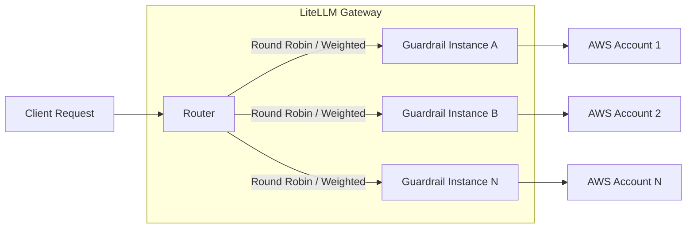
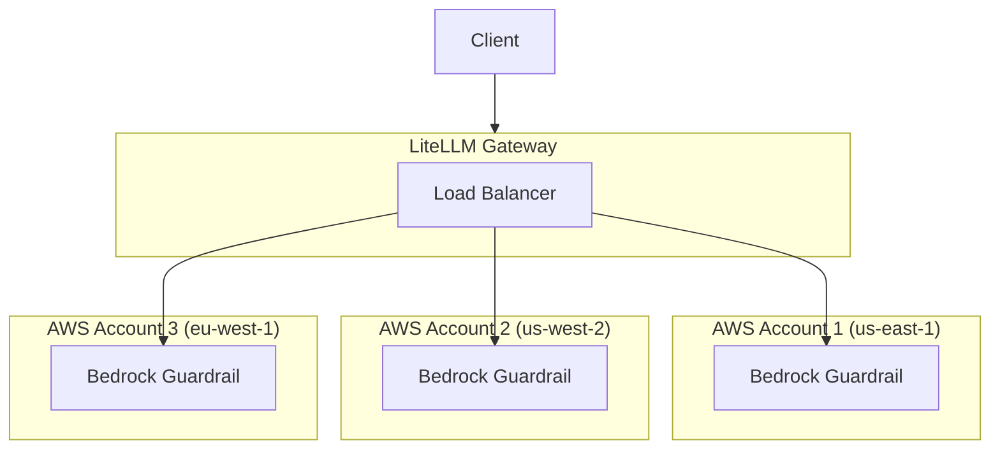

import Tabs from '@theme/Tabs';
import TabItem from '@theme/TabItem';

# 防护栏负载均衡

把防护栏（guardrail）请求负载均衡（load balancing）到多份防护栏部署（deployment）上。当防护栏提供商（例如 AWS Bedrock Guardrails）设有速率限制（rate limit），而你想把请求分散到多个账号或区域时，这个能力尤其有用。

## 工作原理



当你用**相同的 `guardrail_name`** 定义多个防护栏时，LiteLLM 会自动按路由器（Router）的负载均衡策略在它们之间分发请求。

## 为什么使用防护栏负载均衡？

| 使用场景 | 优势 |
|----------|---------|
| **AWS Bedrock 速率限制** | Bedrock Guardrails 按账号设有速率限制。分散到多个 AWS 账号可以提升吞吐量 |
| **多区域冗余** | 把防护栏部署到多个区域，实现故障转移（failover）并降低延迟 |
| **成本优化** | 把用量分散到定价档位不同或持有赠金的账号上 |
| **A/B 测试** | 用加权分发来测试不同的防护栏配置 |

## 快速上手

### 1. 用相同名称定义多个防护栏

定义多个防护栏条目，让它们使用**相同的 `guardrail_name`**，但配置各不相同：

<Tabs>
<TabItem value="bedrock" label="Bedrock 防护栏">

```yaml showLineNumbers title="config.yaml"
model_list:
  - model_name: {{openai_large}}
    litellm_params:
      model: openai/{{openai_large}}
      api_key: os.environ/OPENAI_API_KEY

guardrails:
  # First Bedrock guardrail - AWS Account 1
  - guardrail_name: "content-filter"
    litellm_params:
      guardrail: bedrock/guardrail
      mode: "pre_call"
      guardrailIdentifier: "abc123"
      guardrailVersion: "1"
      aws_access_key_id: os.environ/AWS_ACCESS_KEY_ID_1
      aws_secret_access_key: os.environ/AWS_SECRET_ACCESS_KEY_1
      aws_region_name: "us-east-1"
  
  # Second Bedrock guardrail - AWS Account 2
  - guardrail_name: "content-filter"
    litellm_params:
      guardrail: bedrock/guardrail
      mode: "pre_call"
      guardrailIdentifier: "def456"
      guardrailVersion: "1"
      aws_access_key_id: os.environ/AWS_ACCESS_KEY_ID_2
      aws_secret_access_key: os.environ/AWS_SECRET_ACCESS_KEY_2
      aws_region_name: "us-west-2"
```

</TabItem>

<TabItem value="custom" label="自定义防护栏">

```yaml showLineNumbers title="config.yaml"
model_list:
  - model_name: {{openai_large}}
    litellm_params:
      model: openai/{{openai_large}}
      api_key: os.environ/OPENAI_API_KEY

guardrails:
  # First custom guardrail instance
  - guardrail_name: "pii-filter"
    litellm_params:
      guardrail: custom_guardrail.PIIFilterA
      mode: "pre_call"
  
  # Second custom guardrail instance
  - guardrail_name: "pii-filter"
    litellm_params:
      guardrail: custom_guardrail.PIIFilterB
      mode: "pre_call"
```

</TabItem>

<TabItem value="aporia" label="Aporia 防护栏">

```yaml showLineNumbers title="config.yaml"
model_list:
  - model_name: {{openai_large}}
    litellm_params:
      model: openai/{{openai_large}}
      api_key: os.environ/OPENAI_API_KEY

guardrails:
  # First Aporia instance
  - guardrail_name: "toxicity-filter"
    litellm_params:
      guardrail: aporia
      mode: "pre_call"
      api_key: os.environ/APORIA_API_KEY_1
      api_base: os.environ/APORIA_API_BASE_1
  
  # Second Aporia instance
  - guardrail_name: "toxicity-filter"
    litellm_params:
      guardrail: aporia
      mode: "pre_call"
      api_key: os.environ/APORIA_API_KEY_2
      api_base: os.environ/APORIA_API_BASE_2
```

</TabItem>
</Tabs>

### 2. 启动 LiteLLM 网关

```bash showLineNumbers title="Start proxy"
litellm --config config.yaml --detailed_debug
```

### 3. 发起请求

使用该防护栏的请求会被自动负载均衡：

```bash showLineNumbers title="Test request"
curl -X POST http://localhost:4000/v1/chat/completions \
  -H "Content-Type: application/json" \
  -H "Authorization: Bearer $LITELLM_API_KEY" \
  -d '{
    "model": "{{openai_large}}",
    "messages": [{"role": "user", "content": "Hello, how are you?"}],
    "guardrails": ["content-filter"]
  }'
```

## 加权负载均衡

给各实例设置权重（weight），把流量按需不均匀地分配到各个防护栏实例：

```yaml showLineNumbers title="config.yaml - Weighted distribution"
guardrails:
  # 80% of traffic
  - guardrail_name: "content-filter"
    litellm_params:
      guardrail: bedrock/guardrail
      mode: "pre_call"
      guardrailIdentifier: "primary-guard"
      guardrailVersion: "1"
      weight: 8  # Higher weight = more traffic
  
  # 20% of traffic
  - guardrail_name: "content-filter"
    litellm_params:
      guardrail: bedrock/guardrail
      mode: "pre_call"
      guardrailIdentifier: "secondary-guard"
      guardrailVersion: "1"
      weight: 2  # Lower weight = less traffic
```

## Bedrock 防护栏的多账号设置

AWS Bedrock Guardrails 的速率限制按账号计。下面演示如何在多个 AWS 账号之间搭建负载均衡：

### 架构



### 配置

```yaml showLineNumbers title="config.yaml - Multi-account Bedrock"
model_list:
  - model_name: {{anthropic}}
    litellm_params:
      model: bedrock/us.anthropic.{{anthropic}}

guardrails:
  # AWS Account 1 - US East
  - guardrail_name: "bedrock-content-filter"
    litellm_params:
      guardrail: bedrock/guardrail
      mode: "during_call"
      guardrailIdentifier: "guard-us-east"
      guardrailVersion: "DRAFT"
      aws_access_key_id: os.environ/AWS_ACCESS_KEY_1
      aws_secret_access_key: os.environ/AWS_SECRET_KEY_1
      aws_region_name: "us-east-1"
  
  # AWS Account 2 - US West
  - guardrail_name: "bedrock-content-filter"
    litellm_params:
      guardrail: bedrock/guardrail
      mode: "during_call"
      guardrailIdentifier: "guard-us-west"
      guardrailVersion: "DRAFT"
      aws_access_key_id: os.environ/AWS_ACCESS_KEY_2
      aws_secret_access_key: os.environ/AWS_SECRET_KEY_2
      aws_region_name: "us-west-2"
  
  # AWS Account 3 - EU West
  - guardrail_name: "bedrock-content-filter"
    litellm_params:
      guardrail: bedrock/guardrail
      mode: "during_call"
      guardrailIdentifier: "guard-eu-west"
      guardrailVersion: "DRAFT"
      aws_access_key_id: os.environ/AWS_ACCESS_KEY_3
      aws_secret_access_key: os.environ/AWS_SECRET_KEY_3
      aws_region_name: "eu-west-1"
```

### 测试多账号设置

```bash showLineNumbers title="Run multiple requests to verify load balancing"
# Run 10 requests - they will be distributed across accounts
for i in {1..10}; do
  curl -s -X POST http://localhost:4000/v1/chat/completions \
    -H "Content-Type: application/json" \
    -H "Authorization: Bearer $LITELLM_API_KEY" \
    -d '{
      "model": "{{anthropic}}",
      "messages": [{"role": "user", "content": "Hello"}],
      "guardrails": ["bedrock-content-filter"]
    }' &
done
wait
```

查看代理日志，确认请求已分散到不同的 AWS 账号。

## 自定义防护栏示例

创建两个自定义防护栏类，用于负载均衡：

```python showLineNumbers title="custom_guardrail.py"
from litellm.integrations.custom_guardrail import CustomGuardrail
from litellm.proxy._types import UserAPIKeyAuth
from litellm.caching.caching import DualCache


class PIIFilterA(CustomGuardrail):
    """PII Filter Instance A"""
    
    async def async_pre_call_hook(
        self,
        user_api_key_dict: UserAPIKeyAuth,
        cache: DualCache,
        data: dict,
        call_type: str,
    ):
        print("PIIFilterA processing request")
        # Your PII filtering logic here
        return data


class PIIFilterB(CustomGuardrail):
    """PII Filter Instance B"""
    
    async def async_pre_call_hook(
        self,
        user_api_key_dict: UserAPIKeyAuth,
        cache: DualCache,
        data: dict,
        call_type: str,
    ):
        print("PIIFilterB processing request")
        # Your PII filtering logic here
        return data
```

```yaml showLineNumbers title="config.yaml"
guardrails:
  - guardrail_name: "pii-filter"
    litellm_params:
      guardrail: custom_guardrail.PIIFilterA
      mode: "pre_call"
  
  - guardrail_name: "pii-filter"
    litellm_params:
      guardrail: custom_guardrail.PIIFilterB
      mode: "pre_call"
```

## 验证负载均衡

开启详细的调试日志，确认负载均衡确实生效：

```bash showLineNumbers title="Start with debug logging"
litellm --config config.yaml --detailed_debug
```

日志里应该能看到当前选中的是哪个防护栏实例：

```
Selected guardrail deployment: bedrock/guardrail (guard-us-east)
Selected guardrail deployment: bedrock/guardrail (guard-us-west)
Selected guardrail deployment: bedrock/guardrail (guard-eu-west)
...
```

## 相关阅读

- [防护栏快速上手](./quick_start.md)
- [Bedrock 防护栏](./bedrock.md)
- [自定义防护栏](./custom_guardrail.md)
- [LLM 调用的负载均衡](../load_balancing.md)
