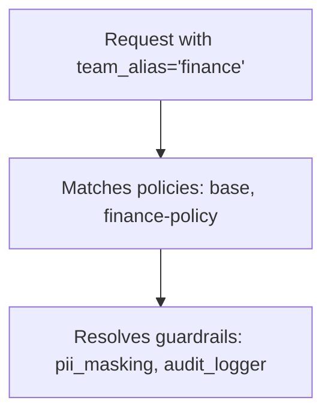

import Image from '@theme/IdealImage';
import Tabs from '@theme/Tabs';
import TabItem from '@theme/TabItem';

# [Beta] 防护栏策略

通过策略（policy）可以把多个防护栏（guardrails）编成一组，并控制其中哪些在特定团队、密钥或模型上运行。

## 为什么使用策略？

- 为团队、密钥或模型启用/禁用指定防护栏
- 把多个防护栏组合成一条策略
- 从现有策略继承，只覆写需要调整的部分

## 快速上手

<Tabs>
<TabItem value="config" label="config.yaml">

```yaml showLineNumbers title="config.yaml"
model_list:
  - model_name: {{openai_large}}
    litellm_params:
      model: openai/{{openai_large}}

# 1. Define your guardrails
guardrails:
  - guardrail_name: pii_masking
    litellm_params:
      guardrail: presidio
      mode: pre_call

  - guardrail_name: prompt_injection
    litellm_params:
      guardrail: lakera
      mode: pre_call
      api_key: os.environ/LAKERA_API_KEY

# 2. Create a policy
policies:
  my-policy:
    guardrails:
      add:
        - pii_masking
        - prompt_injection

# 3. Attach the policy
policy_attachments:
  - policy: my-policy
    scope: "*"  # apply to all requests
```

</TabItem>
<TabItem value="ui" label="UI（LiteLLM 仪表板）">

**第 1 步：创建策略**

进入 **Policies** 标签页，点击 **+ Create New Policy**（新建策略），填写策略名称和描述，并选择要添加的防护栏。


</TabItem>
</Tabs>

响应头会显示实际执行的内容：

```
x-litellm-applied-policies: my-policy
x-litellm-applied-guardrails: pii_masking,prompt_injection
```

## 为特定团队添加防护栏

<EnterpriseFeature feature="基于团队/密钥的策略挂载" />

你已有全局基线策略，但想为某个特定团队追加额外防护栏。

<Tabs>
<TabItem value="config" label="config.yaml">

```yaml showLineNumbers title="config.yaml"
policies:
  global-baseline:
    guardrails:
      add:
        - pii_masking

  finance-team-policy:
    inherit: global-baseline
    guardrails:
      add:
        - strict_compliance_check
        - audit_logger

policy_attachments:
  - policy: global-baseline
    scope: "*"

  - policy: finance-team-policy
    teams:
      - finance  # team alias from /team/new
```

</TabItem>
<TabItem value="ui" label="UI（LiteLLM 仪表板）">

**方式一：创建团队范围的挂载**

进入 **Policies** > **Attachments** 标签页，点击 **+ Create New Attachment**（新建挂载），选择策略以及要限定的团队。


**方式二：从团队设置中挂载**

进入 **Teams**，点击某个团队，切换到 **Settings** 标签页，在 **Policies** 下勾选要挂载的策略。


<Image img={require('../../../img/policy_team_attach.png')} />

</TabItem>
</Tabs>

现在 `finance` 团队会命中 `pii_masking` + `strict_compliance_check` + `audit_logger`，而其他团队仍然只有 `pii_masking`。

## 为特定团队移除防护栏

<EnterpriseFeature feature="基于团队/密钥的策略挂载" />

防护栏已在全局运行，但想对某个特定团队（例如内部测试团队）禁用其中一部分。

```yaml showLineNumbers title="config.yaml"
policies:
  global-baseline:
    guardrails:
      add:
        - pii_masking
        - prompt_injection

  internal-team-policy:
    inherit: global-baseline
    guardrails:
      remove:
        - pii_masking  # don't need PII masking for internal testing

policy_attachments:
  - policy: global-baseline
    scope: "*"

  - policy: internal-team-policy
    teams:
      - internal-testing  # team alias from /team/new
```

现在 `internal-testing` 团队只命中 `prompt_injection`，其他团队则两条防护栏都生效。

## 继承

从一条基础策略出发，在其上叠加：

```yaml showLineNumbers title="config.yaml"
policies:
  base:
    guardrails:
      add:
        - pii_masking
        - toxicity_filter

  strict:
    inherit: base
    guardrails:
      add:
        - prompt_injection

  relaxed:
    inherit: base
    guardrails:
      remove:
        - toxicity_filter
```

最终效果：
- `base` → `[pii_masking, toxicity_filter]`
- `strict` → `[pii_masking, toxicity_filter, prompt_injection]`
- `relaxed` → `[pii_masking]`

## 模型条件

只对特定模型运行防护栏：

```yaml showLineNumbers title="config.yaml"
policies:
  gpt-safety:
    guardrails:
      add:
        - strict_content_filter
    condition:
      model: "gpt-5.6.*"  # regex - matches {{openai_small}}, {{openai_large}}

  bedrock-compliance:
    guardrails:
      add:
        - audit_logger
    condition:
      model:  # exact match list
        - bedrock/anthropic.{{anthropic}}
        - bedrock/anthropic.{{anthropic_large}}
```

## 挂载

策略只有挂载后才会生效。挂载（attachment）告诉 LiteLLM 每条策略应该应用在*哪些范围*。

**全局**——对每个请求生效：

```yaml showLineNumbers title="config.yaml"
policy_attachments:
  - policy: default
    scope: "*"
```

**指定团队**（使用 `/team/new` 创建的团队别名）：

```yaml showLineNumbers title="config.yaml"
policy_attachments:
  - policy: hipaa-compliance
    teams:
      - healthcare-team  # team alias
      - medical-research  # team alias
```

**指定密钥**（使用 `/key/generate` 创建的密钥别名，支持通配符）：

```yaml showLineNumbers title="config.yaml"
policy_attachments:
  - policy: internal-testing
    keys:
      - "dev-*"  # key alias pattern
      - "test-*"  # key alias pattern
```

**基于标签**（按元数据标签匹配密钥/团队，支持通配符）：

```yaml showLineNumbers title="config.yaml"
policy_attachments:
  - policy: hipaa-compliance
    tags:
      - "healthcare"
      - "health-*"  # wildcard - matches health-team, health-dev, etc.
```

标签读取自密钥和团队的 `metadata.tags`。例如，用 `metadata: {"tags": ["healthcare"]}` 创建的密钥就能匹配上面的挂载。

## 测试策略匹配

排查某个给定上下文会命中哪些策略与防护栏。部署前可以用它验证策略配置。

<Tabs>
<TabItem value="ui" label="UI（LiteLLM 仪表板）">

进入 **Policies** > **Test** 标签页，输入团队别名、密钥别名、模型或标签，点击 **Test**，即可看到哪些策略命中、会应用哪些防护栏。

<Image img={require('../../../img/policy_test_matching.png')} />

</TabItem>
<TabItem value="api" label="API">

```bash
curl -X POST "http://localhost:4000/policies/resolve" \
    -H "Authorization: Bearer <your_api_key>" \
    -H "Content-Type: application/json" \
    -d '{
        "tags": ["healthcare"],
        "model": "{{openai_large}}"
    }'
```

响应：

```json
{
    "effective_guardrails": ["pii_masking"],
    "matched_policies": [
        {
            "policy_name": "hipaa-compliance",
            "matched_via": "tag:healthcare",
            "guardrails_added": ["pii_masking"]
        }
    ]
}
```

</TabItem>
</Tabs>

## 策略执行顺序

当多条策略命中同一个请求时，LiteLLM 会按挂载范围从宽到窄的顺序执行它们：先 `scope: "*"`，再 `teams`，然后 `keys`、`tags`、`models`。同时组合了多种约束的挂载，按其中最窄的一项排序，并排在同层级单约束挂载之后（`models: [gpt-4o]` 排在 `teams: [finance], models: [gpt-4o]` 之前）。仍然并列的挂载保持其在 `config.yaml` 中的书写顺序；通过 API 或界面创建的挂载排在其后，新的在前。通过请求体传入的策略（`"policies": [...]`）在所有挂载命中之后按给定顺序执行。跨层级来看，执行顺序与挂载在 `config.yaml` 中的罗列方式以及由哪个 proxy worker 处理请求无关。

这就是流水线实际的执行顺序，因此全局拦截策略一定会在模型级策略运行之前就拒绝请求。`x-litellm-applied-policies` 响应头，以及 `/policies/resolve` 和策略模拟器（Policy Simulator）返回的 `matched_policies`，也遵循同样的顺序。当同一策略在多个命中的范围上都有挂载时，它只会执行一次，按排序最靠前的那个挂载计，`matched_via` 报告的也是该挂载（两者都没有 `priority` 时报告 `scope:*` 而非 `model:gpt-4o`）。

要覆盖层级顺序，可以在挂载上设置一个可选的整数字段 `priority`。带 `priority` 的挂载排在所有不带 `priority` 的挂载之前，数值越小越先执行；两个值相同时，回退到上述层级顺序。不带 `priority` 的挂载行为与之前完全一致，现有配置不受影响。下面的例子里，尽管 `tags` 是更宽的层级，`model-policy` 仍会先于 `tag-policy` 执行：

```yaml showLineNumbers title="config.yaml"
policy_attachments:
  - policy: model-policy
    models: [gpt-4o]
    priority: 1
  - policy: tag-policy
    tags: [production]
    priority: 2
```

`POST /policies/attachments` 接受同样的字段，`GET /policies/attachments/list` 会返回它；在管理界面（Admin UI）的 Attachments 标签页中，它体现为一个可排序的 Priority 列和一个可选的 Priority 输入框。取值必须是 32 位有符号整数（-2147483648 到 2147483647）。

```yaml showLineNumbers title="config.yaml"
policy_attachments:
  - policy: model-policy
    models: [gpt-4o]
  - policy: team-policy
    teams: [finance]
  - policy: global-policy
    scope: "*"
```

来自 `finance` 密钥的 `gpt-4o` 请求会依次执行 `global-policy`、`team-policy`、`model-policy`，并返回 `x-litellm-applied-policies: global-policy,team-policy,model-policy`。

## 默认（回退）挂载

挂载命中是叠加式的：只要范围命中请求，每个挂载都会贡献自己的策略。如果想让某条策略只对显式选择的请求生效、其余请求走另一条策略，就用 `default: true` 标记回退挂载。只要有任意非默认挂载命中请求、且其策略适用（策略存在，且 `condition` 若有设置需与请求模型匹配），默认挂载就会被跳过。当没有非默认挂载命中时，范围同样命中的所有默认挂载都会生效，顺序沿用常规执行顺序。

```yaml showLineNumbers title="config.yaml"
policy_attachments:
  - policy: strict-guardrail
    tags: [strict-opt-in]
  - policy: standard-guardrail
    scope: "*"
    default: true
```

携带 `strict-opt-in` 标签的请求只执行 `strict-guardrail`；不携带的请求只执行 `standard-guardrail`，且其在 `/policies/resolve` 和策略模拟器中的 `matched_via` 会带 `default:` 前缀（例如 `default:scope:*`）。默认挂载同样遵循 `teams`、`keys`、`models` 和 `tags`，因此 `teams: [finance], default: true` 只对没有命中其他任何挂载的 finance 请求生效。不带 `default` 的挂载行为与之前完全一致。

`POST /policies/attachments` 接受同样的字段，`GET /policies/attachments/list` 会返回它；管理界面的新建挂载表单里是一个 Default 开关，Attachments 标签页里则多出一列 Default。

## 策略流编排器（Policy Flow Builder）

若需要条件执行（例如只有第一个防护栏失败时才运行第二个），可以使用 [策略流编排器（Policy Flow Builder）](./policy_flow_builder) 来定义流水线，为每一步设置 **pass**、**fail** 和可选的 **error** 动作（`on_pass`、`on_fail`、`on_error`）。

## 配置参考

### `policies`

```yaml
policies:
  <policy-name>:
    description: ...
    inherit: ...
    guardrails:
      add: [...]
      remove: [...]
    condition:
      model: ...
    pipeline: ...  # optional; see Policy Flow Builder
```

| 字段 | 类型 | 说明 |
|-------|------|-------------|
| `description` | `string` | 可选。说明这条策略的用途。 |
| `inherit` | `string` | 可选。要从中继承防护栏的父策略。 |
| `guardrails.add` | `list[string]` | 要启用的防护栏。 |
| `guardrails.remove` | `list[string]` | 要禁用的防护栏（配合继承使用）。 |
| `condition.model` | `string` or `list[string]` | 可选。仅当模型匹配时生效，支持正则。 |
| `pipeline` | `object` | 可选。按顺序执行防护栏，每步可配置动作（`on_pass`、`on_fail`，可选 `on_error`）。参见 [策略流编排器（Policy Flow Builder）](./policy_flow_builder)。 |

### `policy_attachments`

```yaml
policy_attachments:
  - policy: ...
    scope: ...
    teams: [...]
    keys: [...]
    models: [...]
    tags: [...]
    priority: ...
    default: ...
```

| 字段 | 类型 | 说明 |
|-------|------|-------------|
| `policy` | `string` | **必填**。要挂载的策略名称。 |
| `scope` | `string` | 设为 `"*"` 表示全局生效。 |
| `teams` | `list[string]` | 团队别名（来自 `/team/new`），支持 `*` 通配符。 |
| `keys` | `list[string]` | 密钥别名（来自 `/key/generate`），支持 `*` 通配符。 |
| `models` | `list[string]` | 模型名称，支持 `*` 通配符。 |
| `tags` | `list[string]` | 标签模式（来自密钥/团队的 `metadata.tags`），支持 `*` 通配符。 |
| `priority` | `integer` | 可选。数值越小越先执行；带 priority 的挂载先于不带 priority 的挂载，数值相同时回退到层级顺序。 |
| `default` | `boolean` | 可选，默认为 `false`。仅当没有非默认挂载命中请求时才应用此挂载。 |

### 响应头

| 响应头 | 说明 |
|--------|-------------|
| `x-litellm-applied-policies` | 命中该请求的策略 |
| `x-litellm-applied-guardrails` | 实际执行的防护栏 |
| `x-litellm-policy-sources` | 每条策略的命中原因（例如 `hipaa=tag:healthcare; baseline=scope:*`） |

## 工作原理

配置示例：

```yaml showLineNumbers title="config.yaml"
policies:
  base:
    guardrails:
      add: [pii_masking]

  finance-policy:
    inherit: base
    guardrails:
      add: [audit_logger]

policy_attachments:
  - policy: base
    scope: "*"
  - policy: finance-policy
    teams: [finance]
```



1. 请求进入，携带 `team_alias='finance'`
2. 命中 `base`（通过 `scope: "*"`）和 `finance-policy`（通过 `teams: [finance]`）
3. 解析防护栏：`base` 添加 `pii_masking`，`finance-policy` 继承后再添加 `audit_logger`
4. 最终防护栏：`pii_masking`、`audit_logger`
