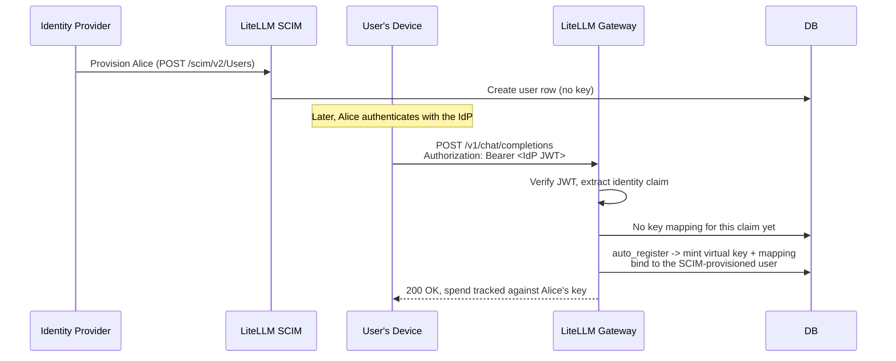

# 预配身份与签发密钥

SSO 部署中经常有人问：由你的身份提供商（IdP）经 SCIM 预配（provisioning）出来的用户，是否会自动获得一个虚拟密钥（virtual key）和一份存在自己笔记本上的凭据，随时可以调用网关。LiteLLM 具备实现这一目标所需的全部能力，但它们是各自独立的功能，需要你自行组合，而不是一条开箱即用的流水线。本页是一份手把手指南，带你从零搭建出一套可用的环境：经 SCIM 预配的用户从自己的设备完成认证，并拿到属于自己的虚拟密钥。每一步之后都有一个检查点，方便你确认进度。

如果你只需要查某一个功能的参考细节，对应的专业页面讲得更深：[SCIM 预配](../tutorials/scim_litellm.md)、[OIDC JWT 认证](./token_auth.md)、[JWT 映射到虚拟密钥](./jwt_key_mapping.md) 和 [CLI 认证](./cli_sso.md)。

---

## 搭建目标

端到端流程由四层能力组合而成，每一层都是一个职责单一的独立功能：

| 层 | 功能 | 产出 | 企业版？ |
|---|---|---|---|
| 身份预配 | SCIM | 从你的 IdP 同步而来的 `LiteLLM_UserTable` 行和团队 | Yes |
| 请求认证 | JWT 认证 | 借助 IdP 令牌为每个请求验证出的调用方身份 | Yes |
| 授权与花费 | 虚拟密钥 | 模型访问权限、预算、速率限制、花费追踪（spend tracking） | No |
| 设备端凭据与智能体启动 | CLI 登录与包装命令（`lite login`、`lite claude` / `lite codex`） | 存储好的会话令牌，以及由包装命令替你设好代理环境变量后启动的编码智能体 | No |

这些功能彼此之间不会自动衔接。SCIM 创建了用户并不会铸造密钥；JWT 认证验证了令牌本身也不会创建密钥；两者都不会往用户设备上放任何东西。要得到端到端的效果，需要开启恰当的功能组合，并让它们对齐同一个身份 claim，下面各步骤做的正是这件事。

配置完成后的目标流程如下：



---

## 前提条件

你需要：一个有数据库支撑的 LiteLLM 代理（SCIM 和 `auto_register` 都要写入数据库）、一个企业版许可证（SCIM 和 JWT 认证都是企业版功能）、你的代理 `master_key`，以及一个身份提供商：支持用 OIDC 签发 JWT、用 SCIM 2.0 做预配（如 Okta、Entra ID、OneLogin、Keycloak、Auth0、Google Workspace）。

---

## 第 1 步：开启 JWT 认证

把网关指向 IdP 的签名密钥，并告诉它哪些 claim 承载着用户、邮箱和团队信息。将 `JWT_PUBLIC_KEY_URL` 设为 IdP 的 JWKS 或 OIDC 发现 URL，再视需要设置 `JWT_AUDIENCE` 和 `JWT_ISSUER`，用来限定接受哪些令牌：

```bash
export JWT_PUBLIC_KEY_URL="https://your-idp.example.com/.well-known/openid-configuration"
export JWT_AUDIENCE="litellm-proxy"     # 可选，但建议设置
export JWT_ISSUER="https://your-idp.example.com"  # 可选，但建议设置
```

```yaml title="config.yaml"
general_settings:
  master_key: os.environ/LITELLM_MASTER_KEY
  enable_jwt_auth: True
  litellm_jwtauth:
    user_id_jwt_field: "sub"        # 来自 IdP 的稳定用户 ID
    user_email_jwt_field: "email"
    team_ids_jwt_field: "groups"    # 承载用户所属组/团队 ID 的 claim
```

**检查点**。重启代理，带上有效的 IdP JWT 作为 bearer 令牌发送一个请求。请求应能通过认证，并把调用方解析到某个团队。如果收到 401，说明签名、audience 或 issuer 校验未通过；故障排查见 [OIDC JWT 认证](./token_auth.md)。

---

## 第 2 步：用 SCIM 预配用户与团队

先创建供 IdP 使用的 SCIM 令牌，然后接入预配。在管理界面（Admin UI）中依次进入 Settings > Admin Settings > SCIM，创建一个 SCIM 令牌；它本质上是一把普通的虚拟密钥，只是可用路由被锁定在 `/scim/*`。复制租户 URL（`https://<your-proxy>/scim/v2`）和该令牌。在 IdP 中 LiteLLM 应用的预配配置里，粘贴这个 URL 和令牌，再勾选要同步的用户和组。带截图的完整操作指引见 [SCIM 页面](../tutorials/scim_litellm.md)。

**检查点**。完成分配后，确认用户和团队已经同步到位：

```bash
curl 'https://<your-proxy>/scim/v2/Users' \
  -H 'Authorization: Bearer <SCIM_TOKEN>'
```

你应该能看到已预配的用户，分配的组也会以团队的形式出现在管理界面里。注意这些用户此刻还没有虚拟密钥；SCIM 以 `auto_create_key=False` 创建身份，从不铸造密钥。这件事由第 3 步接手。

---

## 第 3 步：开启虚拟密钥自动注册

在 `litellm_jwtauth` 中增加两项配置：用于标识每个客户端的 claim，以及客户端尚无密钥时的处理方式。

```yaml title="config.yaml"
general_settings:
  master_key: os.environ/LITELLM_MASTER_KEY
  enable_jwt_auth: True
  litellm_jwtauth:
    user_id_jwt_field: "sub"
    user_email_jwt_field: "email"
    team_ids_jwt_field: "groups"
    virtual_key_claim_field: "email"                    # 按客户端查找密钥
    unregistered_jwt_client_behavior: "auto_register"   # 首个请求时铸造密钥
```

`unregistered_jwt_client_behavior` 可取 `fallback_team_mapping`（默认值，落到团队认证）、`reject`（无映射时返回 403）或 `auto_register`。设为 `auto_register` 时，携带新 claim 值的第一个请求会当场铸造一把虚拟密钥和对应的 claim 到密钥映射，不需要任何管理员调用。密钥只有在令牌通过全部策略校验（签名、RBAC 与 scope、`custom_validate`、`user_allowed_email_domain`）之后才会创建；它继承由 JWT 解析出的团队、用户和组织；解析为代理管理员的令牌不会走这条路径；此外它必须有数据库支撑。每客户端预算和手工映射见 [JWT 映射到虚拟密钥](./jwt_key_mapping.md)。

**检查点**。重启代理。此时还不会创建任何东西，因为触发条件是第一个请求，而不是这次配置变更。验证留到第 5 步进行。

---

## 第 4 步：将编码智能体接入网关

开发者的工具需要把代理配置为 base URL，并提供一份凭据作为 bearer 令牌。与其让每个开发者手动 export，不如交给 `lite` CLI 自动接线。从下面两种方式里挑适合你的。

**推荐做法：用 `lite` CLI 启动智能体**。该 CLI 自带包装命令 `lite claude`、`lite codex` 和 `lite opencode`：开发者还没有凭据时先走 SSO 登录，再向代理校验密钥，设置好智能体会读取的环境变量，然后交棒给智能体。开发者什么都不用 export。

```bash
export LITELLM_PROXY_URL=https://your-litellm-proxy:4000
lite claude          # 或者：lite codex / lite opencode
```

首次运行会触发 `lite login`（浏览器 SSO 登录），在开发者操作系统的钥匙串里存一个短时效的会话令牌，然后启动智能体。包装命令会按智能体设置正确的变量：Claude Code 拿到 `ANTHROPIC_BASE_URL`（代理根地址）和 `ANTHROPIC_AUTH_TOKEN`，并清掉可能残留的 `ANTHROPIC_API_KEY`，确保代理令牌生效；Codex 和 OpenCode 拿到 `OPENAI_BASE_URL`（代理地址加 `/v1`）和 `OPENAI_API_KEY`，其中 Codex 还会被额外指向一个自定义 provider 配置，因为它会忽略 `OPENAI_BASE_URL`。智能体自身的参数可以直接透传给包装命令，例如 `lite claude --model my-proxy-model`，且它请求的模型必须存在于代理上。这条路径用的是 `lite login` 的会话令牌，绑定的是经 SSO（并经 SCIM 预配）的用户，因此不会走第 3 步的 `auto_register` 路径；凭据由登录流程签发，花费依然记在该用户名下。想用长期有效的虚拟密钥替代 SSO 会话令牌的话，传 `--api-key` 或设置 `LITELLM_PROXY_API_KEY`。部署前置条件见 [CLI 认证](./cli_sso.md)。

**已自带 IdP JWT 的客户端**。服务，或已接入你的 IdP 的智能体，把 IdP 签发的 JWT 作为 bearer 令牌直接发给代理；LiteLLM 不会存储它。这正是会触发第 3 步 `auto_register` 的路径：第一个请求到达时铸造按用户隔离的虚拟密钥。对 Anthropic 风格的客户端，把地址指向代理根路径，并把 JWT 作为认证令牌传入：

```bash
export ANTHROPIC_BASE_URL="https://your-litellm-proxy:4000"
export ANTHROPIC_AUTH_TOKEN="<user-sso-jwt-token>"
```

有两个容易踩坑的细节要说清楚。其一，`lite login` 的凭据存放在操作系统钥匙串（macOS Keychain、Windows 凭据管理器或 Linux Secret Service）中，服务名为 `litellm-cli`；`~/.litellm/token.json` 只保存非机密的元数据：网关 URL、用户的 id、邮箱和角色、认证头名称以及登录时间戳。访问钥匙串需要 `keyring` 包，它随 `cli` extra 一起安装，因此请以 `litellm[cli]` 的方式安装 CLI。在没有钥匙串可用的环境（比如无界面的 Linux 服务器），或者你设置了 `LITELLM_CLI_DISABLE_KEYRING` 关闭钥匙串存储时，凭据会退回到同一个 `0600` 文件里，`lite login` 会说明实际用的是哪一种。目前仍没有 git 风格的 credential-helper 集成。其二，CLI 存储的会话令牌是 LiteLLM 签发的、作用域限于该网关的令牌，既不是原始 IdP JWT，也不是会出现在 Keys 管理界面里的持久化虚拟密钥。

---

## 第 5 步：触发并验证自动注册

这一步验证的是第 4 步第二种方式的 `auto_register` 路径，即客户端直接发送 IdP JWT。如果你的开发者是通过 `lite claude` / `lite codex` 上手的，则没有映射可查；智能体能启动、用户花费出现在仪表板（dashboard）里，即为成功。对于 IdP JWT 路径，用预配用户的 JWT，以该用户的身份发送第一个真实请求：

```bash
JWT_TOKEN="eyJhbG..."   # 对应 SCIM 预配用户的有效 IdP 令牌

curl -X POST 'https://your-litellm-proxy:4000/v1/chat/completions' \
  -H "Authorization: Bearer $JWT_TOKEN" \
  -H 'Content-Type: application/json' \
  -d '{"model": "{{anthropic}}", "messages": [{"role": "user", "content": "Hello"}]}'
```

第一个请求会铸造该用户的虚拟密钥和 claim 到密钥的映射。两边都确认一下：

```bash
# 映射此时已存在，以 claim 值为键（这里是用户邮箱）
curl 'https://your-litellm-proxy:4000/jwt/key/mapping/list?page=1&size=50' \
  -H "Authorization: Bearer $LITELLM_API_KEY"
```

在管理界面里，自动注册的密钥出现在该用户名下，元数据中带有 `auto_registered: true`，花费、速率限制和模型访问从此按用户分别追踪。此后该用户的每个后续请求都复用同一把密钥。到这里，整个流程就能自转了；你只需在需要调整某个用户的预算或可用模型时介入，直接更新底层的密钥即可。

---

## 让密钥绑定到正确的用户

要把自动注册的密钥关联到正确的 SCIM 预配用户，需要在 SCIM 与 JWT claim 中配置一个一致的身份值。LiteLLM 将 SCIM 的 `userName` 存为 `user_id`，将 `emails[0].value` 存为 `user_email`。`externalId` 属性在 `PUT` 和 `PATCH` 请求时会存为 `sso_user_id`，初始 `POST` 时则不会；因此 `sso_user_id` 可能一直为空，直到该用户被更新过。详见[属性映射表](../tutorials/scim_litellm.md#user-attribute-mapping)。

把 `user_id_jwt_field` 配置为指向包含与 SCIM `userName` 相同值的 JWT claim。当 `emails[0].value` 与 `user_email_jwt_field` 配置的 JWT claim 匹配时，LiteLLM 也能按邮箱匹配到已有用户。将 `virtual_key_claim_field` 设为全局唯一的值（例如邮箱地址或稳定的 subject 标识符），避免多个用户共用同一条密钥映射。

---

## LiteLLM 做与不做的事

| 行为 | 是否支持 |
|---|---|
| SCIM 从你的 IdP 预配用户和团队 | Yes |
| SCIM 为预配用户自动创建虚拟密钥 | No（`auto_create_key=False`） |
| SCIM 取消预配时撤销该用户的密钥 | Yes |
| JWT 认证用 IdP 令牌完成请求认证 | Yes |
| JWT 认证自动注册每客户端虚拟密钥 | Yes，需 `virtual_key_claim_field` + `auto_register` |
| SCIM 预配事件直接触发密钥创建 | No（由第一个请求惰性触发） |
| `lite login` 把网关凭据存到设备上 | Yes（OS 钥匙串；没有钥匙串时存 `~/.litellm/token.json`，权限 `0600`） |
| `lite claude` / `lite codex` / `lite opencode` 替你设好智能体的环境变量 | Yes（按智能体接好 base URL 和 bearer 令牌） |
| 凭据存放在 OS 钥匙串中 | Yes（服务名 `litellm-cli`；无 git 风格 credential-helper 集成） |
| 设备上存的凭据就是原始 IdP JWT | No（它是 LiteLLM 签发的会话令牌） |

---

## 相关页面

- [SCIM 与 LiteLLM](../tutorials/scim_litellm.md)：从你的 IdP 预配用户和团队
- [OIDC JWT 认证](./token_auth.md)：JWT 认证的基础配置
- [JWT 映射到虚拟密钥](./jwt_key_mapping.md)：每客户端密钥、手工映射与 `auto_register`
- [CLI 认证](./cli_sso.md)：`lite login` 设备登录流程
- [虚拟密钥](./virtual_keys.md)：访问控制与花费的计量单元
