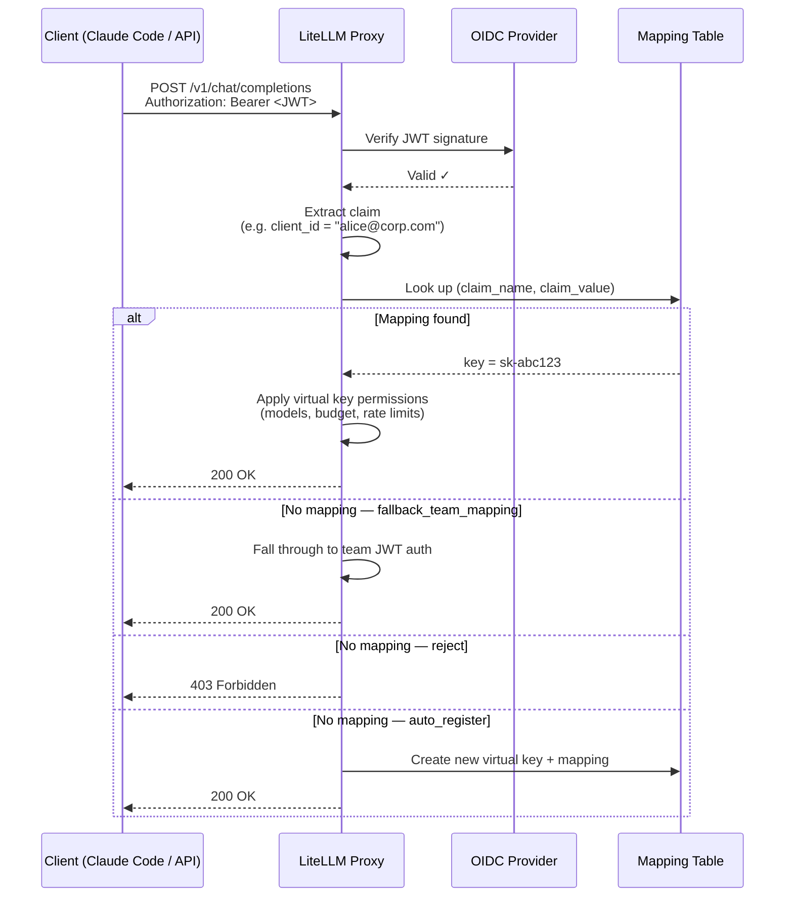

# JWT → 虚拟密钥映射

<EnterpriseFeature feature="JWT → 虚拟密钥映射" />

将 JWT 令牌映射到 LiteLLM 虚拟密钥（virtual key），让每个 JWT 客户端都能获得与虚拟密钥相同的细粒度管控：模型限制、花费上限、速率限制、防护栏（guardrails），以及完整的花费追踪（spend tracking）。

**为什么重要**：标准的 JWT 认证把 JWT 映射到一个*团队*（team）。团队是一条共享边界，同一团队下的所有客户端共用同一套限额。而有了 JWT → 虚拟密钥映射，每个 JWT 客户端（以 `client_id`、`azp` 或 `sub` 之类的声明（claim）标识）都会映射到属于自己的虚拟密钥。无需向用户发放 API 密钥（API key），即可实现按客户端问责。

**常见用例**：你们公司使用 SSO/OIDC 登录，开发者拿各自的身份令牌运行 Claude Code。你希望按开发者管控模型访问和花费上限，又不想给每个人发一枚 LiteLLM API 密钥。

---

## 工作原理



---

## 配置

### 前置条件

先完成 [OIDC JWT 认证配置](./token_auth.md)；你需要配置好 `JWT_PUBLIC_KEY_URL`，并在代理（proxy）配置中设置 `enable_jwt_auth: True`。

### 第 1 步：配置映射所依据的 JWT 声明

在 `litellm_jwtauth` 配置中添加 `virtual_key_claim_field`。它是 LiteLLM 用作查找键的 JWT 声明：

```yaml
general_settings:
  master_key: os.environ/LITELLM_MASTER_KEY
  enable_jwt_auth: True
  litellm_jwtauth:
    team_id_jwt_field: "team_id"          # 已有的团队映射（可选）
    user_id_jwt_field: "sub"
    virtual_key_claim_field: "client_id"  # 用作密钥映射查找键的声明
    unregistered_jwt_client_behavior: "fallback_team_mapping"  # 见下文
```

`virtual_key_claim_field` 此前名为 `jwt_client_id_field`；旧名作为向后兼容的别名仍然可用。

**`unregistered_jwt_client_behavior`** 控制 JWT 没有已注册映射时的行为：

| 取值 | 行为 |
|-------|----------|
| `fallback_team_mapping` | 回退到基于团队的 JWT 认证（默认值；向后兼容） |
| `reject` | 找不到映射时返回 403 |
| `auto_register` | 首次遇到时自动创建虚拟密钥和映射 |

使用 `auto_register` 时，携带新声明值的首个请求会即时创建虚拟密钥和映射，无需管理员调用。密钥只有在 JWT 通过全部策略校验（签名、RBAC/作用域、`custom_validate` 和 `user_allowed_email_domain`）之后才会创建；令牌只要有一项检查不通过，请求就会被拒绝，什么都不会创建。新密钥继承从已验证 JWT 解析出的团队、用户和组织，因此请确保这些声明已配置。解析为代理管理员的令牌不会自动注册，因为管理员本就拥有全部权限。`auto_register` 需要数据库连接。

### 第 2 步：注册 JWT 客户端到虚拟密钥的映射

**推荐方式：交给 `auto_register` 自动完成**。在第 1 步设置 `unregistered_jwt_client_behavior: "auto_register"`，每个新声明值的首个请求就会自动创建自己的密钥，无需管理员调用。适用于所有客户端都从同一套默认配置起步的场景。

**手动方式：注册带特定限额的密钥**。当某个客户端需要专属的预算或模型集合时，先创建虚拟密钥，再把声明值映射过去。没有单一的原子端点，需要分两次调用。

```bash
# 1. 按你想要的限额创建一枚虚拟密钥
curl -X POST 'http://0.0.0.0:4000/key/generate' \
  -H 'Authorization: Bearer <PROXY_MASTER_KEY>' \
  -H 'Content-Type: application/json' \
  -d '{
    "models": ["{{anthropic}}", "{{anthropic_large}}"],
    "max_budget": 50.0,
    "budget_duration": "30d",
    "rpm_limit": 100,
    "tpm_limit": 50000,
    "team_id": "engineering"
  }'
# -> {"key": "sk-abc123...", ...}

# 2. 把一个 JWT 声明值映射到这枚密钥
curl -X POST 'http://0.0.0.0:4000/jwt/key/mapping/new' \
  -H 'Authorization: Bearer <PROXY_MASTER_KEY>' \
  -H 'Content-Type: application/json' \
  -d '{
    "jwt_claim_name": "client_id",
    "jwt_claim_value": "dev-alice",
    "key": "sk-abc123...",
    "description": "dev-alice"
  }'
```

### 第 3 步：测试

```bash
# 从你的 OIDC 提供商获取一个 JWT（必须带有 client_id: dev-alice）
JWT_TOKEN="eyJhbG..."

curl -X POST 'http://0.0.0.0:4000/v1/chat/completions' \
  -H "Authorization: Bearer $JWT_TOKEN" \
  -H 'Content-Type: application/json' \
  -d '{
    "model": "{{anthropic}}",
    "messages": [{"role": "user", "content": "Hello"}]
  }'
```

此时该请求会记在 `dev-alice` 的虚拟密钥名下，花费、速率限制和模型访问都按客户端逐一执行。

---

## 实战演练：管理员授予细粒度权限，团队使用 Claude Code

下面是一个工程团队用公司 SSO 配合 Claude Code 的完整流程。

### 管理员配置

**1. 为工程部门创建一个团队**

```bash
curl -X POST 'http://0.0.0.0:4000/team/new' \
  -H 'Authorization: Bearer <MASTER_KEY>' \
  -H 'Content-Type: application/json' \
  -d '{
    "team_alias": "engineering",
    "models": ["{{anthropic}}", "{{anthropic_large}}"]
  }'
```

**2. 为每位开发者注册各自的密钥和花费上限**

每位开发者对应一枚虚拟密钥，外加一条从其 JWT 声明到该密钥的映射。先用 `/key/generate` 创建密钥，再用 `/jwt/key/mapping/new` 把声明值映射过去。

```bash
# Alice：资深工程师，预算更高
ALICE_KEY=$(curl -s -X POST 'http://0.0.0.0:4000/key/generate' \
  -H 'Authorization: Bearer <MASTER_KEY>' -H 'Content-Type: application/json' \
  -d '{"team_id": "engineering", "models": ["{{anthropic}}", "{{anthropic_large}}"], "max_budget": 200.0, "budget_duration": "30d", "rpm_limit": 200}' \
  | jq -r '.key')

curl -X POST 'http://0.0.0.0:4000/jwt/key/mapping/new' \
  -H 'Authorization: Bearer <MASTER_KEY>' -H 'Content-Type: application/json' \
  -d "{\"jwt_claim_name\": \"client_id\", \"jwt_claim_value\": \"alice@corp.com\", \"key\": \"$ALICE_KEY\", \"description\": \"alice@corp.com\"}"

# Bob：外包承包商，限额更紧
BOB_KEY=$(curl -s -X POST 'http://0.0.0.0:4000/key/generate' \
  -H 'Authorization: Bearer <MASTER_KEY>' -H 'Content-Type: application/json' \
  -d '{"team_id": "engineering", "models": ["{{anthropic}}"], "max_budget": 20.0, "budget_duration": "30d", "rpm_limit": 30}' \
  | jq -r '.key')

curl -X POST 'http://0.0.0.0:4000/jwt/key/mapping/new' \
  -H 'Authorization: Bearer <MASTER_KEY>' -H 'Content-Type: application/json' \
  -d "{\"jwt_claim_name\": \"client_id\", \"jwt_claim_value\": \"bob@contractor.com\", \"key\": \"$BOB_KEY\", \"description\": \"bob@contractor.com\"}"
```

如果团队里所有人都从同一套默认配置起步，可以跳过这些逐人调用，改为设置 `unregistered_jwt_client_behavior: "auto_register"`。

**3. 配置 Claude Code 使用代理**

在团队的 Claude Code 配置中把代理设为 API 基地址：

```bash
# 让 Claude Code 指向 LiteLLM 代理，而不是直连 Anthropic。
# 这里的 ANTHROPIC_API_KEY 是发送给代理的 Bearer 令牌，请把它设为
# 用户的 SSO/OIDC JWT 令牌（登录时从你的 IdP 获取）。
export ANTHROPIC_API_KEY="<user-sso-jwt-token>"
export ANTHROPIC_BASE_URL="http://your-litellm-proxy:4000"
```

或者写入 `~/.claude/settings.json`：

```json
{
  "env": {
    "ANTHROPIC_BASE_URL": "http://your-litellm-proxy:4000"
  }
}
```

**4. 开发者照常通过 SSO 认证**

Alice 运行 Claude Code 时，她的 JWT 由 IdP（身份提供商）签发、带有 `client_id: alice@corp.com`，会发送到代理。LiteLLM 查到映射后找到她的虚拟密钥，并执行她专属的限额：每月 $200 预算、200 RPM 上限，且只能访问 Sonnet 和 Opus。

Bob 的令牌映射到他自己的密钥：每月 $20、仅限 Sonnet、30 RPM。

不用分发任何 API 密钥，没有共享限额，每位开发者的花费在 LiteLLM 仪表板（dashboard）中一览无余。

---

## 管理映射

每条映射都有一个 `id`（创建时会返回）。`info`、`update` 和 `delete` 端点都以这个 `id` 为键，所以先用 `list` 把它查出来。

**列出映射**

```bash
curl 'http://0.0.0.0:4000/jwt/key/mapping/list?page=1&size=50' \
  -H 'Authorization: Bearer <MASTER_KEY>'
```

**按 id 查看单条映射**

```bash
curl 'http://0.0.0.0:4000/jwt/key/mapping/info?id=<mapping-id>' \
  -H 'Authorization: Bearer <MASTER_KEY>'
```

响应内容是映射自身的元数据：声明名与声明值、描述、`is_active`、时间戳，以及创建者和最后更新者。其中不包含关联的密钥及其配置，哈希后的密钥也永远不会返回。要查看密钥的模型、预算或花费，请使用 `/key/info`。

**更新映射**

`update` 修改的是映射本身：换绑到另一枚密钥、修改描述，或切换 `is_active`。要调整预算或模型访问，请用 `/key/update` 更新底层密钥；映射只存储声明、关联密钥、描述和启用标志。

```bash
curl -X POST 'http://0.0.0.0:4000/jwt/key/mapping/update' \
  -H 'Authorization: Bearer <MASTER_KEY>' \
  -H 'Content-Type: application/json' \
  -d '{
    "id": "<mapping-id>",
    "key": "sk-newkey...",
    "description": "rotated key",
    "is_active": true
  }'
```

**删除映射**

```bash
curl -X POST 'http://0.0.0.0:4000/jwt/key/mapping/delete' \
  -H 'Authorization: Bearer <MASTER_KEY>' \
  -H 'Content-Type: application/json' \
  -d '{"id": "<mapping-id>"}'
```

---

## 安全性

- 创建、更新和删除映射仅限代理管理员操作；管理员查看者（admin viewer）角色还可以列出和查看映射。所有 `/jwt/key/mapping/*` 路由对其他调用方一律返回 403。
- 映射端点从不返回底层密钥或其哈希令牌；响应只携带映射自身的元数据。
- 通过映射或自动注册得到的密钥就是一枚标准虚拟密钥：它严格执行该密钥上配置的模型、预算、速率限制、团队与防护栏设置；和任何非管理员密钥一样，它可以调用 LLM 路由，但不能管理其他密钥或管理资源。

---

## 多个身份提供商

映射仅以 `(jwt_claim_name, jwt_claim_value)` 为键，没有按签发方（issuer）区分的维度。如果两个身份提供商会签发相同的声明值（比如都发送 `sub: user-123`），这些令牌就会解析到同一条映射并发生冲突。请选择在你所有提供商之间全局唯一的声明来做映射（例如 `email`），或者用[绑定签发方的 JWT 规则](./token_auth.md)配置按签发方校验，让每个提供商的身份落在互不相同的声明值上。

---

## JWT 客户端与虚拟密钥的能力对比

| 能力 | 虚拟密钥 | JWT → 虚拟密钥映射 |
|---|---|---|
| 按客户端的模型访问 | ✅ | ✅ |
| 按客户端的花费预算 | ✅ | ✅ |
| 按客户端的 RPM/TPM 限制 | ✅ | ✅ |
| 团队成员身份 | ✅ | ✅ |
| 仪表板中的花费追踪 | ✅ | ✅ |
| 防护栏 | ✅ | ✅ |
| 密钥轮换 | ✅ | ✅（仅管理员） |
| 密钥过期 | ✅ | ✅ |
| 无需分发 API 密钥 | ❌ | ✅ |
| 兼容现有 SSO/OIDC | ❌ | ✅ |

---

## 相关文档

- [OIDC JWT 认证](./token_auth.md)：使用本功能前必须完成的 JWT 认证基础配置
- [虚拟密钥](./virtual_keys.md)：虚拟密钥完整文档
- [访问控制](./access_control.md)：模型与团队访问控制
