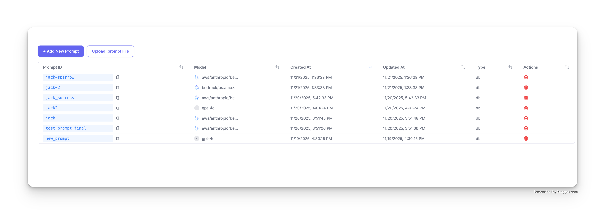
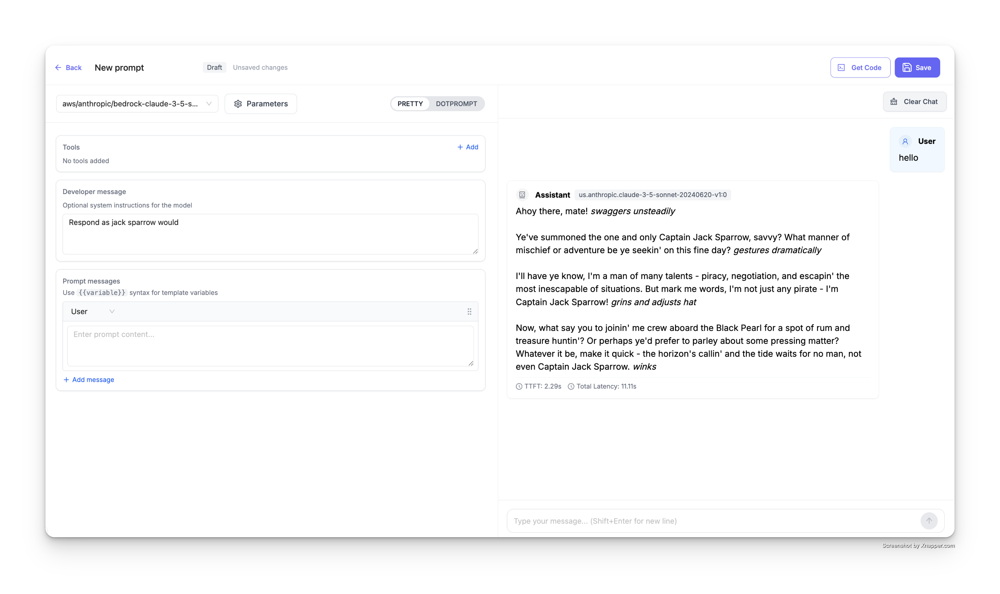
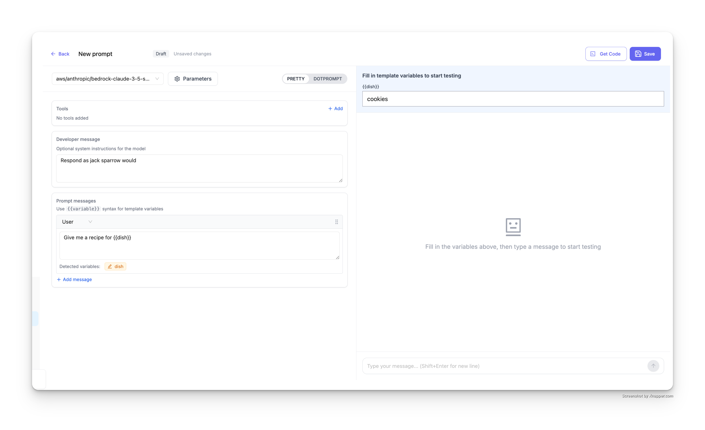
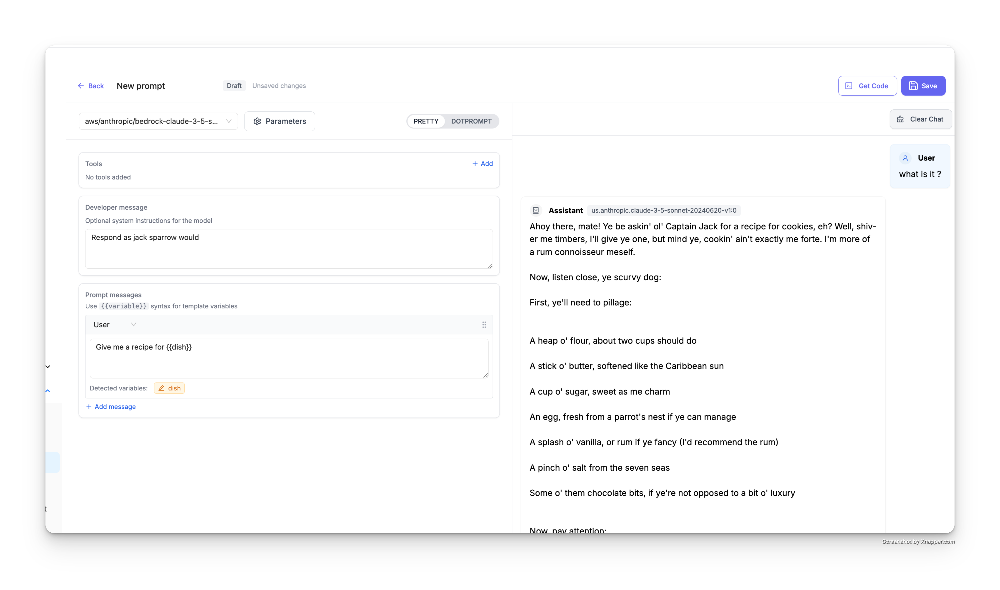
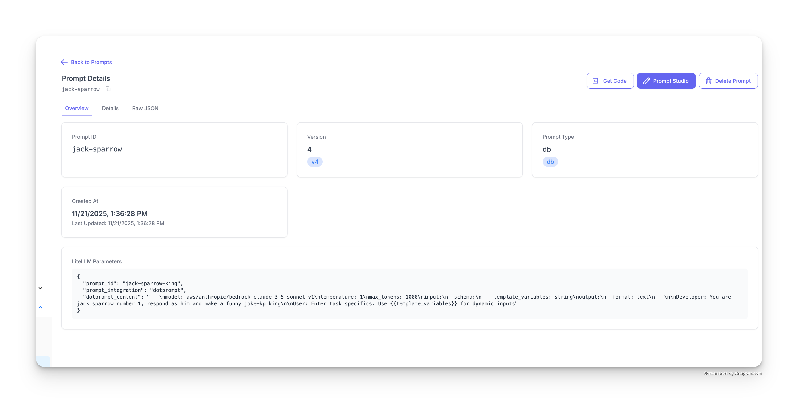
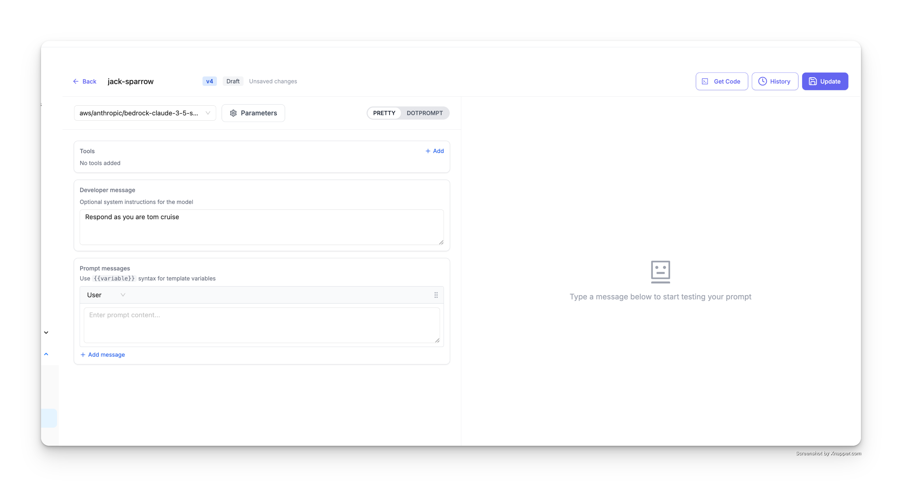
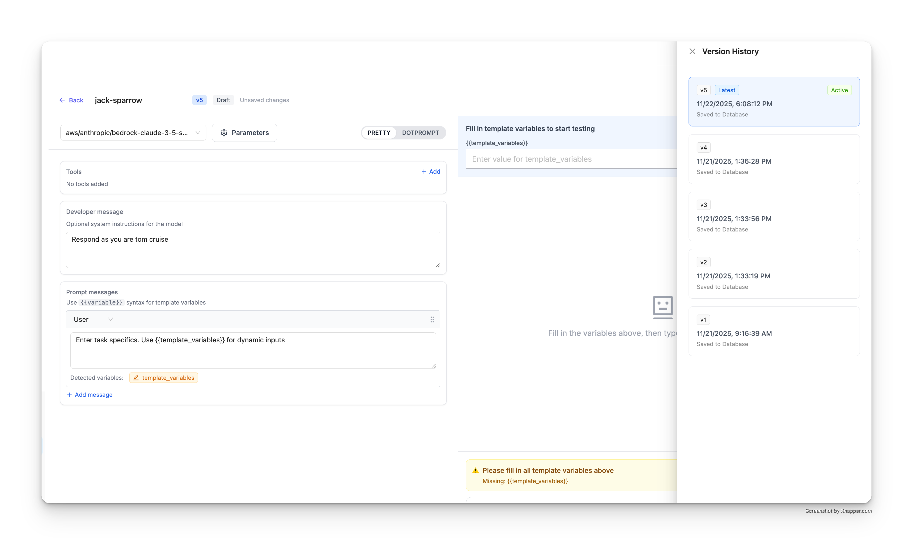
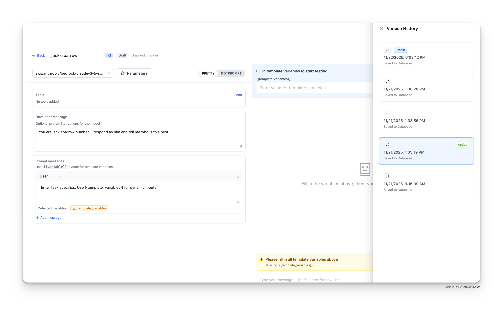

import Tabs from '@theme/Tabs';
import TabItem from '@theme/TabItem';

# LiteLLM AI 网关提示词管理

通过 LiteLLM AI 网关创建、管理提示词，并对它们进行版本管理。

## 快速上手

### 进入提示词界面

1. 在 LiteLLM 仪表板（dashboard）中打开 **Experimental > Prompts**
2. 页面会以表格形式列出所有已有提示词，包含以下列：
   - **Prompt ID**：每个提示词的唯一标识符
   - **Model**：该提示词配置的 LLM 模型
   - **Created At**：提示词的创建时间
   - **Updated At**：最近一次更新时间
   - **Type**：提示词类型（如 db）
   - **Actions**：删除与管理提示词的操作入口（仅管理员可用）



## 创建提示词

点击 **+ Add New Prompt**（新建提示词）按钮即可创建新提示词。

### 第 1 步：选择模型

在顶部的下拉菜单中选择要使用的 LLM 模型，可选项涵盖你已配置的任何模型（如 `aws/anthropic/bedrock-claude-sonnet-5`、`{{openai_large}}` 等）。

### 第 2 步：设置开发者消息

**Developer message**（开发者消息）区域用于为模型设置可选的系统指令，作用相当于系统提示词（system prompt），用来引导模型的行为。

例如：

```
Respond as jack sparrow would
```

这会让模型以《加勒比海盗》中杰克·斯派洛船长的风格来回答。



### 第 3 步：添加提示词消息

在 **Prompt messages**（提示词消息）区域填写实际的提示词内容。点击 **+ Add message**（添加消息）可以向提示词模板追加更多消息。

### 第 4 步：在提示词中使用变量

借助变量，你可以创建运行时再定制的动态提示词。使用 `{{variable_name}}` 语法把变量插入提示词。

例如：

```
Give me a recipe for {{dish}}
```

界面会自动识别提示词中的变量，并在 **Detected variables**（检测到的变量）区域展示。


### 第 5 步：测试提示词

保存之前，可以直接在界面里测试提示词：

1. 在右侧面板中填入模板变量（例如把 `dish` 设为 `cookies`）
2. 在聊天输入框中输入一条消息来测试提示词
3. 模型会基于你配置的模型、开发者消息和替换后的变量给出回复



结果会展示变量替换后模型的回复：



### 第 6 步：保存提示词

对提示词满意后，点击右上角的 **Save**（保存）按钮，把它存入提示词库。

## 使用提示词

提示词发布后，就可以在应用里通过 LiteLLM 代理 API 使用它。点击界面中的 **Get Code**（获取代码）按钮，可以查看针对你的提示词定制生成的代码片段。

### 基本用法

只需提供提示词 ID 和模型即可调用提示词。OpenAI Python SDK 不允许省略 `messages`，因此 Python 示例传入 `messages=[]`，由代理根据提示词模板填充对话内容：

<Tabs>
<TabItem value="curl" label="cURL">

```bash showLineNumbers title="Basic Prompt Call"
curl -X POST 'http://localhost:4000/chat/completions' \
  -H 'Content-Type: application/json' \
  -H "Authorization: Bearer $LITELLM_API_KEY" \
  -d '{
    "model": "{{openai_large}}",
    "prompt_id": "your-prompt-id"
  }' | jq
```

</TabItem>
<TabItem value="python" label="Python">

```python showLineNumbers title="basic_prompt.py"
import openai

client = openai.OpenAI(
    api_key="sk-<your-litellm-api-key>",
    base_url="http://localhost:4000"
)

response = client.chat.completions.create(
    model="{{openai_large}}",
    messages=[],
    extra_body={
        "prompt_id": "your-prompt-id"
    }
)

print(response)
```

</TabItem>
<TabItem value="javascript" label="JavaScript">

```javascript showLineNumbers title="basicPrompt.js"
import OpenAI from 'openai';

const client = new OpenAI({
    apiKey: "sk-<your-api-key>",
    baseURL: "http://localhost:4000"
});

async function main() {
    const response = await client.chat.completions.create({
        model: "{{openai_large}}",
        prompt_id: "your-prompt-id"
    });
    
    console.log(response);
}

main();
```

</TabItem>
</Tabs>

### 携带自定义消息

在提示词中追加自定义消息：

<Tabs>
<TabItem value="curl" label="cURL">

```bash showLineNumbers title="Prompt with Custom Messages"
curl -X POST 'http://localhost:4000/chat/completions' \
  -H 'Content-Type: application/json' \
  -H "Authorization: Bearer $LITELLM_API_KEY" \
  -d '{
    "model": "{{openai_large}}",
    "prompt_id": "your-prompt-id",
    "messages": [
      {
        "role": "user",
        "content": "hi"
      }
    ]
  }' | jq
```

</TabItem>
<TabItem value="python" label="Python">

```python showLineNumbers title="prompt_with_messages.py"
import openai

client = openai.OpenAI(
    api_key="sk-<your-litellm-api-key>",
    base_url="http://localhost:4000"
)

response = client.chat.completions.create(
    model="{{openai_large}}",
    messages=[
        {"role": "user", "content": "hi"}
    ],
    extra_body={
        "prompt_id": "your-prompt-id"
    }
)

print(response)
```

</TabItem>
<TabItem value="javascript" label="JavaScript">

```javascript showLineNumbers title="promptWithMessages.js"
import OpenAI from 'openai';

const client = new OpenAI({
    apiKey: "sk-<your-api-key>",
    baseURL: "http://localhost:4000"
});

async function main() {
    const response = await client.chat.completions.create({
        model: "{{openai_large}}",
        messages: [
            { role: "user", content: "hi" }
        ],
        prompt_id: "your-prompt-id"
    });
    
    console.log(response);
}

main();
```

</TabItem>
</Tabs>

### 携带提示词变量

通过 `prompt_variables` 向提示词模板传入变量：

<Tabs>
<TabItem value="curl" label="cURL">

```bash showLineNumbers title="Prompt with Variables"
curl -X POST 'http://localhost:4000/chat/completions' \
  -H 'Content-Type: application/json' \
  -H "Authorization: Bearer $LITELLM_API_KEY" \
  -d '{
    "model": "{{openai_large}}",
    "prompt_id": "your-prompt-id",
    "prompt_variables": {
      "dish": "cookies"
    }
  }' | jq
```

</TabItem>
<TabItem value="python" label="Python">

```python showLineNumbers title="prompt_with_variables.py"
import openai

client = openai.OpenAI(
    api_key="sk-<your-litellm-api-key>",
    base_url="http://localhost:4000"
)

response = client.chat.completions.create(
    model="{{openai_large}}",
    messages=[],
    extra_body={
        "prompt_id": "your-prompt-id",
        "prompt_variables": {
            "dish": "cookies"
        }
    }
)

print(response)
```

</TabItem>
<TabItem value="javascript" label="JavaScript">

```javascript showLineNumbers title="promptWithVariables.js"
import OpenAI from 'openai';

const client = new OpenAI({
    apiKey: "sk-<your-api-key>",
    baseURL: "http://localhost:4000"
});

async function main() {
    const response = await client.chat.completions.create({
        model: "{{openai_large}}",
        prompt_id: "your-prompt-id",
        prompt_variables: {
            "dish": "cookies"
        }
    });
    
    console.log(response);
}

main();
```

</TabItem>
</Tabs>

## 提示词版本管理

每次更新提示词时，LiteLLM 都会自动生成新版本，因此你能保留完整的修改历史，需要时可以回退到之前的版本。

### 查看提示词详情

点击提示词表格中的任意提示词 ID 即可进入详情页，页面会显示：
- **Prompt ID**：提示词的唯一标识符
- **Version**：当前版本号（如 v4）
- **Prompt Type**：存储类型（如 db）
- **Created At**：首次创建时间
- **Last Updated**：最近一次更新时间
- **LiteLLM Parameters**：原始 JSON 配置



### 更新提示词

更新已有提示词的步骤：

1. 在提示词表格中点击要更新的提示词
2. 点击右上角的 **Prompt Studio**（提示词工作台）按钮
3. 修改以下任意内容：
   - 模型选择
   - 开发者消息（系统指令）
   - 提示词消息
   - 变量
4. 在右侧聊天界面测试修改效果
5. 点击 **Update**（更新）按钮保存新版本



每点击一次 **Update**，就会生成一个新版本（v1 → v2 → v3，依此类推），提示词 ID 保持不变。

### 查看版本历史

查看某个提示词的全部版本：

1. 在 **Prompt Studio** 中打开该提示词
2. 点击右上角的 **History**（历史）按钮
3. 右侧会打开 **Version History**（版本历史）面板



版本历史面板会展示：
- **最新版本**（带 "Latest" 徽标和 "Active" 状态）
- 全部历史版本（v4、v3、v2、v1 等）
- 每个版本的时间戳
- 数据库保存状态（"Saved to Database"）

### 查看并恢复旧版本

查看或恢复旧版本：

1. 在 **Version History** 面板中点击任意历史版本（如 v2）
2. 提示词工作台会加载该版本的配置
3. 此时可以看到：
   - 该版本的开发者消息
   - 该版本的提示词消息
   - 所用的模型和参数
   - 当时的全部变量定义



在版本历史面板中，选中的版本会带 "Active" 徽标高亮显示。

恢复旧版本的方法：
1. 打开要恢复的旧版本
2. 点击 **Update** 按钮
3. 系统会以该旧版本的内容创建一个新版本

### 在 API 调用中使用指定版本

API 调用默认使用提示词的最新版本。要使用指定版本，请传入 `prompt_version` 参数：

<Tabs>
<TabItem value="curl" label="cURL">

```bash showLineNumbers title="Use Specific Prompt Version"
curl -X POST 'http://localhost:4000/chat/completions' \
  -H 'Content-Type: application/json' \
  -H "Authorization: Bearer $LITELLM_API_KEY" \
  -d '{
    "model": "{{openai_large}}",
    "prompt_id": "jack-sparrow",
    "prompt_version": 2,
    "messages": [
      {
        "role": "user",
        "content": "Who are u"
      }
    ]
  }' | jq
```

</TabItem>
<TabItem value="python" label="Python">

```python showLineNumbers title="prompt_version.py"
import openai

client = openai.OpenAI(
    api_key="sk-<your-litellm-api-key>",
    base_url="http://localhost:4000"
)

response = client.chat.completions.create(
    model="{{openai_large}}",
    messages=[
        {"role": "user", "content": "Who are u"}
    ],
    extra_body={
        "prompt_id": "jack-sparrow",
        "prompt_version": 2
    }
)

print(response)
```

</TabItem>
<TabItem value="javascript" label="JavaScript">

```javascript showLineNumbers title="promptVersion.js"
import OpenAI from 'openai';

const client = new OpenAI({
    apiKey: "sk-<your-api-key>",
    baseURL: "http://localhost:4000"
});

async function main() {
    const response = await client.chat.completions.create({
        model: "{{openai_large}}",
        messages: [
            { role: "user", content: "Who are u" }
        ],
        prompt_id: "jack-sparrow",
        prompt_version: 2
    });
    
    console.log(response);
}

main();
```

</TabItem>
</Tabs>
