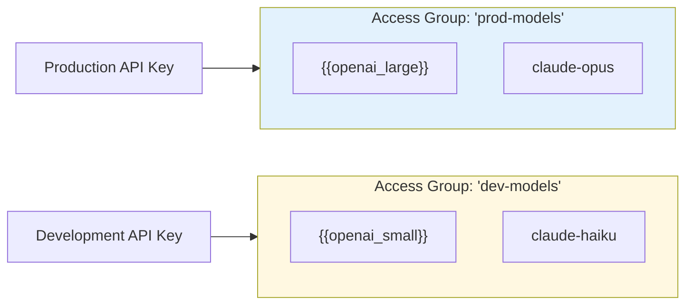
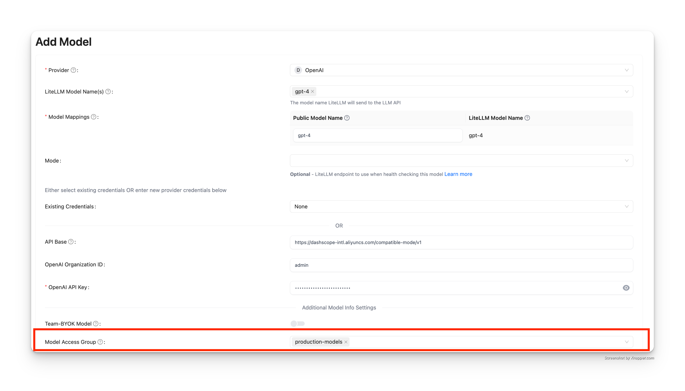
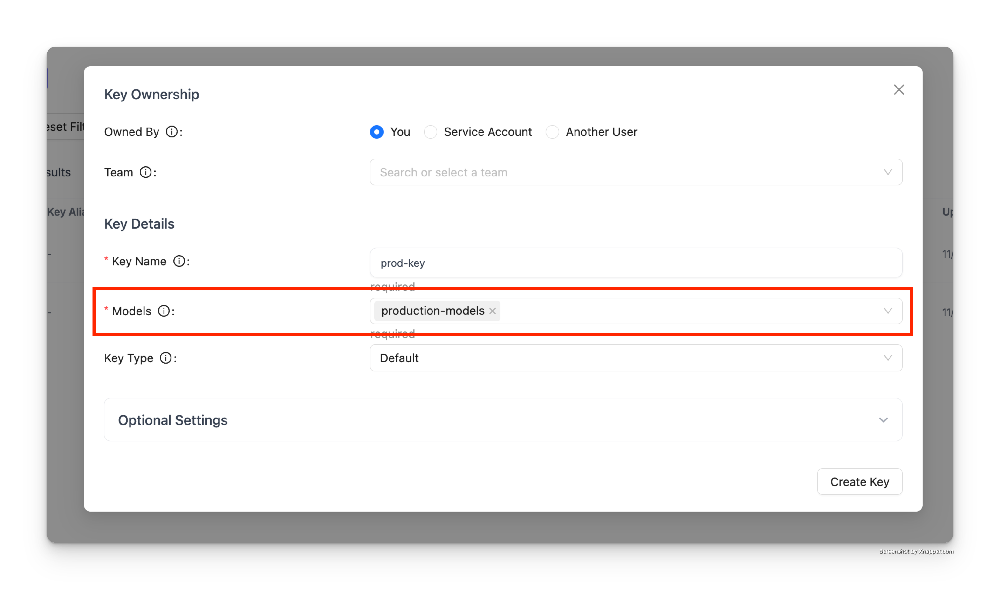

import Tabs from '@theme/Tabs';
import TabItem from '@theme/TabItem';

# 模型访问组

### 概述

将多个模型归入同一个名称下，再把整个组授权给密钥或团队。之后在组内增删模型，无需逐个更新密钥。

适用场景：

- 区分生产与开发模型
- 把昂贵模型限制给特定团队
- 按提供商或能力组织模型
- 用通配符（wildcard）控制整个模型系列的访问（如 `openai/*`）

### 工作原理



**核心概念**：把模型归组 → 将组挂到密钥上 → 密钥即可访问组内全部模型

**步骤 1：在 config.yaml 中为模型分配访问组**

```yaml showLineNumbers title="config.yaml"
model_list:
  - model_name: {{openai_large}}
    litellm_params:
      model: openai/fake
      api_key: fake-key
      api_base: https://exampleopenaiendpoint-production.up.railway.app/
    model_info:
      access_groups: ["beta-models"] # 👈 Model Access Group
  - model_name: fireworks-llama-v3-70b-instruct
    litellm_params:
      model: fireworks_ai/accounts/fireworks/models/llama-v3-70b-instruct
      api_key: "os.environ/FIREWORKS"
    model_info:
      access_groups: ["beta-models"] # 👈 Model Access Group
```

<Tabs>

<TabItem value="key" label="密钥访问组">

**创建带访问组的密钥**

```bash showLineNumbers title="创建带访问组的密钥"
curl --location 'http://localhost:4000/key/generate' \
-H 'Authorization: Bearer <your-master-key>' \
-H 'Content-Type: application/json' \
-d '{"models": ["beta-models"], # 👈 Model Access Group
			"max_budget": 0,}'
```

测试密钥

<Tabs>
<TabItem label="允许访问" value = "allowed">

```bash showLineNumbers title="测试密钥 - 允许访问"
curl -i http://localhost:4000/v1/chat/completions \
  -H "Content-Type: application/json" \
  -H "Authorization: Bearer sk-<key-from-previous-step>" \
  -d '{
    "model": "{{openai_large}}",
    "messages": [
      {"role": "user", "content": "Hello"}
    ]
  }'
```

</TabItem>

<TabItem label="拒绝访问" value = "not-allowed">

:::info

由于 gpt-5.6-luna 不在 `beta-models` 访问组内，这条请求预期会失败。

:::

```bash showLineNumbers title="测试密钥 - 拒绝访问"
curl -i http://localhost:4000/v1/chat/completions \
  -H "Content-Type: application/json" \
  -H "Authorization: Bearer sk-<key-from-previous-step>" \
  -d '{
    "model": "{{openai_small}}",
    "messages": [
      {"role": "user", "content": "Hello"}
    ]
  }'
```

</TabItem>

</Tabs>

</TabItem>

<TabItem value="team" label="团队访问组">

创建团队

```bash showLineNumbers title="创建团队"
curl --location 'http://localhost:4000/team/new' \
-H 'Authorization: Bearer sk-<key-from-previous-step>' \
-H 'Content-Type: application/json' \
-d '{"models": ["beta-models"]}'
```

为团队创建密钥

```bash showLineNumbers title="为团队创建密钥"
curl --location 'http://0.0.0.0:4000/key/generate' \
--header 'Authorization: Bearer sk-<key-from-previous-step>' \
--header 'Content-Type: application/json' \
--data '{"team_id": "0ac97648-c194-4c90-8cd6-40af7b0d2d2a"}
```


测试密钥

<Tabs>
<TabItem label="允许访问" value = "allowed">

```bash showLineNumbers title="测试团队密钥 - 允许访问"
curl -i http://localhost:4000/v1/chat/completions \
  -H "Content-Type: application/json" \
  -H "Authorization: Bearer sk-<key-from-previous-step>" \
  -d '{
    "model": "{{openai_large}}",
    "messages": [
      {"role": "user", "content": "Hello"}
    ]
  }'
```

</TabItem>

<TabItem label="拒绝访问" value = "not-allowed">

:::info

由于 gpt-5.6-luna 不在 `beta-models` 访问组内，这条请求预期会失败。

:::

```bash showLineNumbers title="测试团队密钥 - 拒绝访问"
curl -i http://localhost:4000/v1/chat/completions \
  -H "Content-Type: application/json" \
  -H "Authorization: Bearer sk-<key-from-previous-step>" \
  -d '{
    "model": "{{openai_small}}",
    "messages": [
      {"role": "user", "content": "Hello"}
    ]
  }'
```

</TabItem>

</Tabs>

</TabItem>

</Tabs>


### ✨ 通配模型的访问控制

控制对所有带特定前缀模型的访问（如 `openai/*`）。

也可以用它给用户开放全部模型，只排除少数不希望他们使用的模型（如 `openai/o1-*`）。

<EnterpriseFeature feature="在通配模型上设置模型访问组" />

1. 配置 config.yaml


```yaml showLineNumbers title="config.yaml - 通配模型"
model_list:
  - model_name: openai/*
    litellm_params:
      model: openai/*
      api_key: os.environ/OPENAI_API_KEY
    model_info:
      access_groups: ["default-models"]
  - model_name: openai/o1-*
    litellm_params:
      model: openai/o1-*
      api_key: os.environ/OPENAI_API_KEY
    model_info:
      access_groups: ["restricted-models"]
```

2. 生成一个有 `default-models` 访问权限的密钥

```bash showLineNumbers title="为通配访问组生成密钥"
curl -L -X POST 'http://0.0.0.0:4000/key/generate' \
-H "Authorization: Bearer $LITELLM_API_KEY" \
-H 'Content-Type: application/json' \
-d '{
    "models": ["default-models"],
}'
``` 

3. 测试密钥

<Tabs>
<TabItem label="请求成功" value = "success">

```bash showLineNumbers title="测试通配访问 - 允许"
curl -i http://localhost:4000/v1/chat/completions \
  -H "Content-Type: application/json" \
  -H "Authorization: Bearer sk-<key-from-previous-step>" \
  -d '{
    "model": "openai/{{openai_large}}",
    "messages": [
      {"role": "user", "content": "Hello"}
    ]
  }'
```
</TabItem>
<TabItem value="bad-request" label="请求被拒">

```bash showLineNumbers title="测试通配访问 - 拒绝"
curl -i http://localhost:4000/v1/chat/completions \
  -H "Content-Type: application/json" \
  -H "Authorization: Bearer sk-<key-from-previous-step>" \
  -d '{
    "model": "openai/o1-mini",
    "messages": [
      {"role": "user", "content": "Hello"}
    ]
  }'
```

</TabItem>
</Tabs>

## 通过 API 管理访问组

:::warning[仅限数据库中的模型]
访问组管理 API 只对已存入数据库的模型（通过 `/model/new` 添加）生效。

定义在 `config.yaml` 里的模型无法通过这些 API 管理，只能在配置文件中直接修改。
:::

使用这些访问组管理端点，即可在不重启代理服务器的情况下动态创建、更新和删除访问组。

### 教程：访问组完整工作流

本教程演示如何创建访问组、查看其详情、把访问组挂到密钥上，以及更新组内的模型。

**前提条件**：

- 模型必须先加入数据库（不能只写在 config.yaml 里）
- 授权时需要用到主密钥（master key）

#### 步骤 1：将模型添加到数据库

先把几个模型加入数据库：

```bash showLineNumbers title="将模型添加到数据库"
# Add {{openai_large}} to database
curl -X POST 'http://localhost:4000/model/new' \
  -H "Authorization: Bearer $LITELLM_API_KEY" \
  -H 'Content-Type: application/json' \
  -d '{
    "model_name": "{{openai_large}}",
    "litellm_params": {
      "model": "{{openai_large}}",
      "api_key": "os.environ/OPENAI_API_KEY"
    }
  }'

# Add Claude to database
curl -X POST 'http://localhost:4000/model/new' \
  -H "Authorization: Bearer $LITELLM_API_KEY" \
  -H 'Content-Type: application/json' \
  -d '{
    "model_name": "{{anthropic}}",
    "litellm_params": {
      "model": "{{anthropic}}",
      "api_key": "os.environ/ANTHROPIC_API_KEY"
    }
  }'
```

#### 步骤 2：创建访问组

创建一个包含多个模型的访问组：

```bash showLineNumbers title="创建访问组"
curl -X POST 'http://localhost:4000/access_group/new' \
  -H "Authorization: Bearer $LITELLM_API_KEY" \
  -H 'Content-Type: application/json' \
  -d '{
    "access_group": "production-models",
    "model_names": ["{{openai_large}}", "{{anthropic}}"]
  }'
```

**响应**：

```json showLineNumbers title="响应"
{
  "access_group": "production-models",
  "model_names": ["{{openai_large}}", "{{anthropic}}"],
  "models_updated": 2
}
```

#### 步骤 3：查看访问组信息

查看访问组的详细信息：

```bash showLineNumbers title="查询访问组信息"
curl -X GET 'http://localhost:4000/access_group/production-models/info' \
  -H "Authorization: Bearer $LITELLM_API_KEY"
```

**响应**：

```json showLineNumbers title="响应"
{
  "access_group": "production-models",
  "model_names": ["{{openai_large}}", "{{anthropic}}"],
  "deployment_count": 2
}
```

#### 步骤 4：创建带访问组的密钥

创建一个可以访问组内所有模型的 API 密钥：

```bash showLineNumbers title="创建带访问组的密钥"
curl -X POST 'http://localhost:4000/key/generate' \
  -H "Authorization: Bearer $LITELLM_API_KEY" \
  -H 'Content-Type: application/json' \
  -d '{
    "models": ["production-models"],
    "max_budget": 100
  }'
```

**响应**：

```json showLineNumbers title="响应"
{
  "key": "sk-...",
  "models": ["production-models"]
}
```

**测试密钥**：

```bash showLineNumbers title="测试密钥访问"
# This succeeds - {{openai_large}} is in production-models
curl -X POST 'http://localhost:4000/v1/chat/completions' \
  -H 'Authorization: Bearer sk-...' \
  -H 'Content-Type: application/json' \
  -d '{
    "model": "{{openai_large}}",
    "messages": [{"role": "user", "content": "Hello"}]
  }'

# This succeeds - {{anthropic}} is in production-models
curl -X POST 'http://localhost:4000/v1/chat/completions' \
  -H 'Authorization: Bearer sk-...' \
  -H 'Content-Type: application/json' \
  -d '{
    "model": "{{anthropic}}",
    "messages": [{"role": "user", "content": "Hello"}]
  }'
```

#### 步骤 5：更新访问组

向访问组添加或移除模型：

```bash showLineNumbers title="更新访问组"
curl -X PUT 'http://localhost:4000/access_group/production-models/update' \
  -H "Authorization: Bearer $LITELLM_API_KEY" \
  -H 'Content-Type: application/json' \
  -d '{
    "model_names": ["{{openai_large}}", "{{anthropic}}", "{{gemini_flash}}"]
  }'
```

**响应**：

```json showLineNumbers title="响应"
{
  "access_group": "production-models",
  "model_names": ["{{openai_large}}", "{{anthropic}}", "{{gemini_flash}}"],
  "models_updated": 3
}
```

步骤 4 创建的 API 密钥此时会自动获得 `{{gemini_flash}}` 的访问权限，密钥本身无需任何改动。

### 预算

访问组还可以携带一份共享预算，所有被授予该组的密钥都从这份预算中扣减。参见[模型访问组预算](model_access_group_budgets.md)。

### API 参考：访问组管理

包含全部端点、参数和响应结构的完整 API 文档，参见[访问组管理 API 参考](https://docs.litellm.ai/api-reference/#/model%20management/create_model_group_access_group_new_post)。

## 通过 UI 管理访问组

也可以直接通过 LiteLLM 管理界面（Admin UI）管理访问组。

### 步骤 1：将模型添加到访问组

向数据库添加模型时，使用 "Model Access Group" 字段为它指定访问组：



此例中，`{{openai_large}}` 被加入了 `production-models` 访问组。

### 步骤 2：创建带访问组的密钥

创建 API 密钥时，在 "Models" 字段中指定访问组：



该密钥即可访问 `production-models` 组内的所有模型。

### 步骤 3：测试密钥

使用生成的密钥发起请求：

```bash showLineNumbers title="测试带访问组的密钥"
# This succeeds - {{openai_large}} is in production-models
curl -X POST 'http://localhost:4000/v1/chat/completions' \
  -H 'Authorization: Bearer sk-...' \
  -H 'Content-Type: application/json' \
  -d '{
    "model": "{{openai_large}}",
    "messages": [{"role": "user", "content": "Hello"}]
  }'
```

**响应**：

```json showLineNumbers title="成功响应"
{
  "id": "chatcmpl-...",
  "object": "chat.completion",
  "created": 1234567890,
  "model": "{{openai_large}}",
  "choices": [
    {
      "index": 0,
      "message": {
        "role": "assistant",
        "content": "Hello! How can I help you today?"
      },
      "finish_reason": "stop"
    }
  ]
}
```

如果尝试访问不在访问组内的模型，请求将被拒绝：

```bash showLineNumbers title="测试被拒请求"
# This fails - {{openai_small}} is not in production-models
curl -X POST 'http://localhost:4000/v1/chat/completions' \
  -H 'Authorization: Bearer sk-...' \
  -H 'Content-Type: application/json' \
  -d '{
    "model": "{{openai_small}}",
    "messages": [{"role": "user", "content": "Hello"}]
  }'
```

**响应**：

```json showLineNumbers title="错误响应"
{
  "error": {
    "message": "Invalid model for key",
    "type": "invalid_request_error"
  }
}
```
