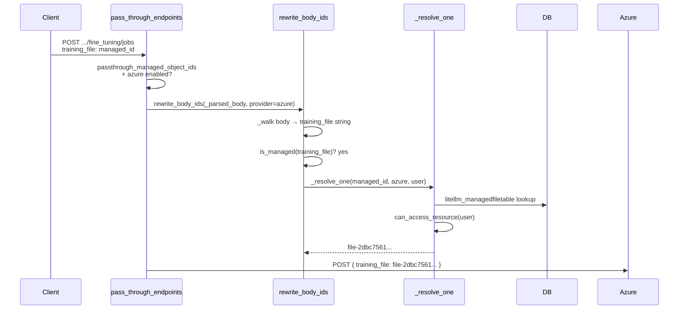

# 透传托管 ID

使用 LiteLLM 的透传（passthrough）端点（例如 `/openai_passthrough/v1/files`、`/azure/openai/batches`）时，上游提供商会返回它自己生成的原始 ID，比如 `file-abc123` 或 `batch_xyz`。默认情况下，这些 ID 会原样返回给你的客户端，这意味着：

- 任何用户只要猜到或截获了其他用户的 `file-abc123`，就能直接使用它。
- 代理层面没有任何记录说明哪个资源归谁所有。
- 多租户隔离只能完全在你的应用代码里自行实现。

**透传托管 ID**（Passthrough Managed IDs）就是为解决这个问题而设计的。启用该功能后，代理会：

1. 对它在响应中看到的每一个原始提供商 ID，**生成**一个稳定且不透明的托管 ID。
2. 把 `managed_id → raw_id` 的映射**存入**代理数据库，并标记上创建它的用户/团队。
3. 在把任何请求转发到上游之前，先跑一遍所有权/权限校验，再把托管 ID **还原**为原始提供商 ID。

你的客户端永远看不到原始提供商 ID，也永远无法访问自己不拥有的资源，哪怕猜到或伪造出了托管 ID 字符串也没用。

## 如何启用

在代理配置的 `general_settings` 里加一行：

```yaml
general_settings:
  passthrough_managed_object_ids: true
```

该功能要求：
- 代理已配置数据库（Prisma / PostgreSQL）。
- `managed_files` 企业版钩子可用。

功能只对 **OpenAI**（`/openai_passthrough/...`）和 **Azure OpenAI**（`/azure/openai/...`）两类透传路由生效。

:::info[`/openai/v1/files`、`/openai/v1/batches` 与 `/openai/v1/responses` 不是透传路由]

这三条路径由 LiteLLM 的原生端点直接服务，和 `/v1/files`、`/v1/batches`、`/v1/responses` 完全一样，所以 `passthrough_managed_object_ids` 根本接触不到它们。要在这几条路径上做租户隔离，文件和批处理请使用 [`require_managed_files`](./litellm_managed_files)，responses 则使用内置的 Responses API 所有权校验。OpenAI 的透传前缀是 `/openai_passthrough`。

:::

## 原生托管端点与透传对比

| | 原生托管端点 | 带托管 ID 的透传 |
|---|---|---|
| **URL 前缀** | `/v1/files`、`/v1/batches` | `/openai_passthrough/v1/files`、`/azure/openai/batches` |
| **路由** | LiteLLM 内部逻辑；基于模型的路由 | 直接转发到上游提供商 |
| **凭证解析** | 经由 `model_list` 路由器 | 经由 `PassthroughEndpointRouter` / 环境变量 |
| **适用场景** | 想让 LiteLLM 自动挑对部署，或需要跨提供商批处理 | 想直接调用提供商 API（例如微调、responses、自定义端点），但仍需要代理层的访问控制 |
| **ID 管理** | 始终由 LiteLLM 托管 | 仅在 `passthrough_managed_object_ids: true` 时使用托管 ID |
| **流式响应的 ID 生成** | 支持 | 支持 `POST /v1/responses` 且 `stream: true` 的场景（每个事件中的 `response.id` 都会被改写） |

## 支持的端点

### 响应 ID 生成（OUTPUT）

下面是具体路由：在这些路由上，LiteLLM 会为**响应体**中看到的原始提供商 ID 生成托管 ID，并在返回客户端之前完成替换。

| 提供商 | Method | 路径 | 被改写的字段 |
|----------|--------|------|-----------------|
| OpenAI | `POST` | `/v1/files` | `id` (`file-`) |
| OpenAI | `GET` | `/v1/files/{file_id}` | `id` (`file-`) |
| OpenAI | `DELETE` | `/v1/files/{file_id}` | `id` (`file-`) |
| OpenAI | `POST` | `/v1/batches` | `id` (`batch_`), `input_file_id`, `output_file_id`, `error_file_id` |
| OpenAI | `GET` | `/v1/batches/{batch_id}` | `id` (`batch_`), `input_file_id`, `output_file_id`, `error_file_id` |
| OpenAI | `POST` | `/v1/batches/{batch_id}/cancel` | `id` (`batch_`), `input_file_id`, `output_file_id`, `error_file_id` |
| OpenAI | `POST` | `/v1/responses` | `id` (`resp_`) |
| OpenAI | `GET` | `/v1/responses/{response_id}` | `id` (`resp_`) |
| OpenAI | `DELETE` | `/v1/responses/{response_id}` | `id` (`resp_`) |
| Azure | `POST` | `/v1/files` | `id` (`file-`) |
| Azure | `GET` | `/v1/files/{file_id}` | `id` (`file-`) |
| Azure | `DELETE` | `/v1/files/{file_id}` | `id` (`file-`) |
| Azure | `POST` | `/v1/batches` | `id` (`batch_`), `input_file_id`, `output_file_id`, `error_file_id` |
| Azure | `GET` | `/v1/batches/{batch_id}` | `id` (`batch_`), `input_file_id`, `output_file_id`, `error_file_id` |
| Azure | `POST` | `/v1/batches/{batch_id}/cancel` | `id` (`batch_`), `input_file_id`, `output_file_id`, `error_file_id` |
| Azure | `POST` | `/v1/responses` | `id` (`resp_`) |
| Azure | `GET` | `/v1/responses/{response_id}` | `id` (`resp_`) |
| Azure | `DELETE` | `/v1/responses/{response_id}` | `id` (`resp_`) |

带 `stream: true` 的 `POST /v1/responses` 同样在覆盖范围内。代理从第一个 `response.created` 事件起就把这条响应登记为调用方所有，并在流式转发过程中改写每个事件里的 `response.id`，因此流式响应的所有权归属与保护机制和非流式响应完全一致。

### 托管 ID 解析（INPUT）

这一步**不区分路由**。对每一个 OpenAI 或 Azure 透传请求，LiteLLM 都会在向上游转发之前扫描整个请求：

| 位置 | 扫描内容 |
|----------|-----------------|
| **URL 路径** | 每一段路径 |
| **查询参数** | 每个字符串类型的参数值 |
| **请求体** | 所有字符串值，递归处理（嵌套对象和数组同样生效） |

也就是说，任何在路径、查询参数或请求体中接受文件 ID、批处理 ID 或响应 ID 的端点，都会自动解析托管 ID，包括上表没有列出的端点，例如微调任务（`/v1/fine_tuning/jobs`）、assistants 或任意自定义端点。

**以微调任务为例**：

```python
# Client sends managed IDs for training_file and validation_file
response = client.post("/azure/openai/v1/fine_tuning/jobs", json={
    "model": "gpt-4o-mini",
    "training_file": "bGl0ZWxsbV9wcm94eTpwYXNzdGhyb3VnaDtwcm92...",  # managed ID
    "validation_file": "bGl0ZWxsbV9wcm94eTpwYXNzdGhyb3VnaDtwcm92...",  # managed ID
})

# Proxy resolves both to raw file IDs and forwards:
# POST .../fine_tuning/jobs
# { "model": "gpt-4o-mini", "training_file": "file-2dbc75...", "validation_file": "file-2dbc75..." }
```

## 任意端点的请求流程

这适用于**任意** OpenAI 或 Azure 透传端点，不限于微调。同一路径/查询参数/请求体扫描会作用于每个请求；下面的示例是一个微调任务，请求体里带了托管文件 ID。



在**响应**方向上，`rewrite_response_ids()` 会为原始提供商 ID 生成托管 ID，但只作用于输出映射中列出的路由（files、batches、responses）。其他端点（例如微调）返回的上游 ID 保持原样，除非它们也出现在这份映射里。

## 权限校验

每次托管 ID 解析都要依次通过四项校验。**四项全部通过**请求才会被放行，否则直接拒绝。

### 1. 提供商匹配

托管 ID 中编码了生成它所用的提供商（例如 `azure`）。如果把 Azure 生成的 ID 发到 OpenAI 透传路由上（反过来也一样），代理会返回 **404**，且绝不会把这个 ID 转发到上游。

### 2. 数据库存在性校验

托管 ID 必须能映射到代理数据库中的一条真实记录。猜出来的、伪造的或用 base64 拼出来的字符串，只要不对应真实记录，都会返回 **404**。数据库校验不通过时，原始提供商 ID **绝不会**被发往上游。

### 3. 单次请求的访问校验

`can_access_resource()` 决定调用方能否使用某个具体资源：

| 调用方身份 | 满足条件时授予访问权 |
|-----------------|---------------------|
| 代理管理员 / 主密钥 | 始终允许 |
| 拥有 `user_id` | `created_by == user_id` |
| 拥有 `team_id`（服务账号） | `team_id == resource.team_id` |
| 同时拥有 `user_id` 和 `team_id` | 满足上述任一条件 |
| 两者皆无 | 永不（**403**） |

### 4. 列表端点的访问校验

`build_owner_filter()` 为列表操作限定数据库查询的范围（见下文）。同样的规则，写成 Prisma 的 `WHERE` 子句就是：

| 调用方 | WHERE 子句 |
|--------|-------------|
| 代理管理员 / 主密钥 | `{}`（无过滤条件，可见所有行） |
| 仅 `user_id` | `created_by = user_id` |
| 仅 `team_id` | `team_id = team_id` |
| 同时具备 `user_id` 和 `team_id` | `created_by = user_id OR team_id = team_id` |
| 两者皆无 | 立即返回空列表，不执行数据库查询 |

## 列表端点的工作方式

`GET /openai_passthrough/v1/files` 和 `GET /openai_passthrough/v1/batches`（以及对应的 Azure 版本）会被**完全拦截**。请求绝不会转发到上游提供商，代理改为查询自己的数据库，只返回调用方拥有的那些行：

```
GET /openai_passthrough/v1/files
                                     ┌─────────────────────────────┐
                         admin key?  │  WHERE {}                   │
                                     │  (all rows)                 │
                                     └─────────────────────────────┘
                         user key?   ┌─────────────────────────────┐
                                     │  WHERE created_by = user_id │
                                     │  OR team_id = team_id       │
                                     └─────────────────────────────┘
                                               │
                                               ▼
                              OpenAI-style paginated response
                              { "object": "list", "data": [...] }
                              All IDs in data[] are managed IDs
```

分页参数 `limit`、`after` 和 `before` 都受支持，并直接映射为 `created_at` 上的游标。

既没有 `user_id` 也没有 `team_id` 的调用方永远只会拿到空列表；代理绝不会退回到不加范围限制的查询。

## 代理未曾记录的对象

所有权是在功能开启时、对象经由透传路由创建的那一刻记录下来的。在你启用该功能之前创建的文件、批处理或响应，以及拿着同一个 API 密钥直连提供商创建的对象，在代理侧都没有归属信息，因此透传路由允许的任何密钥仍然可以用原始提供商 ID 访问到它们（见下文的局限说明）。LiteLLM 刻意不去替任何人认领这些对象。

如果这些既有对象也必须隔离，严格的做法是停止让多个租户共用同一个提供商密钥：为每个团队定义一个[自定义透传端点](./pass_through)，在其 `headers` 中写入该团队自己的提供商 API 密钥，再通过团队 metadata 里的 `allowed_passthrough_routes` 把每个团队限制在自己的端点上。这样可见性就由提供商自行划定，托管 ID 在此之上照常生效。

## 局限

### 流式改写仅覆盖 responses

`POST /v1/responses` 的流是唯一携带可生成 ID 的 SSE 响应，因此也只有这类流会被代理改写。其余所有流式透传响应都原样转发，不做任何处理。

### 原始 ID 仅对其所有者有效

如果你发送的是原始提供商 ID（例如 `file-abc123`）而不是托管 ID，代理会在转发前检查它是否对应某个托管资源。映射到其他调用方资源的原始 ID 会被拒绝并返回 **404**（与未知托管 ID 返回的结果相同，调用方因此无法探测哪些 ID 真实存在）。所有者本人的原始 ID 会正常转发。而代理从未记录过的原始 ID 则不经所有权校验直接转发，这正是上文那些对象仍然能被访问到的原因。

### ID 与提供商绑定

为 `azure` 生成的托管 ID 不能用在 `openai` 透传路由上，反之亦然。尝试混用会返回 **404**。
