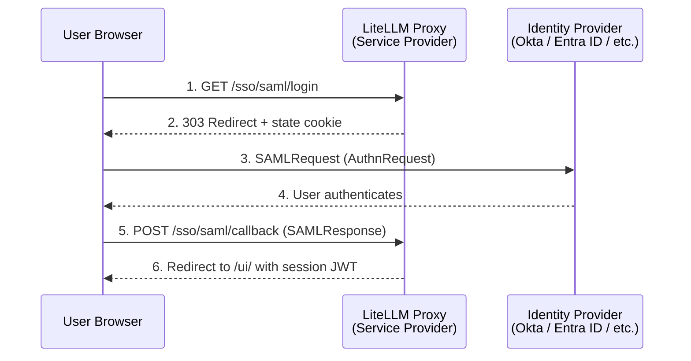

import Image from '@theme/IdealImage';
import Tabs from '@theme/Tabs';
import TabItem from '@theme/TabItem';

# SAML 2.0 SSO

<EnterpriseFeature feature="SSO">SSO 最多 5 个用户免费使用，超出后需要企业版许可证。</EnterpriseFeature>

LiteLLM 在现有 OIDC 提供商（Google、Microsoft、Generic OAuth）之外，还为管理界面（Admin UI）提供 SAML 2.0 单点登录（SSO）支持。SAML 既可以在管理界面（**Admin Settings -> SSO Settings**）里配置，也可以通过环境变量配置，无需改动 `config.yaml`。当配置了 SAML 且没有设置任何 OIDC 提供商时，管理界面上原有的 **SSO** 登录按钮会自动重定向到 SAML 身份提供商（IdP）。

## 工作原理



代理本身充当 SAML 服务提供商（SP）。用户点击登录按钮后，会携带一个已签名的 AuthnRequest 被重定向到身份提供商（IdP）。用户在 IdP 处完成认证后，浏览器把已签名的 SAML 断言（assertion）POST 回代理的断言消费服务（ACS，Assertion Consumer Service）端点。代理校验断言的签名、受众和时间戳，按需在数据库中创建该用户，并签发一个会话 JWT，让用户登录管理界面。

SP 发起与 IdP 发起两种流程均通过 HTTP-POST binding 支持。SP 发起的登录会借助一个 HttpOnly 的 state cookie 绑定到发起登录的那个浏览器，因此被截获的断言无法在另一个浏览器中重放。IdP 发起的（unsolicited，未经请求的）响应默认被拒绝，只有显式设置 `SAML_ALLOW_UNSOLICITED=true` 时才会被接受。

## 从管理界面配置

最快的配置方式是直接在仪表板（dashboard）上操作。进入 **Admin Settings -> SSO Settings**，点击 **Configure SSO**，在提供商下拉框中选择 **SAML SSO**。粘贴你 IdP 的元数据（URL 或内联 XML），设置 SP Entity ID 和代理基础 URL（Proxy Base URL），可选开启 IdP 发起的响应，然后保存。

<Image img={require('../../img/saml_ui_config_form.png')} style={{ width: '800px', height: 'auto' }} />

这些设置会（加密后）存储在 SSO 配置表中，并作为处理程序读取的 `SAML_*` 变量生效，因此即使不设环境变量，重启后依然有效。无界面或 GitOps 部署建议改用环境变量；下方的[快速上手](#快速上手)介绍的正是这种方式。

## 快速上手

### 1. 安装 SAML 扩展依赖

SAML 集成依赖 `python3-saml` 库，该库捆绑了原生 `xmlsec`/`libxml2` 库。使用 `saml` 扩展安装：

```bash
pip install 'litellm[saml]'
```

官方 Docker 镜像已经包含该扩展。如果你要自己构建镜像，请在安装步骤中加入 `litellm[saml]`。

### 2. 设置环境变量

至少要提供 IdP 的元数据（URL 或内联 XML），SP Entity ID 则可选：

```bash
# 指向 IdP 的元数据（二选一）
SAML_IDP_METADATA_URL="https://your-idp.example.com/app/abc123/sso/saml/metadata"
# 或者
SAML_IDP_METADATA_XML="<EntityDescriptor ...>...</EntityDescriptor>"

# 可选：覆盖 SP Entity ID（默认为元数据端点 URL）
SAML_SP_ENTITY_ID="https://litellm.yourcompany.com/sso/saml/metadata"

# 任何 SSO 方式都必需
PROXY_BASE_URL="https://litellm.yourcompany.com"
LITELLM_MASTER_KEY="sk-..."
DATABASE_URL="postgresql://..."
```

### 3. 在 IdP 处注册代理

你的 IdP 需要从代理这里拿到两个值：

| 字段 | 取值 |
| --- | --- |
| **ACS URL**（Assertion Consumer Service） | `https://<proxy_base_url>/sso/saml/callback` |
| **SP Entity ID** / 受众 | `https://<proxy_base_url>/sso/saml/metadata`（或你在 `SAML_SP_ENTITY_ID` 中设置的值） |

SP 元数据 XML 可以直接从 `GET /sso/saml/metadata` 下载；如果你的 IdP 支持上传元数据，把它导入即可。

保存后，SSO Settings 页面会展示已配置的提供商，其中就包括你要在 IdP 处注册的 SP Entity ID：

<Image img={require('../../img/saml_ui_configured.png')} style={{ width: '800px', height: 'auto' }} />

### 4. 启动代理并测试

启动（或重启）代理。访问 `https://<proxy_base_url>/ui` 并点击 SSO 登录按钮。你应该会被重定向到你的 IdP，认证完成后再回到管理界面。

## IdP 配置指南

<Tabs>
<TabItem value="okta" label="Okta">

#### 第 1 步：在 Okta 创建 SAML 应用

在 Okta 管理控制台中，进入 **Applications > Create App Integration** 并选择 **SAML 2.0**。

在 **General Settings** 页面，为应用命名（例如 "LiteLLM Proxy"）。

在 **Configure SAML** 页面，填写：

| 字段 | 取值 |
| --- | --- |
| **单点登录 URL（Single sign-on URL）** | `https://<proxy_base_url>/sso/saml/callback` |
| **受众 URI（Audience URI，SP Entity ID）** | `https://<proxy_base_url>/sso/saml/metadata` |
| **Name ID 格式** | EmailAddress |

在 **Attribute Statements** 下，添加代理需要读取的属性。常见的默认 claim 名称开箱即用，你也可以添加显式映射：

| 名称 | 取值 |
| --- | --- |
| `email` | `user.email` |
| `firstName` | `user.firstName` |
| `lastName` | `user.lastName` |

如果你想通过 Okta 控制用户角色，可以添加 **Group Attribute Statement**，或者添加一个名为 `role` 的自定义属性，取值为 `proxy_admin`、`proxy_admin_viewer`、`internal_user` 或 `internal_user_viewer`。

#### 第 2 步：复制 IdP 元数据 URL

创建应用后，进入 **Sign On** 标签页，复制 **Metadata URL**（形如 `https://your-org.okta.com/app/abc123/sso/saml/metadata`）。

#### 第 3 步：设置环境变量

```bash
SAML_IDP_METADATA_URL="https://your-org.okta.com/app/abc123/sso/saml/metadata"
PROXY_BASE_URL="https://litellm.yourcompany.com"
```

#### 第 4 步：分配用户

在 Okta 应用的 **Assignments** 标签页中，分配应能访问 LiteLLM 管理界面的用户或用户组。

</TabItem>
<TabItem value="azure" label="Microsoft Entra ID (Azure AD)">

#### 第 1 步：创建企业应用程序

在 Azure 门户中，进入 **Microsoft Entra ID > Enterprise applications > New application > Create your own application**。为应用命名（例如 "LiteLLM Proxy"），并选择 "Integrate any other application you don't find in the gallery (Non-gallery)"。

#### 第 2 步：配置 SAML SSO

进入 **Single sign-on > SAML** 并配置：

| 字段 | 取值 |
| --- | --- |
| **标识符（Identifier，Entity ID）** | `https://<proxy_base_url>/sso/saml/metadata` |
| **回复 URL（Reply URL，ACS URL）** | `https://<proxy_base_url>/sso/saml/callback` |

在 **Attributes & Claims** 下，确认默认 claim 中包含用户邮箱。Entra ID 的默认 claim（`emailaddress`、`givenname`、`surname`）会被 LiteLLM 自动识别。

要映射 LiteLLM 角色，可以添加一个名为 `role` 的自定义 claim，其值来自应用程序角色或目录属性。

#### 第 3 步：复制元数据 URL

在 **SAML Certificates** 下，复制 **App Federation Metadata Url**。

#### 第 4 步：设置环境变量

```bash
SAML_IDP_METADATA_URL="https://login.microsoftonline.com/<tenant-id>/federationmetadata/2007-06/federationmetadata.xml?appid=<app-id>"
PROXY_BASE_URL="https://litellm.yourcompany.com"
```

#### 第 5 步：分配用户

在 **Users and groups** 中，分配应能访问管理界面的用户或用户组。

</TabItem>
<TabItem value="generic" label="其他 SAML IdP">

任何符合 SAML 2.0 标准的 IdP 都可以使用。你需要：

1. IdP 的元数据 XML（以 URL 形式提供，或内联粘贴）。
2. 在 IdP 处注册代理的 ACS URL（`/sso/saml/callback`）和 Entity ID（`/sso/saml/metadata`）。
3. IdP 必须发送已签名的断言，且断言中至少包含用户邮箱（作为 NameID 或属性）。

```bash
# 基于 URL 的元数据
SAML_IDP_METADATA_URL="https://idp.example.com/metadata"

# 或者内联粘贴完整的元数据 XML
SAML_IDP_METADATA_XML='<EntityDescriptor xmlns="urn:oasis:names:tc:SAML:2.0:metadata" entityID="https://idp.example.com">...</EntityDescriptor>'

PROXY_BASE_URL="https://litellm.yourcompany.com"
```

</TabItem>
</Tabs>


## 属性映射

LiteLLM 会自动识别常见的 SAML 属性名（URN/OID 和友好名称），涵盖邮箱、名字、姓氏、角色和团队。如果你的 IdP 使用非标准属性名，可以通过环境变量覆盖：

| 环境变量 | 默认候选值 | 说明 |
| --- | --- | --- |
| `SAML_ATTRIBUTE_EMAIL` | `urn:oid:0.9.2342.19200300.100.1.3`、`emailaddress` claim URI、`email`、`mail` | 包含用户邮箱的属性 |
| `SAML_ATTRIBUTE_USER_ID` | NameID | 用户稳定标识符对应的属性 |
| `SAML_ATTRIBUTE_FIRST_NAME` | `urn:oid:2.5.4.42`、`givenname` claim URI、`givenName` | 名字属性 |
| `SAML_ATTRIBUTE_LAST_NAME` | `urn:oid:2.5.4.4`、`surname` claim URI、`sn` | 姓氏属性 |
| `SAML_ATTRIBUTE_ROLE` | `role`、`roles`、`litellm_role` | 映射到 LiteLLM 用户角色的属性 |
| `SAML_ATTRIBUTE_TEAM_IDS` | `teams`、`team_ids`、`groups` | 映射到 LiteLLM 团队 ID 的属性 |

角色属性的取值必须是 `proxy_admin`、`proxy_admin_viewer`、`internal_user` 或 `internal_user_viewer`。

## 配置参考

所有配置都通过环境变量完成。只要设置了 `SAML_IDP_METADATA_URL` 或 `SAML_IDP_METADATA_XML` 中的任意一个，SAML 就会被启用。

| 变量 | 默认值 | 用途 |
| --- | --- | --- |
| `SAML_IDP_METADATA_URL` | unset | 待拉取并解析的 IdP 元数据 URL |
| `SAML_IDP_METADATA_XML` | unset | 内联 IdP 元数据 XML（URL 方式的替代） |
| `SAML_IDP_METADATA_VALIDATE_CERT` | `true` | 通过 HTTPS 拉取元数据时校验 TLS 证书 |
| `SAML_SP_ENTITY_ID` | `<proxy_base_url>/sso/saml/metadata` | 服务提供商 Entity ID |
| `SAML_SP_NAME_ID_FORMAT` | `emailAddress` | 请求的 NameID 格式 |
| `SAML_STRICT` | `true` | 强制严格的 SAML 校验（受众、时间戳、destination） |
| `SAML_WANT_ASSERTIONS_SIGNED` | `true` | 拒绝未签名的断言 |
| `SAML_WANT_MESSAGES_SIGNED` | `false` | 要求 SAML 响应消息本身必须签名 |
| `SAML_AUTHN_REQUESTS_SIGNED` | `false` | 对发出的 AuthnRequest 签名 |
| `SAML_ALLOW_UNSOLICITED` | `false` | 接受 IdP 发起的（unsolicited）响应 |
| `SAML_ATTRIBUTE_EMAIL` | auto-detected | 覆盖邮箱对应的断言属性名 |
| `SAML_ATTRIBUTE_USER_ID` | NameID | 覆盖用户 ID 对应的断言属性 |
| `SAML_ATTRIBUTE_FIRST_NAME` | auto-detected | 覆盖名字对应的断言属性 |
| `SAML_ATTRIBUTE_LAST_NAME` | auto-detected | 覆盖姓氏对应的断言属性 |
| `SAML_ATTRIBUTE_ROLE` | `role` | 覆盖 LiteLLM 角色对应的断言属性 |
| `SAML_ATTRIBUTE_TEAM_IDS` | `teams`/`groups` | 覆盖团队 ID 对应的断言属性 |

## SP 端点

代理对外提供三个 SAML 端点：

| 方法 | 路径 | 用途 |
| --- | --- | --- |
| `GET` | `/sso/saml/login` | SP 发起的登录；将浏览器重定向到 IdP |
| `GET` | `/sso/saml/metadata` | SP 元数据 XML，用于在 IdP 处注册代理 |
| `POST` | `/sso/saml/callback` | 断言消费服务（ACS）；校验 IdP 的签名响应 |

现有的 `GET /sso/key/generate` 端点（即管理界面上的登录按钮）在 SAML 是唯一配置的 SSO 提供商时，会自动重定向到 SAML IdP。

## 安全机制

SP 发起的登录使用一个 HttpOnly 的 state cookie（`litellm_saml_authn`）把 SAML 响应绑定到发起登录的那个浏览器。这样可以防止登录 CSRF 攻击，即攻击者截获一个已签名的响应并在其他浏览器会话中重放。在 HTTPS 下该 cookie 为 `Secure; SameSite=None`（以便在 IdP 的跨站 POST 中存活）；在本地开发用的纯 HTTP 下则为 `SameSite=Lax`。

断言防重放通过一个以断言 ID 为键的"已消费断言"守卫（consumed-assertion guard）实现。每条断言在其有效期内只能使用一次。

IdP 发起的（unsolicited）响应无法与浏览器绑定，这正是默认拒绝它们的原因。只有当你的部署确实需要 IdP 发起的登录，并且你清楚其中的取舍时，才设置 `SAML_ALLOW_UNSOLICITED=true`。

## 故障排查

**"SAML SSO requires the optional 'python3-saml' dependency"**（501 错误）。安装 SAML 扩展依赖：`pip install 'litellm[saml]'`。官方 Docker 镜像已包含它。

**"Could not parse an IdP entityID/SSO URL/certificate from the SAML metadata"**（502 错误）。元数据 URL 返回的内容中，解析器提取不到 IdP 描述符。请确认 URL 正确且代理能够访问它。如果使用 `SAML_IDP_METADATA_XML`，请确保完整设置了 XML（没有被 shell 引号截断）。

**"SAML response references an unknown or already-used login request"**（401 错误）。断言中的 `InResponseTo` 与任何进行中的登录都不匹配。可能的原因包括：登录状态已过期（10 分钟窗口）、用户收藏了 IdP 的重定向地址，或断言被重放。让用户从 `/sso/saml/login` 重新发起一次全新的登录。

**"Unsolicited (IdP-initiated) SAML responses are disabled"**（401 错误）。代理收到一个没有 `InResponseTo` 属性的 SAML 响应，说明这是一次 IdP 发起的登录。如果你想允许这种流程，请设置 `SAML_ALLOW_UNSOLICITED=true`。

**IdP 跨站 POST 后断言校验失败**。请确保 `PROXY_BASE_URL` 设置为代理的公网 URL（包含 `https://`）。SP 元数据中的 ACS URL 和受众都由它派生，两者不一致会导致校验失败。
