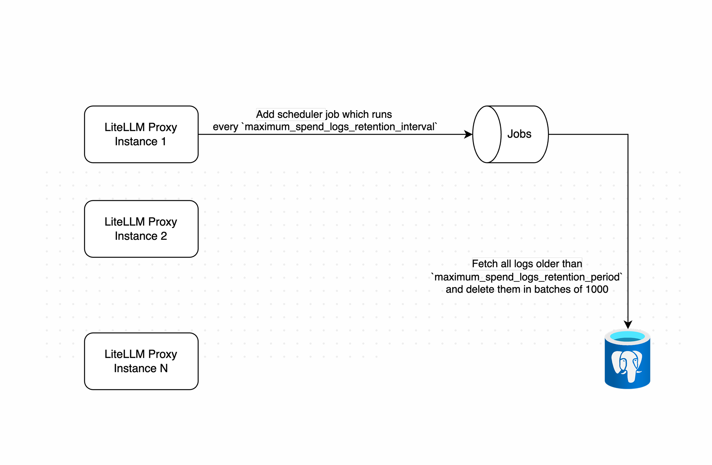
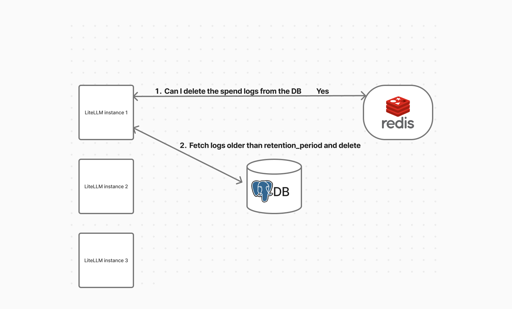

# 花费日志的最长保留期

本文介绍如何设置花费日志（spend logs）的最长保留期。通过自动删除旧日志，可以帮助控制数据库体积。

保留与清理属于开源功能。本页所有设置均无需企业版权限即可使用，清理任务在运行前也不会检查许可证状态。

### 前提条件

- **Postgres**（用于存储日志）
- **Redis** *（可选）*：仅在运行多个代理实例并希望启用分布式锁时才需要

## 用法

### 配置

将以下内容添加到 `proxy_config.yaml` 的 `general_settings` 下：

```yaml title="proxy_config.yaml"
general_settings:
  maximum_spend_logs_retention_period: "7d"  # Keep logs for 7 days

  # Optional: prune per-tag daily spend rollups older than this
  maximum_daily_tag_spend_retention_period: "90d"

  # Optional: set how frequently cleanup should run - default is daily
  maximum_spend_logs_retention_interval: "1d"  # Run cleanup daily

  # Optional: set exact time for cleanup (Cron syntax)
  maximum_spend_logs_cleanup_cron: "0 4 * * *" # Run at 04:00 AM daily

  # Optional: bound how much work a single run may do
  maximum_spend_logs_cleanup_batch_size: 1000   # Rows per DELETE statement
  maximum_spend_logs_cleanup_max_batches: 500   # DELETE statements per table per run
  maximum_spend_logs_cleanup_run_budget: "5m"   # Wall clock for the whole run
  maximum_spend_logs_cleanup_batch_timeout: "30s" # statement_timeout and lock_timeout per batch

litellm_settings:
  cache: true
  cache_params:
    type: redis
```

### 清理任务的运行时机

清理任务只在你显式要求时才会存在。当 `maximum_spend_logs_retention_period`、`maximum_autorouter_session_retention_period`、`maximum_health_check_retention_period` 或 `maximum_daily_tag_spend_retention_period` 中任意一项被设置时，任务会在代理启动时注册；一项都没设置则不会注册。之后通过 `/config/update` 设置其中任意一项，任务会在下一次配置同步时注册，无需重启。一项都未设置时，无论批次、预算或间隔如何配置，都不会删除任何数据。

设置了保留期但未设置 `maximum_spend_logs_cleanup_cron` 时，调度按间隔而非一天中的固定时刻进行。间隔取自 `maximum_spend_logs_retention_interval`，默认 `1d`，并附加最多 60 秒的随机偏移，避免一组 Pod 在同一瞬间集中触发。因此首次运行大约落在启动后的一个间隔处，既不在午夜，也不在启动那一刻。希望任务固定在空闲时段运行的话，请设置 `maximum_spend_logs_cleanup_cron`。

### 会删除哪些数据

一次运行会清理下列表，每张表按各自保留设置推算出的截止时间处理：

| 表 | 时间列 | 保留设置 |
| --- | --- | --- |
| `LiteLLM_SpendLogs` | `startTime` | `maximum_spend_logs_retention_period` |
| `LiteLLM_SpendLogToolIndex` | `start_time` | `maximum_spend_logs_retention_period` |
| `LiteLLM_AutoRouterSession` | `last_turn_at` | `maximum_autorouter_session_retention_period` |
| `LiteLLM_HealthCheckTable` | `checked_at` | `maximum_health_check_retention_period` |
| `LiteLLM_DailyTagSpend` | `date` | `maximum_daily_tag_spend_retention_period` |

`LiteLLM_SpendLogToolIndex` 的行由花费日志派生，因此与它们所指向的日志行在同一截止时间过期。Auto Router 会话汇总有自己的保留设置和截止时间。仅设置 `maximum_autorouter_session_retention_period` 就足以注册清理任务，此时花费日志不受影响，只有会话汇总会被清理。

`LiteLLM_DailyTagSpend` 按标签、模型与自然日各存一行，是 Tag Usage（标签用量）页面的数据来源。它的 `date` 列是 `YYYY-MM-DD` 字符串，因此截止粒度是“天”：日期严格早于保留期回溯目标日的行会被删除，目标日当天保留。未设置 `maximum_daily_tag_spend_retention_period` 时，这张表完全不会被触碰，这也是此前的既有行为。标签预算基于累计计数器执行，不受清理影响；但 Tag Usage 图表无法再展示已被删除的日期。

### 配置选项

#### `maximum_spend_logs_retention_period`（必填）

日志删除前的保留时长。支持的格式：

- `"7d"` – 7 天
- `"24h"` – 24 小时
- `"60m"` – 60 分钟
- `"3600s"` – 3600 秒

#### `maximum_spend_logs_retention_interval`（可选）

清理任务的运行频率，格式同上。未设置时，当且仅当已设置 `maximum_spend_logs_retention_period`，清理才会每 24 小时运行一次。

#### `maximum_spend_logs_cleanup_cron`（可选）

使用标准 cron 语法安排清理。此项优先于 `maximum_spend_logs_retention_interval`。

示例：
- `"0 4 * * *"` – 每天 04:00 运行
- `"0 0 * * sun"` – 每周日零点运行
- `"*/30 * * * *"` – 每 30 分钟运行一次

:::warning[weekday 字段请使用日名称]

请在 weekday 字段中使用日名称（`sun`、`mon` 等）而非数字。LiteLLM 用 APScheduler 调度清理任务，其星期编号 0 表示周一、6 表示周日；标准 cron 则是 0 表示周日、6 表示周六。两种约定的数字星期值不会互相转换，因此 `"0 0 * * 0"` 会在周一触发，而非周日。日名称在两种约定中含义相同，行为始终符合预期。

:::

以下四项设置约束单次运行的工作量。每项设置都还有一个对应的环境变量，用于设定该项的默认值。两者不可互换：同时存在时，以 `general_settings` 中的键为准（逐项生效）。凡时长解析器无法识别的值、以及非正值，都会回退到默认值。

#### `maximum_spend_logs_cleanup_batch_size`（可选）

每条 `DELETE` 语句删除的行数。默认 `1000`。环境变量默认值：`SPEND_LOG_CLEANUP_BATCH_SIZE`。

#### `maximum_spend_logs_cleanup_max_batches`（可选）

任务每次运行对每张表发出的 `DELETE` 语句数量，恰好为此数、绝不多发。默认 `500`，即按默认批大小，一次运行最多从每张被清理的表删除 500,000 行。环境变量默认值：`SPEND_LOG_RUN_LOOPS`。

#### `maximum_spend_logs_cleanup_run_budget`（可选）

整个运行的墙钟时间预算，时长格式与保留期相同。默认 `5m`。预算由运行触及的所有表共享，而非每表单独一份：花费日志先消耗预算，剩余的才轮到工具索引与会话汇总。预算耗尽时，运行就地停止，剩余积压等待下一个周期。环境变量默认值：`SPEND_LOG_CLEANUP_RUN_BUDGET_SECONDS`，以秒表示。

#### `maximum_spend_logs_cleanup_batch_timeout`（可选）

应用于任务所发每条语句的 Postgres `statement_timeout` 与 `lock_timeout`。默认 `30s`。在该窗口内完不成、或拿不到锁的语句会被数据库直接取消，而不是持锁不放、让用户流量在后面排队。环境变量默认值：`SPEND_LOG_CLEANUP_BATCH_TIMEOUT_SECONDS`，以秒表示。

:::warning[批处理超时应高于单个批次的真实所需]

被取消的语句计为一次批处理失败，连续失败 `SPEND_LOG_CLEANUP_MAX_CONSECUTIVE_BATCH_FAILURES` 次（默认 3 次）会中止运行。如果把超时设得比一个批次的真实所需还短，每个批次都会被取消，运行将在一条数据都没删的情况下中止，并记录 `Aborting LiteLLM_SpendLogs cleanup after 3 consecutive batch failures; total deleted before abort: 0`。调大 `maximum_spend_logs_cleanup_batch_size` 时，请确认超时仍能为更大的语句留出完成时间。

:::

## 工作原理

### 第 1 步：锁获取（使用 Redis 时可选）

若启用了 Redis，LiteLLM 会用它确保同一时刻只有一个实例运行清理。

- 拿到锁时：
  - 该实例继续执行清理
  - 其他实例跳过
- 没有锁时：
  - 清理照常运行（对单节点部署很有用）

  
*花费日志删除的工作机制*

### 第 2 步：批量删除

清理开始后：

- 根据配置的保留期计算截止日期
- 分批删除早于截止时间的日志（默认批次大小 `1000`）
- 批次之间加入短暂延迟，避免数据库过载

  
*旧日志的批量删除*

### 第 3 步：边界控制

不加限制时，对一张大表的单次运行就是一连串沉重的写入事务，足以拖垮它正在清理的数据库。每次运行同时受三重边界约束，到达其中任意一个即停：`maximum_spend_logs_cleanup_batch_size`（每条 `DELETE` 的行数，默认 1000）、`maximum_spend_logs_cleanup_max_batches`（每张表的语句数，默认 500）和 `maximum_spend_logs_cleanup_run_budget`（整个运行的墙钟预算，默认 `5m`）。按默认值算，每张表最多删除 500,000 行、最多工作五分钟。

预算在语句之间检查，因此它决定任务何时停止发出新工作。约束一条已在执行中的语句的是 `maximum_spend_logs_cleanup_batch_timeout`，它作为 Postgres `statement_timeout` 与 `lock_timeout` 应用于任务发出的每条语句，剩余行数探测也不例外。在语句间检查预算的直接结果是：一次运行最多超出预算一个批处理超时的时长，设定预算时要清楚实际上限是预算加一个超时。提前停止是设计预期。运行会在下一个周期从同一截止时间继续，积压数据分多次运行逐步清空。

每项边界都有一个用于设置默认值的环境变量，连同两个失败处理参数一并列于下表。同一边界若存在对应的 `general_settings` 键，该键优先于环境变量默认值：

| 环境变量 | 默认值 | 说明 |
| --- | --- | --- |
| `SPEND_LOG_CLEANUP_BATCH_SIZE` | `1000` | 每条 `DELETE` 语句删除的行数 |
| `SPEND_LOG_RUN_LOOPS` | `500` | 每次运行对每张表发出的 `DELETE` 语句上限 |
| `SPEND_LOG_CLEANUP_RUN_BUDGET_SECONDS` | `300` | 整个运行的墙钟预算（秒），由它清理的所有表共享 |
| `SPEND_LOG_CLEANUP_BATCH_TIMEOUT_SECONDS` | `30` | 应用于任务所发每条语句的 Postgres `statement_timeout` 与 `lock_timeout`（秒） |
| `SPEND_LOG_CLEANUP_REMAINING_COUNT_CAP` | `100000` | 剩余行数探测的行数上限，避免汇报积压本身变成一次昂贵的扫描 |
| `SPEND_LOG_CLEANUP_MAX_CONSECUTIVE_BATCH_FAILURES` | `3` | 运行中止前容忍的连续批处理失败次数 |
| `SPEND_LOG_CLEANUP_BATCH_FAILURE_BACKOFF_SECONDS` | `0.5` | 批次失败后重试前的暂停时长 |

### 指标

任务通过 Prometheus 上报其工作情况，帮你区分健康的稳态和持续增长的积压。除最后一个指标以 `outcome` 为标签外，其余指标均以 `table` 为标签：

| 指标 | 含义 |
| --- | --- |
| `litellm_spend_log_cleanup_rows_deleted_total` | 已删除的行数，按表区分 |
| `litellm_spend_log_cleanup_batch_duration_seconds` | 单个批次的耗时，调批大小时要看的就是它 |
| `litellm_spend_log_cleanup_rows_remaining` | 运行结束后仍在等待清理的过期行数 |
| `litellm_spend_log_cleanup_batch_failures_total` | 失败的批次数，包括被批处理超时取消的语句 |
| `litellm_spend_log_cleanup_runs_total` | 按 `outcome` 统计的运行次数：`completed`、`budget_exhausted`、`batch_cap_reached`、`skipped_locked`、`skipped_disabled` 或 `aborted` |

`rows_remaining` 是最值得设告警的指标。持平或接近零说明保留策略跟得上，持续上升则说明跟不上。把它与 `runs_total` 结合来看：健康的部署停留在 `completed`，而持续的 `budget_exhausted` 或 `batch_cap_reached` 说明每次运行都被提前截断，需要调大相关参数。

`rows_remaining` 背后的探测受 `SPEND_LOG_CLEANUP_REMAINING_COUNT_CAP`（默认 100000）约束。计数到上限即停，确保汇报积压本身不会变成对大表的全表扫描，因此过期行数超过上限的表只会报告恰好等于上限的值。数值一旦停在 100000，就把它当下限看待。

## 大表场景

### 索引

`LiteLLM_SpendLogs` 自带 `startTime` 索引和 `(startTime, request_id)` 复合索引，删除批次要用的正是它们，因此默认 schema 下无需为保留功能添加任何索引。在一张预置 2,000,000 行数据的表上，单个批次的执行计划是由 `LiteLLM_SpendLogs_startTime_idx` 索引扫描驱动的嵌套循环，1000 行批次约需 1.8 ms。

可见批次本身开销很小，运行缓慢很少是执行计划不佳的信号。大积压真正的代价是 WAL（预写日志）体量，以及删除留下的死元组带来的 autovacuum 负载。在同一张表上，一次 111 秒内删除约 500,000 行的运行，在花费日志表和工具索引表上留下约 1,000,000 个死元组，足以让 autovacuum 在运行结束很久之后仍在处理这两张表。要围绕这一点调优，而不是围绕删除计划。

### 参数取值权衡

批大小是在吞吐量与锁持有时间、WAL 记录体积之间做权衡。批次越大，每条语句删除的行数越多，在批次间固定停顿上耗费的时间占比也越小，代价是行锁持有更久、`maximum_spend_logs_cleanup_batch_timeout` 的余量更小。批数上限决定单次运行从一张表最多能删多少行；运行预算则决定整个运行最多能让数据库为它忙多久，不受前两项设置的影响。

批次间的停顿固定为 0.1s，在默认批大小下它主导了单批成本，使吞吐量接近每秒 10,000 行，也让 500 批的上限（而非五分钟预算）成为默认配置下真正生效的限制。

设想一个每天写入 5,000,000 行花费日志、保留 30 天的部署。稳态下每天运行都要删除约一天的行数，因此 500,000 的默认上限会让保留策略永远追不上，表会无限增长。把 `maximum_spend_logs_cleanup_batch_size` 提到 `5000`、`maximum_spend_logs_cleanup_max_batches` 提到 `2000`，上限提升到 10,000,000 行，删除 5,000,000 行约需 110 秒，从容落在默认 `5m` 预算之内，每条语句也远未触及 30s 的批处理超时。几天后检查 `litellm_spend_log_cleanup_rows_remaining`：趋势持平说明跟得上，持续攀升的话，用 `maximum_spend_logs_retention_interval` 提高清理频率，而不是继续加大批次。

### 清空大量积压

对一张已经积累数月历史数据的表首次开启保留功能，是值得提前规划的场景。运行到预算即停，下一个周期从同一截止时间接着做，所以积压确实会自行清空，只是需要多次运行。按默认配置和每日间隔，1 亿行的积压要清上几个月。

想更快清空，可以在维护窗口内调大 `maximum_spend_logs_cleanup_run_budget` 和 `maximum_spend_logs_cleanup_max_batches`，运行期间关注花费日志表的复制延迟和 autovacuum，结束后把两者调回默认。在自己掌控的时间窗口里清空数据，远比在高峰时段被动承担同样的工作量来得可控。

如果表大是因为写入量确实高，而非保留功能此前未开启，改成分区表是更好的答案。此后保留操作直接删除整个分区而不再逐行删除，磁盘立即释放，也不产生需要 vacuum 的死元组，分区删除回收的数据与任何批次或预算参数都无关。见下文。

## 高流量部署的分区方案

在高请求量下（每天数百万行），基于 `DELETE` 的保留策略会成为问题。删除行并不会把磁盘还给操作系统；它会留下死元组（“墓碑”），需要 autovacuum 之后回收。当写入速度超过 autovacuum 时，即使逻辑行数有界，表在磁盘上也会持续增长，`LiteLLM_SpendLogs` 可能在一个月内膨胀到数百 GB。

解决办法是按 `startTime` 做 Postgres 原生范围分区。使用分区表后，保留操作用 `DROP TABLE` 整个删除分区，这是瞬间完成的元数据操作，立即释放磁盘，无墓碑、无 vacuum。设置 `general_settings.use_spend_logs_partitioning: true` 且表确实已完成分区后，同一个清理任务会从分批删除切换为删除过期分区，并在每次运行时预建未来的分区，保证写入始终有分区可落；这两个条件缺一不可，仅有自动检测并不会改变行为。

该功能为可选开启。默认 schema 不分区，因此在转换表之前，现有部署不受影响。

分区维护与运行预算有一处值得了解的交互。任务只会在运行还有剩余预算时启动分区维护，已超预算的运行会跳过它，留待下一个周期。一旦分区删除开始执行，预算无法将其中断，因为删除分区是持有 `ACCESS EXCLUSIVE` 锁的 DDL，必须执行到底。任务的其他一切工作都可以在语句间被打断，因此分区删除是唯一一件预算无法中途约束的工作。

### 转换数据表

对已有数据的表做分区无法原地完成，因此转换过程会把现有表改名挪开，再新建一张分区表。分区键必须是主键的一部分，因此主键变为复合主键 `("request_id", "startTime")`；LiteLLM 的花费日志写入路径使用 `INSERT ... ON CONFLICT DO NOTHING`，与之兼容。

请对数据库执行 [`db_scripts/partition_spend_logs.sql`](https://github.com/BerriAI/litellm/blob/main/db_scripts/partition_spend_logs.sql) 中的操作手册（先在预发副本上测试，并提前备份）。它会创建分区父表、复合主键、`startTime` 索引，以及一个兜底越界数据的 `DEFAULT` 分区。

转换完成后，按上文方式设置保留期，清理任务便会替你管理分区。

### 调优

| 环境变量 | 默认值 | 说明 |
| --- | --- | --- |
| `SPEND_LOG_PARTITION_INTERVAL` | `day` | 分区粒度：`day`、`week` 或 `month`。高流量表请用 `day`，这样保留更精确，单个分区也保持可控。 |
| `SPEND_LOG_PARTITION_PRECREATE_AHEAD` | `7` | 每次清理运行时预建的未来分区数量。 |

只有当分区的整个时间范围都早于保留截止时间时，该分区才会被删除，因此实际保留期会向上取整到分区粒度。
